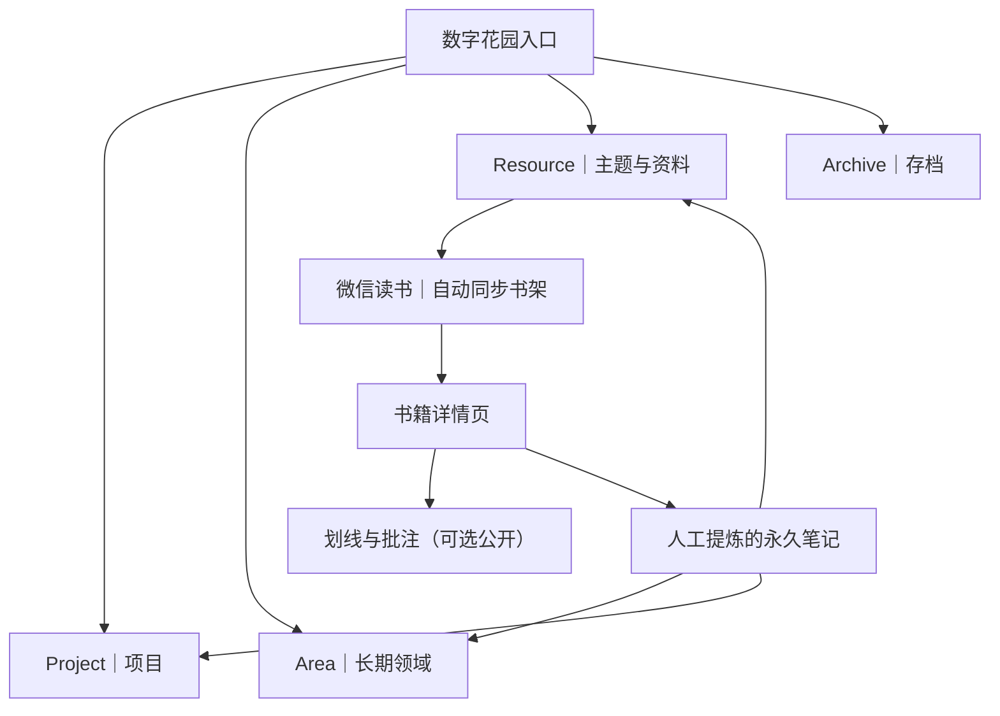
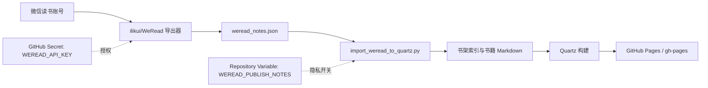

# NotesBook｜个人知识库与数字花园

> 将阅读、实践、灵感与项目经验沉淀为可连接、可检索、可持续迭代的知识网络。

[](https://quartz.jzhao.xyz/)
[](https://www.markdownguide.org/)
[](https://docs.github.com/actions)

## 项目定位

NotesBook 是基于 [Quartz](https://quartz.jzhao.xyz/) 构建的个人数字花园。它不仅保存资料，更强调把资料加工成自己的理解，并通过双向链接形成可复用的知识网络。

- **PARA 组织法**：Projects、Areas、Resources、Archives 管理行动与资料归属。
- **卡片化思考**：一篇笔记尽量聚焦一个可独立理解的观点。
- **可视化理解**：优先使用 Mermaid 表达流程、架构、因果与概念关系；必要时补充图片、截图和示意图。
- **自动化阅读导入**：通过 [ilikui/WeRead](https://github.com/ilikui/WeRead) 导出微信读书书架与阅读记录，并生成 Quartz Markdown 页面。
- **持续迭代**：保留来源、建立链接、定期复查，避免知识库退化为收藏夹。

## 知识库结构



| 目录 | 主要用途 |
| --- | --- |
| [content/](content/) | 数字花园全部 Markdown 内容 |
| [content/Area/KM/](content/Area/KM/) | 知识管理、数字花园、渐进阅读与工作流 |
| [content/Resource/](content/Resource/) | 主题资源、工具、阅读记录 |
| [scripts/](scripts/) | 数据导入与辅助脚本 |
| [.github/workflows/](.github/workflows/) | 自动同步、构建与部署流程 |

## 微信读书数据接入

NotesBook 已配置自动同步工作流：[`.github/workflows/sync-weread.yml`](.github/workflows/sync-weread.yml)。它会调用 [WeRead 仓库](https://github.com/ilikui/WeRead) 的导出脚本，将导出 JSON 转为 Quartz 可识别的 Markdown。

### 首次启用

1. 打开 NotesBook 的 **Settings → Secrets and variables → Actions → Secrets**。
2. 新建 Repository secret：`WEREAD_API_KEY`，填入你自己的微信读书 API 密钥。不要把密钥写入仓库文件、提交记录或公开日志。
3. （可选）在 **Settings → Secrets and variables → Actions → Variables** 新建 `WEREAD_PUBLISH_NOTES`，默认保持 `false`。
4. 打开 **Actions → Sync WeRead Reading Records → Run workflow**，手动运行一次。
5. 检查工作流是否完成，并查看 [微信读书索引](content/Resource/微信读书/index.md) 对应的生成页面。

工作流默认每天按北京时间约 00:15 触发，也支持手动运行。首次同步后，后续运行会更新已有书籍页面。

### 隐私默认值

- 默认只发布书籍元数据、作者、分类和记录数量，不发布原始划线及个人批注。
- 只有明确将 `WEREAD_PUBLISH_NOTES` 设置为 `true`，才会将划线和批注写入公开站点。公开前请确认内容不包含隐私、未授权传播的文本或其他敏感信息。
- `WEREAD_API_KEY` 必须放在 GitHub Secrets 中；不要将其写入 Markdown、脚本或截图。
- 自动生成的书籍详情位于 `content/Resource/微信读书/书籍/`。不要手动编辑生成文件；请将自己的理解另写为永久笔记，再链接到书籍页面。

### 数据流



### 故障排查

| 现象 | 检查项 |
| --- | --- |
| 提示缺少 API Key | 确认 `WEREAD_API_KEY` 添加在 **NotesBook 仓库**，而不是仅添加在 WeRead 仓库 |
| 导出步骤失败 | 检查密钥是否有效、API 网关变量是否正确，并查看 Actions 日志中的错误摘要 |
| 导入提示没有书籍 | 脚本会为避免误删现有数据而终止；检查导出 JSON 是否包含非空的 `books` 数组 |
| 同步成功但页面没有变化 | 检查提交步骤是否有新变更，以及 Quartz 构建和部署步骤是否成功 |
| 不希望公开划线 | 保持 `WEREAD_PUBLISH_NOTES` 未设置或设为 `false`，重新运行同步 |

## 本地开发与构建

项目使用 Node.js 和 npm 管理 Quartz 依赖：

```bash
npm ci
npx quartz build
```

若需本地运行或排查构建问题，请先阅读 [Quartz 官方文档](https://quartz.jzhao.xyz/)。当前仓库中的自动同步工作流会在构建前生成微信读书页面；本地手动构建不会自动请求个人阅读数据。

## 笔记写作规范

1. **标题具体**：优先使用问题或结论，例如“为什么阅读摘录不等于理解”，而不是只写“阅读”。
2. **先结论，后证据**：开头写清核心观点，再给出推理、案例和限制条件。
3. **保留来源**：书名、作者、章节、链接或记录日期应尽可能完整。
4. **建立双向关联**：连接相关概念、反例、项目实践和待解决问题。
5. **图文并用**：流程用 Mermaid；结构复杂时用架构图；需要展示真实界面或硬件细节时使用有来源的图片。
6. **区分原始资料与个人观点**：引用、划线、摘要和自己的推论应明确区分。
7. **及时复查**：修正过时结论、合并重复笔记，并保留仍有价值的历史记录。

## 推荐入口

- [数字花园首页](content/index.md)
- [资源总览](content/Resource/index.md)
- [知识管理专题](content/Area/KM/index.md)
- [人工智能学习中心](content/Area/AI/index.md)
- [AI 从入门到精通](content/Area/AI/人工智能.md)
- [AI 论文与数据集](content/Area/AI/AI论文与数据集.md)
- [GitHub 开源 AI 学习项目](content/Area/AI/GitHub开源学习项目.md)
- [渐进阅读](content/Area/KM/渐进阅读.md)
- [微信读书同步工作流](.github/workflows/sync-weread.yml)
- [微信读书导入脚本](scripts/import_weread_to_quartz.py)

---

本仓库内容持续演进。自动同步用于搬运和索引阅读记录，真正可复用的知识仍需经过理解、提炼、链接与实践。
