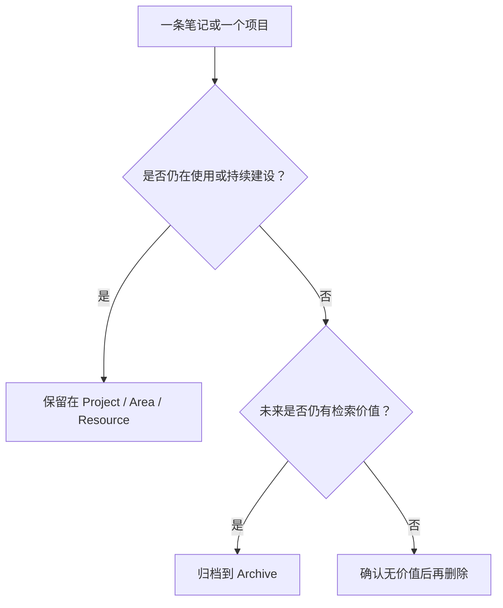

# Archive｜归档区说明

Archive（归档区）用于保存**已经停止维护、暂时不再活跃，但仍有长期参考价值**的内容。它不是临时收件箱，也不是无差别堆放文件的目录。

## 归档判断

## 当前状态

目前已清理此目录中与个人知识主题无直接关系的 Quartz 英文文档，以及只有占位文字的空笔记。后续归档内容应优先保留个人经验、历史决策、完成项目的总结和仍有复用价值的资料。

## 归档规范

- **保留价值**：记录为什么归档、何时归档，以及未来可能如何复用。
- **避免重复**：仍在持续更新的主题应链接到对应的 `Area` 或 `Resource`，不复制整份内容。
- **清理前判断**：只有明确无关、重复且无增量价值，或纯占位内容，才考虑删除。
- **维护链接**：删除文件后同步更新索引与反向链接，避免留下失效入口。

## 相关入口

- [[Area]] —— 长期维护的责任领域
- [[Project]] —— 有明确目标和完成条件的项目
- [[Resource]] —— 仍有参考价值的外部资料
