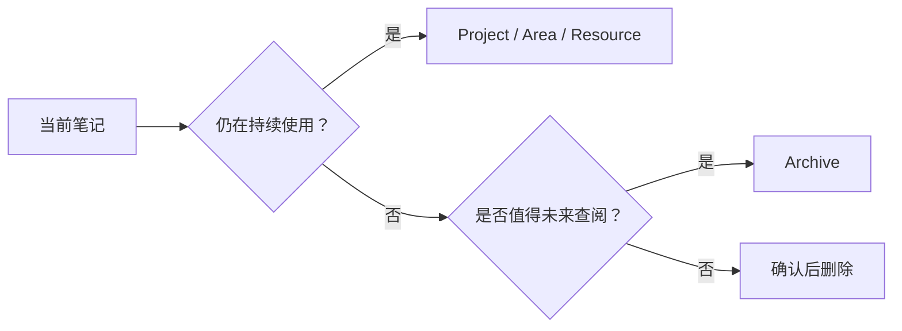

# Archive｜归档区

Archive（归档区）存放已完成、已停止维护或暂时不活跃，但仍有检索价值的历史内容。它不是垃圾桶，也不应成为外部文档的无差别镜像。

> [!info] 一句话定位
> **不再活跃，但值得留存的过去。**

## 归档原则

## 当前内容

目前没有保留在本目录中的归档条目。此前混入的 Quartz 建站英文文档和仅含占位文字的笔记已清理；如果以后有完成项目总结、历史决策或暂时不活跃但仍有价值的个人资料，可按归档规范重新收录。

## 相关入口

- [[Area]] —— 长期维护的责任领域
- [[Project]] —— 有明确目标和完成条件的项目
- [[Resource]] —— 有持续参考价值的资料
- [[index]] —— 知识库首页
