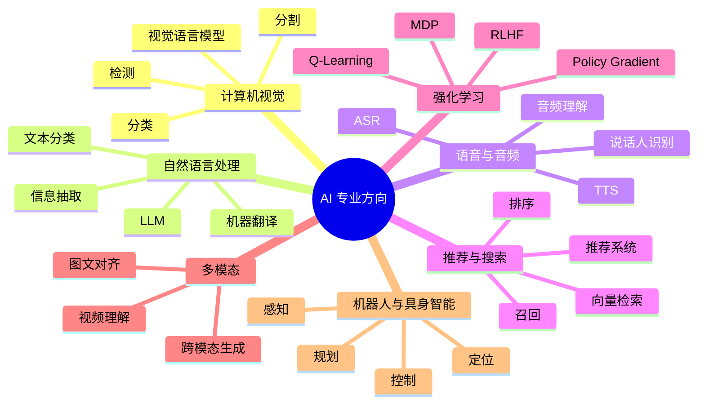

# AI 专业方向

完成机器学习与深度学习基础后，选择一个主方向深入。不要同时追逐所有热点；建议以一个真实任务、一个公开数据集和一个可复现实验作为主线。

## 方向总览

## 1. 计算机视觉（CV）

学习内容：图像分类、目标检测、语义/实例分割、关键点、跟踪、视觉 Transformer、多模态视觉语言模型。

- 课程：[Stanford CS231n](https://cs231n.stanford.edu/)
- 数据：[COCO](https://cocodataset.org/)、[CIFAR](https://www.cs.toronto.edu/~kriz/cifar.html)、[Open Images](https://storage.googleapis.com/openimages/web/index.html)
- 项目：[timm](https://github.com/huggingface/pytorch-image-models)、[Ultralytics](https://github.com/ultralytics/ultralytics)、[MMDetection](https://github.com/open-mmlab/mmdetection)、[Detectron2](https://github.com/facebookresearch/detectron2)
- 练习：先做分类，再做目标检测，最后比较不同模型在小目标、遮挡和长尾类别上的误差。

## 2. 自然语言处理（NLP）

学习内容：分词、文本表示、语言模型、文本分类、序列标注、信息抽取、机器翻译、问答、语义检索和 LLM。

- 课程：[Stanford CS224n](https://web.stanford.edu/class/cs224n/)
- 教材：[Speech and Language Processing](https://web.stanford.edu/~jurafsky/slp3/)
- 数据：[GLUE](https://gluebenchmark.com/)、[SQuAD](https://rajpurkar.github.io/SQuAD-explorer/)、[Hugging Face Datasets](https://huggingface.co/datasets)
- 项目：[Transformers](https://github.com/huggingface/transformers)、[spaCy](https://github.com/explosion/spaCy)、[Sentence Transformers](https://github.com/UKPLab/sentence-transformers)
- 练习：文本分类 → Embedding 检索 → 重排 → RAG，并评估召回率和答案忠实度。

## 3. 语音与音频

学习内容：声学特征、语音识别（ASR）、语音合成（TTS）、说话人识别、音频事件检测和语音对话。

- 数据：[Mozilla Common Voice](https://commonvoice.mozilla.org/)、[LibriSpeech](https://www.openslr.org/12/)
- 项目：[Whisper](https://github.com/openai/whisper)、[SpeechBrain](https://github.com/speechbrain/speechbrain)、[ESPnet](https://github.com/espnet/espnet)
- 指标：WER/CER、实时因子、延迟、说话人区分能力和人工听感。
- 练习：建立一个离线音频转写流程，记录噪声、口音和专有名词对识别的影响。

## 4. 推荐系统与搜索

学习内容：协同过滤、矩阵分解、召回、排序、Learning to Rank、Embedding 检索、在线 A/B 测试。

- 教材：[推荐系统实践资料](https://github.com/datawhalechina)
- 项目：[RecBole](https://github.com/RUCAIBox/RecBole)、[Microsoft Recommenders](https://github.com/recommenders-team/recommenders)
- 指标：Recall@K、NDCG@K、MAP、覆盖率、多样性和业务转化指标。
- 练习：先建立热门度基线，再比较协同过滤与深度推荐模型；注意时间切分和用户泄漏。

## 5. 强化学习（RL）

学习内容：马尔可夫决策过程、状态/动作/奖励、Bellman 方程、动态规划、Q-Learning、DQN、Policy Gradient、Actor-Critic、PPO。

- 课程：[OpenAI Spinning Up](https://spinningup.openai.com/)
- 项目：[CleanRL](https://github.com/vwxyzjn/cleanrl)、[Stable-Baselines3](https://github.com/DLR-RM/stable-baselines3)、[Gymnasium](https://github.com/Farama-Foundation/Gymnasium)
- 练习：从 CartPole 开始，对比随机策略、Q-Learning 和 PPO，记录多随机种子的均值与方差。
- 注意：RL 实验方差通常较大，单次运行结果不足以证明方法优越。

## 6. 多模态与生成模型

学习内容：图文对齐、视觉语言模型、音视频理解、跨模态检索、Diffusion、条件生成和评估。

- 课程：[Hugging Face 多模态课程入口](https://huggingface.co/learn)
- 项目：[Transformers](https://github.com/huggingface/transformers)、[Diffusers](https://github.com/huggingface/diffusers)、[OpenCLIP](https://github.com/mlfoundations/open_clip)
- 练习：构建图文检索基线，评估 Recall@K；再研究生成结果的质量、安全和版权风险。

## 7. 机器人与具身智能

学习内容：多传感器感知、状态估计、定位建图、运动规划、控制、模仿学习、强化学习和视觉-语言-动作模型。

- 机器人中间件：[ROS 2](https://github.com/ros2/ros2)
- 仿真：[MuJoCo](https://github.com/google-deepmind/mujoco)、[Isaac Lab](https://github.com/isaac-sim/IsaacLab)
- 具身学习：[LeRobot](https://github.com/huggingface/lerobot)
- 练习：先在仿真环境完成感知或控制闭环，再考虑真实硬件；记录安全边界和 sim-to-real 差距。

## 方向选择建议

| 兴趣 / 目标 | 推荐方向 |
|---|---|
| 图像、视频、自动驾驶感知 | 计算机视觉、多模态 |
| 文本、知识库、企业助手 | NLP、LLM、RAG |
| 语音交互、音频理解 | 语音与音频 |
| 个性化推荐、搜索排序 | 推荐系统与搜索 |
| 决策、控制、策略优化 | 强化学习 |
| 机器人、自动化设备 | 机器人与具身智能 |

## 相关

- [[人工智能]]
- [[深度学习]]
- [[生成式AI与大模型]]
- [[AI工程与部署]]
- [[AI论文与数据集]]
- [[GitHub开源学习项目]]

## 专业方向深度路线

每个方向均有独立的知识路线、核心公式/指标、数据集、开源工具、论文和项目阶梯：

- [[计算机视觉实战路线]]：分类、检测、分割、跟踪、自动驾驶视觉与边缘部署。
- [[NLP与自然语言处理实战]]：传统 NLP、Transformer、语义检索、文本分类和问答。
- [[语音与音频AI实战]]：ASR、TTS、说话人识别、音频事件检测和流式语音。
- [[推荐系统与搜索实战]]：召回、排序、双塔、向量检索和在线 A/B 测试。
- [[强化学习实战路线]]：MDP、Q-Learning、DQN、PPO、SAC 与策略评估。
- [[机器人与具身智能实战]]：ROS 2、SLAM、规划控制、模仿学习和 VLA。

建议先选一个主方向完成至少一个端到端项目，再拓展相邻领域。方向页面中的数据集和模型需逐项核对许可证及使用限制。
