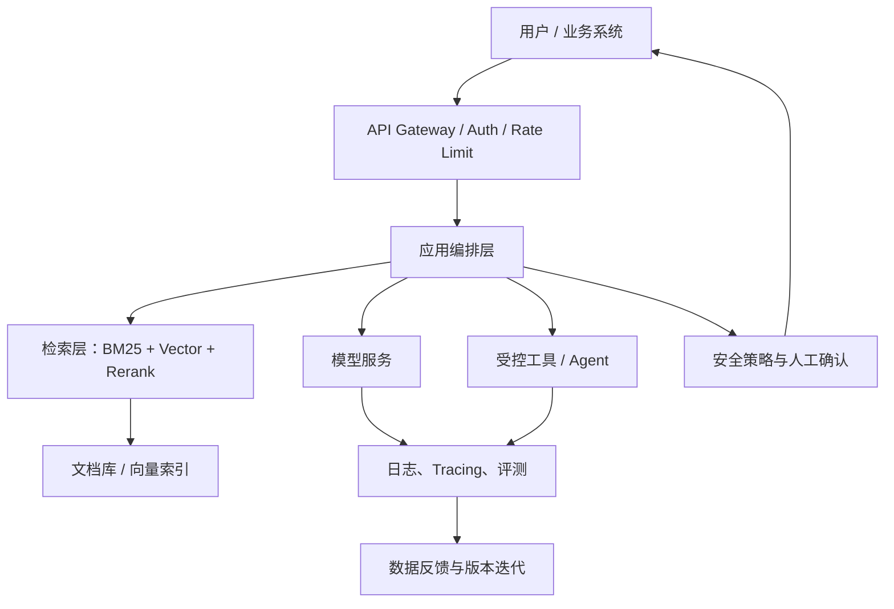

# AI 工程与部署

模型能力只是 AI 产品的一部分。生产系统还需要数据治理、服务接口、评测、可观测性、安全、成本控制和持续迭代。

## 端到端工程架构

## RAG 系统

典型流程：文档解析 → 清洗 → 分块 → 元数据 → Embedding → 索引 → Query 改写 → 召回 → 重排 → 上下文组装 → 生成 → 引用校验。

- 检索策略：关键词检索、向量检索、混合检索。
- 切分策略：固定长度、递归切分、结构化切分、父子块。
- 质量评估：Recall@K、MRR、NDCG、答案正确性、忠实度、引用准确率。
- 风险：索引陈旧、权限穿透、提示注入、检索噪声、幻觉。

相关项目：
- [LlamaIndex](https://github.com/run-llama/llama_index)
- [LangChain](https://github.com/langchain-ai/langchain)
- [Haystack](https://github.com/deepset-ai/haystack)
- [RAGAS](https://github.com/explodinggradients/ragas)
- [Qdrant](https://github.com/qdrant/qdrant)
- [Milvus](https://github.com/milvus-io/milvus)

## Agent 系统

Agent 不只是模型循环调用工具。需要定义状态、工具契约、权限、终止条件、异常恢复和可审计轨迹。

- 工具调用：输入 Schema、参数校验、权限最小化、超时与幂等。
- 规划：任务拆解、执行顺序、依赖和预算。
- 记忆：短期上下文与外部长期存储分离。
- 控制：最大步数、循环检测、人工审批和安全护栏。
- 评估：端到端成功率、工具选择准确率、失败恢复率和成本。

相关项目：
- [LangGraph](https://github.com/langchain-ai/langgraph)
- [Microsoft AutoGen](https://github.com/microsoft/autogen)
- [CrewAI](https://github.com/crewAIInc/crewAI)
- [MCP Specification](https://github.com/modelcontextprotocol/specification)

进一步阅读：[[智能体]]。

## 推理与部署

- 推理服务：[vLLM](https://github.com/vllm-project/vllm)、[llama.cpp](https://github.com/ggml-org/llama.cpp)、[Ollama](https://github.com/ollama/ollama)。
- 量化：理解 FP16/BF16、INT8、INT4 的质量/显存/吞吐权衡。
- 加速：KV Cache、Continuous Batching、Speculative Decoding、并行策略。
- 服务化：REST/gRPC、容器、健康检查、限流、队列、灰度和回滚。
- 可观测性：请求 ID、Trace、Token 用量、延迟分位数、错误率、模型版本。

## MLOps 与治理

- 数据与模型版本：DVC、MLflow、Weights & Biases（注意服务条款与数据隐私）。
- 实验追踪：[MLflow](https://github.com/mlflow/mlflow)、[DVC](https://github.com/iterative/dvc)。
- 模型服务：[BentoML](https://github.com/bentoml/BentoML)、[KServe](https://github.com/kserve/kserve)。
- 评测：[OpenCompass](https://github.com/open-compass/OpenCompass)、[lm-evaluation-harness](https://github.com/EleutherAI/lm-evaluation-harness)。
- 安全：越权工具调用、提示注入、数据泄漏、输出验证、供应链和模型许可审查。

## 工程项目建议

1. 将一个本地模型封装为 API，加入超时、日志和健康检查。
2. 构建文档 RAG，制作 50–100 条人工标注评测问题。
3. 为 RAG 加入混合检索和重排，对比 Recall@K 与答案质量。
4. 构建只能读取指定目录的 Agent 工具，加入调用审计和人工确认。
5. 进行并发压测，记录吞吐、P50/P95 延迟、显存与单位请求成本。

## 相关

- [[生成式AI与大模型]]
- [[智能体]]
- [[AI论文与数据集]]
