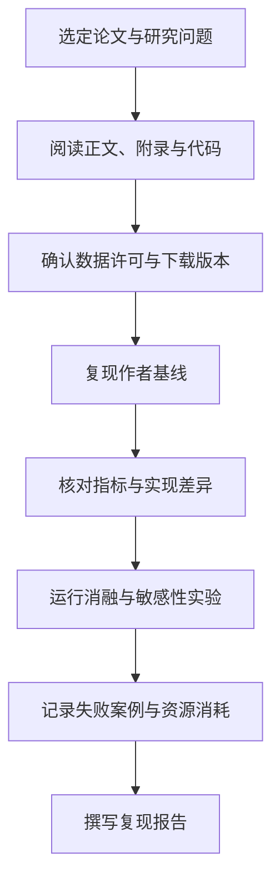

# AI 论文与数据集

本页提供论文检索、公开数据集、基准评测和复现实验入口。**公开可访问不代表可任意商用、训练或再分发**；使用前必须核对数据集卡、论文说明、原始网站和许可证。

## 1. 论文检索与追踪

| 平台 | 用途 | 链接 |
|---|---|---|
| arXiv | 机器学习、AI、CV、NLP 预印本 | [arXiv](https://arxiv.org/) |
| Semantic Scholar | 论文检索、引用关系与作者 | [Semantic Scholar](https://www.semanticscholar.org/) |
| OpenAlex | 开放学术元数据 API | [OpenAlex](https://openalex.org/) |
| Papers with Code | 论文、代码、任务和基准关联 | [Papers with Code](https://paperswithcode.com/) |
| ACL Anthology | NLP/计算语言学论文 | [ACL Anthology](https://aclanthology.org/) |
| CVF Open Access | CVPR / ICCV / ECCV 论文 | [CVF](https://openaccess.thecvf.com/) |
| NeurIPS Proceedings | NeurIPS 会议论文 | [NeurIPS](https://proceedings.neurips.cc/) |
| OpenReview | 会议投稿、评审与公开讨论 | [OpenReview](https://openreview.net/) |
| Google Scholar | 学术搜索与引用追踪 | [Google Scholar](https://scholar.google.com/) |

建议检索关键词：survey、benchmark、reproducibility、ablation、dataset、evaluation。阅读时记录研究问题、核心假设、数据来源、基线、指标、消融实验、失败案例和局限性。

## 2. 经典论文入口

| 方向 | 论文 | 链接 |
|---|---|---|
| CNN | ImageNet Classification with Deep CNNs | [arXiv](https://arxiv.org/abs/1207.0580) |
| ResNet | Deep Residual Learning for Image Recognition | [arXiv](https://arxiv.org/abs/1512.03385) |
| Transformer | Attention Is All You Need | [arXiv](https://arxiv.org/abs/1706.03762) |
| BERT | BERT: Pre-training of Deep Bidirectional Transformers | [arXiv](https://arxiv.org/abs/1810.04805) |
| GPT-3 | Language Models are Few-Shot Learners | [arXiv](https://arxiv.org/abs/2005.14165) |
| RAG | Retrieval-Augmented Generation for Knowledge-Intensive NLP Tasks | [arXiv](https://arxiv.org/abs/2005.11401) |
| LoRA | Low-Rank Adaptation of Large Language Models | [arXiv](https://arxiv.org/abs/2106.09685) |
| Diffusion | Denoising Diffusion Probabilistic Models | [arXiv](https://arxiv.org/abs/2006.11239) |
| RLHF | Training language models to follow instructions with human feedback | [arXiv](https://arxiv.org/abs/2203.02155) |
| DPO | Direct Preference Optimization | [arXiv](https://arxiv.org/abs/2305.18290) |

## 3. 数据集与数据平台

### 通用数据与机器学习
- [UCI Machine Learning Repository](https://archive.ics.uci.edu/)：经典表格数据集，适合入门与基线实验。
- [OpenML](https://www.openml.org/)：机器学习数据集、任务和实验元数据。
- [Kaggle Datasets](https://www.kaggle.com/datasets)：社区数据集与竞赛；逐项检查数据来源和许可。
- [Google Dataset Search](https://datasetsearch.research.google.com/)：跨站点发现数据集。

### NLP / LLM
- [Hugging Face Datasets](https://huggingface.co/datasets)：数据集卡、加载脚本和版本信息。
- [GLUE Benchmark](https://gluebenchmark.com/)：经典自然语言理解任务集合。
- [SuperGLUE](https://super.gluebenchmark.com/)：更具挑战性的 NLU 基准。
- [SQuAD](https://rajpurkar.github.io/SQuAD-explorer/)：阅读理解数据集。
- [GSM8K](https://github.com/openai/grade-school-math)：小学数学文字题推理数据。
- [MMLU](https://github.com/hendrycks/test)：多学科知识评测基准。
- [The Pile](https://pile.eleuther.ai/)：语言模型训练语料研究资源；注意原始数据来源及各子集许可。
- [FineWeb](https://huggingface.co/datasets/HuggingFaceFW/fineweb)：大规模网页语料数据集，需查看数据集卡与使用限制。

### 计算机视觉
- [COCO](https://cocodataset.org/)：目标检测、分割和图像描述。
- [Pascal VOC](http://host.robots.ox.ac.uk/pascal/VOC/)：经典视觉识别与检测基准。
- [Open Images](https://storage.googleapis.com/openimages/web/index.html)：大规模图像及标注资源。
- [MNIST](https://yann.lecun.com/exdb/mnist/)：手写数字识别入门。
- [CIFAR-10/100](https://www.cs.toronto.edu/~kriz/cifar.html)：小尺寸图像分类基准。
- [ImageNet](https://www.image-net.org/)：大规模视觉数据集，下载和使用需遵循其访问与许可条款。

### 语音、音频与多模态
- [Common Voice](https://commonvoice.mozilla.org/)：多语言语音数据，按版本检查许可。
- [LibriSpeech](https://www.openslr.org/12/)：英语语音识别研究数据。
- [FSD](https://zenodo.org/records/4060432)：环境声音分类数据集入口，查看具体版本许可。
- [LAION](https://laion.ai/)：多模态数据集与研究资源，注意来源、隐私和版权风险。

## 4. 基准与评测
- [Papers with Code Benchmarks](https://paperswithcode.com/benchmarks)：任务与基准入口。
- [HELM](https://crfm.stanford.edu/helm/)：语言模型综合评测框架。
- [EleutherAI lm-evaluation-harness](https://github.com/EleutherAI/lm-evaluation-harness)：可复用的语言模型评测工具。
- [OpenCompass](https://github.com/open-compass/OpenCompass)：大模型评测平台。
- [Hugging Face Evaluate](https://github.com/huggingface/evaluate)：评估指标与评测工具。
- [RAGAS](https://github.com/explodinggradients/ragas)：RAG 评估工具。

评测时应报告模型版本、提示模板、采样参数、数据版本、样本数、置信区间或方差，并避免把不同设置下的榜单分数直接比较。

## 5. 论文复现工作流

推荐在每次实验中保存：Git commit、环境依赖、数据版本、配置文件、随机种子、硬件、日志、checkpoint 和评价脚本。

## 6. 数据合规检查清单
- 数据来源是否可信，采集是否符合网站条款和当地法律？
- 是否含个人信息、敏感信息、生物特征或未成年人数据？
- 许可证是否允许研究、商业使用、修改和再分发？
- 是否要求署名、相同方式共享或禁止特定用途？
- 数据集是否包含恶意样本、偏见、泄漏或重复内容？
- 模型发布时是否需要披露训练数据来源和限制？

## 相关
- [[机器学习]]
- [[深度学习]]
- [[生成式AI与大模型]]
- [[AI工程与部署]]
