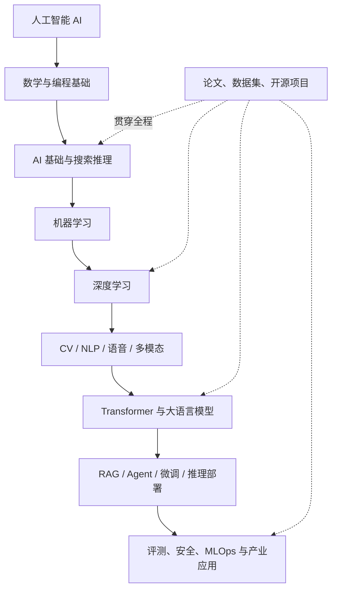

# 人工智能学习中心

从数学、编程和经典算法出发，逐步掌握机器学习、深度学习、大模型、智能体与 AI 工程。这里不仅收集资料，更强调**读懂原理、运行代码、复现论文、完成项目、评估结果**。

> [!tip] 推荐学习方式
> 每个主题按「概念 → 数学直觉 → 代码实验 → 论文/数据 → 项目复盘」学习。不要只收藏链接；至少留下一个可运行实验和一篇自己的总结。

## 知识地图

## 专题导航

| 专题 | 学习内容 | 入口 |
|---|---|---|
| 总览与学习路线 | 能力地图、阶段目标、项目路线与自测标准 | [[人工智能]] |
| 数学与 Python | 线性代数、微积分、概率统计、NumPy、PyTorch 张量 | [[数学与Python基础]] |
| 机器学习 | 监督/无监督学习、特征工程、模型评估、经典算法 | [[机器学习]] |
| 机器学习实验手册 | 公式、算法直觉、Pipeline、可运行 sklearn 实验与错误分析 | [[机器学习实验手册]] |
| 深度学习 | 神经网络、反向传播、CNN、RNN、Transformer | [[深度学习]] |
| 深度学习实验手册 | PyTorch 训练循环、Fashion-MNIST、CNN、调试与复现 | [[深度学习实验手册]] |
| AI 专业方向 | CV、NLP、语音、推荐、强化学习、多模态、机器人 | [[AI专业方向]] |
| 生成式 AI 与大模型 | Token、注意力、预训练、SFT、LoRA、推理 | [[生成式AI与大模型]] |
| 大模型与 RAG 实战 | 文档处理、检索、引用、评测、安全与生产注意事项 | [[大模型与RAG实战手册]] |
| AI 工程与部署 | 数据管线、RAG、Agent、服务化、监控与成本 | [[AI工程与部署]] |
| 论文与数据集 | 论文检索、复现流程、公开数据集与许可 | [[AI论文与数据集]] |
| GitHub 开源项目 | 入门课程、ML/DL、LLM、Agent、部署与评测仓库 | [[GitHub开源学习项目]] |
| 书籍与课程 | 从入门到研究的书单、大学课程和公开教材 | [[AI书籍与课程]] |
| 项目实战路线 | 从入门分类到论文复现、RAG 和工程部署的项目阶梯 | [[AI项目实战路线]] |
| 智能体 | 工具调用、规划、记忆、多智能体和可靠性 | [[智能体]] |

## 推荐学习路径

1. **入门（2–4 周）**：Python、NumPy、基础数学、AI 概念；完成一个数据分析或分类小项目。
2. **机器学习（4–6 周）**：用 scikit-learn 完成回归、分类、聚类和模型评估；按实验手册完成基线与错误分析。
3. **深度学习（6–8 周）**：使用 PyTorch 实现 MLP、CNN、Attention，理解训练循环与反向传播。
4. **专业方向（持续）**：选择 CV、NLP、语音、推荐系统或时序建模，阅读经典论文并复现实验。
5. **大模型工程（持续）**：掌握 Transformer、提示工程、RAG、微调、推理部署和评估。
6. **研究与生产（进阶）**：建立数据治理、实验追踪、模型监控、安全评测和成本优化流程。

## 相关领域

- [[数学]]
- [[数据结构与算法]]
- [[Python]]
- [[行业报告]]
- [[智能体]]

## 学习原则

- 先建立可解释的基线，再引入更复杂的模型。
- 训练集、验证集、测试集严格分离；避免数据泄漏。
- 记录数据版本、代码版本、随机种子、超参数和评价指标。
- 论文结论要结合数据集、实验设置、基线和局限性判断。
- 使用数据集和模型前检查许可证、隐私要求、用途限制与再分发条款。
