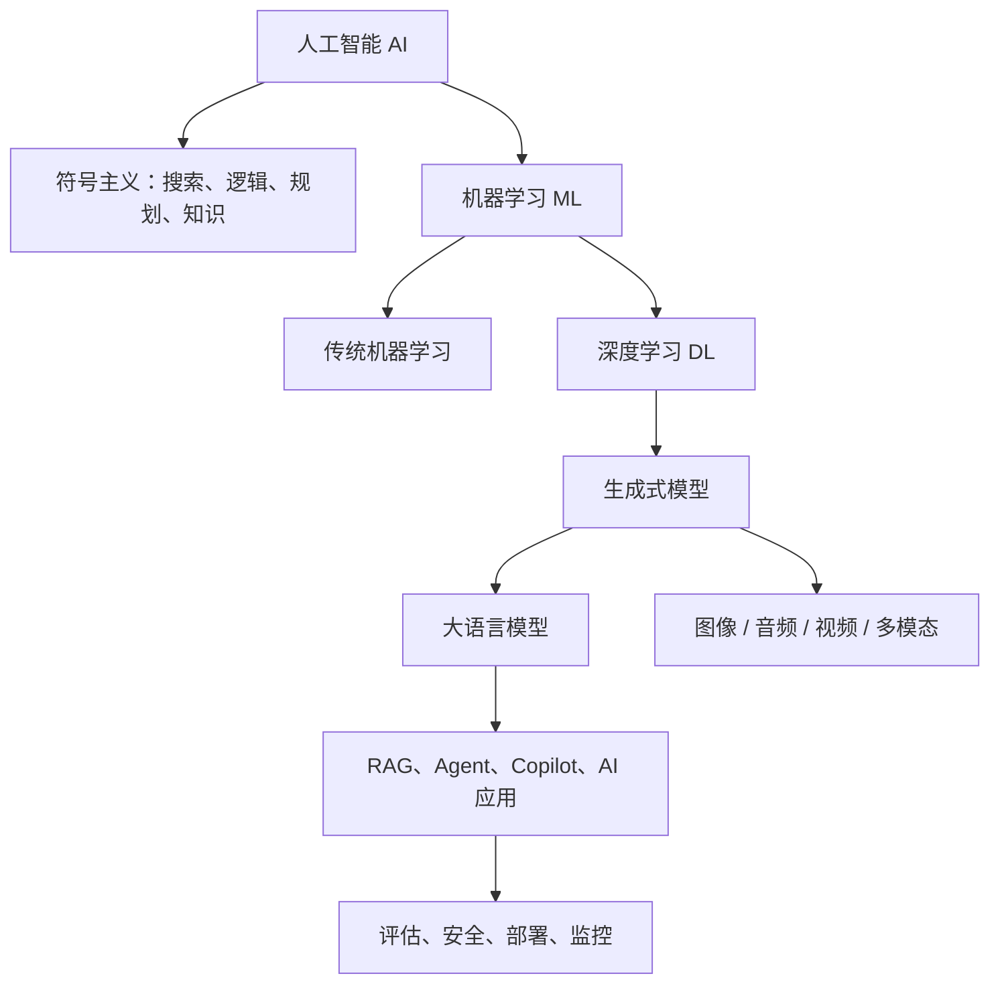
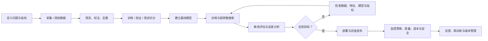

# 人工智能：从入门到精通

## 1. 人工智能是什么

人工智能（Artificial Intelligence, AI）研究如何让机器执行通常需要人类智能的任务，例如感知、语言理解、推理、规划、学习与决策。它不是单一算法，而是由数学、计算机科学、数据、模型和工程系统共同构成的领域。

- **AI**：更大的研究与工程范畴，包含搜索、规划、知识表示、机器学习等。
- **机器学习（ML）**：从数据中学习规律，而不是完全依赖人工编写规则。
- **深度学习（DL）**：使用多层神经网络学习复杂表示。
- **生成式 AI（GenAI）**：生成文本、图像、音频、视频、代码等内容。
- **大语言模型（LLM）**：以语言 token 为主要建模对象的大规模神经网络模型。
- **AI Agent**：将模型与上下文、工具、状态和控制流程组合起来执行任务的系统。

## 2. 从入门到精通的能力阶梯

| 阶段 | 必须掌握 | 可验证成果 |
|---|---|---|
| L0 认知入门 | AI/ML/DL 区别、数据与模型、训练与推理 | 能解释一个 AI 应用的数据流 |
| L1 编程基础 | Python、Git、Linux、NumPy、Pandas、可视化 | 独立完成数据清洗与分析 |
| L2 数学基础 | 向量矩阵、导数梯度、概率分布、统计估计 | 能解释线性回归和梯度下降 |
| L3 机器学习 | 回归、分类、聚类、特征工程、验证策略 | 完成端到端 tabular ML 项目 |
| L4 深度学习 | 张量、自动微分、反向传播、CNN、Attention | 用 PyTorch 训练并调试神经网络 |
| L5 专业方向 | CV/NLP/语音/推荐/时序/强化学习 | 复现一个经典模型并分析误差 |
| L6 大模型 | Transformer、预训练、SFT、LoRA、RAG | 构建可评测的领域问答系统 |
| L7 AI 工程 | 推理服务、缓存、并发、监控、安全、成本 | 部署可观测、可回滚的 AI 服务 |
| L8 研究能力 | 论文阅读、实验设计、消融、统计显著性 | 复现论文并形成技术报告 |

## 3. 基础知识清单

### 数学
- 线性代数：向量、矩阵乘法、秩、特征值、特征向量、SVD。
- 微积分：导数、偏导数、链式法则、梯度、Jacobian。
- 概率统计：条件概率、贝叶斯公式、常见分布、期望、方差、极大似然。
- 优化：梯度下降、随机梯度下降、动量、Adam、正则化。
- 信息论：熵、交叉熵、KL 散度、互信息。

### 编程与计算环境
- Python：函数、类、迭代器、类型标注、异常、虚拟环境。
- 科学计算：NumPy、Pandas、Matplotlib、SciPy。
- 深度学习：PyTorch、CUDA 基础、自动微分、DataLoader。
- 工程工具：Git、Linux、Docker、Jupyter、pytest、日志与配置管理。

### 核心算法与概念
- 搜索与规划：BFS、DFS、A*、博弈树、约束满足。
- 经典 ML：线性/逻辑回归、决策树、随机森林、梯度提升、SVM、KNN、聚类、PCA。
- 深度学习：MLP、CNN、RNN/LSTM/GRU、Attention、Transformer。
- 生成模型：自回归模型、VAE、GAN、Diffusion。
- 大模型工程：Tokenizer、Embedding、向量检索、RAG、微调、量化、推理优化。

## 4. 训练一个模型的完整流程

**关键原则：** 测试集只用于最终评估；不要根据测试集反复调参。对时间序列、用户数据和同源样本，应采用符合数据生成过程的切分策略，防止泄漏。

## 5. 必须理解的评价指标

| 任务 | 常用指标 | 注意事项 |
|---|---|---|
| 分类 | Accuracy、Precision、Recall、F1、ROC-AUC、PR-AUC | 类别不平衡时不能只看 Accuracy |
| 回归 | MAE、MSE、RMSE、R² | 检查异常值与误差分布 |
| 检索 | Recall@K、Precision@K、MRR、NDCG | 同时评估召回和排序 |
| 生成 | Perplexity、ROUGE、BLEU、人工评测 | 自动指标不能完整代表事实性与有用性 |
| LLM 应用 | 正确性、忠实度、拒答、安全、延迟、成本 | 使用代表真实场景的评测集 |
| Agent | 任务成功率、步骤数、工具错误率、恢复率 | 评估端到端任务，不只评估单次回答 |

## 6. 实战项目路线

1. **入门**：鸢尾花分类、泰坦尼克生存预测、房价回归。
2. **数据科学**：公开数据集 EDA、特征工程、交叉验证与误差分析。
3. **深度学习**：MNIST/Fashion-MNIST 分类、CIFAR-10 图像分类。
4. **NLP**：文本分类、语义相似度、Embedding 检索。
5. **CV**：目标检测、图像分割、数据增强和模型部署。
6. **LLM**：本地模型推理、结构化输出、RAG 文档问答。
7. **Agent**：让模型调用受控工具，完成多步骤任务并记录执行轨迹。
8. **工程化**：API 服务、Docker 部署、评估流水线、监控和版本回滚。

每个项目至少提交：问题定义、数据来源与许可证、基线、实验配置、评价结果、错误案例、复现步骤和局限性。

## 7. 常见误区

- 把调用模型 API 等同于掌握 AI：应用开发与模型训练是不同能力。
- 只追求模型规模：数据质量、任务定义、评测和系统约束同样重要。
- 只报告单一指标：需要分层评估、误差分析和真实场景测试。
- 忽略数据许可：公开可下载不代表可任意商用或再分发。
- 盲目微调：先判断提示工程、检索、工具调用是否已经足够。
- 把 Agent Demo 当作生产系统：生产系统还需要权限边界、审计、超时、重试和人工确认。

## 8. 下一步学习

- [[数学与Python基础]]
- [[机器学习]]
- [[深度学习]]
- [[生成式AI与大模型]]
- [[AI工程与部署]]
- [[AI论文与数据集]]
- [[AI书籍与课程]]
- [[智能体]]
