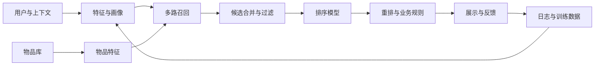

# 推荐系统与搜索实战

推荐系统解决“给谁推荐什么、何时推荐、以什么顺序呈现”。搜索系统解决“给定查询，如何找到并排序相关内容”。两者共享召回、排序、Embedding 和在线评估等技术。

## 1. 推荐系统典型架构

## 2. 主要算法

- 热门度基线：简单、强韧，适合冷启动对照。
- User/Item-based Collaborative Filtering：利用用户或物品相似性。
- Matrix Factorization：学习用户和物品的隐向量。
- BPR：面向隐式反馈的 pairwise 排序目标。
- Wide & Deep、DeepFM：结合记忆与泛化能力。
- 双塔模型：用户塔与物品塔分别编码，适合大规模召回。
- Learning to Rank：LambdaMART、神经排序等。
- 序列推荐：建模用户行为顺序与兴趣变化。

矩阵分解常见形式：

\[
\hat r_{ui}=\mu+b_u+b_i+p_u^Tq_i
\]

其中用户向量 \(p_u\) 与物品向量 \(q_i\) 的内积表达偏好估计。

## 3. 评估指标

- 召回：Recall@K、HitRate@K。
- 排序：NDCG@K、MAP、MRR。
- 预测：RMSE、MAE（适用于评分预测）。
- 系统与产品：覆盖率、多样性、新颖性、延迟、点击率、转化率。
- 公平性与健康度：曝光分布、长尾覆盖、过滤气泡和反馈回路。

离线指标不能完全替代在线 A/B 测试；A/B 测试还需关注样本随机化、统计功效、护栏指标和长期效应。

## 4. 搜索与检索

- 倒排索引与 BM25：高效关键词检索基线。
- Dense Retrieval：查询和文档向量化。
- 双塔召回：适合大规模候选召回。
- Cross-Encoder Reranker：对 query-document 对进行精细排序。
- Hybrid Search：融合词法与向量检索。
- Query Understanding：拼写纠错、意图识别、查询改写。

## 5. 数据集与项目

- [MovieLens](https://grouplens.org/datasets/movielens/)：电影评分与推荐研究。
- [Amazon Reviews](https://nijianmo.github.io/amazon/index.html)：商品评论与交互数据，注意版本和使用条款。
- [MIND](https://msnews.github.io/)：新闻推荐数据集。
- [RecBole](https://github.com/RUCAIBox/RecBole)：推荐算法统一框架。
- [Microsoft Recommenders](https://github.com/recommenders-team/recommenders)：推荐系统实践示例。
- [Faiss](https://github.com/facebookresearch/faiss)：向量近邻检索。
- [BEIR](https://github.com/beir-cellar/beir)：信息检索评测集合。

## 6. 项目阶梯

1. 用 MovieLens 建立热门度推荐基线。
2. 实现 Item-based CF 和矩阵分解，比较 Recall@K/NDCG@K。
3. 实现双塔召回，构建离线向量索引。
4. 增加 Cross-Encoder 重排，评估召回与排序的分工。
5. 设计 A/B 测试方案，加入覆盖率、多样性和延迟护栏。

时间切分很重要：不能用未来交互预测过去；同一用户行为序列也要按时间构造训练与评估样本。

## 7. 论文阅读

- [Matrix Factorization Techniques for Recommender Systems](https://ieeexplore.ieee.org/document/5197422)：矩阵分解经典工作。
- [BPR: Bayesian Personalized Ranking](https://arxiv.org/abs/1205.2618)：隐式反馈排序。
- [Wide & Deep Learning](https://arxiv.org/abs/1606.07792)：记忆与泛化。
- [DeepFM](https://arxiv.org/abs/1703.04247)：因子分解与深度网络结合。
- [Neural Collaborative Filtering](https://arxiv.org/abs/1708.05031)：神经协同过滤。

## 相关

- [[AI专业方向]]
- [[机器学习实验手册]]
- [[AI论文与数据集]]
- [[AI项目实战路线]]
