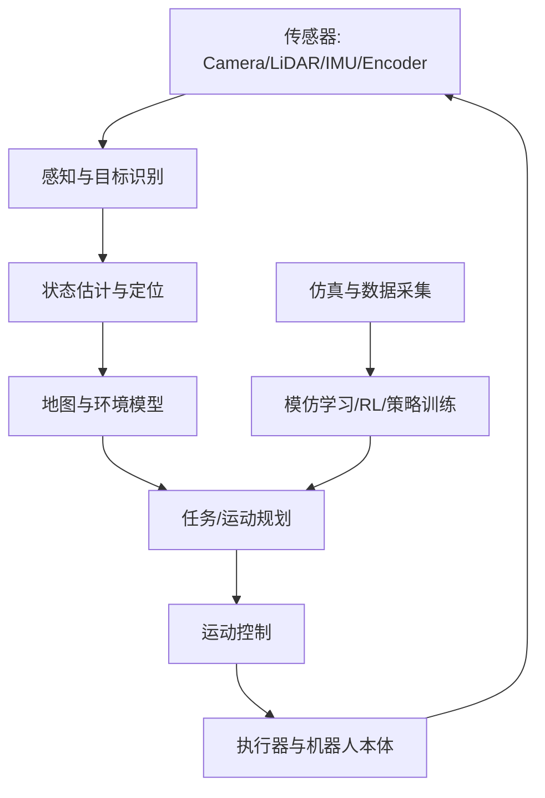

# 机器人与具身智能实战

机器人系统把感知、状态估计、规划、控制和执行器连接成闭环。具身智能进一步研究智能体如何通过身体与环境交互学习和完成任务。

## 1. 系统知识地图

## 2. 核心知识

- 坐标系与刚体变换：旋转矩阵、四元数、齐次变换矩阵。
- 传感器：相机、LiDAR、IMU、编码器、力/扭矩传感器。
- 状态估计：卡尔曼滤波、扩展卡尔曼滤波、因子图。
- 定位与建图：里程计、SLAM、回环检测、地图表示。
- 规划：A*、Dijkstra、RRT/RRT*、轨迹优化。
- 控制：PID、LQR、MPC、轨迹跟踪。
- 学习方法：模仿学习、行为克隆、离线 RL、在线 RL。
- 具身多模态：视觉-语言-动作（VLA）、任务规划和动作生成。

## 3. 关键公式

离散线性系统：

\[
x_{k+1}=Ax_k+Bu_k+w_k
\]
\[
z_k=Hx_k+v_k
\]

其中状态 \(x\) 由系统模型预测，传感器观测 \(z\) 用于校正估计。实际机器人通常存在非线性、异步、多频率传感器和不确定噪声，需要使用 EKF、UKF 或图优化等方法。

PID 控制：

\[
u(t)=K_p e(t)+K_i\int_0^t e(\tau)d\tau+K_d\frac{de(t)}{dt}
\]

调参时要检查饱和、积分 windup、采样周期、噪声和执行器动态，而不只是让曲线看起来平滑。

## 4. 软件与仿真生态

- [ROS 2](https://github.com/ros2/ros2)：机器人中间件、节点、Topic、Service、Action。
- [Nav2](https://github.com/ros-navigation/navigation2)：移动机器人导航。
- [MoveIt 2](https://github.com/moveit/moveit2)：机械臂运动规划。
- [Gazebo](https://github.com/gazebosim/gz-sim)：机器人仿真。
- [MuJoCo](https://github.com/google-deepmind/mujoco)：物理仿真与控制研究。
- [Isaac Lab](https://github.com/isaac-sim/IsaacLab)：机器人学习仿真框架。
- [LeRobot](https://github.com/huggingface/lerobot)：机器人学习数据、模型和实践工具。
- [OpenVLA](https://github.com/openvla/openvla)：开源视觉-语言-动作研究项目。

## 5. 数据与基准

- [KITTI](https://www.cvlibs.net/datasets/kitti/)：自动驾驶视觉、里程计和 3D 数据。
- [nuScenes](https://www.nuscenes.org/)：多传感器自动驾驶数据集。
- [Waymo Open Dataset](https://waymo.com/open/)：自动驾驶感知和运动数据。
- [RoboMimic](https://robomimic.github.io/)：机器人模仿学习基准。
- [RLBench](https://github.com/stepjam/RLBench)：机器人操作任务基准。
- [DROID](https://droid-dataset.github.io/)：机器人操作数据集。

务必检查数据集访问条件、研究用途限制、隐私和许可；仿真数据与真实机器人数据的分布可能明显不同。

## 6. 项目阶梯

1. ROS 2 发布/订阅：让传感器节点发布数据，另一个节点订阅并记录。
2. 仿真小车：完成里程计、地图构建和路径导航。
3. 机械臂：完成运动学计算、轨迹规划和安全限位。
4. 传感器融合：融合 IMU 与轮速/视觉里程计，分析漂移。
5. 模仿学习：采集少量示教轨迹，训练行为克隆策略并评估失败状态。
6. Sim-to-Real：先在仿真验证，再逐步迁移到真实设备，设置急停、速度/力限制和安全操作区。

## 7. 经典论文阅读

- [Probabilistic Robotics](https://mitpress.mit.edu/9780262201629/probabilistic-robotics/)：概率机器人基础教材。
- [Playing Atari with Deep Reinforcement Learning](https://arxiv.org/abs/1312.5602)：深度 RL。
- [QT-Opt](https://arxiv.org/abs/1806.10293)：机器人抓取与强化学习。
- [RT-1](https://arxiv.org/abs/2212.06817)：机器人 Transformer。
- [RT-2](https://arxiv.org/abs/2307.15818)：视觉语言模型与机器人动作。

## 8. 安全与工程要求

机器人会与真实物理世界交互。任何实机实验都应先定义急停、工作空间、速度/力矩限制、碰撞检测、通信失效策略和人工接管机制。仿真通过不代表实机安全。

## 相关

- [[AI专业方向]]
- [[强化学习实战路线]]
- [[计算机视觉实战路线]]
- [[AI论文与数据集]]
