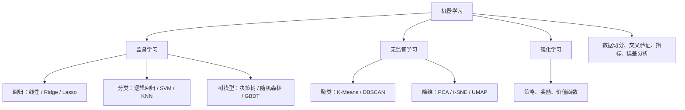

# 机器学习

机器学习的目标是从样本中学习可泛化的规律。学习重点不是背算法名称，而是理解数据假设、损失函数、优化方式、泛化能力和适用边界。

## 知识地图

## 核心学习清单

1. 问题类型：回归、二分类、多分类、多标签、聚类、异常检测、排序。
2. 数据处理：缺失值、异常值、类别编码、标准化、特征工程。
3. 模型：线性/逻辑回归、朴素贝叶斯、KNN、SVM、决策树、随机森林、XGBoost/LightGBM。
4. 泛化：偏差-方差、过拟合、欠拟合、正则化、交叉验证。
5. 评估：混淆矩阵、Precision、Recall、F1、ROC-AUC、PR-AUC、MAE、RMSE。
6. 可解释性：特征重要性、Permutation Importance、SHAP（理解其适用条件）。

## 推荐课程与代码

- [吴恩达 Machine Learning Specialization](https://www.coursera.org/specializations/machine-learning-introduction)
- [Google Machine Learning Crash Course](https://developers.google.com/machine-learning/crash-course)
- [scikit-learn 用户指南](https://scikit-learn.org/stable/user_guide.html)
- [scikit-learn 示例](https://scikit-learn.org/stable/auto_examples/index.html)
- [Hands-On Machine Learning 配套代码](https://github.com/ageron/handson-ml3)
- [XGBoost](https://github.com/dmlc/xgboost)
- [LightGBM](https://github.com/microsoft/LightGBM)
- [CatBoost](https://github.com/catboost/catboost)

## 项目练习

- 泰坦尼克生存预测：重点练习数据清洗、交叉验证和类别不平衡。
- 房价预测：比较线性模型、随机森林和梯度提升。
- 客户流失预测：分析召回率、阈值选择和业务成本。
- 异常检测：比较 Isolation Forest 与基于距离的方法。

## 进阶：实验设计

- 先建立 Dummy/简单模型基线，再逐步增加复杂度。
- Pipeline 中拟合的预处理步骤只能使用训练数据。
- 超参数搜索只能使用训练集内部的验证策略。
- 对数据集版本、特征、模型参数、随机种子和指标做记录。
- 除平均指标外，分析不同类别、不同时间段和边界样本的表现。

## 相关

- [[数学与Python基础]]
- [[深度学习]]
- [[AI论文与数据集]]
