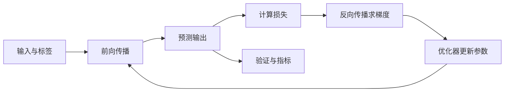

# 深度学习

深度学习通过多层神经网络学习数据表示。真正掌握它，需要能解释前向传播、损失函数、反向传播、优化器、正则化和训练稳定性，并能独立实现训练与评估流程。

## 神经网络训练流程

## 核心模块

- 感知机与 MLP：线性层、激活函数、初始化。
- 训练机制：计算图、自动微分、反向传播、梯度裁剪。
- 优化：SGD、Momentum、Adam/AdamW、学习率调度。
- 泛化：Dropout、Weight Decay、数据增强、Early Stopping。
- 架构：CNN、RNN/LSTM/GRU、Attention、Transformer。
- 生成模型：VAE、GAN、Diffusion、自回归模型。
- 训练工程：混合精度、梯度累积、分布式训练、checkpoint。

## 经典论文起点

- [AlexNet（2012）](https://arxiv.org/abs/1207.0580)：深度 CNN 在 ImageNet 上取得重要突破。
- [Deep Residual Learning / ResNet（2015）](https://arxiv.org/abs/1512.03385)：残差连接缓解深层网络优化困难。
- [Attention Is All You Need（2017）](https://arxiv.org/abs/1706.03762)：提出 Transformer。
- [BERT（2018）](https://arxiv.org/abs/1810.04805)：双向 Transformer 预训练代表工作。
- [Diffusion Models Beat GANs（2021）](https://arxiv.org/abs/2105.05233)：扩散模型的重要研究。

## GitHub 学习资料

- [Dive into Deep Learning](https://github.com/d2l-ai/d2l-zh)：中文教材、公式、代码和实践。
- [PyTorch Tutorials](https://github.com/pytorch/tutorials)：官方示例。
- [fast.ai course](https://github.com/fastai/fastbook)：从实践切入深度学习。
- [Hugging Face Transformers](https://github.com/huggingface/transformers)：预训练模型与 NLP/多模态工具。
- [timm](https://github.com/huggingface/pytorch-image-models)：视觉模型实现集合。

## 实战路线

1. 用 PyTorch 从零实现 MLP，并检查梯度数值。
2. 用 CNN 完成 Fashion-MNIST 或 CIFAR-10 分类。
3. 对比不同优化器、学习率、Batch Size 和正则化方式。
4. 实现一个简化版 Attention，观察序列长度和计算量变化。
5. 选择一篇论文，复现基线并做至少一组消融实验。

## 调试清单

- 先尝试让模型在一个很小的 batch 上过拟合，以验证代码链路。
- 检查输入/标签维度、dtype、设备和损失函数要求。
- 观察训练损失与验证损失是否分离。
- 检查梯度是否为 None、是否爆炸或消失。
- 保存最佳验证 checkpoint，不要只保存最后一个 epoch。

## 相关

- [[数学与Python基础]]
- [[机器学习]]
- [[生成式AI与大模型]]
- [[AI论文与数据集]]
