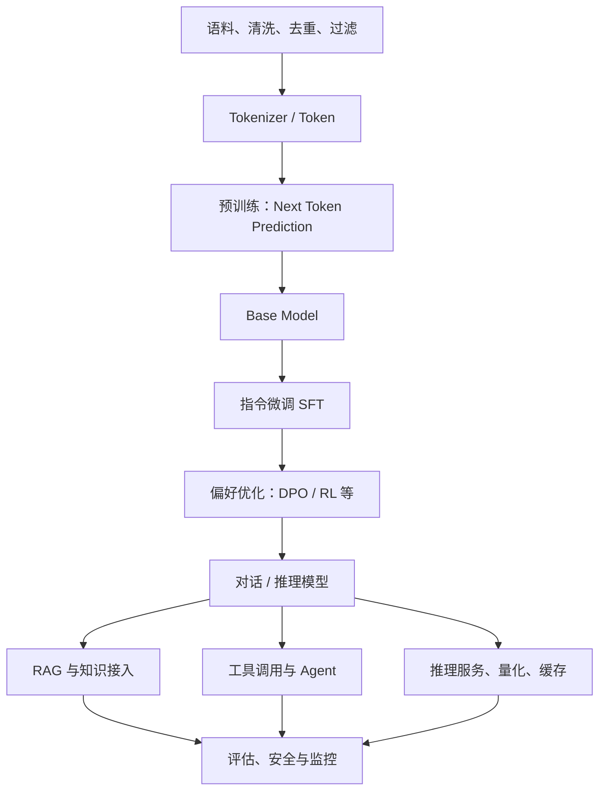

# 生成式 AI 与大语言模型

生成式模型学习数据分布并生成新样本。大语言模型通常以 token 序列建模为核心，通过预训练获得通用表示，再通过指令微调、偏好优化和工具使用适配任务。

## 大模型技术栈

## 必须掌握的概念

- Tokenizer：文本如何切分为 token，词表大小与上下文长度的影响。
- Embedding：把离散 token 映射到向量空间。
- Self-Attention：Query、Key、Value、注意力权重和复杂度。
- Transformer：位置编码、残差连接、LayerNorm、前馈网络。
- 预训练：数据规模、训练目标、数据质量和计算资源。
- 推理：Temperature、Top-p、KV Cache、Batching、吞吐与延迟。
- 后训练：SFT、偏好数据、DPO、RLHF/RLAIF。
- 高效微调：LoRA、QLoRA、PEFT。
- RAG：切分、Embedding、召回、重排、上下文构造和引用。
- 评估：事实性、指令遵循、拒答、安全、鲁棒性和成本。

## 推荐课程与项目

- [Hugging Face LLM Course](https://huggingface.co/learn/llm-course)：Transformer、数据集、微调和部署。
- [Stanford CS336: Language Modeling from Scratch](https://stanford-cs336.github.io/spring2025/)：语言模型构建与训练。
- [Dive into Deep Learning](https://d2l.ai/)：深度学习理论与实现。
- [The Annotated Transformer](https://nlp.seas.harvard.edu/annotated-transformer/)：逐步实现 Transformer。
- [nanoGPT](https://github.com/karpathy/nanoGPT)：小型 GPT 训练代码，适合理解训练流程。
- [Transformers](https://github.com/huggingface/transformers)：模型架构与推理接口。
- [PEFT](https://github.com/huggingface/peft)：参数高效微调。
- [TRL](https://github.com/huggingface/trl)：语言模型后训练工具。

## 经典论文阅读顺序

1. [Attention Is All You Need](https://arxiv.org/abs/1706.03762) — Transformer。
2. [BERT](https://arxiv.org/abs/1810.04805) — 双向预训练语言表示。
3. [GPT-3](https://arxiv.org/abs/2005.14165) — In-context learning。
4. [Training language models to follow instructions with human feedback](https://arxiv.org/abs/2203.02155) — InstructGPT / RLHF。
5. [LoRA](https://arxiv.org/abs/2106.09685) — 低秩适配微调。
6. [Retrieval-Augmented Generation](https://arxiv.org/abs/2005.11401) — 检索增强生成。
7. [Direct Preference Optimization](https://arxiv.org/abs/2305.18290) — DPO。

## 实践任务

- 使用 Transformers 加载一个开放权重模型，完成本地推理。
- 对比不同 tokenizer 的 token 数量与截断行为。
- 使用 PEFT/LoRA 对小型模型进行领域微调。
- 构建一个带来源引用的 RAG 问答系统。
- 用固定测试集比较 Prompt、RAG、微调方案的质量、延迟和成本。

## 重要提醒

开放权重不等于无限制开源。使用模型前应核对模型卡、权重许可证、训练数据说明、商用限制、地域限制和安全政策。不要将机密数据、个人信息或未授权数据上传到第三方模型服务。

## 推荐阅读

- [Hands-On Large Language Models](https://www.oreilly.com/library/view/hands-on-large-language/9781098150952/)：理解 Token、Embedding、Transformer 与语义检索，配套代码见[GitHub](https://github.com/HandsOnLLM/Hands-On-Large-Language-Models)。
- [Natural Language Processing with Transformers](https://www.oreilly.com/library/view/natural-language-processing/9781098103231/)：Hugging Face 与 Transformer 实践，配套代码见[GitHub](https://github.com/nlp-with-transformers/notebooks)。
- [Generative Deep Learning](https://www.oreilly.com/library/view/generative-deep-learning/9781098134174/)：VAE、GAN、扩散模型等生成式方法。
- 完整书单见 [[AI书籍与课程]]。

## 相关

- [[深度学习]]
- [[AI工程与部署]]
- [[智能体]]
- [[AI论文与数据集]]
