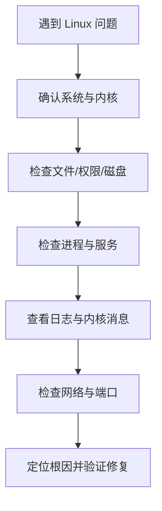

# Linux 学习指南与常用命令

本页整理 Linux 系统信息、文件管理、文本处理、进程服务、网络和包管理等基础操作，并保留 Flomo 原始卡片。

## Linux 运维与排障路径

## 权限安全提醒

原始笔记提到 `chmod -R 777`。这会递归授予所有用户读、写、执行权限，风险很高，**不要把它当作通用修复命令**。应先用 `ls -l`、`stat` 确认目标权限，再按最小权限原则使用 `chmod` / `chown`，并避免对系统目录盲目递归修改。

## 原始 Flomo 卡片

### 1. **Linux 学习指南**

**Flomo 来源：** https://v.flomoapp.com/mine/?memo_id=OTAzNDYyOTc

**Linux 学习指南**

**1\. 查看系统信息**

- 内核版本：cat /proc/version、uname -a
- 发行版：cat /etc/os-release、lsb\_release -a
- CPU：lscpu、cat /proc/cpuinfo
- 内存：free -h、cat /proc/meminfo
- 磁盘：df -h、lsblk
- 硬件：lsusb、lspci

**2\. 文件与目录**

- 查看：pwd、ls -al、cd
- 复制 / 移动 / 删除：cp -r、mv、rm -rf
- 查找：find、which、locate
- 权限：chmod -R 777（递归改读写执行，777 放得很开，慎用）、chown、ls -l 看权限位
- 软链：ln -s

**3\. 文本处理**

- 查看：cat、less、head、tail -f
- 搜索：grep -rn "关键词" .
- 编辑：vi / vim（普通、插入、命令行三种模式）
- 管道与重定向：\|、>、>>

**4\. 进程与服务**

- 进程：ps aux、top / htop、kill -9、pkill
- 服务：systemctl status / start / stop
- 日志：dmesg、journalctl -f

**5\. 网络**

- 地址与连通：ip addr、ping
- 端口：ss -tunlp、netstat -tunlp
- 传输：wget、scp、rsync
- 远程：ssh、ssh-keygen

**6\. 包管理**

- Debian / Ubuntu：apt update、apt install
- RHEL / CentOS：yum、dnf

参考：Linux 常用命令汇总 → [https://www.cnblogs.com/ywl925/p/11083351.html](https://www.cnblogs.com/ywl925/p/11083351.html)

📎 相关：Linux 常用指令 → [https://v.flomoapp.com/mine/?memo\_id=MTE3ODI0MzE1](https://v.flomoapp.com/mine/?memo_id=MTE3ODI0MzE1)

#Area/学习管理/Linux学习

#Archive/MigratedNotion 
#Archive/DeleteCandidate

---

### 2. 

**Flomo 来源：** https://v.flomoapp.com/mine/?memo_id=MTE3ODI0MzE1

Linux常用的指令：

修改文件读写权限 chmod +R 777

#Area/学习管理/Linux学习

#Archive/MigratedNotion 
#Archive/DeleteCandidate

