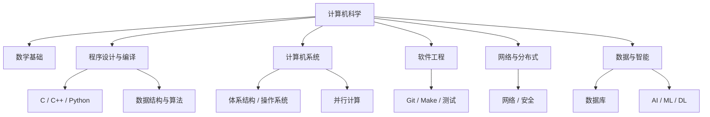

# 计算机科学自学路线与工具资源

本页整理 Flomo「CS自学指南」中的学习路线、工具清单与跨领域概念卡。原笔记提及的 C-Free 5.0 属于历史环境记录，不代表当前推荐开发环境；实际使用应优先选择仍受维护的编译器、IDE 与工具链。

## 计算机科学知识地图

## 学习建议

- 先建立计算机系统基础，再逐步深入算法、操作系统、网络、数据库、编译原理和安全。
- 工具链建议以 Git、现代 C/C++ 编译器、GNU Make/CMake、调试器和自动化测试为主。
- AI、机器学习、深度学习是层层递进且存在交叉的领域：AI 范围最广，机器学习是实现 AI 的重要方法，深度学习是机器学习中的一类方法。

---

## 1. "人工智能"、"机器学习"、"深度学习"这三个概念之间的关系是什么样的？用一张包含关系图怎么画？

**Flomo 来源：** https://v.flomoapp.com/mine/?memo_id=MjQ2NTQyNTA5

"人工智能"、"机器学习"、"深度学习"这三个概念之间的关系是什么样的？用一张包含关系图怎么画？

- \[ **基础概念**\] [https://v.flomoapp.com/mine/?memo\_id=MjQ2Mzc0NzUw](https://v.flomoapp.com/mine/?memo_id=MjQ2Mzc0NzUw)

#Area/学习管理/CS自学指南

#Archive/MigratedNotion 
#Archive/DeleteCandidate

---

## 2. - 开发环境的安装

**Flomo 来源：** https://v.flomoapp.com/mine/?memo_id=MTI0MzYzODQ3

- 开发环境的安装
  - C-Freee 5.0

  - 编译器的安装
- 计算机基本原理介绍

- 桌面应用开发漫谈 \- 萝卜墩儿

  [https://rememberber.github.io/post/zhuo-mian-ying-yong-kai-fa-man-tan/](https://rememberber.github.io/post/zhuo-mian-ying-yong-kai-fa-man-tan/)

  

  #Area/学习管理/CS自学指南/C语言

  

#Archive/MigratedNotion 
#Archive/DeleteCandidate

---

## 3. - 必须工具

**Flomo 来源：** https://v.flomoapp.com/mine/?memo_id=ODYxNDc4MzM

- 必须工具
  - VIM

  - Emacs

  - Git

  - GitHub

  - GNU Make
- 好书推荐

- 数学基础

- 数学进阶

- 编程入门

- 电子基础

- 数据结构与算法

- 软件工程

- 体系结构

- 操作系统

- 并行与分布式系统

- 计算机系统安全

- 计算机网络

- 数据库系统

- 编译原理

- 程序设计语言

- 计算机图形学

- Web开发

- 数据科学

- 人工智能

- 机器学习

- 机器学习系统

- 深度学习

- 机器学习进阶

数据记录在幕布，notion和wonderpen里面

#Area/学习管理/CS自学指南

#Archive/MigratedNotion 
#Archive/DeleteCandidate

## 相关专题

- [Linux 学习指南与常用命令](./Linux学习指南) —— 系统信息、文件权限、进程服务、网络与包管理。
