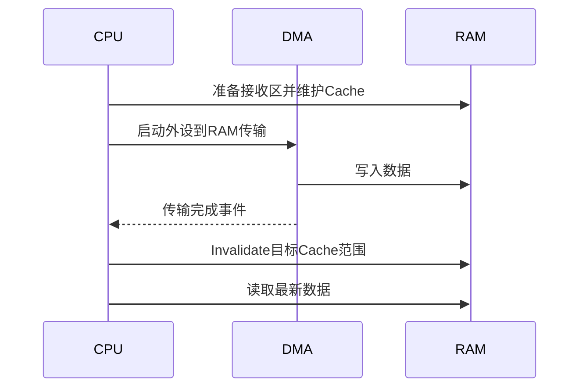

# 专栏⑮·补充二：DMA——数据搬运不占 CPU 的隐形引擎

> 来源：Flomo 原始笔记｜[查看原笔记](https://v.flomoapp.com/mine/?memo_id=MjUxMjA1MDkw)｜迁移日期：2026-10-31

**专栏⑮·补充二：DMA——数据搬运不占 CPU 的隐形引擎**

▎ **为什么嵌入式高性能离不开 DMA** 
UART 收一串不定长数据、ADC 连续采样 1024 点、SPI 读 Flash 一页——这些如果全用中断逐字节搬，CPU 全耗在搬运上，实时性崩。DMA 把「从外设搬到内存」这件事外包给硬件，搬完再打断你。

▎ **DMA 是什么**

- 直接内存访问：独立于 CPU 的搬运引擎，一条总线主设备
- 搬运描述：源地址 \+ 目的地址 \+ 长度 \+ 触发源（外设事件）
- 搬完回调：传输完成中断（TC）通知 CPU

▎ **三种搬运模式**

1. 内存→内存：Mem2Mem（批量拷贝，比 memcpy 省 CPU）
2. 外设→内存：Periph2Mem（ADC 采样、UART 接收、SPI 读）
3. 内存→外设：Mem2Periph（UART 发送、SPI 写、DAC）

▎ **经典场景**

- UART 接收：IDLE 中断 + DMA 环形缓冲区——不定长数据一条链搞定
- ADC 多通道连续采样：DMA 直接把结果搬进数组，CPU 只做数据处理
- SPI Flash 读：DMA 搬一页（256B），CPU 同时干别的
- 显示器/传感器高频刷新

▎ **DMA 与缓存（有 Cache 的 MCU 必看）**

- 数据一致性：DMA 写内存，CPU 读的是 Cache 旧数据——需要 Clean/Invalidate
- 场景：DMA 收完数据 → CPU 读之前要 Invalidate（让 Cache 失效重新读内存）
- DMA 发数据 → CPU 写完后要 Clean（把 Cache 刷回内存）
- 多核 \+ DMA 更要注意（接 C语言补充三 barrier）

▎ **三个坑**

1. 环形缓冲边界：DMA 指针回绕，处理时小心撕裂——按块处理或双缓冲（Ping-Pong）
2. 搬运一半改配置：DMA 正在搬，你改了长度/地址——传输错乱，停用再改
3. 数据一致性：有 Cache 的核上忘记 Invalidate/Clean——读到旧数据的经典疑难杂症

▎ **一句话**：DMA 是把搬运外包给硬件——三种模式（内存/外设双向）覆盖 UART/ADC/SPI 所有高频场景；有 Cache 的 MCU 记住「收完 Invalidate、发前 Clean」，一致性是唯一的深坑。

📎 第3篇：PWM 与定时器 → [https://v.flomoapp.com/mine/?memo\_id=MjQ2MzYzNjk0](https://v.flomoapp.com/mine/?memo_id=MjQ2MzYzNjk0) 
📎 C语言补充三：并发与原子性（barrier）→ [https://v.flomoapp.com/mine/?memo\_id=MjUxMjA0Mjc0](https://v.flomoapp.com/mine/?memo_id=MjUxMjA0Mjc0) 
📎 专栏⑮导航 → [https://v.flomoapp.com/mine/?memo\_id=MjQ1NzMzNDk3](https://v.flomoapp.com/mine/?memo_id=MjQ1NzMzNDk3)

**专栏⑮进度：10/10 + 补充二**

#Area/技术/嵌入式

## 工程问答补全：DMA 与 Cache 一致性

### Q1. DMA 传输完成中断是否意味着 CPU 一定能读到最新数据？

不一定。DMA 与 CPU Cache 是两个独立访问者。DMA 直接读写主存，而 CPU 可能命中 Cache 中的旧副本；若没有正确维护 Cache，CPU 可能读到旧数据，或脏 Cache Line 在稍后回写时覆盖 DMA 新数据。

### Q2. DMA 接收和发送分别怎样维护 Cache？

- **DMA 接收（外设 → RAM）：** DMA 开始前，若目标 Cache Line 可能有 CPU 脏数据，需按芯片规则先 Clean+Invalidate 或采取等效策略，避免 DMA 写入后被旧脏行覆盖；DMA 完成后，在 CPU 读取前对覆盖范围 Invalidate，使 CPU 从内存重新取数。
- **DMA 发送（RAM → 外设）：** CPU 填充发送缓冲区后，在启动 DMA 前 Clean，确保最新数据写回内存。
- **双向/复用缓冲区：** 需明确所有权交接点；CPU 与 DMA 不得在没有同步协议的情况下同时修改同一缓存行。

具体维护顺序、API 和屏障要求以芯片 Cache/DMA 手册及编译器/SDK 为准。

### Q3. 为什么 DMA 缓冲区要按 Cache Line 对齐？

Cache 维护通常以整条 Cache Line 为粒度。如果 DMA 缓冲区与普通变量共享同一 Cache Line，Invalidate 可能丢弃邻接变量的脏数据；Clean 也可能把不应提交的数据写回。应将缓冲区按 Cache Line 对齐，并将长度填充到整行边界，或放入 non-cacheable 区域。

### Q4. DMA 环形接收如何避免读写指针竞争？

采用半传输/全传输中断、IDLE 事件或硬件写指针快照更新生产位置；消费者维护独立读位置。必须处理回绕、溢出、半包、连续突发和索引快照一致性。若使用双缓冲，明确每个缓冲区由 CPU 或 DMA 独占的时间窗口。

### 验证清单
- [ ] 地址和长度满足 DMA 对齐、总线地址范围要求。
- [ ] 缓冲区不与其他变量共享需维护的 Cache Line。
- [ ] DMA 发送前 Clean；接收前/后按芯片手册维护。
- [ ] 传输完成事件与缓存维护之间有正确同步。
- [ ] 压测回绕、连续帧、缓存开启/关闭和高负载情况。
