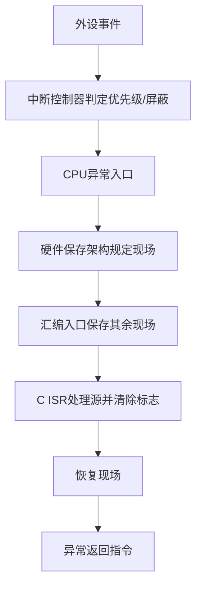

# ①<u><mark>PC(Program Counter)</mark></u>:CPU内一定会有的寄存器，不同CPU可能会用不同的名字，如IP(Instruction Pointer);是用来记 录下一个指令的地址。当CPU执行完一个指令后，PC值会自动累加，此外，某些指令（如JUMP）就是通过改变PC的值来改变CPU的执行顺序。

原始 Flomo：https://v.flomoapp.com/mine/?memo_id=MTM1MDIwMjg2

①<u><mark>PC(Program Counter)</mark></u>:CPU内一定会有的寄存器，不同CPU可能会用不同的名字，如IP(Instruction Pointer);是用来记 录下一个指令的地址。当CPU执行完一个指令后，PC值会自动累加，此外，某些指令（如JUMP）就是通过改变PC的值来改变CPU的执行顺序。

②<u><mark>中断矢量表（Interrupt Vector Table）</mark></u>：计算机系统通过中断（Interupt）来处理突发事件，例如，键盘被按下或计时器到时

等。通常CPU（或CPU+中断处理器）可以处理许多中断来源，所以程序员必须指定当某个中断发生时，要让CPU去执行哪一个函数，而记录这些设定的表格就叫做中断矢量表。

#Area/技术/嵌入式
## 工程问答补全：PC、异常入口与中断向量

### Q1. PC 保存的是当前指令地址还是下一条指令地址？

概念上 PC 用于控制取指位置，但“读到的 PC 值”与当前指令地址的关系依 ISA 和流水线实现而异。某些架构在异常入口保存的是返回地址，某些需要根据异常类型调整；调试时不能把不同 ISA 的 PC 语义混用。

### Q2. 中断向量表和中断描述符表是一回事吗？

不是。中断向量表是广义概念：将异常/中断向量映射到处理入口。不同架构实现不同，例如 ARM Cortex-M 使用向量表结构，PowerPC 有异常向量入口，x86 保护模式使用 IDT。入口格式、基地址配置和特权级规则均依架构而定。

### Q3. CPU 进入中断时硬件会自动保存哪些现场？

由 ISA 决定。硬件通常保存足以返回的最小异常状态（例如返回 PC、状态寄存器或异常原因），而通用寄存器、浮点寄存器等可能需要软件入口代码保存。编译器中断属性、汇编 wrapper 和 RTOS 上下文切换代码必须一致，否则会破坏被打断任务状态。

### Q4. 中断嵌套为什么需要优先级和屏蔽策略？

高优先级中断可以打断低优先级 ISR，以降低关键事件响应延迟；但嵌套会增加栈深度、共享数据竞争和最坏执行时间。应限制可嵌套层数，避免 ISR 中阻塞、长循环或调用不允许在中断上下文运行的 API。

### Q5. 从中断向量表到 C ISR 的典型路径是什么？

### 验证清单
- [ ] 向量表地址、对齐和启动映射正确。
- [ ] 中断源使能、优先级、屏蔽位和清除方式正确。
- [ ] ISR ABI/编译器属性与汇编入口匹配。
- [ ] 评估嵌套栈深度、最大 ISR 执行时间和延迟。
- [ ] 对中断风暴、重复触发和异常返回进行测试。
