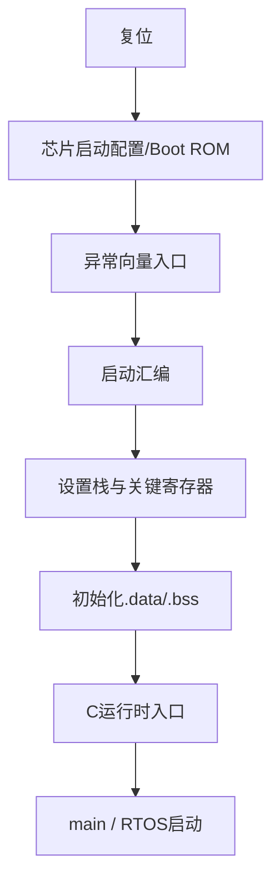

# PowerPC

原始 Flomo：https://v.flomoapp.com/mine/?memo_id=MTc5NDUyOTE2

PowerPC

<https://www.cnblogs.com/binarysystemloophole/articles/10313895.html>

- PowerPC指令集
- 软件结构

#Area/技术/嵌入式
## 1. PowerPC 是什么？它与 x86、ARM 的关系是什么？

PowerPC 是基于 IBM POWER 指令集技术发展而来的 RISC 处理器架构家族，曾广泛用于嵌入式控制器、网络设备和汽车 MCU。它不是单一芯片型号；不同实现可能采用不同核心、指令子集、异常模型、存储管理和调试能力。选型或读代码时必须确认具体内核手册，而不能只看“PowerPC”名称。

## 2. PowerPC 的指令集通常包含哪些类别？

- 整数运算：加减、逻辑、比较、移位。
- 数据传送：寄存器与内存之间的 Load/Store。
- 分支控制：条件分支、链接分支、返回。
- 特殊寄存器访问：读写状态寄存器、计数器和控制寄存器（具体名称依内核）。
- 浮点/向量指令：是否支持取决于具体内核。
- 同步与内存序：屏障、原子或专用同步指令依实现而异。

RISC 的常见特点是 Load/Store：算术逻辑操作主要在寄存器之间进行，内存访问由专门的加载/存储指令完成。

## 3. PowerPC 汇编中的 GPR、FPR、CR、LR、CTR、XER 分别做什么？

GPR 是通用整数寄存器；FPR 在支持浮点单元的实现中保存浮点数据；CR 保存比较结果/条件字段；LR 常用于保存分支链接返回地址；CTR 可用于计数循环或某些分支控制；XER 保存扩展运算状态。具体寄存器集合与可用字段要以目标核心架构手册为准。

## 4. PowerPC 的函数调用与 ABI 为什么重要？

ABI 约定函数参数如何传递、返回值放在哪里、哪些寄存器由调用者保存、哪些由被调用者保存、栈帧如何布局以及结构体如何对齐。编译器、汇编启动代码、库函数和应用代码必须遵守同一 ABI，否则可能出现参数错位、返回地址破坏、栈损坏或链接后运行异常。排查时查看编译器选项、链接脚本、反汇编和 map 文件。

## 5. 异常、中断和普通函数调用有什么区别？

普通函数调用由当前程序控制流发起；中断/异常由外设事件、处理器状态或指令执行异常触发，硬件按架构规则保存部分状态并转到异常向量入口。软件通常还需保存其余现场、识别异常源、清除中断条件并按规定返回。不能把所有异常入口都当作普通 C 函数；栈、寄存器保存、嵌套和返回指令可能有特殊要求。

## 6. 启动代码、向量表和链接脚本如何协作？

链接脚本定义代码/数据段放置地址、内存区域、入口符号和段对齐；启动代码建立栈、初始化运行环境、复制初始化数据、清零 BSS，并调用 C 运行时入口；向量表将异常源映射到处理函数。三者必须与芯片启动模式、Boot ROM、Flash/RAM 布局和调试启动方式一致。

## 7. 大小端、对齐和缓存一致性会造成什么问题？

字节序决定多字节数据在内存中的字节排列；对齐限制决定某类访问地址是否有效或高效；Cache 会让 CPU 看到的数据与 DMA/外设看到的内存内容暂时不同。协议序列化必须显式规定字节序；结构体不能直接当作跨平台报文格式；DMA 缓冲区应按芯片要求进行 Cache clean/invalidate、对齐和内存屏障处理。

## 8. PowerPC 代码调试时如何定位异常？

先记录异常类型、异常向量、保存的 PC/LR/CR/状态寄存器、堆栈和核心编号；再将 PC 映射到 ELF/map/反汇编，检查访问地址、权限、对齐、栈边界和中断嵌套。若异常发生在优化代码中，使用带符号 ELF、保留关键变量并结合硬件 Trace/调试器复现。具体异常寄存器和返回流程必须以目标内核手册为准。

## 9. PowerPC 与汽车 MCU 工程如何结合？

汽车 MCU 可能使用 Power Architecture 的 e200 等内核实现，但不同芯片在核心数量、锁步配置、Cache、DMA、MPU、ECC、外设和安全机制方面差异很大。工程流程应为：确认芯片型号与核心手册 → 选择正确编译器/ABI → 检查启动与链接文件 → 验证中断向量和内存布局 → 验证 Cache/DMA → 做异常注入和最坏时序测试。

## 10. 常见错误与验证清单

- [ ] 确认具体核心及其架构版本，避免套用其他 PowerPC 内核指令。
- [ ] 编译器 ABI、浮点 ABI、优化等级与库一致。
- [ ] 启动代码、向量表地址和链接脚本匹配芯片启动模式。
- [ ] 检查栈大小、对齐、.data/.bss 初始化。
- [ ] DMA 与 Cache 一致性处理符合芯片手册。
- [ ] 异常处理函数使用正确入口/返回约定。
- [ ] 通过 map、反汇编、寄存器快照和 Trace 留存证据。

## 来源与边界

原始 Flomo 卡片仅记录“PowerPC 指令集、软件结构”两个方向及一条历史参考链接，没有指定目标核心、编译器或芯片。以上先补齐通用架构知识；具体寄存器名、汇编语法、ABI 和异常返回序列必须在确定芯片/核心后再落到具体版本。
