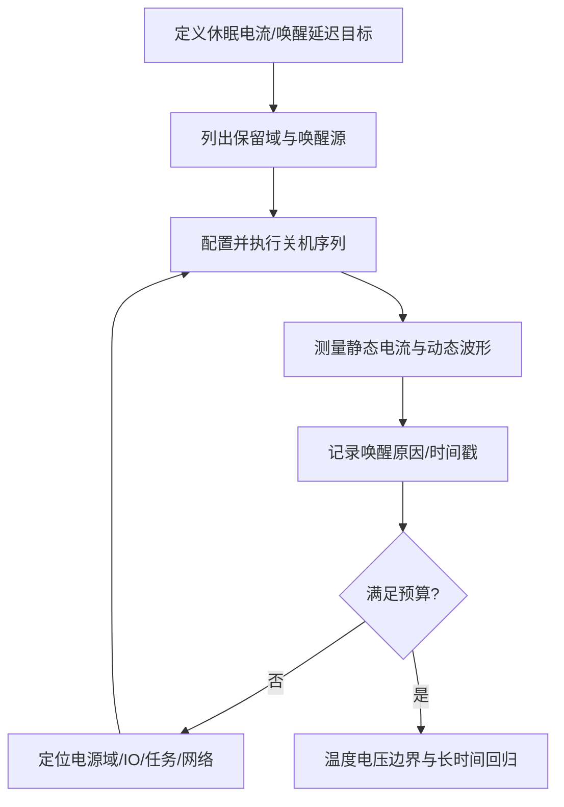

# 专栏⑮·补充三：低功耗设计——睡眠、唤醒、功耗测量，接住你 EcuM 的经验

> 来源：Flomo 原始笔记｜[查看原笔记](https://v.flomoapp.com/mine/?memo_id=MjUxMjA1MTEy)｜迁移日期：2026-10-31

**专栏⑮·补充三：低功耗设计——睡眠、唤醒、功耗测量，接住你 EcuM 的经验**

▎ **为什么低功耗是汽车电子必修课** 
休眠电流超标 = 蓄电池亏电 = 车主打不着火（你专栏④ EcuM 第3篇那个 20 次假唤醒的案例）。AUTOSAR 的 EcuM 唤醒验证、休眠流程，底层就是这套低功耗设计。软件上把功耗降下来，和把休眠电流测准，是两件都要会的事。

▎ **MCU 功耗模式谱系（以 STM32 为例）**

1. Run：全速，功耗最大
2. Sleep：CPU 停，外设/时钟跑——中断可唤醒，唤醒最快
3. Stop：大部分时钟停，SRAM 保持——唤醒慢（µs 级），可被 RTC/外部事件唤醒
4. Standby：几乎全关，只有备份域 + 唤醒引脚——唤醒最慢（ms 级），RAM 丢

▎ **降功耗三板斧**

1. 选模式：能 Stop 不 Sleep，能 Standby 不 Stop——但要权衡唤醒时间
2. 关外设时钟：不用的外设 RCC 关掉——每个外设时钟都是电流
3. IO 状态：浮空输入最耗电（漏电流）——不用的引脚配成模拟/下拉

▎ **睡眠电流的真实来源（排查顺序）**

1. 外设没关：GPIO 浮空、ADC 没禁用、看门狗在跑
2. 电源本身：LDO 静态电流 > DC-DC——休眠时切到低静态电流的 LDO 或关 DC-DC
3. 外部器件：传感器/收发器还在供电——用 MOSFET 切电源轨（负载开关）

▎ **唤醒设计（接 EcuM 唤醒验证）**

- 唤醒源：RTC 定时、外部中断（CAN/LIN 总线活动、PPS）、复位
- 唤醒验证：唤醒后先验证「是不是真唤醒」再初始化全量外设——假唤醒直接睡回去（你 7/22 的睡死事故就是验证超时配太小）
- 唤醒时间预算：从唤醒到能干活，每个阶段（时钟起振→外设初始化→应用就绪）量一遍

▎ **功耗测量**

- 测静态电流：万用表 µA 档串入电源（或示波器电流探头）
- 测动态电流：示波器看波形——尖峰 = 唤醒瞬间
- 长时间记录：电流记录仪/电子负载——一夜测完看有没有周期性尖峰（假唤醒）

▎ **一句话**：低功耗 = 选对睡眠模式 \+ 关掉一切能关的 \+ 唤醒验证再起来；测量是硬功夫——静态电流用万用表、动态用示波器，一夜记录抓假唤醒。

📎 专栏④ EcuM 导航（唤醒验证）→ [https://v.flomoapp.com/mine/?memo\_id=MjQ4NTYwNjky](https://v.flomoapp.com/mine/?memo_id=MjQ4NTYwNjky) 
📎 硬件补充三：电源深入 → [https://v.flomoapp.com/mine/?memo\_id=MjUxMDMwMDAz](https://v.flomoapp.com/mine/?memo_id=MjUxMDMwMDAz) 
📎 专栏⑮导航 → [https://v.flomoapp.com/mine/?memo\_id=MjQ1NzMzNDk3](https://v.flomoapp.com/mine/?memo_id=MjQ1NzMzNDk3)

**专栏⑮进度：10/10 + 补充三**

#Area/技术/嵌入式

## 工程问答补全：低功耗状态机与测量

### Q1. Sleep、Stop、Standby 是跨 MCU 通用的标准名称吗？

不是。它们是许多 MCU 厂商使用的低功耗模式名称，但保留的时钟、RAM、电源域、唤醒源和唤醒延迟各不相同。必须根据目标芯片的电源模式表和唤醒源矩阵确认，不能把 STM32 的模式行为直接套用到汽车 MCU。

### Q2. 如何选择低功耗模式？

先列出必须保持的功能：RAM 是否保留、RTC 是否运行、CAN/LIN 收发器是否需要唤醒、外部中断是否可用、唤醒延迟上限、数据保持要求和复位后恢复成本。然后比较各模式的静态电流、进入/退出时间和可用唤醒源，选择满足系统需求的最低功耗模式，而不是一味追求最深睡眠。

### Q3. 为什么休眠前要先停止任务、外设和网络请求？

持续运行的周期任务、未释放的 ComM 请求、外设 DMA、定时器和未完成 NvM 作业都可能阻止系统进入目标低功耗状态，或在睡眠中产生非预期唤醒。休眠前要逐项确认运行请求、通信状态、外设状态、存储作业和唤醒源配置。

### Q4. 如何区分静态电流超标与周期性假唤醒？

使用电流记录仪/示波器记录足够长的时间，同时记录唤醒原因、复位原因、网络活动和关键 GPIO 标记。稳定偏高通常优先检查未关闭的电源域、收发器、外设和 IO 漏电；周期尖峰则关联 RTC、网络管理、看门狗、传感器中断和软件定时器事件。

### Q5. 低功耗验证怎样形成闭环？

### 验证清单
- [ ] 所有唤醒源有明确配置、极性、滤波和去抖策略。
- [ ] 进入低功耗前无未完成 DMA/NvM/通信事务。
- [ ] 测量仪器量程、压降和采样带宽适合目标电流。
- [ ] 覆盖温度、电压、网络噪声和快速重复唤醒。
- [ ] 记录睡眠进入时间、唤醒原因、恢复时间和峰值电流。
