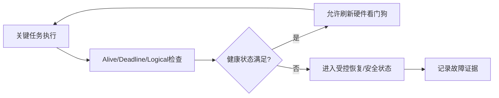

# **专栏⑮·补充四：看门狗与可靠性——喂狗策略决定系统能不能自己活过来

> 来源：Flomo 原始笔记｜[查看原笔记](https://v.flomoapp.com/mine/?memo_id=MjUxMjA1MTM5)｜迁移日期：2026-10-31

▎ **专栏⑮·补充四：看门狗与可靠性——喂狗策略决定系统能不能自己活过来**

▎ **看门狗是什么**  硬件计数器，不喂就复位——系统卡死/死循环的唯一自救手段。汽车 ECU 里看门狗是安全要求（ISO 26262 ASIL 场景标配），裸机和 RTOS 喂狗策略完全不同。

▎ **两种看门狗**

1. 独立看门狗（IWDG）：独立时钟（LSI），不受主时钟故障影响——卡死必复位，最可靠

2. 窗口看门狗（WWDG）：必须在窗口期（早于下限/晚于上限都复位）喂——抓「喂太勤」的程序跑飞

- 选型：可靠性第一用 IWDG；要防「异常快速循环」用 WWDG

▎ **喂狗策略：裸机 vs RTOS**

- 裸机：main loop 里喂——但 main loop 卡死前可能还在喂（比如喂狗代码在死循环里）

- 更稳：放在高优先级定时器中断里喂 \+ 主循环任务监控（任务活着才喂）

- RTOS：idle 任务喂（系统还有 idle = 调度还活着）+ 关键任务看门狗任务监控（每个任务喂自己的标志，全齐才喂狗）

- AUTOSAR：WdgM（Watchdog Manager）管多级监控——Alive/Supervision 模式

▎ **喂狗的本质**  喂狗不是「让狗别叫」，是「报告系统还活着」——所以喂狗点要能代表系统健康：

- 主循环喂 = 报告「主循环还活着」

- 任务监控喂 = 报告「所有关键任务都按时跑了」

- 只喂狗不监控 = 假活

▎ **三个坑**

1. 喂狗代码放死循环前：卡死时还在喂，看门狗形同虚设

2. 窗口期没算对：过早/过晚都复位——明明没死却被复位，比死了还难查

3. 低功耗模式忘了处理：Stop/Standby 下看门狗还在跑——睡眠前要暂停或喂好再睡（或唤醒后重配）

▎ **一句话**：看门狗是系统最后的自救——独立看门狗保底、窗口看门狗防跑飞；喂狗点 = 健康报告点，RTOS 里用任务监控「全齐才喂」，只喂不监控等于假活。

📎 补充一：RTOS 内核（idle 喂狗）→ <https://v.flomoapp.com/mine/?memo_id=MjUxMjA1MDcx>  📎 补充三：低功耗设计（睡眠与看门狗）→ <https://v.flomoapp.com/mine/?memo_id=MjUxMjA1MTEy>  📎 专栏⑮导航 → <https://v.flomoapp.com/mine/?memo_id=MjQ1NzMzNDk3>

**专栏⑮进度：10/10 + 补充四（共 14 篇）**

#Area/技术/嵌入式

## 工程问答补全：看门狗与健康监控

### Q1. 看门狗为什么不能只在固定周期中断里喂？

如果主循环或关键任务已经卡死，但独立定时中断仍在执行喂狗代码，系统会表现为“看门狗一直正常”，无法发现应用失效。喂狗必须依赖关键功能链路的健康证据，而不只是某个定时器还活着。

### Q2. AUTOSAR WdgM 主要监控什么？

WdgM 可按配置对 Supervised Entity 执行 Alive、Deadline 和 Logical Supervision 等监控：Alive 检查执行次数/活跃性；Deadline 检查关键流程在时间窗口内完成；Logical 检查状态转换序列是否符合预期。具体监督点、容错次数和触发策略取决于项目配置及所用规范版本。

### Q3. 窗口看门狗为何能检测“喂得太早”？

窗口看门狗只允许在指定时间窗口内刷新。过早刷新可能说明程序异常快速循环、时钟或调度行为异常；过晚刷新则可能说明任务超时或系统卡死。窗口边界必须按时钟误差、任务抖动和最坏执行时间设计。

### Q4. 看门狗复位后应该记录什么？

至少记录复位原因寄存器、最近一次监督失败实体、任务/ISR 运行轨迹、栈溢出标记、关键状态和掉电前诊断信息。记录动作不能阻塞安全恢复；若需要持久化，应评估复位路径可用的存储时序和掉电预算。

### Q5. 看门狗设计的安全闭环是什么？

### 验证清单
- [ ] 关键任务有监督点，不允许单一 idle/ISR 代替系统健康判定。
- [ ] 注入任务卡死、超时、错误顺序和调度饥饿。
- [ ] 验证早喂、晚喂和时钟漂移行为。
- [ ] 看门狗复位后保留根因并执行安全恢复。
- [ ] 低功耗期间的看门狗时钟/暂停策略有芯片依据。
