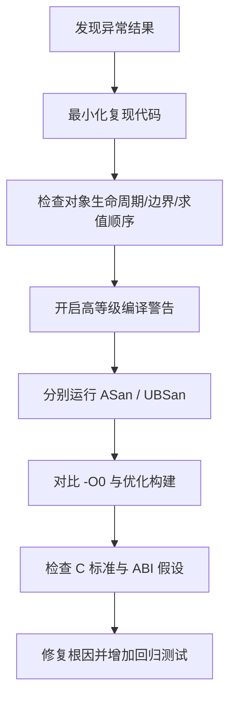

# C语言 1000问｜未定义行为专题（Q1–Q4）

> 来源：Flomo 原始笔记；本页按问题顺序整理，保留原笔记的核心解释、示例与实践建议。
> 
> - [Q1：什么是未定义行为](#q1什么是未定义行为ub)
> - [Q2：序列点与求值顺序](#q2序列点与求值顺序)
> - [Q3：严格别名规则](#q3严格别名规则)
> - [Q4：有符号溢出与符号转换](#q4有符号溢出与符号转换)

## Q1：什么是未定义行为（UB）？

> [Flomo 原文](https://v.flomoapp.com/mine/?memo_id=MjU2NDUxMTA5)

▎ 五大学习法：西蒙学习法——把「UB」钻透

**什么是未定义行为（UB）**

- C 标准对某些程序行为「不做任何保证」——标准没说会发生什么，编译器可以任意处理（看起来正常、崩溃、静默算错、甚至把整段代码优化掉）。
- UB 不是「结果随机」，而是「标准不约束，实现不保证」。
- 相邻概念：未指定行为（unspecified，几个允许结果之一）、实现定义行为（implementation-defined，编译器必须文档化，如 int 宽度、char 是否有符号）。

**为什么「看起来能用」不代表没问题**

- 编译器会「假设 UB 不会发生」来做优化——一旦真触发 UB，优化可能让它表现得更诡异。
- 经典：有符号溢出是 UB，编译器可假设 a + 1 > a 永远成立，于是把 if (a + 1 < a) 判成死代码删掉。
- 表现随编译器 / 优化级别 / 平台而变：debug 版正常、release 版崩溃；换个编译器就出问题。
- UB 的危害在于隐性、延迟、不可复现——这正是它在嵌入式里最危险的地方。

**几个最常见的 UB**

1. 有符号整数溢出：INT_MAX + 1（无符号是回绕、定义良好；有符号是 UB）。
2. 数组 / 指针越界访问（哪怕只读）。
3. 解引用空指针 / 悬垂指针 / 野指针。
4. 读取未初始化的自动变量。
5. 序列点 / 未定序修改：i = i++ + ++i。
6. 整数除零 / 取模零。
7. 移位越界：x << 32（移位量 ≥ 类型宽度）、左移负数。
8. 违反严格别名的类型双关。
9. free 后使用、free 非 malloc 指针、free 两次。
10. 函数返回后使用指向其局部变量的指针。
11. 修改字符串字面量。
12. va_arg 类型不匹配。

**怎么防**

- 编译警告开全：-Wall -Wextra -Werror，测试时用 -fsanitize=undefined,address（UBSan / ASan）。
- 静态分析：clang-tidy、Coverity、MISRA C 检查器。
- 写代码时：位运算用无符号、边界检查、初始化所有变量、别写多重副作用表达式。
- 嵌入式：MISRA C 大量规则就是在消 UB——不可移植 / 未定义的构造一律禁。

一句话：UB 是「标准没规定、实现不保证」——最坑的是它让优化器把 UB 当作不会发生来做假设，于是 debug 正常、release 崩；背熟有符号溢出、越界、未初始化、i=i++、除零这些高频 UB，再用警告和 sanitizer 兜底。

## Q2：序列点与求值顺序

> [Flomo 原文](https://v.flomoapp.com/mine/?memo_id=MjU2NDUxMTU2)

▎ 五大学习法：费曼学习法——把「序列点」讲透

**什么是序列点（sequence point）**

- 序列点是程序执行中的一个「时间点」，保证这个点之前所有副作用（side effect）都已完成，之后的操作都还没开始。
- 直观理解：它是「求值顺序的检查站」——过了这个点，前面该改的内存都改完了。
- 常见序列点：完整表达式结束时；&&、||、?: 的第一个操作数求值之后；逗号运算符的左操作数之后；函数调用时参数求值之后、进入函数体之前（但参数之间没有序列点）；函数返回时。

**C11 之后：从「序列点」到「先序 / 后序（sequenced before）关系」**

- C11 把描述改成了 sequenced before / unsequenced / indeterminately sequenced 这种关系语言，思想一样：不允许未定序地既读又写同一个对象。
- 两个操作若没有先序关系，又都作用于同一对象、其中一个还修改它，就可能构成未定义行为。

**为什么 i = i++ + ++i 是 UB**

- 这里对 i 有多个修改：i++（读并改）、++i（改）、以及赋值给 i（又改一次）。
- 这些修改之间没有序列点 / 没有先序关系，顺序未定。
- 因此最终 i 等于几，标准不做保证；不同编译器或优化级别可能呈现不同现象。

**类似的高频 UB 表达式**

- i = i++; a[i] = i++; f(i++, i++);（函数参数求值顺序未指定）
- printf("%d %d", i++, i++); —— 参数之间无序列点。
- x = x++ + 1; y = i++ * i++。
- 经验法则：一个表达式里同一个对象只读一次或只改一次，别既读又改。

**未指定行为也要小心**

- 函数实参的求值顺序彼此未指定，但要区分“顺序未指定”和“行为未定义”：`f(i++, i++)` 中两个实参对同一标量对象产生未定序修改，因此仍是 UB；`f(i++, j++)` 若两个对象不同且没有其他未定序冲突，通常只是实参求值先后未指定，不应依赖其先后顺序。
- 运算符优先级不等于求值顺序：a + b 里 a、b 谁先算，标准不规定。

**怎么避开**

- 别在一个表达式里对同一变量既读又写。
- 需要自增 / 自减时，拆成独立语句。
- 函数多个参数有副作用时，先在单独语句里算好再传。
- -Wall -Wextra 常能提示部分序列点问题。

## Q3：严格别名（strict aliasing）规则

> [Flomo 原文](https://v.flomoapp.com/mine/?memo_id=MjU2NDUxMjAw)

▎ 五大学习法：西蒙学习法——把「严格别名」钻透

**什么是别名（aliasing）**

- 两个指针指向同一块内存，就说它们互为别名。
- 编译器做优化时要判断两条访问是不是同一块内存——若可能别名，就不能随便调换顺序 / 缓存值。

**严格别名规则**

- 一个对象的有效类型是确定的；只能通过兼容类型的指针（或字符类型指针）访问它，否则是未定义行为。
- 声明了 int x，就应只用 int* 访问它；若用 float* 或某 struct* 去读同一块内存，就是违反严格别名 → UB。
- 例外：char* / unsigned char* 可以读取任意对象的字节（这也是 memcpy、序列化的基础）。

**为什么编译器会出问题**

- 编译器优化时假设不同类型的指针不会指向同一对象，于是可能把值缓存在寄存器里、不重新从内存读；调换两次写操作的顺序；或消掉它认为不相关的一次读 / 写。
- 一旦真用不同类型指针访问同一内存，优化结果就可能和预期不一致——典型表现是看起来对，开了 -O2 就错。

**一个经典例子**

- int i = 0x3f800000; float f = *(float*)&i —— 用 float* 访问 int 对象，违反严格别名。
- 或用两个不同 struct* 访问同一地址，做结构体式解读。

**正确做法**

- 用 memcpy 做位级转换：float f; memcpy(&f, &i, sizeof f); —— 标准明确允许，编译器也能优化掉，最安全。
- 用 union 做类型双关（C 里相对宽松，但仍需理解标准规则；很多团队改用 memcpy）。
- 确实要用不同指针访问同一内存：可评估 -fno-strict-aliasing 或编译器扩展 attribute((may_alias))，不要把它们当作通用可移植方案。

**和 restrict 的关系**

- restrict 是反过来的承诺：告诉编译器这个指针是访问该对象的唯一途径，帮助优化。
- 用错 restrict（其实有别名）同样是 UB。
- 严格别名是默认假设不别名，restrict 是显式声明不别名。

**嵌入式相关**

- 寄存器映射、协议解析、把字节流解释成结构体，常触发这类问题。
- 常见替代：memcpy、逐字段解析、位操作、packed + 逐字节读，避免直接强转指针。
- 打补丁时把指针强转成别的类型去读，是现场最常见的 -O2 才现形 bug。

## Q4：有符号整数溢出与符号转换

> [Flomo 原文](https://v.flomoapp.com/mine/?memo_id=MjU2NDUxMjUw)

▎ 五大学习法：西蒙学习法——把「有无符号的坑」钻透

**一、溢出：无符号 vs 有符号**

- 无符号溢出：定义良好——就是模 2 的 N 次方回绕。UINT_MAX + 1 得 0，标准保证。
- 有符号溢出：未定义行为。INT_MAX + 1 标准什么都不保证，编译器可假设它不会发生并据此优化。
- 由于 UB，编译器可能删掉边界检查、改写循环判断。

**二、有符号 / 无符号混用的比较陷阱**

- 有符号和无符号一起参与运算 / 比较时，常见算术转换可能把有符号值转换成无符号；负数因此变成很大的正数。
- if (-1 < 1u)：-1 转成 UINT_MAX（常见 32 位环境下为 4294967295），比较变成 UINT_MAX < 1，结果为 false。
- for (unsigned i = n; i >= 0; i--)：i >= 0 恒真，递减到 0 后下溢，循环不会按预期终止。
- 这类 bug 极隐蔽：不报错、逻辑看着对、运行却错。

**三、常见高危写法**

1. 循环变量用无符号却递减判断 >= 0。
2. 数组下标 / 长度用无符号，和可能为负的差值比较。
3. 函数返回 -1 表示错误，却赋给无符号变量。
4. sizeof（返回 size_t，无符号）与 int 混比。
5. 位运算常量不加 U：1 << 31 可能触发有符号左移相关的未定义行为。

**四、怎么防**

- 警告开全：-Wsign-compare、-Wconversion、-Wsign-conversion。
- 类型选择：位运算 / 大小 / 下标用无符号；需要负值 / 差值用有符号，尽量避免混用。
- 显式转换：比较前把两边转成同一类型，并先确认转换语义和范围。
- 需要模运算回绕就用无符号并明确注释，别依赖有符号回绕。
- MISRA C 对隐式有符号 / 无符号转换有严格规则，就是为减少这类问题。

一句话：无符号溢出是定义好的回绕，有符号溢出是 UB；而有符号与无符号混用时，负数可能被转换成巨大的无符号值。-Wsign-compare / -Wconversion 能发现不少问题。


## UB 复现与验证闭环



**建议验证命令（以 GCC/Clang 为例，具体选项依工具链版本）：**

```bash
# 诊断构建
cc -std=c17 -Wall -Wextra -Wpedantic -Wconversion -Wsign-conversion \
   -O1 -g -fsanitize=address,undefined -fno-omit-frame-pointer \
   ub_demo.c -o ub_demo

# 单独检查优化级别差异
cc -std=c17 -O0 -g ub_demo.c -o ub_demo_O0
cc -std=c17 -O2 -g ub_demo.c -o ub_demo_O2
```

Sanitizer 只能发现执行路径上可检测到的问题，不能证明程序不存在 UB；静态分析、代码审查、边界测试和目标平台验证仍不可省略。`-Werror` 建议在团队确认警告基线后启用，避免第三方代码或编译器版本变化导致无关构建中断。

## 逐题掌握检查

| 题目 | 能否解释 | 能否识别代码风险 | 能否提出修复 |
|---|---|---|---|
| Q1 未定义行为 | 区分 UB、未指定、实现定义 | 能定位越界、悬垂指针、除零等 | 用边界检查、生命周期管理和工具检测 |
| Q2 求值顺序 | 理解 sequenced-before | 能识别同一完整表达式中的未定序读写 | 拆分为独立语句 |
| Q3 严格别名 | 理解有效类型与允许访问类型 | 能识别不兼容指针强转 | 使用 memcpy/逐字段解析 |
| Q4 整数溢出与转换 | 区分有符号/无符号规则 | 能识别隐式转换、溢出与下溢 | 显式范围检查并统一类型语义 |


## 标准依据

- [ISO/IEC 9899:2011 Committee Draft N1570，6.5 Expressions、6.5.7 Shift operators](https://oifans.cn/docs/c11/n1570.html)：未定序副作用与有符号左移的规则。
- [SEI CERT C EXP30-C](https://cmu-sei.github.io/secure-coding-standards/sei-cert-c-coding-standard/rules/expressions-exp/exp30-c/)：不要依赖副作用的求值顺序。
- 注意：C11/C17/C23 的条文措辞及缺陷报告可能存在差异；项目应以实际采用的正式标准版本为准。
