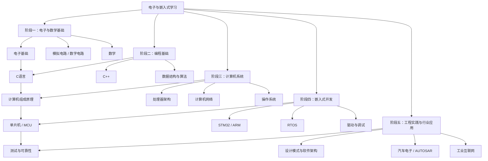

# 电子与嵌入式（EE）

本领域覆盖电路基础、C/C++、计算机系统、MCU、实时操作系统、驱动开发、测试与汽车电子。建议沿着“基础原理 → 编程与系统 → 嵌入式实践 → 工程应用”的顺序学习，并通过项目把各阶段连接起来。

## 学习路线

## 按主题进入

### 基础知识

- [[电子基础]]：电路、元器件与基本测量
- [[模拟电路]] / [[数字电路]]：模拟与数字电路基础
- [[数学]]：工程计算与算法所需数学
- [[计算机组成原理]] / [[处理器架构]]：处理器、存储器与指令执行

### 编程与系统

- [[C语言]] / [[CPP]]：嵌入式常用编程语言
- [[数据结构与算法]]：常用数据结构、算法与复杂度
- [[操作系统]] / [[RTOS]]：进程、任务调度、同步与实时性
- [[计算机网络]]：网络分层与通信基础
- [[设计模式]] / [[面对对象]]：可维护的软件设计

### 嵌入式实践

- [[单片机介绍]] / [[51单片机]] / [[MCU]] / [[STM32]] / [[ARM]]
- [[看门狗]]：故障检测与系统恢复
- [[测试]]：单元测试、集成测试与调试方法
- [[工具]] / [[常用芯片手册]]：开发工具与芯片资料

### 行业与进阶

- [[新能源汽车]]：汽车电子与电动化
- [[人工智能]]：机器学习与智能应用基础
- [[工业互联网]]：设备互联与工业系统
- [[行业报告]] / [[求职招聘]]：行业信息与职业发展
- [[英语]]：技术阅读与资料检索

## 推荐实践顺序

1. 用 C 语言实现基础数据结构与常用算法。
2. 在 MCU 上完成 GPIO、定时器、UART、ADC 等外设练习。
3. 增加中断、DMA、任务调度与故障处理。
4. 为驱动和业务逻辑增加可复现的测试。
5. 选择一个完整项目，记录需求、架构、验证结果与问题复盘。

## 相关入口

- [[Area]]：长期学习领域总览
- [[CS]]：计算机科学系统学习路径
- [[AI]]：人工智能领域
- [[AUTOSAR]]：汽车软件架构专题

## 新增迁移笔记

### MCU 与嵌入式实践

- [[1000问/基础概念Q2-MCU与MPU选型]]：MCU / MPU 架构差异与选型。
- [[驱动开发/单片机驱动开发指南与框架]]：驱动分层、开发流程与框架选型。
- [[1000问/看门狗与可靠性设计]]：IWDG、WWDG、任务监督与健康喂狗。
- [[1000问/低功耗设计与唤醒管理]]：睡眠模式、唤醒验证与功耗测量。
- [[1000问/DMA数据搬运与缓存一致性]]：DMA 传输模式、环形缓冲与 Cache 一致性。
- [[1000问/未定义行为专题-Q1-Q4]]：C 语言未定义行为专题。
- [[1000问/多文件组织Q3-前置声明与头文件依赖]]：前置声明与头文件依赖治理。
