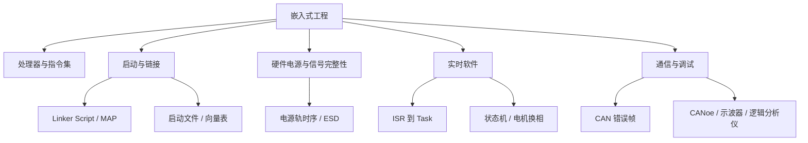

# 嵌入式工程进阶与实战补充

本页补齐 Flomo「嵌入式学习」分类中尚未在 NotesBook 找到来源 ID 的 12 条有效卡片。内容横跨指令译码、链接脚本、电源时序、BLDC、FreeRTOS、CAN 故障、调试方法与学习资源。已在硬件、电机控制、通信专题中归档的卡片不重复复制；空白占位卡不作为知识条目迁移。

## 工程知识关联图



## 迁移说明

- 原始内容保留在每张卡片中，来源 ID 与 Flomo 链接可追溯。
- 对原文中带有疑问语气的技术推断，后续复用时应通过芯片数据手册、工具日志或实测确认，不直接视为通用结论。
- 学习网站、书籍和视频类条目归入资源索引，不等同于已经完成内容阅读或验证。

---

## 1. 芯片识别指令，靠的不是“理解”文字，而是<u><mark>内部的硬件电路对特定二进制数字（0和1）做出的反应</mark></u>。这个过程就像用一套固定的“密码本”去匹配信号。

**Flomo 来源：** https://v.flomoapp.com/mine/?memo_id=MjU1OTI4ODA5

芯片识别指令，靠的不是“理解”文字，而是<u><mark>内部的硬件电路对特定二进制数字（0和1）做出的反应</mark></u>。这个过程就像用一套固定的“密码本”去匹配信号。

核心机制完全取决于指令译码器（Instruction Decoder）：

1. 取指与译码：CPU从内存取出一条由0和1组成的指令（如10110000）。译码器这个纯硬件电路会立刻将其拆解，识别出“操作码”（干什么，如加法）和“操作数”（对谁干）。

2. 生成控制信号：译码器根据操作码，瞬间接通或断开内部特定的电路开关，生成一系列“微操作”信号，指挥ALU（计算单元）、寄存器等部件协同工作。


<u><mark>至于不同架构（如x86和ARM）如何区分，关键在于“密码本”完全不同，硬件解码器也只认自己那套</mark></u>：

- 硬件不兼容（原生运行）：x86芯片的解码器只认识x86的“密码本”。如果你把ARM的二进制指令强行喂给它，解码器会因查不到对应规则而直接报“无效指令”异常，导致程序崩溃。所以手机ARM芯片无法直接安装电脑的x86软件。

- 跨架构运行（翻译层）：在苹果M系列（ARM）芯片上运行x86软件时，靠的是二进制翻译器（如Rosetta 2）。它像一个实时“同声传译”，在软件运行前，先把x86的“外语”指令逐条翻译成ARM的“母语”指令，再将翻译后的ARM指令喂给硬件解码器去执行。

- 内部异构核心：现代SoC（如手机芯片）内部有CPU、GPU、NPU等不同核心，每个核心都有自己的专用解码器。操作系统在分配任务时，会直接把代码发给对应“语种”的核心。


总结一句话：<u><mark>芯片只认自己出厂时焊死的“二进制词典”</mark></u>。想在不同架构间运行，必须依赖上层的编译器（把高级语言转成该架构的0和1）或翻译器（运行前转码）。

<p></p>

💡<u>指令集是焊死在芯片里面的&#34;密码本&#34;，密码本不一样，解析数据不一样。</u>

#Area/学习管理/嵌入式学习

#Archive/MigratedNotion<br>
#Archive/DeleteCandidate


---

## 2. Linker File（链接脚本）进阶——语法深度、多编译器和 AUTOSAR 实战

**Flomo 来源：** https://v.flomoapp.com/mine/?memo_id=MjQ5MzQ1Nzg5

**Linker File（链接脚本）进阶——语法深度、多编译器和 AUTOSAR 实战**

第1张卡覆盖了核心三要素和常见错误。这张卡再往深一层——语法细节、多编译器差异、高级场景。

**一、GNU LD 链接脚本语法深度**

**PROVIDE——条件式符号定义**

定义符号，但只在其他目标文件没有定义时才生效。用在启动文件里非常常见：

PROVIDE(\_\_stack\_top = ORIGIN(RAM) + LENGTH(RAM)); PROVIDE(\_\_heap\_start = ADDR(.bss) + SIZEOF(.bss));

好处：链接脚本提供一个默认值，但启动文件可以覆盖它。

**KEEP——阻止 --gc-sections 丢弃段**

SECTIONS { .isr\_vector : { KEEP(\*(.isr\_vector)) /\* 中断向量表——即使没被引用也不能被 GC \*/ } > FLASH }

如果不加 KEEP，链接器的 --gc-sections（垃圾回收）可能认为 .isr\_vector 没有被任何代码"调用"（因为没有函数直接跳转到它——CPU 硬件根据向量表跳转的）——回收掉——ECU 启动不了。

**ASSERT——编译期断言**

ASSERT(SIZEOF(.text) + SIZEOF(.rodata) < 512K, "FLASH 空间不足，代码+只读数据超过 512KB"); ASSERT(ABSOLUTE(ADDR(.bss)) + SIZEOF(.bss) < 0x20020000, "BSS 段超出 RAM 范围");

在 CI 构建时特别好用——编译失败比"上电后跑飞了"好在 CI 阶段就发现。

**ALIGN——地址对齐**

. = ALIGN(4); /\* 当前地址对齐到 4 字节 \*/ . = ALIGN(16); /\* 对齐到 16 字节（Cache Line）——适合多核共享数据 \*/

**SORT——文件名的排序控制**

SECTIONS { .text : { \*(.text .text.\*) /\* 所有 .text 段，按文件名排序 \*/ SORT(\*)(.text .text.\*) /\* 显式按文件名排序 \*/ } > FLASH }

在确定性的二进制构建（reproducible build）中，SORT 保证每次编译生成的二进制完全一致——即使源文件的扫描顺序变了。

**二、三种链接脚本格式的对比——GNU LD vs IAR .icf vs ARMCC scatter**

**GNU LD (.ld)**

- 语法：类 C（大括号 + 赋值表达式）

- MEMORY 和 SECTIONS 分开定义

- 符号用 symbol = expression;

- 工具链：arm-none-eabi-gcc / GCC for ARM / RISC-V

- 优点：开源生态、最广泛的支持


**IAR .icf（ILINK Configuration File）**

- 语法：类 VHDL（关键字驱动）

- 用 define region 定义存储区，用 place in / place at 定义放置规则

- 用 export symbol 导出符号


define region FLASH\_region = mem:\[from 0x08000000 to 0x080FFFFF\]; define region RAM\_region = mem:\[from 0x20000000 to 0x2001FFFF\]; place in FLASH\_region { section .text }; place in RAM\_region { section .data, section .bss }; export symbol \_\_stack\_top = 0x20020000;

- 优点：IDE 集成好，带图形化的 linker 配置向导

- 跟 GNU LD 最大的不同：.icf 用关键字描述放置逻辑，不用地址计算表达式


**ARM scatter-loading（ARMCC / Keil）**

- 语法：描述性格式（.sct 后缀）

LR\_IROM1 0x08000000 0x00100000 { ER\_IROM1 0x08000000 0x00100000 { \*.o (RESET, +First) \*(InRoot$$Sections) .ANY (+RO) } RW\_IRAM1 0x20000000 0x00020000 { .ANY (+RW +ZI) } }

- 优点：加载时域（LR）和执行时域（ER）的概念清晰——非常适合 XIP（Flash 原地执行）和 Overlay

**格式迁移的要点：**

- GNU LD → IAR .icf：MEMORY → define region，SECTIONS → place in / place at

- IAR .icf → GNU LD：反方向

- 项目中如果存在"PC 用 GCC 调试、但标定用 IAR 编译"的场景——两份链接脚本要保持逻辑一致


**三、AUTOSAR 项目中链接脚本的高级功能**

**3.1 Calibration Parameter 专属段**

AUTOSAR 项目中，标定（Calibration）数据需要跟代码分开存放——方便标定工具在运行时修改。

SECTIONS { /\* 标定参数：放在 RAM 中，运行时可通过 XCP/CCP 修改 \*/ .calib : { \*(.calib) /\* 所有标定参数 \*/ \*(.Calprm) /\* AUTOSAR 标准标定段 \*/ } > RAM AT > FLASH /\* 常数列：在 Flash 中，运行时只读 \*/ .calib\_const : { \*(.calib\_const) } > FLASH }

**3.2 多核 VirtAddress 映射**

AUTOSAR 多核项目中，每个核的本地 RAM 地址空间不同——链接脚本需要做地址映射。

以 TC3xx 为例：

- Core0 本地 RAM：0x70000000~0x7003FFFF

- Core1 本地 RAM：0x60000000~0x6003FFFF

- 共享 LMU RAM：0x90000000~0x9003FFFF


链接脚本需要把 Core0 的 .data 放到 0x70000000+、Core1 的 .data 放到 0x60000000+、共享数据放到 0x90000000+。

关键： **Core0 的代码引用了共享变量——链接器看到的地址是 0x90000000——但 Core0 通过 LMU 映射到本地地址空间访问。** 如果链接脚本配错了（把共享变量放在了 Core0 的本地 RAM），Core1 就读不到。

**3.3 NvM Block 地址空间预留**

AUTOSAR 的 NvM 模块需要知道每个 Flash Block 所在的物理地址。链接脚本里要预留一个"不会放代码"的区域：

MEMORY { FLASH\_CODE (rx) : ORIGIN = 0x08000000, LENGTH = 896K /\* 代码区 \*/ FLASH\_NVM (rx) : ORIGIN = 0x080E0000, LENGTH = 128K /\* NvM 存储区（物理地址固定） \*/ }

然后 NvM 配置工具中把 Block 的物理地址指向 FLASH\_NVM 区域。

**3.4 链接后处理——校验码注入**

OTA 刷写需要 CRC/SHA 校验。固件编译后，链接器不知道完整的固件大小——需要编译后做"链接后处理"：

1. 编译 \+ 链接 → 生成 .elf

2. 用 objcopy 提取 .bin（不带校验码）

3. 算整个 .bin 的 CRC

4. 把 CRC 值写入 .bin 的末尾（或指定地址）

5. 重新生成带校验码的 .bin


这个过程不是链接脚本本身做的事——是编译流程（Makefile/CI）的一部分。但链接脚本需要为 CRC 值预留地址空间：

.wrapper\_info : { . = ALIGN(4); KEEP(\*(.wrapper\_info)) } > FLASH

然后在 C 语言里定义一个结构体占据这个段：

\_\_attribute\_\_((section(".wrapper\_info"))) const struct { uint32\_t magic; // 魔数标记 uint32\_t image\_size; // 固件大小 uint32\_t crc32; // CRC（编译后填充） uint32\_t version; // 版本号 } wrapper = { 0xA5A5A5A5, 0, 0, 0 };

**四、调试进阶：.map 文件"三层分析法"**

.map 文件是链接脚本的执行报告。三层逐层看：

**第一层：段摘要**

Memory Configuration Name Origin Length Attributes FLASH 0x08000000 0x00100000 xr RAM 0x20000000 0x00030000 xrw

→ 确认芯片的内存布局跟 datasheet 一致。

**第二层：段详细溢出分析**

.text 0x08000000 0x3A4E0 .../main.o(.text) 0x08000000 0x1234 .../can.o(.text) 0x08001234 0x890 .../dcm.o(.text) 0x08001AC4 0x2BC0

→ 每个目标文件的代码大小。如果某个模块膨胀了（比如 DCM 加了新功能，.text 从 0x1A00 涨到 0x2BC0）——一眼看出是谁在"吃 Flash"。

**第三层：跨段地址分析**

.isr\_vector 0x08000000 0x1A0 .text 0x080001A0 0x3A4E0 .rodata 0x0803A680 0x1234 .data 0x20000000 0x5678 LOAD 0x0803B8B4

→ .data 的 VMA（运行地址）= 0x20000000，LMA（加载地址）= 0x0803B8B4。启动代码从 LMA 拷贝到 VMA——拷多大？5120 字节（0x5678-0x0000）。拷过去后 RAM 还剩多少？从 0x20005678 到 0x20030000（约 168KB）。如果某个 BSS 段突然变大——RAM 不够了——MAP 文件里一眼能看到。

**五、堆问题法·Linker File 100 问（前 10 问）**

01. .text 段在 FLASH 中的地址由谁决定——链接脚本还是启动文件？

02. .data 段为什么需要两个地址（LMA 和 VMA）？

03. .bss 段的初始值是谁给的？为什么启动文件要清零它？

04. KEEP() 不加上去，链接器什么时候会丢掉中断向量表？

05. 链接后 .map 文件里出现 undefined reference to \_sdata——是链接脚本没写好还是启动文件没引用？

06. 两个目标文件定义了同名全局变量——链接器会报错吗？还是合并？

07. PROVIDE 和 EXTERN 的区别是什么？

08. ASSERT 在链接脚本里能检查什么？

09. --gc-sections 开启后，如何防止标定数据被回收？

10. .ld 文件和 .icf 文件的语法能否互相转换？需要改哪些关键字？


📎 第1卡：Linker File基础 → [https://v.flomoapp.com/mine/?memo\_id=MjQ5MzQ1NTYx](https://v.flomoapp.com/mine/?memo_id=MjQ5MzQ1NTYx)<br> 📎 嵌入式三问·其一（启动文件/链接脚本/VTOR）→ [https://v.flomoapp.com/mine/?memo\_id=MjQ5MDI2MDAw](https://v.flomoapp.com/mine/?memo_id=MjQ5MDI2MDAw)<br> 📎 C语言三问·其二（const段与链接脚本）→ [https://v.flomoapp.com/mine/?memo\_id=MjQ5MDI3NjAz](https://v.flomoapp.com/mine/?memo_id=MjQ5MDI3NjAz)

#Area/学习管理/嵌入式学习

#Archive/MigratedNotion<br>
#Archive/DeleteCandidate


---

## 3. 三问答·其二：MCU 电源轨时序——VDDIO 先于 VDD\_Core 上电，ESD 二极管会不会烧

**Flomo 来源：** https://v.flomoapp.com/mine/?memo_id=MjQ5MzM1NDg2

**三问答·其二：MCU 电源轨时序——VDDIO 先于 VDD\_Core 上电，ESD 二极管会不会烧**

**问题本质：** MCU 的 I/O 引脚内部有 ESD 保护二极管——阳极接 GND，阴极接 VDDIO（或 VDD\_Core，取决于 I/O 电源域的设计）。如果 VDDIO 已经上电（比如 3.3V）但 VDD\_Core 还没上电（0V），外部设备通过 I/O 引脚向 MCU 灌入 3.3V——ESD 二极管的正向压降约 0.7V——3.3V - 0.7V = 2.6V 施加在芯片内部电路上。如果内部电路还没上电，这个 2.6V 可能通过 ESD 二极管反灌到 VDD\_Core 网络——Vin/2 电平导致内部逻辑处于不确定状态——最坏情况：闩锁（Latch-up）或 ESD 二极管过流损坏。

**三个方案，从简单到可靠：**

**方案 A：读 datasheet 的 "Power-up Sequence" 确认风险（最低成本，但需要正确解读）**

绝大多数汽车级 MCU（TC3xx、S32K、RH850）的 datasheet 都有 "Power-up and Power-down Sequence" 章节，里面有：

- VDD\_Core 和 VDDIO 的上电顺序要求（通常要求 VDD\_Core 先于或同时于 VDDIO）

- VDDIO 和 VDDA 的关系（通常 VDDA 必须 ≥ VDDIO）

- 各电源轨之间的最大压差允许值（比如 VDDIO - VDD\_Core ≤ 0.5V）


如果 datasheet 写明 "VDDIO 不能先于 VDD\_Core 上电"——那就说明这个芯片的 I/O 电源域依赖于 Core 电源域先就绪。如果没写但也没禁止——可以用实验验证：让 VDDIO 先上电、Core 后上电，量 I/O 引脚在 Core 上电前的状态——如果不正常（电压反灌/电流倒灌），就不能这么用。

**但有一个常见的陷阱：** datasheet 的时序要求通常是"recommended"，不是"absolute maximum"。有些芯片上了电也能工作——但长期可靠性下降（ESD 二极管反复承受反向偏置 → 寿命缩短）。项目中的做法是：安全第一——按照时序要求来设计，不依赖"大部分时间能工作"。

**方案 B：加电压监控芯片（如 TPS3808）（推荐——一劳永逸）**

TPS3808 是 TI 的电压监控复位芯片——监控 VDD\_Core 的电压是否达到阈值（如 1.2V），输出一个 open-drain 的 RESET 信号接 MCU 的复位引脚。当 VDD\_Core 未达到阈值时，RESET 保持低电平——MCU 不启动——IO 引脚处于高阻态（Hi-Z），ESD 二极管不会导通。

但这只解决了"MCU 不启动时 I/O 不会反灌"的问题—— **电源轨本身的上电时序还是要由电源芯片（PMIC/DC-DC/LDO）的使能顺序来保证。** TPS3808 只做监控和复位，不做电源轨的时序控制。

更好的做法：用 PMIC（如 TPS65218、TC3xx 配套的 TLF35584）——它内置了电源轨的上电时序控制，按配置好的顺序依次使能各电源轨。

**方案 C：用 PMIC 的使能顺序控制时序（最可靠但成本最高）**

PMIC 通过 EN（Enable）引脚的延迟链来控制各电源轨的上电顺序。比如：EN\_Core 先使能 → Core LDO 输出 1.2V → 延迟 1ms → EN\_IO 使能 → IO LDO 输出 3.3V → 延迟 1ms → VDDA LDO 输出 3.3V。完全可控，无需额外器件。

**工程建议：**

- 样机阶段：读 datasheet 确认要求 + 示波器量各电源轨的上电顺序（看是否满足 datasheet 的时序图）

- 量产阶段：用 PMIC 或 使能延迟电路 保证时序。不依赖"datasheet 说可以容忍同时上电"——不同批次芯片的 ESD 参数有离散性，量产时不能赌


📎 7/30 今日三问 → [https://v.flomoapp.com/mine/?memo\_id=MjQ5MjU2NzE0](https://v.flomoapp.com/mine/?memo_id=MjQ5MjU2NzE0)

<p></p>

#Area/学习管理/嵌入式学习

#Archive/MigratedNotion<br>
#Archive/DeleteCandidate


---

## 4. 电机控制三问·其一：从 AUTOSAR 状态机切入 BLDC 换相——同一个"状态+时序"问题

**Flomo 来源：** https://v.flomoapp.com/mine/?memo_id=MjQ5MDI3Mjg0

**电机控制三问·其一：从 AUTOSAR 状态机切入 BLDC 换相——同一个"状态+时序"问题**

（来自7/28晚电机控制专题三问。五大学习法：费曼学习法→用"做过的熟悉概念"解释"新概念"，卡壳点就是新领域最难啃的点。）

**BLDC 的六步换相 vs AUTOSAR BswM 状态机**

第一次看 BLDC 六步换相时，第一反应是：这不就是 BswM 的规则链吗？只是动作从"切换通信模式"变成了"切换导通相"。

**BswM 的做法**：一个条件集（比如「刷写模式激活 AND 安全解锁状态 ON」）→ 触发一个动作（关闭应用报文）。规则按优先级排，条件发生变化时重新评估。

**BLDC 六步换相的做法**：一个位置条件（「霍尔传感器检测到转子转过 60° 电气角」）→ 触发一个动作（关断上一相、导通下一相）。换相的顺序表就是一张 6 状态的有限状态机。

区别在于：

- BswM 的状态切换是 **事件驱动的**（收到某条 CAN 消息才变）

- BLDC 的换相是 **时序驱动的**（转子到了某个位置就必须换，不管 MCU 有没有其他事情要处理）


所以 BLDC 最核心的工程问题不是"换相逻辑怎么写"，是\*\*"换相中断来了，CPU 能不能在死线之前处理完"\*\*——这跟在 AUTOSAR 里做诊断服务时问的问题是一样的：这个服务最长执行时间是 50ms，但 S3Server 超时是 20ms——时序冲突。

**FOC 的 Park/Clark 变换 vs CAN 信号解析的坐标系变换**

另一个觉得自己做过的东西跟电机控制对上了的点——Park 变换（静止坐标系→旋转坐标系）。

CAN 信号解析里有一个类似的事：DBC 定义的信号在 byte0~byte7 里是"物理比特分布"，MCU 收到后要按 DBC 的定义把比特重新排列成物理值——本质也是一次坐标系变换。只是 CAN 是从"总线的比特坐标"变到"应用层的物理坐标"，FOC 是从"定子的三相坐标"变到"转子的 dq 坐标"。

发现的规律： **嵌入式里大部分"难理解"的概念，本质上都是在翻译——把一种坐标/状态/协议的表示法翻译成另一种。** 理解了这个，学新协议/新算法时的认知负担就减了一半——不用"从头学一门新语言"，只需要学"怎么从自己的语言翻译过去"。

📎 其二：UART波特率错位排查 → [https://v.flomoapp.com/mine/?memo\_id=MjQ5MDI2NDIx](https://v.flomoapp.com/mine/?memo_id=MjQ5MDI2NDIx)

#Area/学习管理/嵌入式学习

#Archive/MigratedNotion<br>
#Archive/DeleteCandidate


---

## 5. 嵌入式三问·其三：FreeRTOS 中 ISR 到 Task 的数据传递——队列 vs 信号量 vs 共享变量

**Flomo 来源：** https://v.flomoapp.com/mine/?memo_id=MjQ5MDI2MDY0

**嵌入式三问·其三：FreeRTOS 中 ISR 到 Task 的数据传递——队列 vs 信号量 vs 共享变量**

（来自7/28晚嵌入式专题三问。五大学习法：卢曼卡片盒→把每种方案写一张卡，再串成一张"选型决策树"。）

**三种机制的适用范围和代价**

**1\. 队列（xQueueSendFromISR / xQueueReceive）**

当一个 ISR（比如 CAN 接收中断）需要把一整段数据传给一个 Task 时，队列是最直接的选择。

使用方式：

- ISR 中调用 xQueueSendFromISR(queue, &data, &pxHigherPriorityTaskWoken)

- Task 中循环调用 xQueueReceive(queue, &data, portMAX\_DELAY)

- 当 pxHigherPriorityTaskWoken = pdTRUE 时，在 ISR 退出后手动触发一次上下文切换


踩过的坑：

- **队列深度配小了**：CAN 接收中断的触发频率 > Task 的处理速度 → 队列满后数据丢掉。调试时看到的现象是"部分 CAN 报文收到了但没处理"——看起来像丢帧，实际上是队列满了 ISR 发不进去。修复：队列长度 = (ISR 峰值频率 / Task 处理频率) × 安全系数 1.5。

- **FromISR 后缀忘加**：在 ISR 里用了 xQueueSend（Task 版本）——FreeRTOS 不会报错，但会破坏临界区状态，引起随机 hard fault。


**2\. 信号量（xSemaphoreGiveFromISR / xSemaphoreTake）**

当 ISR 只需要"通知 Task 去处理一件事"，不需要传具体数据时——信号量比队列更轻量。

使用方式：

- ISR 中调用 xSemaphoreGiveFromISR(sem, &pxHigherPriorityTaskWoken)

- Task 中调用 xSemaphoreTake(sem, portMAX\_DELAY)——take 到后去轮询共享状态或外设寄存器


踩过的坑：

- **信号量的"通知丢失"**：ISR 连续两次 give→Task 只 take 了一次（信号量的计数值从0→1→2，Task take 一次后回到1）→第二次通知没被处理。如果用二进制信号量（Binary Semaphore），连续两次 give 后计数值是1——丢了一次。如果用计数信号量（Counting Semaphore），计数值不会丢，但 Task 需要循环 take 直到计数值归零。

- **信号量溢出**：ISR 触发频率远高于 Task 的处理速度→信号量计数值不断累加→FreeRTOS 的信号量最大值默认 65535→如果真的溢出（极高频 ISR），信号量变成 0→ISR 再也唤醒不了 Task。修复：用 xSemaphoreCreateCounting 时指定最大值。


**3\. 共享变量 + 临界区**

当数据量很小（比如一个字节的状态标志、一个 ADC 采样值）时——直接写共享变量＋临界区保护就够了，不需要队列或信号量的开销。

使用方式：

- ISR 中直接写全局变量（不需要临界区——ISR 天然不会被同级/更低优先级中断打断）

- Task 中读变量时用 taskENTER\_CRITICAL() / taskEXIT\_CRITICAL() 保护


踩过的坑：

- **变量不是 volatile**：Task 的 while 循环里读共享变量时，编译器优化把变量值缓存在寄存器里——ISR 改了变量，Task 读到的还是寄存器里的旧值。修复：所有 ISR 和 Task 共享的变量加 volatile。

- **读了一个"写到一半"的值**：变量是 32-bit，但在 8-bit MCU 上——Task 读到高位字节时 ISR 改了低位字节 → 值"撕裂"。修复：用 memcpy 一次性复制或用临界区包住读取。


**选型决策树**

ISR 需要传具体数据吗？ ├─ 是 → 队列（QueueFromISR） │ └─ 注意队列深度 ≥ 峰值频率/处理频率 × 安全系数 └─ 否（只需通知 Task 去干活） ├─ 通知频率 ≤ 处理频率 → 二进制信号量 ├─ 通知频率 > 处理频率 → 计数信号量（注意最大值配置） └─ 数据量极小（1个字节）→ 共享变量 + volatile + 临界区

**实际项目中用得最多的是队列**——CAN/LIN 接收中断属于"既需要传数据（帧内容）、又需要通知 Task 去处理"的场景，队列是最匹配的。信号量用在"按钮中断→Task 处理按钮逻辑"这种不需要传数据的场景。共享变量用在 ADC 采样完成中断→显示 Task 读取采样值的场景。

📎 其二：CAN 信号解析故障排查方向 → [https://v.flomoapp.com/mine/?memo\_id=MjQ5MDI2MDMx](https://v.flomoapp.com/mine/?memo_id=MjQ5MDI2MDMx)<br> 📎 其一：上电到 main() 的启动文件坑 → [https://v.flomoapp.com/mine/?memo\_id=MjQ5MDI2MDAw](https://v.flomoapp.com/mine/?memo_id=MjQ5MDI2MDAw)

#Area/学习管理/嵌入式学习

#Archive/MigratedNotion<br>
#Archive/DeleteCandidate


---

## 6. 嵌入式三问·其二：CAN硬件排查第5篇该写什么——从"信号波形"到"信号含义"的断层

**Flomo 来源：** https://v.flomoapp.com/mine/?memo_id=MjQ5MDI2MDMx

**嵌入式三问·其二：CAN硬件排查第5篇该写什么——从"信号波形"到"信号含义"的断层**

（来自7/28晚嵌入式专题三问。五大学习法：MECE框架思维→把 CAN 问题按"物理层/链路层/应用层"分类入格，看第5篇该补哪个格子。）

**已写完的4篇覆盖了什么：**

- 第1篇：终端电阻（物理层→链路特性）

- 第2篇：差分电压/Bus Off（物理层→电平异常）

- 第3篇：采样点/Error Frame（链路层→信号时序）

- 第4篇：TEC/REC/Error Passive（链路层→错误状态机）


四大问题的归类：

- **物理层**（线缆/收发器/电平）：第1篇+第2篇

- **链路层**（时序/采样/错误计数）：第3篇+第4篇

- **应用层**（信号解析/数据库/DBC）：还没写


**所以第5篇应该补"应用层诊断"——当你确信物理层和链路层都没问题，但解析出来的信号值就是不对。**

**场景：CANoe Trace 里看到报文正常收发、无 Error Frame、电平标准——但应用层读出的车速是 255km/h**

物理层：CANH/CANL 差分电压正常（2.0V/2.5V），终端电阻 60Ω，采样点 80%——通过。<br> 链路层：无 Error Frame，TEC=0，REC=0——通过。

但 DBC 里解析出的车速信号（0x123 报文的 byte2-byte3，scale=0.01，offset=0，unsigned）显示 25500——255km/h。这个速度在停车场不可能。

排查方向：

**方向 A：DBC 信号定义与实际发送端不一致**

发送端 ECU（比如 ABS）把车速放在 byte2-byte3，但 DBC 里定义的车速信号起始位在 byte4-byte5。接收端按 DBC 解析，读到的是对端发了另外一帧数据的 byte4-byte5——两个完全不相关的信号拼到一起，算出一个无效值。

修复：拿 DBC 跟 TIER1/内部的设计文件逐字段对一遍——起始位（StartBit）、字节序（Intel/Motorola）、缩放因子、偏移都要对。

**方向 B：CAN ID 过滤导致解析到了"错误帧"的数据**

ECU 收到两个 CAN ID：0x123（车速）和 0x321（引擎转速）。如果 CanIf 的 PduIdMapping 给这两个 ID 配反了——车速信号用引擎转速的 DBC 模板来解析——结果是"看起来像车速值、是引擎的比特分布"。

**方向 C：信号跨多个 CAN 帧时的拼帧错误**

车速信号被拆到两帧中传输（比如 0x123 发高位部分，0x124 发低位部分）。接收端用 PduR 的路由把两帧拼回一个信号——但如果只收到 0x123 没收到 0x124（比如 0x124 被错误过滤了）——拼出来的信号少了一半数据，输出异常值。

**第5篇的结构建议：**

1. **症状分类**：解析值=0xFF/最大范围值 / 解析值跟实际物理量对不上 / 某个信号忽大忽小

2. **排查路径**：先确认物理层正常 → 查 DBC 定义 → 查 PduIdMapping → 查 DBC vs 发送端设计文档 → 查信号拼帧逻辑

3. **实战案例**：某 ECU 读取的 BMS 电池温度异常，查了一圈发现是 DBC 里信号的 Motorola/Intel 字节序定义跟 BMS 实际发送的不一致


📎 其一：上电到 main() 的启动文件坑 → [https://v.flomoapp.com/mine/?memo\_id=MjQ5MDI2MDAw](https://v.flomoapp.com/mine/?memo_id=MjQ5MDI2MDAw)<br> 📎 专栏⑥·第3篇：错误帧/采样点 → [https://v.flomoapp.com/mine/?memo\_id=MjQ4NTYwNzgx](https://v.flomoapp.com/mine/?memo_id=MjQ4NTYwNzgx)

**专栏⑥进度：4/10篇。第5篇建议方向：CAN 信号解析故障排查。**

#Area/学习管理/嵌入式学习

#Archive/MigratedNotion<br>
#Archive/DeleteCandidate


---

## 7. CANoe 中 CAN 总线错误帧类型及排查方法**（读文章摘要）

**Flomo 来源：** https://v.flomoapp.com/mine/?memo_id=MjQ4OTU2NzUz

**CANoe 中 CAN 总线错误帧类型及排查方法**（读文章摘要）

来源：微信公众号「赞哥哥s」— 详解CANoe中CAN总线几种常见的错误帧类型及排查方法

**五种协议错误检测类型**

- **Stuff Error（填充错误）**：5同极性位后未插入反极性填充位，连续6个同极性位。根因：波特率/采样点不一致、Classic节点收到CAN FD帧、边沿抖动。

- **Form Error（格式错误）**：固定为隐性的字段（CRC Delimiter/ACK Delimiter/EOF）被检测为显性。根因：位时序偏差、总线被持续拉低。

- **CRC Error（校验错误）**：接收方重算CRC与帧内CRC字段不一致。根因：传输中数据位损坏、干扰反射、位时序偏移。

- **Bit Error（位错误）**：发送方监测总线电平与自身发送不一致。根因：总线短路/开路、收发器损坏、波特率严重不匹配。

- **ACK Error（应答错误）**：发送方在ACK Slot未检测到显性位（无人应答）。根因：单节点测试、接收方均已Bus-Off、波特率完全不匹配。


**错误帧结构与传播**

- Error Active节点发6个连续显性位（Active Error Flag）→ 强制打断当前帧

- Error Passive节点发6个连续隐性位（Passive Error Flag）→ 可能被覆盖

- 出错数据帧不成功完成，发送方自动重传


**TEC/REC 状态机**

- Error Active: TEC≤127且REC≤127 → 正常通信，发Active Flag

- Error Passive: TEC>127或REC>127 → 仍可通信，发Passive Flag，发送间隔受限

- Bus-Off: TEC≥256 → 断开总线，需应用层恢复


**排查思路**

- Stuff/Form Error优先查位时序（波特率/采样点/Classic-FD混用）

- CRC Error查干扰与偶发物理故障

- Bit Error查硬件与总线电平

- ACK Error查"有没有听众"（单节点正常；多节点仍ACK → 查Bus-Off）

- 用Decision Tree十分钟定方向，半小时内定位根因


**比对已有笔记 → 专栏⑥（CAN硬件排查系列）已覆盖大部分内容，且更偏实作场景：**

- 第3篇：采样点/错误帧 → 采样点对齐+Error Frame关联分析

- 第4篇：TEC/REC/Error Passive → 错误计数与Bus Off前兆判断


这篇文章可以作为「错误帧类型速查表」补充到专栏⑥的排查工具箱。

📎 专栏⑥·第3篇：错误帧/采样点 → [https://v.flomoapp.com/mine/?memo\_id=MjQ4NTYwNzgx](https://v.flomoapp.com/mine/?memo_id=MjQ4NTYwNzgx)<br> 📎 专栏⑥·第4篇：TEC/REC → [https://v.flomoapp.com/mine/?memo\_id=MjQ4ODczNjQ3](https://v.flomoapp.com/mine/?memo_id=MjQ4ODczNjQ3)

<p></p>

#Area/学习管理/嵌入式学习

#Archive/MigratedNotion<br>
#Archive/DeleteCandidate


---

## 8. 嵌入式系列·新增专题：实战排查与高级调试

**Flomo 来源：** https://v.flomoapp.com/mine/?memo_id=MjQ3Mjg0OTcw

嵌入式系列·新增专题：实战排查与高级调试

▎ **CAN总线故障排查实战**

1. CAN总线只有两个节点，一个发一个收——但收方就是收不到。用万用表量CAN\_H和CAN\_L之间的电阻——正常应该是60Ω（两个120Ω终端电阻并联）。如果你量到是120Ω，说明另一个节点没接终端电阻——那收方是不是根本没把CAN收发器使能？如果量到是0Ω，说明CAN\_H和CAN\_L短路了——布局上这两根线是不是挨得太近？

2. 总线通信正常，但某个ECU发出来的报文ID跟DDD（诊断需求文档）上写的不一样——是代码里设错了CAN ID（CAN Identifier），还是ARXML配置里发的帧（Frame）和信号（Signal）映射错了？怎么用CANoe的"发送窗口"手动发一下预期的ID来确认是对面的问题？

3. 高速CAN（250kbps/500kbps）总线长度太长导致信号衰减——一般500kbps的CAN总线理论最大长度约250米。如果一个实际项目里总线超过这个长度（比如工程机械），你会看到什么现象？CRC错误帧暴增是因为信号反射导致位采样错误？

4. CAN错误帧（Error Frame）频繁出现——怎么区分是"位错误"（Bit Error ——发送方监控总线发现跟发的不同）还是"填充错误"（Stuff Error ——连续6个相同位违反位填充规则）？CANoe的"Trace窗口"里的红色Error Frame上面有没有标错误类型？如果每个报文都在同一位置出错——大概率是物理层问题（节点距离过长导致信号跳变沿变缓、采样点没对准）？

5. 如果CAN总线上的一个节点离线了——其他节点能检测到吗？能——因为CAN的"节点状态监控"机制：如果一个节点连续发送Error Passive标志超过一定次数，Bus Off了，其他节点通过CAN controller的"错误计数器"和"节点监控"（Node Monitoring / Alive Counter）来判断它掉线了？


▎ **CAN FD & CAN XL 实战差异**

1. CAN FD的"数据相位"（Data Phase）比"仲裁相位"（Arbitration Phase）快——为什么能快？因为CAN FD在Data Phase不需要CAN的"位填充"（Bit Stuffing）规则覆盖整个帧，只有CRC段需要填充——所以可以提高到2Mbps甚至5Mbps。但如果总线上有个节点的收发器只支持Classic CAN（1Mbps），它看到CAN FD的2Mbps数据相位会怎么办——它会认为"这是个错误帧"从而发送Error Frame破坏整个通信？

2. 一个CAN FD网络升级时最隐蔽的坑——换了一个支持CAN FD的收发器（如TJA1044），但在DBC或ARXML里忘了把协议改成CAN FD——软件还是按Classic CAN的方式发，结果CAN FD的"EDL位"（Extended Data Length）没置位——虽然收发器支持FD但实际跑的还是Classic CAN速度？

3. CAN XL号称要替代FlexRay——它的数据段最大2048字节（vs CAN FD的64字节、Classic CAN的8字节）、速率可达10+Mbps。但在物理层上，CAN XL跟CAN FD兼容吗——CAN XL的收发器跟CAN FD不兼容，需要新的收发器（如TJA1461）——所以不上全套"从收发器到控制器"的硬件改版，不能用？


▎ **MCU 启动异常实战**

1. 上电后MCU不运行——量VDD引脚电压正常、复位引脚也正常（不是低电平）。可能是BOOT引脚配置不对——STM32的BOOT0和BOOT1电平分别对应"从Flash启动"、"从系统存储器（Bootloader）启动"、"从SRAM启动"。如果你要烧录但BOOT引脚设成了"从Flash启动"，烧录器没法通过SWD把代码写进去？

2. 程序偶尔跑飞，但不是每次上电都发生。复位后发现PC（程序计数器）停在0xFFFFFFFC或0x00000000——怎么从这些异常地址反推原因？0xFFFFFFFC对应的是"取指异常"（Prefetch Abort）——可能是代码跳转到了一个不存在的地址。那什么情况下CPU会跳到一个不存在地址——函数指针被覆写了（栈溢出破坏了函数指针的地址）？

3. HardFault处理函数里——怎么从栈里的"现场寄存器"（入栈的R0-R3、R12、LR、PC、xPSR）反推是哪个函数里出的错？读一下入栈的PC值——那个地址应该指向"导致异常的那条指令的下一条"——从.map文件或反汇编里找到这个地址属于哪个函数？

4. 用STM32CubeProgrammer烧录时提示"Device not found in DFU mode"——但明明BOOT0已经拉高了（进入系统Bootloader模式）。为什么还连不上？因为DFU（Device Firmware Upgrade）需要USB连接——如果USB的DP/DM线没接对（DP/DM反了或者没接），MCU虽然进了系统Bootloader但USB不通？


▎ **看门狗实战：防止误复位**

1. 一个产品量产后在现场偶发复位——客户录了一段视频，显示设备运行几小时到几天不等就重启一次。回来查代码发现——IWDG（独立看门狗）每500ms喂一次，但主循环里某个阻塞式的Flash擦写操作偶尔会超过500ms（因为Flash擦除在极端温度下会变慢）——怎么发现这个问题的？在喂狗的地方加一个GPIO翻转输出——用示波器量这个GPIO的波形，看看喂狗间隔是不是偶尔超过500ms？

2. 调试阶段，你不想让看门狗一直复位打断你的断点调试——但关掉IWDG的代码在写完flash后就被烧死了。怎么在调试时不让看门狗咬人？在startup代码里检查DBGMCU->CR寄存器——如果DBGMCU->CR的IWDG\_STOP位被置位（调试器请求暂停IWDG），就跳过IWDG初始化？

3. 窗口看门狗（WWDG）的窗口上限和下限是怎么设的——"不能太早喂也不能太晚喂"的边界来自什么物理原因？如果喂早了（WWDG计数器还没递减到窗口下限以下），也是复位——那什么场景下需要用窗口看门狗而不是普通看门狗？CPU死在一个"不停喂狗"的死循环里（while(1){feed\_dog();}）——如果用的是普通IWDG，这个死循环永远不会触发复位；如果用了WWDG，因为喂得太快了（超过了上限窗口），WWDG会复位？


▎ **ADC 采样异常实战**

1. 设计了一个ADC采样电路，采集一个0-3.3V的模拟信号——但软件读到的值一直偏高0.1V左右。检查VREF+引脚电压是3.30V没问题——那可能是ADC的采样时间（Sampling Time）太短了？ADC的采样电容需要时间从输入源充电——如果输入源阻抗高了（比如信号源内阻10kΩ），默认的1.5 cycle采样时间根本充不满采样电容，导致转换结果偏低——但这里是偏高？那实际可能是VSSA（模拟地）跟VSS（数字地）之间的地弹噪声？

2. 用DMA循环模式读ADC——DMA的缓冲区大小是100个uint16\_t，每100个采样点满了触发一次"半传输中断"和"传输完成中断"。在中断里把数据复制出来做均值滤波——但发现数据偶尔有"跳点"（一个异常大或异常小的值）。这是因为DMA读缓冲的时候，ADC还在继续写——DMA的指针跑到了你刚读过的位置？那应该用"双缓冲"（Double Buffer）模式——一个缓冲区给DMA写，另一个给CPU读，交替使用，读写不冲突？


▎ **I2C 总线卡死实战**

1. I2C总线上有两个从设备：一个温湿度传感器（地址0x44）、一个光照传感器（地址0x44——Shit，地址冲突了！）。两个设备地址一样怎么办？如果I2C设备有"地址引脚"（ADDR pin），可以通过设不同电平改地址——如果没有，硬件上只能加I2C多路复用器（如TCA9548A），或者软件上分时使能两个设备的供电（关掉一个再读另一个）？

2. I2C跟主设备通信了一段时间后，突然SDA一直被拉低——双方都在等对方释放总线。怎么排查是哪个设备拉低了SDA——用示波器或逻辑分析仪看SDA波形，如果一直低、但SCL还在跳——说明是从设备在"时钟拉伸"（Clock Stretching）？如果是SCL和SDA都低——大概率是I2C总线进入了死锁，给主设备复位或重新初始化I2C外设才能释放？

3. I2C通信偶尔出现"NACK"（没有应答）——主设备发了从设备地址后没收到ACK。可能的原因是（1）从设备还没准备好（上电后才刚初始化完总线），（2）从设备掉电了，（3）I2C的速率（400kHz）超过了从设备支持的最大速率。三条里哪条最容易被忽视——刚上电时从设备初始化还没完成、主设备就开始通信了？


▎ **PWM 与电机控制实战**

1. 用一个TIM通道输出50Hz的PWM驱动舵机——但舵机一直在"嗡嗡"响，抖动而不转动。检查PWM频率是对的（50Hz），占空比也设在了中间位置（1500μs）。难道是因为PWM的分辨率不够——如果TIM的ARR设得太小（比如ARR=199，PSC=7199，72MHz→50Hz），那每个计数步对应的脉冲宽度是20ms/200=100μs——50Hz舵机的死区正好在这个精度附近。把ARR设成19999（分辨到1μs），PWM突然就不抖了——这个精度差异决定了舵机能稳还是不能稳？

2. 直流有刷电机用H桥+PWM驱动——但电机低速时转速不稳定，甚至在一个位置"卡顿"。这是PWM频率太低了——电机在PWM关断期间惯性不够维持转动（"断流"导致的转矩脉动）。把PWM频率从100Hz提到10kHz——电机突然就转得丝滑了。但频率高了之后，H桥的MOSFET开关损耗也大了——这个频率的"甜点"怎么找——看电机的电气时间常数（L/R），PWM周期应该远小于电气时间常数，保证电流不会在PWM关断时完全衰减到零？

3. 用PID控制电机转速——P设了一个值，积分I也设了，但电机转速始终有静差（达不到目标转速）。看代码发现——P项的输出值限幅在了\[-100, 100\]，I项也限幅了——但I项的限幅不够，电机启动时积分快速饱和了（Integral Windup）。结果目标转速改低了，积分需要很长时间退饱和——这是不是PID控制新手最常见的踩坑点？


▎ **嵌入式Linux驱动实战**

1. 写了一个GPIO驱动的"LED闪烁"模块，insmod后/sys/class/leds下确实生成了设备——但echo 1 > brightness后LED不亮。dmesg看内核日志——"gpio\_request failed for GPIO 123"——这个GPIO号可能是被别的驱动先占用了（比如PinCtrl子系统已经在设备树里把它分配给了某个外设）。怎么看是哪个驱动占了——cat /sys/kernel/debug/gpio看当前GPIO分配情况？

2. 设备树里配了一个SPI设备，compatible = "mydev,spi-sensor"，内核也编译了对应的驱动——但probe就是没被调用。为什么——设备树里的reg属性（SPI片选号）跟驱动里的SPI设备ID不匹配？还是SPI控制器驱动本身就没初始化成功（查/sys/bus/spi/devices下有没有设备节点）？

3. 一个字符设备驱动——open和release正常，但write系统调用写入数据后，read读到的全是0。代码里write把数据存到了驱动的私有结构体buffer里，read也从同一个buffer读——但分配buffer用的是kmalloc但没有用\_\_GFP\_ZERO，write后也没有加内存屏障（wmb()）——所以read在多核系统上读到了缓存里的旧数据（cache一致性问题）？

4. 为什么用户空间的open/read/write调用在嵌入式Linux里这么慢（跟裸机程序读同一片寄存器比）？因为每次系统调用都需要"软中断"（SVC）→陷入内核 → 查VFS → 找到file\_operations → 调用驱动函数 → 拷贝数据（copy\_to\_user/copy\_from\_user）——这个路径比直接在MCU裸机里操作寄存器地址慢了至少几十微秒？


▎ **RTOS 死锁与优先级反转实战**

1. 任务A（优先级高）和任务B（优先级低）共享一个互斥量Mutex。任务B先拿到Mutex做操作，但被任务A抢占——任务A想拿Mutex但拿不到，任务B又在等某个事件（比如延时结束才释放Mutex）——高优先级任务被低优先级任务"拖死"了。这就是优先级反转。FreeRTOS的互斥量（Mutex，带优先级继承）能解决这个问题——怎么继承的？任务A抢占任务B时，调度器发现任务A在等任务B手里的Mutex，于是把任务B的优先级临时提升到跟任务A一样高——让任务B不被其他中优先级任务打断、快速执行完释放Mutex？

2. 死锁的四个必要条件（互斥、持有并等待、不可剥夺、循环等待）——在嵌入式RTOS中，代码审查时怎么快速识别潜在的死锁？最常见的模式是"两个任务各自持有一个资源然后等对方手里的另一个资源"——如果在一个项目中看到Task1拿了MutexA后申请MutexB，Task2拿了MutexB后申请MutexA——这就是定时炸弹？

3. 信号量（Semaphore）的"计数"和"二值"两种类型——如果用错了，什么场景会出问题？二值信号量（Binary Semaphore）初始值是0——适合"中断通知任务"：ISR里give，任务里take。如果误用成了计数信号量（Counting Semaphore）——每次中断都give+1，任务每次take-1——如果中断频率远高于任务处理速度，semaphore count会不断增长，最终"淹死"——任务会一直被中断淹没？


▎ **嵌入式项目中的RAII与资源管理**

1. C语言里没有RAII（资源获取即初始化）——在嵌入式C项目里，怎么确保"拿到了I2C总线后函数返回之前一定释放"？用goto cleanup模式——函数里所有return之前都goto到cleanup标签释放资源。但如果有嵌套资源（先拿MutexA再拿MutexB）——goto cleanup也要按顺序释放（先释放B再释放A）？

2. 在嵌入式C++项目里，为什么禁止动态内存分配（new/malloc）但可以用智能指针（std::unique\_ptr/std::shared\_ptr）的placement new？因为智能指针帮你在所有退出路径上自动释放——但前提是你的MCU的堆管理器（malloc/free）是确定的、不会碎片化的。在裸机环境里，你根本不应该用动态内存——那智能指针的优势也就不存在了？


▎ **Flash 磨损均衡与寿命管理**

1. 一个NVM参数每隔几秒钟就会被更新一次（比如"点火次数"计数器）——如果直接写Flash同一地址，256KB Flash的典型擦写寿命是10,000次——每几秒写一次，一天8640次，一年就超了？那这种场景必须做"写入均衡"（Wear Leveling）——用NvM的"块管理"功能，把数据写到不同的Flash物理地址上，轮换使用？

2. Flash的"读干扰"（Read Disturb）是什么——频繁读取Flash的某一块区域，会导致附近存储单元的电荷泄漏（因为读取时栅极加电压）。虽然嵌入式MCU的NOR Flash对读干扰不敏感（NAND才明显），但如果一个系统连续运行几年不停机，一直从同一片Flash区域读代码——会不会出问题？


▎ **嵌入式时序分析实战（TATC）**

1. AUTOSAR的时序分析中有个概念叫"最差执行时间"（Worst-Case Execution Time，WCET）——实际项目中怎么测量一个Runnable的WCET？在Runnable入口和出口各加一个GPIO翻转，用示波器或逻辑分析仪抓这个GPIO的脉冲宽度——然后让系统跑各种极端情况（最大数据量、中断最密集），记录最长的一次脉冲宽度——这个"长出来"的宽度就是实际WCET的近似值？

2. 任务抖动的来源有哪些？比WCET本身更大的问题往往是"任务抖动"（Jitter）——一个任务每次执行的时间不一样（因为中断干扰、共享资源的等待时间不同）。在电机控制中，PWM的定时器更新事件如果抖动超过几微秒——电机电流波形就会失真。怎么减少抖动——把时间关键的任务放在"定时器中断的最高优先级"里执行（或者用硬件PWM直接由定时器触发不需要CPU参与）？

3. AUTOSAR TATC（Timing Analysis Tool Chain）——为什么OEM会在项目里要求做"端到端时序分析"？从传感器采集（比如轮速传感器）→SWC处理→CAN通信→执行器响应（比如制动）——这个完整的"信号链"的延迟是多少？如果某个环节的延迟超标了——怎么定位是SWC处理太慢（CPU负载高）、还是CAN通信有延迟（总线负载高）？


#Area/学习管理/嵌入式学习

#Archive/MigratedNotion<br>
#Archive/DeleteCandidate


---

## 9. 学习网站： [http://staff.ustc.edu.cn/~wangxfu/](http://staff.ustc.edu.cn/~wangxfu/)

**Flomo 来源：** https://v.flomoapp.com/mine/?memo_id=MjMyODI1OTIw

学习网站： [http://staff.ustc.edu.cn/~wangxfu/](http://staff.ustc.edu.cn/~wangxfu/)

#Area/学习管理/嵌入式学习

#Archive/MigratedNotion<br>
#Archive/DeleteCandidate


---

## 10. Cortex-M3 权威指南

**Flomo 来源：** https://v.flomoapp.com/mine/?memo_id=OTU0NDk2Njg

Cortex-M3 权威指南

- 五个驱动单元
  - D-BUS

  - S-BUS

  - DMA1

  - DMA2

  - 以太网DMA
- 三个被动单元


  <p></p>


  <p></p>


  <p></p>


  #Area/学习管理/嵌入式学习/STM32


  <p></p>


  <p></p>


#Archive/MigratedNotion<br>
#Archive/DeleteCandidate


---

## 11. - 学习视频 [https://video.100ask.net/p/t\_pc/course\_pc\_detail/big\_column/p\_5e5dbafac5a32\_W4o2nJS1](https://video.100ask.net/p/t_pc/course_pc_detail/big_column/p_5e5dbafac5a32_W4o2nJS1)

**Flomo 来源：** https://v.flomoapp.com/mine/?memo_id=OTQ1OTg5Nzg

- 学习视频 [https://video.100ask.net/p/t\_pc/course\_pc\_detail/big\_column/p\_5e5dbafac5a32\_W4o2nJS1](https://video.100ask.net/p/t_pc/course_pc_detail/big_column/p_5e5dbafac5a32_W4o2nJS1)

- 下载资料 [http://wiki.100ask.org/Mainpage](http://wiki.100ask.org/Mainpage)

- U-Boot 启动内核
  - 内核 启动应用
- 打开不同的驱动程序，去实现功能
  - Open
    - Led\_Open
  - Read
    - Led\_Read
  - write
    - Led\_Write

#Area/学习管理/嵌入式学习/Linux驱动

#Archive/MigratedNotion<br>
#Archive/DeleteCandidate


---

## 12. GCC 是什么？Linux 下的编译流程与交叉编译

**Flomo 来源：** https://v.flomoapp.com/mine/?memo_id=OTQ5MTEyMzE

GCC 是 **GNU Compiler Collection（GNU 编译器集合）**，不是 Linux 专属编译器。它包含 C、C++、Fortran 等语言的编译前端，以及优化器、代码生成器和配套工具。Linux 开发环境常用 GCC，但 GCC 也可用于其他操作系统和交叉编译目标。

### 从源文件到可执行文件


常见命令：

```bash
# 一步完成预处理、编译、汇编和链接
gcc main.c -o app

# 只生成汇编文件
gcc -S main.c -o main.s

# 只生成目标文件，不执行链接
gcc -c main.c -o main.o

# 显示更完整的警告，便于早期发现问题
gcc -Wall -Wextra -Wpedantic -g main.c -o app
```

### GCC、编译器与工具链的区别

- **GCC**：编译器集合，负责把源代码转换为目标架构的机器代码。
- **Binutils**：常见配套工具，包括汇编器 `as`、链接器 `ld`、目标文件工具 `objdump`、`readelf` 等。
- **glibc / musl**：常见 C 运行库；编译器本身不等于 C 运行库。
- **GDB**：调试器，不是编译器。
- **Make / CMake**：构建组织工具，负责描述和调度构建过程，不负责替代编译器。

### Linux 主机编译与嵌入式交叉编译

主机编译器生成当前主机架构可运行的程序；交叉编译器则在主机上运行，但生成目标板架构的程序。例如：

```bash
# 查看编译器目标三元组
gcc -dumpmachine

# ARM 32 位 Linux 目标示例（需安装对应工具链）
arm-linux-gnueabihf-gcc main.c -o app

# AArch64 Linux 目标示例
aarch64-linux-gnu-gcc main.c -o app

# 裸机 Cortex-M 目标示例（工具链需匹配芯片与 ABI）
arm-none-eabi-gcc -mcpu=cortex-m4 -mthumb -c main.c -o main.o
```

交叉编译时必须同时核对 CPU/ISA、ABI、浮点调用约定、端序、C 运行库、头文件和链接脚本；“编译成功”不代表目标板一定能运行。

### 排查清单

1. 用 `-dumpmachine` 确认编译器目标架构。
2. 用 `-v` 查看实际调用的子工具、搜索路径和参数。
3. 用 `file app`、`readelf -h app` 检查 ELF 的 Class、Machine 和 ABI。
4. 用 `objdump -d app` 检查反汇编；用 `ldd app`（仅对可信的动态链接程序）查看动态库依赖。
5. 嵌入式目标还要检查链接脚本、启动文件、向量表、内存布局和芯片手册。

**易错点：** GCC 不是 Linux 内核的一部分；`gcc` 命令也不代表只有一个程序完成整个构建。实际构建由预处理、编译、汇编、链接等阶段及目标工具链共同完成。
