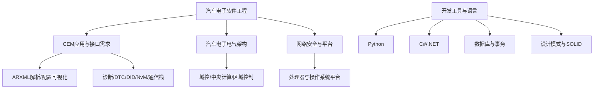

# 技术专题补充卡片

本文件归档此前分散在 Flomo 中、尚未纳入 NotesBook 对应专题目录的技术卡片。按来源标签分组保留原文，避免把短笔记误扩写成未经验证的结论。原始 Flomo 链接与 ID 均保留。

## 技术关联图

## CEM

### 

- Flomo ID：`MTc2MTEyODQ0`
- 创建时间：2025-05-14T20:44:00+08:00
- 原文：[在 Flomo 中打开](https://v.flomoapp.com/mine/?memo_id=MTc2MTEyODQ0)
- 原始标签：Area/技术/CEM、Archive/MigratedWiki、Archive/MigratedNotion、Archive/DeleteCandidate

<u>CEM工作的100个问题</u>

1. 接口的配置操作？

2. 休眠唤醒的相关逻辑是什么？

#Area/技术/CEM

#Archive/MigratedWiki

#Archive/MigratedNotion 
#Archive/DeleteCandidate

---

### 

- Flomo ID：`MTc1NDQzNzk4`
- 创建时间：2025-05-10T20:03:44+08:00
- 原文：[在 Flomo 中打开](https://v.flomoapp.com/mine/?memo_id=MTc1NDQzNzk4)
- 原始标签：Area/技术/CEM、Archive/MigratedWiki、Archive/MigratedNotion、Archive/DeleteCandidate

- AUTOSAR 中的ARXML文件数据可视化

#Area/技术/CEM

#Archive/MigratedWiki

#Archive/MigratedNotion 
#Archive/DeleteCandidate

---

### 

- Flomo ID：`MTY5NzY2MzIy`
- 创建时间：2025-04-05T20:10:50+08:00
- 原文：[在 Flomo 中打开](https://v.flomoapp.com/mine/?memo_id=MTY5NzY2MzIy)
- 原始标签：Area/技术/CEM、Archive/MigratedWiki、Archive/MigratedNotion、Archive/DeleteCandidate

- 解析Arxm 文件转换成Json格式的数据

- 搭建n8n实现自动化操作

#Area/技术/CEM

#Archive/MigratedWiki

#Archive/MigratedNotion 
#Archive/DeleteCandidate

---

### <u><mark>CEM相关的APP需求</mark></u>

- Flomo ID：`MTMxOTY3MTM1`
- 创建时间：2024-08-12T09:48:19+08:00
- 原文：[在 Flomo 中打开](https://v.flomoapp.com/mine/?memo_id=MTMxOTY3MTM1)
- 原始标签：Area/技术/CEM、Archive/MigratedWiki、Archive/MigratedNotion、Archive/DeleteCandidate

<u><mark>CEM相关的APP需求</mark></u>

- <u><strong>ActuatorsSensorsOnCEM</strong></u>

- <u><strong>Climate</strong></u>

- <u><strong>DriverInformationAndPersonalization</strong></u>

- <u><strong>ECUPlatform</strong></u>

- **ExteriorLight**

- <u><strong>InteriorLight</strong></u>

- LockingMgr

- LowVoltageElectricalEnergyManagement

- RemoteControl

- Safety

- SoundSignalling

- TheftProtection

- TPMS

- UsageAuthorization

- VehicleModeManagment

- WindowsMirrorsAndRoof

- VisibilityMgr

<u><mark>诊断相关的需求</mark></u>

#Area/技术/CEM

#Archive/MigratedWiki

#Archive/MigratedNotion 
#Archive/DeleteCandidate

---

### 思考笔记：CEM软件相关的结构

- Flomo ID：`MTIyNjM5NjMx`
- 创建时间：2024-06-11T10:09:48+08:00
- 原文：[在 Flomo 中打开](https://v.flomoapp.com/mine/?memo_id=MTIyNjM5NjMx)
- 原始标签：Area/技术/CEM、Archive/MigratedWiki、Archive/MigratedNotion、Archive/DeleteCandidate

思考笔记：CEM软件相关的结构

1. DTC,DID是怎么实现的？

2. NVM存储从上层到下层的实现逻辑是什么？

3. 接口配置如何实现的？

4. 协议栈的相关内容？

#Area/技术/CEM

#Archive/MigratedWiki

#Archive/MigratedNotion 
#Archive/DeleteCandidate

---

## Python

### 切片是 Python 中用于访问序列（如列表、元组、字符串）中部分元素的技术。通过指定起始索引和结束索引，可以提取序列的一部分。切片的基本语法如下： sequence\[start:stop:step\]

- Flomo ID：`MjMzNzc5Nzkz`
- 创建时间：2026-04-27T15:54:34+08:00
- 原文：[在 Flomo 中打开](https://v.flomoapp.com/mine/?memo_id=MjMzNzc5Nzkz)
- 原始标签：Area/技术/Python、Archive/MigratedWiki、Archive/MigratedNotion、Archive/DeleteCandidate

切片是 Python 中用于访问序列（如列表、元组、字符串）中部分元素的技术。通过指定起始索引和结束索引，可以提取序列的一部分。切片的基本语法如下： sequence\[start:stop:step\]

- start：切片的起始索引（包含该索引的元素）。

- stop：切片的结束索引（不包含该索引的元素）。

- step：切片的步长，默认为 1。 你可以生成列表的任何子集，甚至可以使用负数索引来从序列的末尾开始切片。切片操作不会修改原始序列，而是返回一个新的序列。

#Area/技术/Python

#Archive/MigratedWiki

#Archive/MigratedNotion 
#Archive/DeleteCandidate

---

### Python列表的学习

- Flomo ID：`MjMzNzc2MTAw`
- 创建时间：2026-04-27T15:33:34+08:00
- 原文：[在 Flomo 中打开](https://v.flomoapp.com/mine/?memo_id=MjMzNzc2MTAw)
- 原始标签：Area/技术/Python、Archive/MigratedWiki、Archive/MigratedNotion、Archive/DeleteCandidate

Python列表的学习

1. 创建列表：可以创建一个空列表或包含初始元素的列表。

2. 访问列表元素：可以通过索引访问列表中的元素。

3. 修改列表元素：可以通过索引修改列表中的元素。

4. 添加元素：可以使用 append() 方法在列表末尾添加元素，或使用 insert() 方法在指定位置插入元素。

5. 删除元素：可以使用 del 语句或 remove() 方法删除列表中的元素。

6. 列表切片：可以使用切片操作获取列表的子列表。

7. 列表长度：可以使用 len() 函数获取列表的长度。

   

   

   #Area/技术/Python

   

   

#Archive/MigratedWiki

#Archive/MigratedNotion 
#Archive/DeleteCandidate

---

### 

- Flomo ID：`ODEyODgzMDA`
- 创建时间：2023-09-03T19:53:34+08:00
- 原文：[在 Flomo 中打开](https://v.flomoapp.com/mine/?memo_id=ODEyODgzMDA)
- 原始标签：Area/技术/Python、Archive/MigratedWiki、Archive/MigratedNotion、Archive/DeleteCandidate

- NiceGui 地址 [https://nicegui.io/](https://nicegui.io/)

这是一个web服务器的地址：可以做一个卡片笔记？

- 通过导入卡片学习相关的知识

#Area/技术/Python

#Archive/MigratedWiki

#Archive/MigratedNotion 
#Archive/DeleteCandidate

---

## CSharp

### - C# 开发 [https://dotnet.microsoft.com/en-us/download](https://dotnet.microsoft.com/en-us/download)

- Flomo ID：`MTkxMjMyNTU3`
- 创建时间：2025-08-18T09:05:24+08:00
- 原文：[在 Flomo 中打开](https://v.flomoapp.com/mine/?memo_id=MTkxMjMyNTU3)
- 原始标签：Area/技术/CSharp、Archive/MigratedWiki、Archive/MigratedNotion、Archive/DeleteCandidate

- C# 开发 [https://dotnet.microsoft.com/en-us/download](https://dotnet.microsoft.com/en-us/download)

- .NET CLI 是一个命令行界面，提供了一系列用于开发、构建、测试和发布.NET 应用程序的命令。这些命令统称为 dotnet 命令。它们允许开发者在各种操作系统上进行.NET 开发，而无需依赖于Visual Studio 等集成开发环境.

- 下面是一些常用的 dotnet 命令：

- **项目和解决方案管理:**
  - dotnet new: 创建新的.NET项目或文件，例如控制台应用程序、类库等。

  - dotnet build: 编译.NET项目及其依赖项。

  - dotnet run: 运行.NET应用程序。

  - dotnet clean: 清理.NET项目的构建输出。

  - dotnet restore: 还原.NET项目所需的依赖项。

  - dotnet pack: 创建NuGet包。

  - dotnet publish: 发布.NET应用程序，生成可部署的文件。

  - dotnet test: 运行.NET项目的单元测试。

  - dotnet sln: 修改Visual Studio解决方案文件。
- **NuGet 包管理:**
  - dotnet add package: 添加NuGet包引用到项目。

  - dotnet remove package: 从项目中删除NuGet包引用。

  - dotnet nuget add source: 添加NuGet源。

  - dotnet nuget list source: 列出所有配置的NuGet源。
- **工具管理:**
  - dotnet tool install: 安装全局或本地的.NET工具。

  - dotnet tool uninstall: 卸载全局或本地的.NET工具。

  - dotnet tool list: 列出已安装的.NET工具。
- **其他命令:**
  - dotnet help: 显示命令行帮助。

  - dotnet msbuild: 提供了对MSBuild命令行的访问。

  - dotnet format: 格式化代码。
- **使用示例:**
  - 要创建一个新的控制台应用程序，可以运行 dotnet new console。

  - 要编译项目，可以运行 dotnet build。

  - 要运行应用程序，可以运行 dotnet run。

  - 要添加一个名为Newtonsoft.Json 的NuGet包，可以运行 dotnet add package Newtonsoft.Json。

  - 要安装一个名为dotnet-ef 的全局工具，可以运行 dotnet tool install --global dotnet-ef。
- 通过使用 .NET CLI，开发者可以有效地管理.NET项目、构建、测试和部署应用程序，而无需依赖于特定的IDE。

#Area/技术/CSharp

#Archive/MigratedWiki

#Archive/MigratedNotion 
#Archive/DeleteCandidate

---

## 数据库

### SQLITE 数据库工具： [https://dbeaver.io/](https://dbeaver.io/)

- Flomo ID：`MjMxNDM0ODQx`
- 创建时间：2026-04-14T11:27:51+08:00
- 原文：[在 Flomo 中打开](https://v.flomoapp.com/mine/?memo_id=MjMxNDM0ODQx)
- 原始标签：Area/技术/数据库、Archive/MigratedWiki、Archive/MigratedNotion、Archive/DeleteCandidate

SQLITE 数据库工具： [https://dbeaver.io/](https://dbeaver.io/)

关联自： [https://v.flomoapp.com/mine/?memo\_id=ODM2MTM3MDE](https://v.flomoapp.com/mine/?memo_id=ODM2MTM3MDE)

#Area/技术/数据库

#Archive/MigratedWiki

#Archive/MigratedNotion 
#Archive/DeleteCandidate

---

### ACID原则是数据库事务正常执行的四个，分别指原子性、一致性、独立性及持久性

- Flomo ID：`ODM2MTM3MDE`
- 创建时间：2023-09-21T20:36:17+08:00
- 原文：[在 Flomo 中打开](https://v.flomoapp.com/mine/?memo_id=ODM2MTM3MDE)
- 原始标签：Area/技术/数据库、Archive/MigratedWiki、Archive/MigratedNotion、Archive/DeleteCandidate

ACID原则是数据库事务正常执行的四个，分别指原子性、一致性、独立性及持久性

**事务的原子性(Atomicity)：** <u>是指一个事务要么全部执行，要么不执行</u>，也就是说一个事务不可能只执行了一半就停止了。比如你从取款机取钱，这个事务可以分成两个步骤：1划卡，2出钱。不可能划了卡，而钱却没出来。这两步必须同时完成，要么就不完成。

**事务的一致性(Consistency)：** 是指事务的运行并不改变数据库中数据的一致性。例如，完整性约束了a+b=10，一个事务改变了a，那么b也应该随之改变。

**独立性(Isolation）：** 事务的独立性也称作隔离性，是指两个以上的事务不会出现交错执行的状态。因为这样可能会导致数据不一致，更加具体的来讲，就是事务之间的操作是独立的。

**持久性(Durability）：** 事务的持久性是指事务执行成功以后，该事务对数据库所作的更改便是持久的保存在数据库之中，不会无缘无故的回滚。

#Area/技术/数据库

#Archive/MigratedWiki

#Archive/MigratedNotion 
#Archive/DeleteCandidate

---

## 汽车电子电气架构

### 汽车电控技术核心板块说明

- Flomo ID：`MTEzNjQ3NjQ2`
- 创建时间：2024-04-14T19:28:03+08:00
- 原文：[在 Flomo 中打开](https://v.flomoapp.com/mine/?memo_id=MTEzNjQ3NjQ2)
- 原始标签：Area/技术/汽车电子电气架构、Archive/MigratedNotion、Archive/DeleteCandidate

**汽车电控技术核心板块说明**

现代汽车电子控制系统（Electronic Control System）是整车的“神经中枢”与“大脑”。根据原图分类及现代汽车电子电气架构（EEA）的演进，全车电控技术主要划分为以下 **四大核心控制域**：

**1\. 动力性能控制（Powertrain Domain）**

- **核心功能**：主要控制车辆的动力输出、能量转换及传动效率。

- **主要系统**：
  - <u><strong>发动机管理系统 (EMS)</strong></u>：精确控制燃油喷射、点火提前角及进气量（如电喷系统、节气门控制）。

  - **变速器电子控制 (TCU)**：根据车速和发动机负荷，自动选择最佳档位并控制换挡时机。

  - **智能巡航/能量管理**：在新能源或混动车型中，负责整车控制器（VCU）的能量分配及巡航控制。

**2\. 安全性控制（Chassis & Safety Domain）**

- **核心功能**：保障车辆在各种行驶工况下的主动安全与被动保护。

- **主要系统**：
  - **ABS/ESC 稳定系统**：防止车轮抱死、制动侧滑，并在车辆失控边缘主动分配制动力。

  - **安全气囊控制单元 (ACU)**：通过碰撞传感器实时监测冲击力，在毫秒级内触发气囊或安全带收紧。

  - **胎压监测系统 (TPMS)**：实时监控每个轮胎的气压与温度，防止爆胎引发事故。

**3\. 舒适性控制（Body & Comfort Domain）**

- **核心功能**：提升驾驶舱内的驾乘体验、便利性与车身基础电气管理。

- **主要系统**：
  - **电子自动空调 (HVAC)**：根据车内外温度传感器，自动调节冷热风量与空气循环。

  - **车身控制模块 (BCM)**：统一管理电动车窗、中控门锁、后视镜折叠以及智能雨刮。

  - **座椅电动调节与记忆**：控制座椅多向调节、加热、通风及多组驾驶员习惯记忆。

**4\. 娱乐通讯技术（Infotainment & Connectivity Domain）**

- **核心功能**：负责车内外的信息交互、影音娱乐、导航及智能联网（网联化）。 \[1\]

- **主要系统**：
  - **智能座舱系统**：包括数字液晶仪表盘、中控大屏的图像渲染与多媒体播放。

  - **车载通信与导航**：集成 GPS/北斗定位、车载电话（T-Box）、OTA 远程升级及紧急呼叫（eCall）。

#Area/技术/汽车电子电气架构

#Archive/MigratedNotion 
#Archive/DeleteCandidate

---

### - 概念

- Flomo ID：`ODMyNTE1ODE`
- 创建时间：2023-09-19T07:16:12+08:00
- 原文：[在 Flomo 中打开](https://v.flomoapp.com/mine/?memo_id=ODMyNTE1ODE)
- 原始标签：Area/技术/汽车电子电气架构、Archive/MigratedNotion、Archive/DeleteCandidate

- 概念
  - 驱动力
    - 软件定义汽车

    - 智能化，网联化，电动化，共享化
  - 平台
    - 整车平台

    - 电子电气平台
  - 架构
    - 核心思想
      - 分层

      - 分离

      - 接口

      - 领域工程与应用工程
    - 发展趋势

    - 安全体系

    - 对标
  - 平台架构关系
- 功能架构

- 软件架构

- 网络架构

- 物理架构

- 硬件架构

- 网联架构

- 测试验证

- 开发流程

- 架构评估

- 工具链

#Area/技术/汽车电子电气架构

#Archive/MigratedNotion 
#Archive/DeleteCandidate

---

## 设计模式

### SOLID设计原则

- Flomo ID：`MjQ2Njg1Njc1`
- 创建时间：2026-07-14T10:18:15+08:00
- 原文：[在 Flomo 中打开](https://v.flomoapp.com/mine/?memo_id=MjQ2Njg1Njc1)
- 原始标签：Area/技术/设计模式/原则与实践、Archive/MigratedNotion、Archive/DeleteCandidate

SOLID设计原则

▎ **1\. 单一职责原则（SRP）** \- Single Responsibility Principle

- 一个类应该仅有一个引起它变化的原因

- 避免"上帝对象"，分离不同职责到不同的类

- 例：UserService只处理用户逻辑，EmailService只处理邮件逻辑

▎ **2\. 开闭原则（OCP）** \- Open Closed Principle

- 软件实体对扩展开放，对修改关闭

- 通过继承、组合、多态实现扩展而不修改原代码

- 例：支付系统，新增支付方式不修改原有代码

▎ **3\. 里氏替换原则（LSP）** \- Liskov Substitution Principle

- 子类型必须是超类型的可替换者

- 确保继承体系的健全性，避免破坏基类的契约

- 例：正方形不应继承长方形，因为正方形的宽高相等会破坏长方形的接口

▎ **4\. 接口隔离原则（ISP）** \- Interface Segregation Principle

- 客户端不应该被迫依赖它不需要的接口

- 使用多个专用接口代替一个通用接口

- 例：不应该用"Animal"的统一接口，而是"Flyable"、"Swimmable"等

▎ **5\. 依赖倒转原则（DIP）** \- Dependency Inversion Principle

- 高层模块不应该依赖于低层模块，两者都应该依赖抽象

- 使用接口或抽象类来实现依赖倒转

- 例：数据库操作应该依赖Repository接口，而不是具体的MySQLRepository

<u><mark>模式选择快速指南</mark></u>

问题推荐模式核心价值需要创建复杂对象 **Builder** / AbstractFactory分离构建与表示需要单一全局实例 **Singleton** 确保唯一性需要扩展对象功能 **Decorator** 避免类爆炸需要简化复杂系统 **Facade** 隐藏复杂性需要处理多种算法 **Strategy** 算法可互换需要撤销/重做功能 **Command** / Memento请求对象化需要对象间通信 **Observer** / Mediator解耦通信需要遍历集合元素 **Iterator** 统一遍历接口需要处理请求链 **ChainOfResponsibility** 链式传递需要对象状态切换 **State** 状态驱动行为

常见模式组合使用

▎ **工厂 \+ 单例**

- 工厂方法本身是单例的，生产的对象可以重用

- 应用：Spring的BeanFactory

▎ **观察者 \+ 中介者**

- 中介者作为中央控制器，协调多个观察者

- 应用：MVVM框架中的ViewModel

▎ **策略 \+ 工厂**

- 工厂负责创建策略对象，避免客户端依赖具体策略类

- 应用：支付系统中支付策略的工厂

▎ **装饰 \+ 工厂**

- 工厂负责创建各种装饰组合，简化装饰的创建

- 应用：Java IO流的包装

▎ **模板方法 \+ 策略**

- 模板方法定义算法框架，策略定义具体算法

- 应用：数据处理流程

<u><strong><mark>反面模式（需要避免）</mark></strong></u>

▎ **上帝对象（God Object）**

- 问题：一个类承担太多责任，违反SRP

- 表现：类有数百个方法和字段

- 解决：拆分成多个专注的类

▎ **特性羡慕（Feature Envy）**

- 问题：方法频繁调用其他类的方法或字段

- 表现：说明职责放错了地方

- 解决：移动方法到真正需要它的类

▎ **基本类型偏执（Primitive Obsession）**

- 问题：过度使用基本类型而不是创建合适的类

- 表现：充斥着int、String的方法参数

- 解决：创建值对象（如Money、PhoneNumber）

▎ **过度工程（Over-Engineering）**

- 问题：使用过多、过复杂的设计模式

- 表现：简单问题用复杂解决方案

- 解决：YAGNI原则（You Aren't Gonna Need It），需要时再添加

▎ **唐老鸭代码（Functional Drift）**

- 问题：类的实际用途与设计意图不符

- 表现：类做的事情与名字不符

- 解决：定期重构，保持代码一致性

<u><mark>现代架构中的应用</mark></u>

▎ **微服务架构**

- APIGateway（Facade）：统一的入口点

- 服务网格（Proxy）：流量控制、熔断、重试

- 事件总线（Observer）：服务间的异步通信

▎ **响应式编程**

- RxJava/RxJS：本质上是Observer模式的增强

- Stream API：Strategy用于转换和过滤

▎ **依赖注入与IoC容器**

- Factory模式：Spring的Bean创建机制

- 单例模式：Spring Bean的默认作用域

▎ **容器化与编排**

- Factory：创建容器实例

- Singleton：管理容器的生命周期

- Proxy：容器间的网络通信

▎ **函数式编程**

- Strategy：高阶函数替代传统策略对象

- Command：函数作为一等公民

#Area/技术/设计模式/原则与实践

#Archive/MigratedNotion 
#Archive/DeleteCandidate

---

### 软件设计模式（Design Patterns）** 是在软件开发过程中对常见问题的可复用解决方案。GoF（四人帮）定义了23种经典设计模式。

- Flomo ID：`MjQ2Njg1NTk4`
- 创建时间：2026-07-14T10:17:49+08:00
- 原文：[在 Flomo 中打开](https://v.flomoapp.com/mine/?memo_id=MjQ2Njg1NTk4)
- 原始标签：Area/技术/设计模式、Archive/MigratedNotion、Archive/DeleteCandidate

**软件设计模式（Design Patterns）** 是在软件开发过程中对常见问题的可复用解决方案。GoF（四人帮）定义了23种经典设计模式。

<u><mark>创建型模式（Creational）</mark></u>

▎ **单例模式（Singleton）**

- 确保一个类仅有一个实例，并提供全局访问点

- 应用：数据库连接池、日志记录器、配置管理器

- 注意：线程安全、防止反序列化、防止反射攻击

▎ **工厂方法模式（Factory Method）**

- 定义一个用于创建对象的接口，让子类决定实例化哪一个类

- 应用：数据库驱动选择、UI组件创建、支付方式选择

▎ **抽象工厂模式（Abstract Factory）**

- 提供一个接口，用于创建相关或依赖的对象族

- 应用：跨平台UI主题、家具系列产品、数据库连接管理

▎ **建造者模式（Builder）**

- 将一个复杂对象的构建与其表示分离

- 应用：StringBuilder、SQL查询构造、配置对象创建

▎ **原型模式（Prototype）**

- 用原型实例指定创建对象的种类，并通过复制来创建新对象

- 应用：Java的clone()、深拷贝场景、对象池

<u><mark>结构型模式（Structural）</mark></u>

▎ **适配器模式（Adapter）**

- 将一个类的接口转换成客户期望的另一个接口

- 应用：电源适配器、数据格式转换、第三方库集成

▎ **装饰者模式（Decorator）**

- 动态地给对象添加一些额外的职责

- 应用：Java IO流、GUI组件装饰

▎ **外观模式（Facade）**

- 为子系统中的一组接口提供一个统一的高层接口

- 应用：Spring框架、数据库访问层、第三方库封装

▎ **享元模式（Flyweight）**

- 运用共享技术有效地支持大量细粒度的对象

- 应用：String常量池、数据库连接池、棋子对象

▎ **代理模式（Proxy）**

- 为某个对象提供一个代理，以控制对这个对象的访问

- 应用：RPC框架、Spring AOP、延迟加载、安全控制

▎ **桥接模式（Bridge）**

- 将抽象部分与实现部分分离，使它们都可以独立地变化

- 应用：JDBC驱动与数据库、日志系统

▎ **组合模式（Composite）**

- 将对象组合成树形结构以表示"部分-整体"的层次关系

- 应用：文件系统、DOM树、菜单项

<u><strong><mark>行为型模式（Behavioral</mark></strong></u>）

▎ **观察者模式（Observer）**

- 定义对象间的一对多的依赖关系，当一个对象的状态改变时，所有依赖于它的对象都得到通知

- 应用：MVC模式、事件监听、消息发布订阅

▎ **策略模式（Strategy）**

- 定义一系列算法，把它们一个个封装起来，并使它们可以相互替换

- 应用：支付方式选择、排序算法选择、促销算法

▎ **命令模式（Command）**

- 将请求封装成一个对象

- 应用：菜单项、按钮点击、任务队列、撤销/重做

▎ **模板方法模式（Template Method）**

- 定义一个操作中的算法的骨架，把一些步骤延迟到子类中

- 应用：Spring的JdbcTemplate、Servlet的生命周期

▎ **状态模式（State）**

- 允许对象在其内部状态改变时改变它的行为

- 应用：订单状态、工作流状态

▎ **迭代器模式（Iterator）**

- 提供一种方法顺序访问一个聚合对象中的各个元素

- 应用：Java的Iterator接口、遍历集合

▎ **中介者模式（Mediator）**

- 用一个中介对象来封装一系列对象间的交互

- 应用：对话框中的控件交互、飞行管制系统

▎ **备忘录模式（Memento）**

- 不破坏一个对象的封装性，捕获并外部化该对象的一个内部状态

- 应用：撤销/重做、事务回滚、保存游戏进度

▎ **职责链模式（Chain of Responsibility）**

- 将多个对象连成一条链，并沿着这条链传递请求

- 应用：Java异常处理、Servlet过滤器链、审批流程

▎ **访问者模式（Visitor）**

- 表示一个作用于某对象结构中各个元素的操作

- 应用：编译器的AST遍历、表达式求值、报表生成

#Area/技术/设计模式

#Archive/MigratedNotion 
#Archive/DeleteCandidate

---

## 网络安全

### - **Processors:** TI Jacinto/TDA Series, Infineon Aurix Series, NXP i.MX/S32R/S32K series, Renesas RH series​

- Flomo ID：`ODU3Mzg3OTA`
- 创建时间：2023-10-10T09:01:33+08:00
- 原文：[在 Flomo 中打开](https://v.flomoapp.com/mine/?memo_id=ODU3Mzg3OTA)
- 原始标签：Area/技术/网络安全、Archive/MigratedNotion、Archive/DeleteCandidate

- **Processors:** TI Jacinto/TDA Series, Infineon Aurix Series, NXP i.MX/S32R/S32K series, Renesas RH series​

- **Operating System :** Linux/QNX/Free RTOS/ MICROSAR​

- **Firmware/Image Authentication**: Secure Boot, Secure Update​

- **Debug Protection:** Secure JTAG, UART Security​

- **Logging:** Secure Logging​

- **Diagnostics:** Secure Diagnostics​

- **Secure Communication:** Secure CAN, IP Security, Secure Backend Access, Server Communication​

- **PKI:** Certificate and Key Mgmt.​

- **OS Hardening:** OS Security and Run Time Protection​

- **Application Security:** BT, Wi-Fi Security​

#Area/技术/网络安全

#Archive/MigratedNotion 
#Archive/DeleteCandidate

---

## 迁移记录

- 纳入 16 条完整笔记，覆盖 7 个技术主题。
- 原文完整读取，无截断；保留 Flomo ID、链接、时间与标签。
- 短笔记仅做归档与主题关联，不擅自补写未经来源支持的技术细节。
