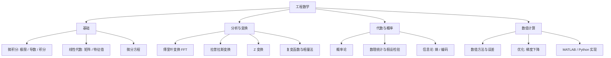

数学是工程与算法的底层语言。对电子与嵌入式方向的人来说，最核心的不是刷难题，而是**建立用数学描述问题的能力**：电路分析要用微积分与复变，信号处理要用傅里叶变换，控制要用状态空间，AI 要用线性代数与概率统计。

> [!info] 一句话定位
> 工程数学 = 把物理世界的问题翻译成方程，再用工具解出来。

## 知识体系

## 考研数学 1000问

- [[1000问/微积分线代与概率论工程实战]] —— 将极限、导数、积分、矩阵变换、Park 变换、贝叶斯诊断和统计检验连接到嵌入式工程。
- [[1000问/马尔可夫链平稳分布与MCMC]] —— 无后效性、转移矩阵、状态分类、平稳分布、细致平衡、MCMC、HMM 与 PageRank。

~~~~mermaid
flowchart TD
  A[考研数学 1000问] --> B[高等数学]
  A --> C[线性代数]
  A --> D[概率论与数理统计]
  B --> E[工程应用：ADC / PID / 标定]
  C --> F[工程应用：DBC / Park / RTE]
  D --> G[工程应用：Dem / 传感器 / 总线统计]
~~~~

## 核心要点

- **微积分**：描述「变化」的工具，导数对应变化率（电流是电荷的变化率），积分对应累积。
- **线性代数**：现代工程最实用的数学。矩阵是线性变换，特征值/特征向量揭示系统的固有特性。
- **傅里叶与拉普拉斯变换**：把时域问题转到频域/复频域求解，是信号处理与电路分析的核心武器。
- **复变与相量法**：让正弦稳态电路分析从解微分方程变成代数运算，见 [[模拟电路]]。
- **概率与统计**：处理噪声、不确定性和数据，是测量、通信与 AI 的基础。
- **数值方法**：计算机不会解析求解，实际都要靠数值算法（如 FFT、牛顿迭代、梯度下降）。
- **和 AI 的关系**：见 [[人工智能]]，机器学习的三大数学支柱正是线代、微积分、概率统计。

## 学习建议

- 结合**具体场景**学数学（学傅里叶就去看滤波器），比抽象推导更有效。
- 用 MATLAB / Python 把公式画出来、跑起来，建立直觉。
- 推荐读物：《数学之美》《线性代数的本质》。

## 相关

- [[人工智能]]
- [[数据结构与算法]]
- [[模拟电路]]
- [[计算机组成原理]]

## 专栏⑰｜Flomo 原始笔记归档

为保留原始推演、案例、问题库与导航内容，原文按篇保存：

- [[数学/专栏⑰原始笔记/导航-考研数学1000问全景]]：高数、线代、概率论总导航。
- [[数学/专栏⑰原始笔记/导航分卷-线性代数1000问]]：线性代数问题库导航。
- [[数学/专栏⑰原始笔记/导航分卷-概率论与数理统计1000问]]：概率论与数理统计问题库导航。
- [[数学/专栏⑰原始笔记/第1篇-马尔可夫链专题]]：马尔可夫链基础理论专题。
- [[数学/专栏⑰原始笔记/第2篇-矩阵变换与坐标系]]：矩阵变换与工程坐标系。
- [[数学/专栏⑰原始笔记/第3篇-堆问题法与数学学习]]：堆问题法的适用边界。
- [[数学/专栏⑰原始笔记/第4篇-课本定义与工程实际]]：数学概念的工程化理解。
- [[数学/专栏⑰原始笔记/第5篇-极限与导数工程实战]]：微积分与 ADC 采样。
- [[数学/专栏⑰原始笔记/第6篇-线性代数工程实战]]：矩阵、DBC、Park 变换与 RTE。
- [[数学/专栏⑰原始笔记/第7篇-概率论工程实战]]：贝叶斯与诊断推理。
- [[数学/专栏⑰原始笔记/第8篇-马尔可夫链工程应用]]：BswM、网络管理与刷写状态机。
- [[数学/专栏⑰原始笔记/第9篇-考研数学应试方法论]]：分轮次复习与问题组织。
- [[数学/专栏⑰原始笔记/第10篇-数学15项自检清单]]：数学学习与工程连接检查。
