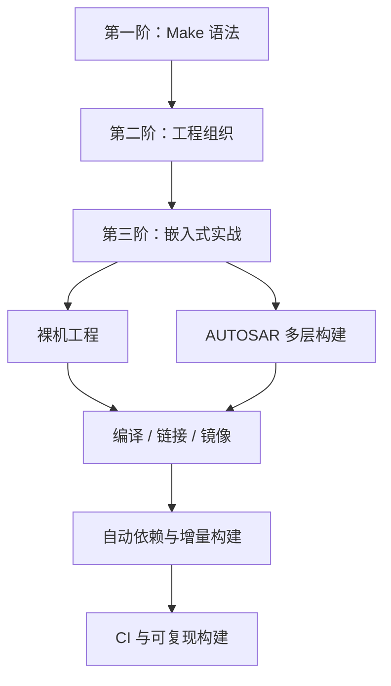
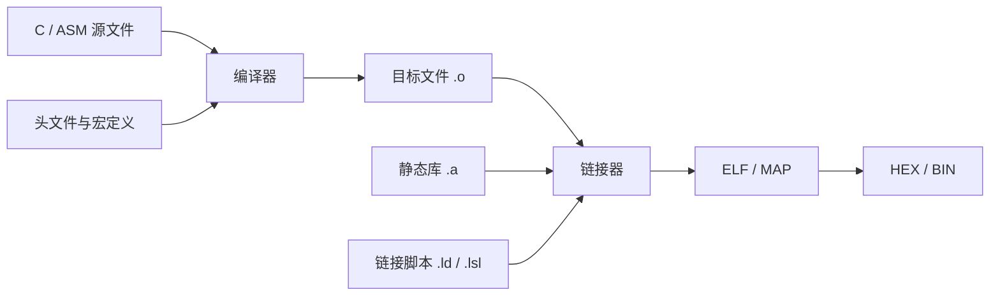
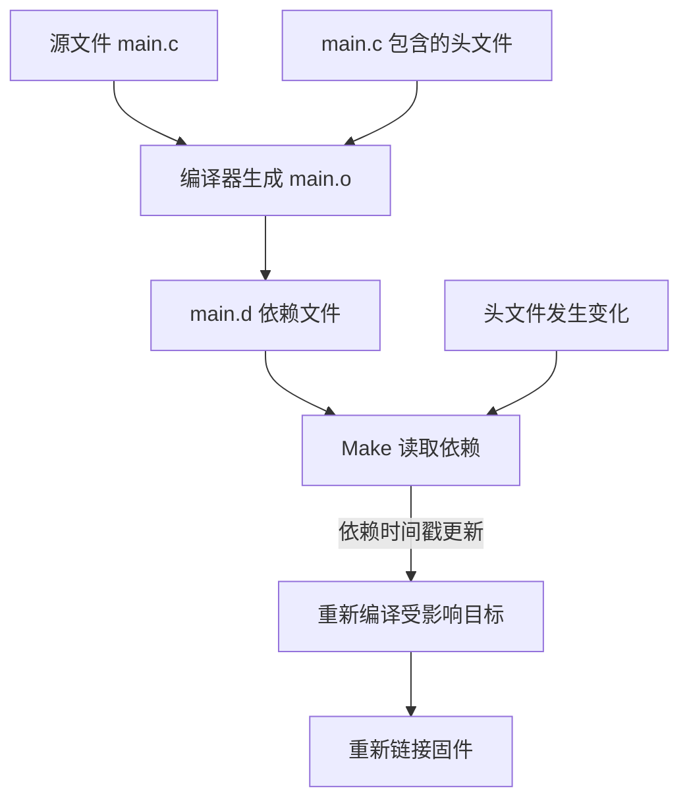
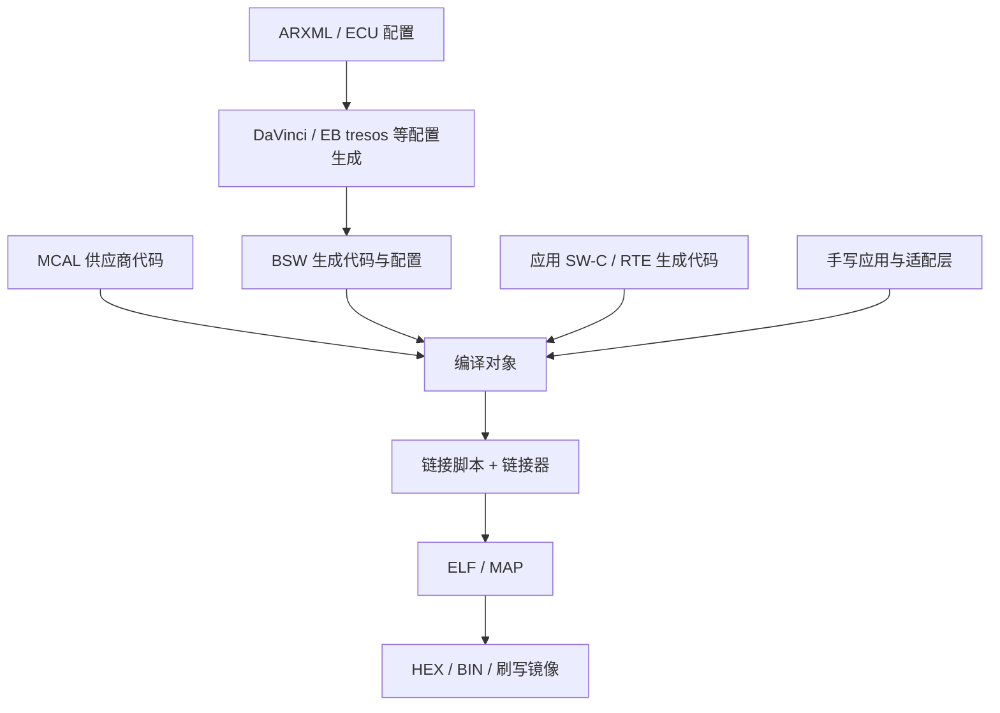

# Makefile 100问：从 GNU Make 语法到嵌入式 AUTOSAR 构建

本篇迁移 Flomo「Makefile 100问」三阶题库。原始导航标记为 **30/30 完成**：第一阶语法、第二阶工程、第三阶嵌入式与 AUTOSAR 实战。以下逐题保留原问题与答案卡内容，并补充构建链路图、依赖关系图和工程化边界。示例以 GNU Make 为主；不同 Make 版本、Shell、编译器和供应商生成工具的行为需以实际环境验证。

## 学习路线

## 第一阶：语法与规则（10题）

### 1.1 一阶Q1：目标必须得是文件名吗？.PHONY 干嘛的？

**答案与解析（根据 Flomo 原始答案卡整理）**

▎ 五大学习法：西蒙学习法——把「make 凭什么判定要不要干活」这一个点钻透，.PHONY 只是它的衍生品

**核心认知：make 默认把目标当「文件名」对待**

- 判定逻辑 = 比较目标和依赖的修改时间：磁盘上有同名文件、且比所有依赖新 → 认为目标已最新，跳过命令
- clean / all / flash 这类目标是「动作名」，本来就不对应文件。没有同名文件时 make 每次都会执行

**.PHONY 是干嘛的**

- 声明某目标是伪目标：告诉 make「别去查时间戳，每次无条件执行」
- 防的幺蛾子：哪天目录里碰巧出现同名文件（clean.log、all.c），make 一看「目标已存在、又没依赖」直接跳过——clean 静默失效，还没人报错，最阴的那种 bug

**一句话总结**：目标不一定是文件，但 make 一律按文件对待；.PHONY 就是交底「这不是文件，别查时间戳」。

📎 题目（一阶）→ [https://v.flomoapp.com/mine/?memo\_id=MjUxMDI4NTA5](https://v.flomoapp.com/mine/?memo_id=MjUxMDI4NTA5) 
📎 Makefile 学习规则 → [https://v.flomoapp.com/mine/?memo\_id=MjQ5MzQ2MDcy](https://v.flomoapp.com/mine/?memo_id=MjQ5MzQ2MDcy)

来源：https://v.flomoapp.com/mine/?memo_id=MjUyMTU3NTQ2

---

### 1.2 一阶Q2：=、:=、?=、+= 什么区别？嵌入式为什么全是 :=？

**答案与解析（根据 Flomo 原始答案卡整理）**

▎ 五大学习法：费曼学习法——把四种赋值讲成「四个时间点的快照」，能讲清就真懂了

**四种赋值**

- **=** 递归展开（懒）：赋值时不展开，引用时才展开、取当时的当前值。能引用后定义的变量，灵活但值会随上下文漂移，排错难
- **:=** 立即展开（勤）：赋值那一刻就展开成最终字符串，之后再改引用变量不影响它。值确定、可预测
- **?=** 条件赋值：变量还没定义过才赋值。经典用途是默认值：CC ?= gcc，命令行或环境变量能覆盖
- **+=** 追加：在现值后追加。追加的语义跟原变量类型走：原 := 则立即展开追加，原 = 则递归追加

**嵌入式为什么到处是 :=**

- 嵌入式 Makefile 变量高度交叉：CFLAGS 依赖 ARCH、TOOLCHAIN、BOARD……用 = 的话，取值时点不同结果不同，规则一多就变成「为什么我改了 FLAGS 没生效」的玄学
- := 把每个变量钉死在赋值那一刻：行为确定、依赖清晰，配 += 追加也安全
- 一句口诀：要确定的值用 :=，要默认值用 ?=，要增量用 +=，要递归才用 =（99% 的场景用不到）

**一句话总结**：= 是懒展开（引用时才算），:= 是勤展开（赋值时就定）；嵌入式工程追求可预测，所以到处是 :=。

📎 题目（一阶）→ [https://v.flomoapp.com/mine/?memo\_id=MjUxMDI4NTA5](https://v.flomoapp.com/mine/?memo_id=MjUxMDI4NTA5) 
📎 一阶Q1（目标与.PHONY）→ [https://v.flomoapp.com/mine/?memo\_id=MjUyMTU3NTQ2](https://v.flomoapp.com/mine/?memo_id=MjUyMTU3NTQ2)

来源：https://v.flomoapp.com/mine/?memo_id=MjUyMTU3NTU0

---

### 1.3 一阶Q3：自动变量 `$@`、`$<`、`$^`、`$` 各代表什么？_\

**答案与解析（根据 Flomo 原始答案卡整理）**

▎ 五大学习法：费曼学习法——把自动变量当「make 替你填好的占位符」，一条规则讲清

**四个自动变量**

- **`$@`** 当前规则的目标名（target）
- **`$<`** 依赖列表里的第一个依赖
- **`$^`** 所有依赖的完整列表（去重）
- **`$*`** 模式规则里 % 匹配到的部分（stem，词干）

**一条规则全用上**

%.o: %.c 
`$(CC)` -c `$<` -o `$@`

- 对 src/main.c 编译出 src/main.o 时：`$@` = src/main.o，`$<` = src/main.c，`$*` = src/main
- 多依赖场景用 `$^`：app.elf: a.o b.o c.o → `$(LD)` `$^` -o `$@` 一次带上全部 .o
- 注意 `$<` 只取第一个；想要「第一个以外的」，用 `$(wordlist 2,$(words $^),$^)`

**一句话总结**：`$@` 是我要造的，`$<` 是第一个原料，`$^` 是所有原料，`$*` 是通配符抓到的那截。

📎 题目（一阶）→ [https://v.flomoapp.com/mine/?memo\_id=MjUxMDI4NTA5](https://v.flomoapp.com/mine/?memo_id=MjUxMDI4NTA5) 
📎 一阶Q2（变量赋值）→ [https://v.flomoapp.com/mine/?memo\_id=MjUyMTU3NTU0](https://v.flomoapp.com/mine/?memo_id=MjUyMTU3NTU0)

来源：https://v.flomoapp.com/mine/?memo_id=MjUyMTYxMjM3

---

### 1.4 一阶Q4：模式规则 %.o: %.c 怎么匹配？和显式规则共存时 make 用谁？

**答案与解析（根据 Flomo 原始答案卡整理）**

▎ 五大学习法：西蒙学习法——把「make 选规则」的优先级钻透

**%.o: %.c 怎么匹配**

- % 是通配符，匹配任意字符串（含路径）：main.o 匹配 %=main，src/main.o 匹配 %=src/main
- 匹配到的值就是 `$*`（stem），规则内可用
- 它跟 shell 的 *.c 不一样：模式规则的 % 在目标和依赖两侧对齐匹配，不是文件名展开

**和显式规则共存时 make 用谁**

- 优先级：显式规则 \> 模式规则。同一目标有显式规则，模式规则就靠边
- 显式规则只要「存在」就赢，哪怕它写得更粗糙
- 标准写法：特殊文件（boot.o 要特殊编译选项）写显式规则覆盖，其余交给 %.o: %.c 兜底
- 陷阱：显式规则漏写了命令（recipe），make 会用模式规则补命令——「隐式规则补全」，容易让人困惑

**一句话总结**：% 是对齐匹配的通配符；显式规则一票否决模式规则，特殊文件显式覆盖、普通文件模式兜底。

📎 题目（一阶）→ [https://v.flomoapp.com/mine/?memo\_id=MjUxMDI4NTA5](https://v.flomoapp.com/mine/?memo_id=MjUxMDI4NTA5) 
📎 一阶Q3（自动变量）→ [https://v.flomoapp.com/mine/?memo\_id=MjUyMTYxMjM3](https://v.flomoapp.com/mine/?memo_id=MjUyMTYxMjM3)

来源：https://v.flomoapp.com/mine/?memo_id=MjUyMTYxMjQ0

---

### 1.5 一阶Q5：make 凭什么判断「这个目标要不要重新编」？

**答案与解析（根据 Flomo 原始答案卡整理）**

▎ 五大学习法：西蒙学习法——把 make 最核心的判定依据钻透，后面所有规则都是它的延伸

**核心：只比时间戳，不比内容**

- 目标文件不存在 → 必须重建
- 目标存在、但比任一依赖旧（依赖被改过）→ 重建
- 目标比所有依赖都新 → 跳过，什么都不做
- 判定顺序：先递归处理依赖——依赖要重建就先重建依赖，拿新时间戳回来再比

**几个容易踩的坑**

- 秒级精度：同一秒内 touch 依赖和目标，make 分不出谁新谁旧，可能漏编
- cp 保留时间戳：拷进来的文件时间比目标还旧，改了等于没改
- .PHONY 依赖：依赖里有伪目标时，伪目标每次都执行，连带规则每次都跑——常被拿来当「强制重编」的 hack
- 头文件依赖：-MMD 生成的 .d 文件也是依赖，漏了它头文件改了不重编

**一句话总结**：make 只看「目标有没有比原料旧」，不看内容改没改；想强制就删目标或挂 .PHONY。

📎 题目（一阶）→ [https://v.flomoapp.com/mine/?memo\_id=MjUxMDI4NTA5](https://v.flomoapp.com/mine/?memo_id=MjUxMDI4NTA5) 
📎 一阶Q4（模式规则）→ [https://v.flomoapp.com/mine/?memo\_id=MjUyMTYxMjQ0](https://v.flomoapp.com/mine/?memo_id=MjUyMTYxMjQ0)

来源：https://v.flomoapp.com/mine/?memo_id=MjUyMTY5MjY0

---

### 1.6 一阶Q6：-I、-D、-Wall 这些选项塞进哪个变量？CFLAGS 和 LDFLAGS 为什么要分开？

**答案与解析（根据 Flomo 原始答案卡整理）**

▎ 五大学习法：西蒙学习法——把「编译期和链接期」两个阶段的变量分清楚

**编译选项放哪**

- -I（头文件路径）、-D（宏定义）、-Wall（告警）、-O（优化）、-g（调试）这些是编译期的，塞进 CFLAGS（C 编译）或 CXXFLAGS（C++ 编译）
- 头文件路径 -I 通常单独放 CPPFLAGS，方便整体覆盖
- 汇编用 ASFLAGS，链接用 LDFLAGS，库名用 LDLIBS

**CFLAGS 和 LDFLAGS 为什么必须分开**

- 阶段不同：CFLAGS 喂给编译（.c → .o），LDFLAGS 喂给链接（.o → elf/bin）
- 混在一起会出事：-Wall 对链接器毫无意义，-T 链接脚本对编译器毫无意义；塞错变量要么报 unrecognized option，要么静默忽略
- 分开才能分别覆盖：嵌入式里常有「编译 -O2、链接加 -Wl,--gc-sections」这种需求，混在一个变量里没法单独调
- 惯例：CFLAGS 管编译选项、LDFLAGS 管链接选项、LDLIBS 管库名（-lm -lpthread）

**一句话总结**：编译期的给 CFLAGS，链接期的给 LDFLAGS，库名给 LDLIBS——分开才能独立覆盖，混用必然出幺蛾子。

📎 题目（一阶）→ [https://v.flomoapp.com/mine/?memo\_id=MjUxMDI4NTA5](https://v.flomoapp.com/mine/?memo_id=MjUxMDI4NTA5) 
📎 一阶Q5（重编判定）→ [https://v.flomoapp.com/mine/?memo\_id=MjUyMTY5MjY0](https://v.flomoapp.com/mine/?memo_id=MjUyMTY5MjY0)

来源：https://v.flomoapp.com/mine/?memo_id=MjUyMTY5Mzk5

---

### 1.7 一阶Q7：`$(CC)` 和 `$CC` 差在哪？什么时候 `$CC` 会解析错？

**答案与解析（根据 Flomo 原始答案卡整理）**

▎ 五大学习法：费曼学习法——把 make 的展开规则和 shell 区分开，一讲就通

**核心：make 只认 `$(XXX)`，`$CC` 会被拆成 `$(C)`C**

- `$CC` 在 make 眼里 = 变量 C 的值 + 字面 C。C 没定义时结果是空 + C = "C"
- 正确写法是 `$(CC)`。`$X` 这种单字母形式只留给自动变量（`$@`、`$<`、`$^`、`$*`）和特殊变量
- 从 shell 抄来的命令最容易踩：`$PATH`、`$HOME`、`$CC` 在 make 里全不是你想的意思

**recipe 里想让 shell 展开怎么办**

- 写成 `$$VAR`：make 先把 `$$` 转成 `$`，再把结果交给 shell 展开
- 例：recipe 里 echo `$$HOME` → shell 展开成 /root
- 判断口诀：这一层要谁展开就写谁——make 层用 `$(...)`，shell 层用 `$$(...)`

**一句话总结**：make 里多字符变量必须 `$(XXX)`；`$CC` 是 `$(C)`C；recipe 里给 shell 的变量要写 `$$XXX`。

📎 题目（一阶）→ [https://v.flomoapp.com/mine/?memo\_id=MjUxMDI4NTA5](https://v.flomoapp.com/mine/?memo_id=MjUxMDI4NTA5) 
📎 一阶Q6（CFLAGS/LDFLAGS）→ [https://v.flomoapp.com/mine/?memo\_id=MjUyMTY5Mzk5](https://v.flomoapp.com/mine/?memo_id=MjUyMTY5Mzk5)

来源：https://v.flomoapp.com/mine/?memo_id=MjUyMTY5Mjcy

---

### 1.8 一阶Q8：make 默认构建哪个目标？第一个目标是 clean 会发生什么？

**答案与解析（根据 Flomo 原始答案卡整理）**

▎ 五大学习法：费曼学习法——把「默认目标 = 第一个目标」这个规则讲成事故现场

**make 默认构建哪个目标**

- 不带参数执行 make：构建「第一个目标」（准确说是第一个非特殊目标），不是 all
- 所以 Makefile 第一条规则通常是 all:，且 all 一般声明为 .PHONY

**第一个目标恰好是 clean 会发生什么**

- 你 make 一下，它把整个工程清掉了——rm 所有产物，当场事故
- 更深一层：clean 通常是 .PHONY 且永远执行，默认目标=clean 意味着每次 make 都先删文件
- 常见防护：all 放第一、clean 放最后；或用 .DEFAULT\_GOAL := all 显式指定默认目标

**一句话总结**：make 不认 all 认「第一个目标」；clean 放第一 = make 一下清掉工程。

📎 题目（一阶）→ [https://v.flomoapp.com/mine/?memo\_id=MjUxMDI4NTA5](https://v.flomoapp.com/mine/?memo_id=MjUxMDI4NTA5) 
📎 一阶Q7（`$(CC)` vs `$CC`）→ [https://v.flomoapp.com/mine/?memo\_id=MjUyMTY5Mjcy](https://v.flomoapp.com/mine/?memo_id=MjUyMTY5Mjcy)

来源：https://v.flomoapp.com/mine/?memo_id=MjUyMTY5NDAy

---

### 1.9 一阶Q9：include xxx.mk 干嘛的？include 的文件不存在会怎样？-include 解决什么？

**答案与解析（根据 Flomo 原始答案卡整理）**

▎ 五大学习法：西蒙学习法——把 make 的「读入期」机制钻透

**include 干嘛的**

- 把其他文件的内容原样展开进当前 Makefile，像 C 语言的 include 指令
- 用途：拆分大工程（变量放 config.mk、规则放 rules.mk）、共享公共片段、读入自动生成的依赖文件（.d）

**include 的文件不存在会怎样**

- make 会先尝试重新生成它（如果它有生成规则），生成不了就直接报错退出——即使你根本没用到里面的变量
- 经典场景：首次构建时 .d 文件还不存在，include 直接炸
- 报错信息很误导：「No rule to make target xxx.mk」

**-include 解决什么**

- -include（等价 sinclude）：文件不存在或生成失败时静默跳过，不报错
- 配合「先编译生成 .d、下次构建再 include」的经典流程
- 口诀：自动生成的依赖文件用 -include，自己维护的配置文件用 include（缺了就该报错）

**一句话总结**：include 是静态展开，文件缺失会炸；-include 容忍缺失，专治首次构建的 .d 文件。

📎 题目（一阶）→ [https://v.flomoapp.com/mine/?memo\_id=MjUxMDI4NTA5](https://v.flomoapp.com/mine/?memo_id=MjUxMDI4NTA5) 
📎 一阶Q8（默认目标）→ [https://v.flomoapp.com/mine/?memo\_id=MjUyMTY5NDAy](https://v.flomoapp.com/mine/?memo_id=MjUyMTY5NDAy)

来源：https://v.flomoapp.com/mine/?memo_id=MjUyMjA5ODI1

---

### 1.10 一阶Q10：命令前面的 @ 是干嘛的？make -s 和它是什么关系？

**答案与解析（根据 Flomo 原始答案卡整理）**

▎ 五大学习法：费曼学习法——把「回显控制」讲成两个层级

**@ 干嘛的**

- 默认 make 会先把命令回显（echo）再执行；行首加 @ 表示这条命令不回显
- 典型用法：@echo "Building..."——只显示你的提示语，不显示命令本身
- 只在 recipe 行首生效，一行一个 @

**make -s 和 @ 的关系**

- -s（silent）是全局开关：所有命令都不回显，等效于每行都加 @
- 区别：@ 是单条局部控制（可读性好、可控），-s 是全局粗粒度（命令行临时用，不写进文件）
- 更细的控制：-n 只打印不执行、-B 强制全部重建
- 回显控制层级：make 默认回显 → @ 关掉单条 → -s 关掉全部

**一句话总结**：@ 是单条命令的静音键，make -s 是全局静音；@ 写在 Makefile 里，-s 留在命令行。

📎 题目（一阶）→ [https://v.flomoapp.com/mine/?memo\_id=MjUxMDI4NTA5](https://v.flomoapp.com/mine/?memo_id=MjUxMDI4NTA5) 
📎 一阶Q9（include）→ [https://v.flomoapp.com/mine/?memo\_id=MjUyMjA5ODI1](https://v.flomoapp.com/mine/?memo_id=MjUyMjA5ODI1)

来源：https://v.flomoapp.com/mine/?memo_id=MjUyMjA5ODMw

## 第二阶：工程组织与调试（10题）

### 2.1 二阶Q1：`$(foreach var, list, text)` 怎么用？list 元素含空格怎么不踩坑？

**答案与解析（根据 Flomo 原始答案卡整理）**

▎ 五大学习法：费曼学习法——把 foreach 讲成「make 自己的循环展开器」

**基本用法**

- `$(foreach var, list, text)`：对 list 里每个元素，把 var 设为该元素，展开 text，把所有结果用空格连起来
- 例：`$(foreach f, a.c b.c, $(f).o)` → a.c.o b.c.o
- 典型场景：批量生成变量、批量拼接路径、遍历子目录生成 -I 参数

**list 元素含空格怎么踩坑**

- list 的分隔符是空格，元素本身不能含空格——路径带空格的元素会被直接拆成两个
- 解法：list 里存变量名，text 里用 `$(var)` 间接引用；或元素间用别的符号拼
- 例：DIRS = dir1 dir2；`$(foreach d, $(DIRS), $(wildcard $(d)/*.c))`
- 另一个坑：foreach 参数用逗号分隔，text 里再出现逗号容易把参数拆乱

**一句话总结**：foreach 是 make 的循环展开器，list 靠空格分元素——路径别带空格，要绕就用变量间接引用。

📎 题目（二阶）→ [https://v.flomoapp.com/mine/?memo\_id=MjUxMDI4NTg1](https://v.flomoapp.com/mine/?memo_id=MjUxMDI4NTg1) 
📎 一阶Q10（@ 与 make -s）→ [https://v.flomoapp.com/mine/?memo\_id=MjUyMjA5ODMw](https://v.flomoapp.com/mine/?memo_id=MjUyMjA5ODMw)

来源：https://v.flomoapp.com/mine/?memo_id=MjUyMjM0NjY2

---

### 2.2 * _Makefile 100问 · 二阶Q2：`$(wildcard src/*.c)` 和 shell 的 .c 展开差在哪？

**答案与解析（根据 Flomo 原始答案卡整理）**

▎ 五大学习法：西蒙学习法——把「make 不展开通配符」这个事实钻透

**核心差异**

- shell 的 *.c：由 shell 在执行命令时展开，展开时机是命令执行那一刻
- Makefile 里的 *.c：make 不会自己展开——变量赋值、规则依赖里裸写 *.c 就是字面量
- `$(wildcard ...)`：make 的函数，在 make 读 Makefile 时就把文件列表定下来

**为什么 Makefile 里不能用 shell 通配符直接列文件**

- 规则依赖里的 *.c 不是命令，不经过 shell，make 拿到的是字面 *.c——匹配不到任何文件，目标永远「缺依赖」
- 命令里的 *.c 会由 shell 展开（比如 rm *.o 能删），但依赖列表里不会
- 所以列源文件必须 `$(wildcard src/*.c)`；且它在读 Makefile 时就展开，新加文件要重新 make 才生效

**一句话总结**：shell 通配符只在命令里生效，依赖和变量里要用 `$(wildcard)` 让 make 自己展开。

📎 题目（二阶）→ [https://v.flomoapp.com/mine/?memo\_id=MjUxMDI4NTg1](https://v.flomoapp.com/mine/?memo_id=MjUxMDI4NTg1) 
📎 二阶Q1（foreach）→ [https://v.flomoapp.com/mine/?memo\_id=MjUyMjM0NjY2](https://v.flomoapp.com/mine/?memo_id=MjUyMjM0NjY2)

来源：https://v.flomoapp.com/mine/?memo_id=MjUyMjM0Njcw

---

### 2.3 二阶Q3：`$(patsubst %.c,%.o,$(SRC))` 干嘛的？缩写 `$(SRC:.c=.o)` 和它什么关系？

**答案与解析（根据 Flomo 原始答案卡整理）**

▎ 五大学习法：费曼学习法——把 patsubst 讲成「批量改名」，缩写是它的语法糖

**patsubst 干嘛的**

- pattern substitute：按模式把字符串里匹配的部分替换
- `$(patsubst %.c,%.o,$(SRC))`：把 SRC 里所有 .c 结尾的项改成 .o 结尾
- 工程里最经典的用法：SRC 列 .c 源文件，OBJ = `$(patsubst %.c,%.o,$(SRC))` 得到 .o 列表，驱动编译和链接
- 只替换匹配 % 模式的部分，不匹配的项原样保留

**缩写 `$(SRC:.c=.o)` 和它什么关系**

- `$(SRC:.c=.o)` 是 patsubst 的简写：`$(var:suffix=replacement)`，只支持「后缀替换」这种简单情况
- 等价于 `$(patsubst %.c,%.o,$(SRC))`——它自动补上了 % 通配
- 注意：后缀替换必须从结尾匹配（.c 必须在末尾），中间替换还得用完整 patsubst
- 另一个写法：`$(SRC:%.c=%.o)` 也是 patsubst 的简写形式（带 %）

**一句话总结**：patsubst 是批量替换引擎，`$(SRC:.c=.o)` 是只换后缀的快捷写法——两者同源，复杂替换用完整版。

📎 题目（二阶）→ [https://v.flomoapp.com/mine/?memo\_id=MjUxMDI4NTg1](https://v.flomoapp.com/mine/?memo_id=MjUxMDI4NTg1) 
📎 二阶Q2（wildcard）→ [https://v.flomoapp.com/mine/?memo\_id=MjUyMjM0Njcw](https://v.flomoapp.com/mine/?memo_id=MjUyMjM0Njcw)

来源：https://v.flomoapp.com/mine/?memo_id=MjUyMjM1MzQ3

---

### 2.4 二阶Q4：`$(filter ...)` 和 `$(filter-out ...)` 怎么用？什么场景要挑子集？

**答案与解析（根据 Flomo 原始答案卡整理）**

▎ 五大学习法：西蒙学习法——把「从文件堆里挑子集」这个工程动作钻透

**基本用法**

- `$(filter pattern..., text)`：从 text 里挑出匹配任一 pattern 的项
- `$(filter-out pattern..., text)`：反过来，剔除匹配的项，留下其余
- pattern 支持 % 通配：`$(filter %.a %.so, $(LIBS))` 挑出所有静态/动态库

**什么场景需要挑子集**

- 从一堆源文件里分出不同编译选项：SRC 里挑出要特殊处理的（比如 boot.c）单独编
- 链接时分开库：`$(filter %.a, $(LIBS))` 传给链接器，`$(filter-out %.a, $(LIBS))` 当普通依赖
- 按目录挑文件：`$(filter src/%, $(SRC))` 只处理 src 下的
- 嵌入式典型：C 和汇编分开编译——`$(filter %.c,$(SRC))` 走 gcc，`$(filter %.s,$(SRC))` 走 as

**一句话总结**：filter 是「要哪些」，filter-out 是「不要哪些」——把文件堆按模式切成子集，是工程里分派编译选项的基本功。

📎 题目（二阶）→ [https://v.flomoapp.com/mine/?memo\_id=MjUxMDI4NTg1](https://v.flomoapp.com/mine/?memo_id=MjUxMDI4NTg1) 
📎 二阶Q3（patsubst）→ [https://v.flomoapp.com/mine/?memo\_id=MjUyMjM1MzQ3](https://v.flomoapp.com/mine/?memo_id=MjUyMjM1MzQ3)

来源：https://v.flomoapp.com/mine/?memo_id=MjUyMjM1MzU0

---

### 2.5 二阶Q5：VPATH / vpath 和 -I 是一回事吗？

**答案与解析（根据 Flomo 原始答案卡整理）**

▎ 五大学习法：西蒙学习法——把「make 找文件」和「编译器找文件」两套机制分清

**VPATH / vpath 干嘛的**

- 多目录工程里，源文件散在 src/、lib/ 下，make 默认只在当前目录找目标和依赖
- VPATH = dir1 dir2：告诉 make「这些目录也去找目标/依赖」
- vpath pattern dirs：更精细，只对匹配 pattern 的文件生效——vpath %.c src，vpath %.h inc
- 典型用法：SRC = main.c uart.c（不写路径），配合 VPATH = src，make 去 src/ 找到它们

**和编译器 -I 是一回事吗**

- 不是。VPATH 是 make 找依赖/目标用的；-I 是编译器找头文件用的——两层独立的文件查找
- make 用 VPATH 找到源文件、把编译命令拼出来，命令里的 -I 让编译器找到 include 的头文件
- 少了 VPATH：make 报 No rule to make target；少了 -I：编译器报 file not found——报错阶段完全不同

**依赖文件找不到时怎么靠 vpath 找**

- 依赖（prerequisite）找不到时，make 也会按 VPATH/vpath 去找：vpath %.h inc 后，头文件依赖能解析
- 注意：vpath 只影响「查找」，不影响命令里 `$<` 的路径写法

**一句话总结**：VPATH 管 make 找文件，-I 管编译器找头文件，两层独立；依赖缺失先查 VPATH，头文件缺失查 -I。

📎 题目（二阶）→ [https://v.flomoapp.com/mine/?memo\_id=MjUxMDI4NTg1](https://v.flomoapp.com/mine/?memo_id=MjUxMDI4NTg1) 
📎 二阶Q4（filter）→ [https://v.flomoapp.com/mine/?memo\_id=MjUyMjM1MzU0](https://v.flomoapp.com/mine/?memo_id=MjUyMjM1MzU0)

来源：https://v.flomoapp.com/mine/?memo_id=MjUyMjM2MzM5

---

### 2.6 二阶Q6：ifeq / ifdef 条件分支怎么写？Debug/Release 切 CFLAGS 用哪个？

**答案与解析（根据 Flomo 原始答案卡整理）**

▎ 五大学习法：费曼学习法——把 make 条件指令讲成「读文件时的预处理」

**条件分支语法**

- ifeq (a, b)：a 等于 b 为真；ifeq "`$(VAR)`" "yes" 带引号更稳（值里可能带空格）
- ifneq (a, b)：不等为真
- ifdef VAR：变量「被定义过」为真（注意：定义成空也算定义，ifdef 看有无、不看值空不空）
- ifndef VAR：没定义为真
- 结构：ifeq ... else ... endif，可以嵌套

**Debug/Release 切 CFLAGS 用哪个**

- 常用组合：ifeq "`$(BUILD)`" "debug"，比 ifdef DEBUG 更推荐——显式、可扩展
- 例： 
  ifeq (`$(BUILD)`,debug) 
  CFLAGS += -g -O0 -DDEBUG 
  else 
  CFLAGS += -O2 
  endif
- 命令行 make BUILD=debug 即可切换；以后要加 test 类型也顺
- ifdef 只适合「存在与否」这种二态判断

**一句话总结**：ifeq 比较值、ifdef 判断有无；切 Debug/Release 用 ifeq "`$(BUILD)`" "debug"，显式且能扩到多种构建类型。

📎 题目（二阶）→ [https://v.flomoapp.com/mine/?memo\_id=MjUxMDI4NTg1](https://v.flomoapp.com/mine/?memo_id=MjUxMDI4NTg1) 
📎 二阶Q5（VPATH）→ [https://v.flomoapp.com/mine/?memo\_id=MjUyMjM2MzM5](https://v.flomoapp.com/mine/?memo_id=MjUyMjM2MzM5)

来源：https://v.flomoapp.com/mine/?memo_id=MjUyMjM2MzQ2

---

### 2.7 二阶Q7：调试三板斧 make -n / -d / --print-data-base 各看什么？

**答案与解析（根据 Flomo 原始答案卡整理）**

▎ 五大学习法：西蒙学习法——把「make 不听话时先看哪」这个排查路径钻透

**三板斧各看什么**

- make -n（dry run）：只打印将要执行的命令，不真执行。看「make 打算干嘛」最快
- make -d（debug）：全量调试输出，包括每个文件的时间戳比较、规则选择过程。信息量大但啰嗦
- make --print-data-base（-p）：打印 make 读入的完整数据库——所有变量值、所有规则、内置规则

**「make 没重编我以为会重编的文件」先用哪招**

- 先用 -n：看它到底打算执行什么命令。它没列出你要的编译命令，说明它认为目标已最新
- 再配合 -d 看时间戳比较：grep 文件名，看 make 判断「目标比依赖新」的依据
- 最后 -p 查变量和规则是否如你所想（VPATH、CFLAGS 是不是你改的那份）
- 顺序口诀：-n 看打算，-d 看判断，-p 看配置

**一句话总结**：-n 快速看意图，-d 深挖时间戳判断，-p 查整个配置库；「没重编」先用 -n，不够再 -d。

📎 题目（二阶）→ [https://v.flomoapp.com/mine/?memo\_id=MjUxMDI4NTg1](https://v.flomoapp.com/mine/?memo_id=MjUxMDI4NTg1) 
📎 二阶Q6（条件分支）→ [https://v.flomoapp.com/mine/?memo\_id=MjUyMjM2MzQ2](https://v.flomoapp.com/mine/?memo_id=MjUyMjM2MzQ2)

来源：https://v.flomoapp.com/mine/?memo_id=MjUyMjQwMzE5

---

### 2.8 二阶Q8：命令行 CFLAGS=-O0 和 Makefile 里的 CFLAGS 谁赢？override 干嘛的？

**答案与解析（根据 Flomo 原始答案卡整理）**

▎ 五大学习法：费曼学习法——把「变量优先级」讲成一层压一层

**谁赢**

- 命令行覆盖一切：make CFLAGS=-O0 时，Makefile 里的 CFLAGS = ... 会被忽略
- 除非用了 override：override CFLAGS += -g 会强制把 -g 追加进命令行给的值
- 优先级排序：命令行传入 \> override 标记 > Makefile 普通赋值 > 环境变量（环境变量最低，除非 -e）

**为什么嵌入式工程常碰这个坑**

- CI 脚本里 make CFLAGS=-O2 传参，发现 Makefile 里 CFLAGS += -DXXX 全丢了——命令行直接替换整个变量，+= 也加不上
- 解法：被覆盖后仍必须保留的用 override；或改成不同变量名（EXTRA\_CFLAGS）由 Makefile 自己拼
- 命令行设的变量还能用 ?= 兜底：Makefile 里 CFLAGS ?= -O2 只在命令行没传时才生效

**一句话总结**：命令行赢过 Makefile 普通赋值，override 是 Makefile 里唯一能跟命令行抗衡的声明；想保留增量就 override += 或换 EXTRA\_CFLAGS。

📎 题目（二阶）→ [https://v.flomoapp.com/mine/?memo\_id=MjUxMDI4NTg1](https://v.flomoapp.com/mine/?memo_id=MjUxMDI4NTg1) 
📎 二阶Q7（调试三板斧）→ [https://v.flomoapp.com/mine/?memo\_id=MjUyMjQwMzE5](https://v.flomoapp.com/mine/?memo_id=MjUyMjQwMzE5)

来源：https://v.flomoapp.com/mine/?memo_id=MjUyMjQwMzI5

---

### 2.9 二阶Q9：递归 make：`$(MAKE)` -C build 和 cd 进去跑差在哪？变量怎么传？-j 并行有什么坑？

**答案与解析（根据 Flomo 原始答案卡整理）**

▎ 五大学习法：西蒙学习法——把「子 make 的边界」钻透

**`$(MAKE)` -C build 和直接 cd 进去跑差在哪**

- `$(MAKE)` 会自动带上父 make 的命令行变量（-j、CFLAGS=...），cd 进去手动跑就丢了
- `$(MAKE)` -C build：让子 make 在 build 目录工作，父进程能感知执行情况
- 直接 cd 进去跑：丢掉父级上下文，也破坏「顶层一个命令构建整个工程」的体验
- 关键：`$(MAKE)` 是变量不是命令名——写死 make 会在递归里丢掉参数

**变量怎么传给子 make（export）**

- 默认只传环境变量和命令行变量；Makefile 里定义的普通变量不会自动传给子 make
- export VAR：把变量导出到子 make 的环境
- 单独一行 export（不带变量名）= 导出所有变量
- 更干净的做法：子 make 里重新定义，或命令行传参 make -C build VAR=xxx

**-j 并行时递归 make 的经典坑**

- 父 make 的 -j 不保证传给子 make（除非走 MAKEFLAGS 或 `$(MAKE)` 自动带）
- 经典坑：外层 -j8、子 make 又 -j8，任务数翻倍资源爆炸；或子 make 单线程，并行失效
- 另一坑：子 make 之间无依赖关系，-j 下同时跑，共享输出目录互踩
- 现代解法：少用递归，用 include 把子目录规则合并成单一 make 实例

**一句话总结**：递归 make 用 `$(MAKE)` -C 才能带上下文，变量靠 export 传，-j 并行会翻倍或失效——能合并成单实例就别递归。

📎 题目（二阶）→ [https://v.flomoapp.com/mine/?memo\_id=MjUxMDI4NTg1](https://v.flomoapp.com/mine/?memo_id=MjUxMDI4NTg1) 
📎 二阶Q8（override）→ [https://v.flomoapp.com/mine/?memo\_id=MjUyMjQwMzI5](https://v.flomoapp.com/mine/?memo_id=MjUyMjQwMzI5)

来源：https://v.flomoapp.com/mine/?memo_id=MjUyMjQyODIy

---

### 2.10 二阶Q10：增量编译的本质：make 拿什么判断 up to date？

**答案与解析（根据 Flomo 原始答案卡整理）**

▎ 五大学习法：费曼学习法——把「增量编译为什么快、什么时候翻车」讲透

**make 拿什么判断 up to date**

- 时间戳链：目标比所有直接依赖新 → up to date，跳过
- 依赖是递归的：.o 依赖 .c 和 .d（头文件依赖），.elf 依赖所有 .o——改动从叶子一路向上传播
- 本质是 DAG 图上的时间戳传播：任何一个输入变新，路径上的产物全部重算

**嵌入式大工程改一个 .c 为什么只要几秒**

- 只重编被影响的 .o（一个文件），再重新链接
- 链接几秒到几十秒，但不用重编全部几百个 .c
- 前提是依赖信息完整：每个 .o 的依赖里列了它 include 的所有头文件

**依赖写漏了会有什么隐蔽后果**

- 少列头文件依赖：改了头文件，依赖它的 .c 不重编——产物还是旧逻辑，但没人报错，最阴的 bug
- 表现：改了宏定义/结构体，make 说 up to date，烧进去行为没变
- 标准解法：编译器自动生成依赖——gcc -MMD -MF 生成 .d 文件，Makefile 用 -include 读入
- 判断依据：make 只认时间戳链，依赖表不全 = 时间戳链断 = 静默漏编

**一句话总结**：增量编译 = 时间戳沿依赖 DAG 传播；快是因为只重算受影响路径；依赖写漏 = 时间戳链断 = 改了不重编的阴 bug。

📎 题目（二阶）→ [https://v.flomoapp.com/mine/?memo\_id=MjUxMDI4NTg1](https://v.flomoapp.com/mine/?memo_id=MjUxMDI4NTg1) 
📎 二阶Q9（递归 make）→ [https://v.flomoapp.com/mine/?memo\_id=MjUyMjQyODIy](https://v.flomoapp.com/mine/?memo_id=MjUyMjQyODIy)

来源：https://v.flomoapp.com/mine/?memo_id=MjUyMjQyODM0

## 第三阶：嵌入式与 AUTOSAR 实战（10题）

### 3.1 三阶Q1：裸机一个 Makefile 搞定，AUTOSAR 为什么变三层？各自谁生成的？

**答案与解析（根据 Flomo 原始答案卡整理）**

▎ 五大学习法：西蒙学习法——把「AUTOSAR 分层与构建分层」的关系钻透

**为什么 AUTOSAR 要三层**

- 裸机工程：代码自研、自己管，一个 Makefile 全量编
- AUTOSAR：代码分来源——芯片厂（MCAL）、工具链（BSW 配置生成）、应用层（SWC 手写），三拨人、三个更新节奏、三种编译要求
- 分层构建 = 分层编译：MCAL 跟芯片绑定（编译器选项特殊）、BSW 由工具生成（配置改一次全量重生成）、RTE+SWC 是应用（最常改、要增量快）

**各自是谁生成的**

- MCAL：芯片厂提供（英飞凌、NXP），通常给库或源码+配置工具，编译器选项按芯片手册定
- BSW：工具链生成（EB tresos、Davinci），根据配置（Arxml）生成源码，构建脚本也常由工具导出
- RTE：工具链生成，连接 BSW 和 SWC 的胶水层
- SWC：应用工程师手写，自己管
- 生成代码 \+ 手写代码 = 两类资产：生成的能重新生成（别手改），手写的要版本管理

**一句话总结**：三层不是架构洁癖，是三拨来源、三种节奏的自然分层——芯片厂管 MCAL、工具管 BSW/RTE、你管 SWC，构建也跟着分。

📎 题目（三阶）→ [https://v.flomoapp.com/mine/?memo\_id=MjUxMDI4Nzcy](https://v.flomoapp.com/mine/?memo_id=MjUxMDI4Nzcy) 
📎 二阶Q10（增量编译本质）→ [https://v.flomoapp.com/mine/?memo\_id=MjUyMjQyODM0](https://v.flomoapp.com/mine/?memo_id=MjUyMjQyODM0)

来源：https://v.flomoapp.com/mine/?memo_id=MjUyMjQ0NDM0

---

### 3.2 三阶Q2：工具生成的 Makefile 和手写的怎么共存？直接改生成文件会怎样？

**答案与解析（根据 Flomo 原始答案卡整理）**

▎ 五大学习法：费曼学习法——把「生成资产 vs 手写资产」的边界讲清

**怎么共存**

- 铁律：生成的 Makefile 不改，手写的 Makefile 包在外面
- 常见结构：工具生成一个 build.mk（或 Makefile.core），你的顶层 Makefile include 它，再叠加自己的规则
- 工具一般留扩展点：变量覆盖（CFLAGS += ...）、附加源文件列表——利用扩展点，别动生成本体
- 另一种：生成代码归生成目录，手写规则把生成目录加进 VPATH / SRC

**直接改生成文件会怎样**

- 下次工具重新生成（改配置、点 Generate），你的修改被覆盖，无声无息
- 更糟：改坏了生成逻辑，工具生成的版本和你本地版本对不上，团队里别人编出不同结果
- 想改「生成结果」而不是「生成逻辑」时，正确动作是改配置（Arxml）、改模板，再重新生成
- 排查口诀：先分清这个文件是手写还是生成——生成文件出问题，八成要回配置源头改

**一句话总结**：生成的 Makefile 当只读，手写层 include 它再叠加；直接改生成文件 = 下次 Generate 全丢，还可能坑全组。

📎 题目（三阶）→ [https://v.flomoapp.com/mine/?memo\_id=MjUxMDI4Nzcy](https://v.flomoapp.com/mine/?memo_id=MjUxMDI4Nzcy) 
📎 三阶Q1（三层构建）→ [https://v.flomoapp.com/mine/?memo\_id=MjUyMjQ0NDM0](https://v.flomoapp.com/mine/?memo_id=MjUyMjQ0NDM0)

来源：https://v.flomoapp.com/mine/?memo_id=MjUyMjQ0NDQy

---

### 3.3 三阶Q3：三层头文件搜索顺序：顺序错了会编出「另一个版本」的 BSW 吗？

**答案与解析（根据 Flomo 原始答案卡整理）**

▎ 五大学习法：西蒙学习法——把「include 搜索顺序」这个隐蔽坑钻透

**三层头文件路径指什么**

- MCAL / BSW / RTE 三层各自有头文件目录，还有生成代码和手写代码的目录
- 搜索顺序由 -I 参数的先后决定：gcc 按命令行 -I 从左到右搜，第一个命中的头文件生效
- 例：-I mcal -I bsw -I rte，某头文件 mcal 和 bsw 都有 → 用 mcal 的

**顺序错了会编出「另一个版本」的 BSW 吗**

- 会。同名头文件在不同层存在（生成版 vs 手写版、旧版 vs 新版），-I 顺序决定编译器拿哪个
- 典型事故：手写目录放生成目录前面，生成目录的更新被手写旧版遮蔽——改配置重新生成后，编的还是旧头文件
- 表现：编译过了，但行为是旧的；或类型定义不一致导致链接错、静默行为错
- 判定原则：谁覆盖谁决定谁在前——一般「配置生成版」应该赢，生成目录放前面

**怎么确认实际用了哪个**

- gcc -H 打印每个 include 实际展开的文件路径
- make -p 看 CFLAGS 里 -I 的顺序
- 同名头文件，grep 两边版本号/宏定义对比

**一句话总结**：-I 从左到右先命中先赢；生成版和手写版同名头文件并存时，顺序错 = 静默编出旧版本 BSW。

📎 题目（三阶）→ [https://v.flomoapp.com/mine/?memo\_id=MjUxMDI4Nzcy](https://v.flomoapp.com/mine/?memo_id=MjUxMDI4Nzcy) 
📎 三阶Q2（生成/手写共存）→ [https://v.flomoapp.com/mine/?memo\_id=MjUyMjQ0NDQy](https://v.flomoapp.com/mine/?memo_id=MjUyMjQ0NDQy)

来源：https://v.flomoapp.com/mine/?memo_id=MjUyNDc5MzM1

---

### 3.4 三阶Q4：链接脚本和 Makefile 什么关系？RAM/FLASH 布局在哪定？-T 是干嘛的？

**答案与解析（根据 Flomo 原始答案卡整理）**

▎ 五大学习法：费曼学习法——把「Makefile 和链接脚本的分工」讲清

**链接脚本和 Makefile 什么关系**

- 分工：Makefile 管「怎么编」（命令、选项、依赖），链接脚本（.ld / .lsl）管「往哪放」（内存布局）
- Makefile 负责把链接脚本传给链接器，脚本内容是链接器的输入
- -T 是干嘛的：-T script.ld 告诉链接器用哪个链接脚本（替代默认布局）

**RAM/FLASH 布局在哪定**

- 在链接脚本里定，不在 Makefile 里：FLASH 起始地址、RAM 起始地址、栈/堆位置、段（text/data/bss）归属
- Makefile 只负责「把 -T xxx.ld 传进去」，外加 LDFLAGS 里的 -Wl,--gc-sections 之类
- 典型：AUTOSAR 里 MCAL 的 RAM 窗口、Bootloader 和 App 的分区地址全在脚本里
- 改地址只动 .ld，Makefile 一般不用动；Makefile 里出现魔法地址反而是坏味道

**常见坑**

- 链接脚本里地址和芯片实际 FLASH/RAM 不匹配 → 链接报 overflow 或烧录后跑飞
- 改了链接脚本没重编（脚本也是依赖！）→ 链接器还用旧的——记得把 .ld 加进依赖
- Boot + App 多段布局：用多个脚本或 MEMORY 区段划分

**一句话总结**：Makefile 管怎么编，链接脚本管放哪；-T 指定脚本，RAM/FLASH 布局只在 .ld 里定，脚本也要进依赖。

📎 题目（三阶）→ [https://v.flomoapp.com/mine/?memo\_id=MjUxMDI4Nzcy](https://v.flomoapp.com/mine/?memo_id=MjUxMDI4Nzcy) 
📎 三阶Q3（头文件顺序）→ [https://v.flomoapp.com/mine/?memo\_id=MjUyNDc5MzM1](https://v.flomoapp.com/mine/?memo_id=MjUyNDc5MzM1)

来源：https://v.flomoapp.com/mine/?memo_id=MjUyNDc5MzQ0

---

### 3.5 三阶Q5：工具每次重新生成代码、时间戳总比目标新，导致每次都全量重编——怎么治？

**答案与解析（根据 Flomo 原始答案卡整理）**

▎ 五大学习法：西蒙学习法——把「假性过时」这个构建病钻透

**病根**

- 工具重新生成代码时，即使内容没变，文件时间戳也刷新成「现在」
- make 只比时间戳：生成文件比 .o 新 → 判定要重编 → 全量重编
- 症状：每次 make 都是全量，增量编译名存实亡，大工程构建时间失控

**怎么治**

- 方案 A：工具侧——生成代码只写「变化的内容」；但多数工具做不到或难配置
- 方案 B：生成后内容比较——内容没变的文件把时间戳改回旧值（touch -r 参考文件 / cmp 或 md5 对比）
- 方案 C：make 侧——生成规则依赖配置文件（.arxml），只在配置变化时才真正重新生成，别每次构建都跑工具
- 方案 D：把生成代码当外部输入——构建前用输出 hash 对比判断生成目录要不要刷新

**嵌入式实际做法**

- 构建脚本包一层：先跑生成工具，再内容比较，把没变化的文件 touch 回旧时间戳
- 或：生成目标设为 .PHONY 但内部判断，或用 .d 文件控制
- 核心思路：让「时间戳」反映「内容真的变了」，而不是「工具跑过了」

**一句话总结**：病根是工具刷新了没变文件的时间戳；治法是内容比较后回写旧时间戳，或让生成规则只在配置变化时触发。

📎 题目（三阶）→ [https://v.flomoapp.com/mine/?memo\_id=MjUxMDI4Nzcy](https://v.flomoapp.com/mine/?memo_id=MjUxMDI4Nzcy) 
📎 三阶Q4（链接脚本）→ [https://v.flomoapp.com/mine/?memo\_id=MjUyNDc5MzQ0](https://v.flomoapp.com/mine/?memo_id=MjUyNDc5MzQ0)

来源：https://v.flomoapp.com/mine/?memo_id=MjUyNDgwNDU3

---

### 3.6 三阶Q6：多核工程构建：每核单独 .elf 还是一起编？共享代码怎么处理最省事？

**答案与解析（根据 Flomo 原始答案卡整理）**

▎ 五大学习法：费曼学习法——把「多核构建的分与合」讲清

**每核单独 .elf 还是一起编**

- 主流做法：每核单独一个 .elf（各自链接脚本、各自 RAM/FLASH 分区），最后打包成一个刷写镜像
- 为什么：每个核有独立的内存映射（TC3xx 的 CPU0/1/2 各有 RAM 段），单独链接才能控制布局；混在一个 .elf 里布局互相干扰
- 构建上：每个核一套 Makefile 规则（或一套规则带 CORE 参数），产物 xxx\_cpu0.elf、xxx\_cpu1.elf
- AUTOSAR 多核工程基本是「多 elf + 统一打包」的格局

**共享代码（common 模块）怎么处理最省事**

- 方案一：共享源文件编进每个核的镜像（最省事）——每个核各编一份 common 的 .o，链接进各自 elf
- 方案二：共享代码编成静态库 .a，每核链接时拉进自己的 elf（编译一次，链接多次）
- 谁省事：源文件方案简单直接，缺点是每核重复编译；库方案省编译时间，但要管好库的依赖
- AUTOSAR 现实：MCAL 常每核实例化（每核有自己的 MCAL 配置），共享的是 BSW 的只读部分和公共头文件

**关键注意**

- 共享代码的编译选项要一致（尤其宏定义），否则不同核里行为不一致
- 核间通信（IPC）的头文件要同步：一个核改了结构体，另一个核必须重编——依赖别漏
- 打包：objcopy 把多个 elf 的段抽出来合并成 hex/bin，刷写脚本统一处理

**一句话总结**：多核 = 每核单独 elf + 各自链接脚本；共享代码要么每核编一份、要么打 .a；核间共享头文件改动记得全核重编。

📎 题目（三阶）→ [https://v.flomoapp.com/mine/?memo\_id=MjUxMDI4Nzcy](https://v.flomoapp.com/mine/?memo_id=MjUxMDI4Nzcy) 
📎 三阶Q5（时间戳坑）→ [https://v.flomoapp.com/mine/?memo\_id=MjUyNDgwNDU3](https://v.flomoapp.com/mine/?memo_id=MjUyNDgwNDU3)

来源：https://v.flomoapp.com/mine/?memo_id=MjUyNDgwNDY0

---

### 3.7 三阶Q7：BSW 打静态库 .a 还是直接 .o 进链接？两种方式各有什么坑？

**答案与解析（根据 Flomo 原始答案卡整理）**

▎ 五大学习法：西蒙学习法——把「库化 vs 直链」两种构建策略的取舍钻透

**两种方式**

- 直链 .o：BSW 的 .o 全部进最终链接命令（或通过变量列表展开）
- 静态库 .a：先把 BSW 的 .o 用 ar 打包成 libBSW.a，链接时 -lBSW 拉进来

**直链 .o 的坑**

- 链接命令巨长：几百个 .o 全列出来，命令行长度可能超限
- 依赖管理碎片化：每个 .o 都要在 SRC 列表里，漏一个编译过了、链接缺符号
- 每核/每变体重复：多核或多配置工程，每个产物都要重新编一遍全部 BSW
- 优点：简单直接，符号全进来，不会有「库里没拉出来」的坑

**静态库 .a 的坑**

- 链接器按需拉取：.a 里的 .o 只在被引用到时才进最终镜像——引用缺失会静默丢符号（链接成功，跑起来缺函数）
- 循环依赖：库之间互相引用要 -Wl,--start-group ... --end-group 包起来，否则链接顺序错报 undefined
- 构建顺序：.a 要先于最终链接生成，Makefile 里要加好依赖
- 改一个 BSW 模块要重新打库，增量粒度变粗

**怎么选**

- BSW 量大、多核/多配置复用 → 打 .a 省时间，但管好链接顺序和 group
- BSW 量小、单核单配置 → 直链 .o 最省心
- 混合常见：BSW 打 .a，应用层直链——分界清晰

**一句话总结**：直链简单但重复编译、命令长；.a 省编译时间但按需拉取会静默丢符号、循环依赖要 group——量大复用打库，量小直链。

📎 题目（三阶）→ [https://v.flomoapp.com/mine/?memo\_id=MjUxMDI4Nzcy](https://v.flomoapp.com/mine/?memo_id=MjUxMDI4Nzcy) 
📎 三阶Q6（多核构建）→ [https://v.flomoapp.com/mine/?memo\_id=MjUyNDgwNDY0](https://v.flomoapp.com/mine/?memo_id=MjUyNDgwNDY0)

来源：https://v.flomoapp.com/mine/?memo_id=MjUyNDgwNjQ4

---

### 3.8 三阶Q8：build 产物目录怎么组织？clean 怎么写才不会误删源码和生成代码？

**答案与解析（根据 Flomo 原始答案卡整理）**

▎ 五大学习法：费曼学习法——把「产物目录和 clean 的边界」讲清

**产物目录怎么组织**

- 核心原则：源码目录只读，所有产物（.o/.d/.elf/.map/.hex）进 build 目录
- 常见结构：build/（顶层）、build/cpu0/ build/cpu1/（多核分目录）、build/obj/ build/out/
- 对应 .o 也落 build 下：OBJ = `$(patsubst %.c,build/%.o,$(SRC))`——源在 src/，产物镜像到 build/src/
- 好处：clean 只动 build/；源码目录干净；多配置（Debug/Release）各建各的 build 目录

**clean 怎么写才不会误删源码和生成代码**

- 铁律：clean 只删 build/ 产物目录，绝不碰源码目录和生成代码目录（generate/ 或工具输出）
- rm -rf build 是最稳的写法——前提是产物全在 build/ 里
- 千万别写 rm -rf *.o（在源码目录跑会误删）；也别把 generate/ 归进产物目录
- 生成代码的清理是另一回事：要「重新生成」就删 generate/ 下的生成物（或整个目录），但要分清这是「清生成」不是「清构建」
- 保护写法：clean 前先确认路径存在（`[ -d build ] && rm -rf build`）；用变量拼路径，别手写绝对路径

**一句话总结**：产物全进 build/，clean 只删 build/——源码目录和生成代码目录永远不在 clean 范围内，用变量拼路径防手滑。

📎 题目（三阶）→ [https://v.flomoapp.com/mine/?memo\_id=MjUxMDI4Nzcy](https://v.flomoapp.com/mine/?memo_id=MjUxMDI4Nzcy) 
📎 三阶Q7（.a vs .o）→ [https://v.flomoapp.com/mine/?memo\_id=MjUyNDgwNjQ4](https://v.flomoapp.com/mine/?memo_id=MjUyNDgwNjQ4)

来源：https://v.flomoapp.com/mine/?memo_id=MjUyNDgwNjU0

---

### 3.9 三阶Q9：-O0/-O2/-Os 对调试的影响：Debug 为什么 -O0 + -g，Release 为什么 -Os？编译器和链接器优化各管什么？

**答案与解析（根据 Flomo 原始答案卡整理）**

▎ 五大学习法：费曼学习法——把「优化等级和调试体验」的关系讲透

**各优化等级干嘛的**

- -O0：不优化，代码生成最直白，变量和语句一一对应源码
- -O1：基本优化，去掉明显冗余
- -O2：激进优化，循环展开、内联、重排，性能好但代码和源码对不上
- -O3：更激进，可能增大代码体积（为了速度）
- -Os：面向体积优化，在 -O2 基础上牺牲一点速度换小镜像

**Debug 为什么 -O0 + -g，Release 为什么 -Os**

- -g：生成调试信息（符号、行号），让调试器能映射源码行——和 -O 是两回事，可以组合
- Debug 要 -O0：优化会重排/内联代码，断点跳不到、变量被优化掉、单步乱跳——没法调试
- Release 要 -Os：嵌入式 FLASH 宝贵，体积优先；行为已验证，不需要可读的调试体验
- 常见组合：Debug = -O0 -g，Release = -Os -g（留调试信息方便现场分析）或 -Os 不带 -g（省空间）

**编译器和链接器优化各管什么**

- 编译器优化（-O）：单个 .c 内部——内联、常量折叠、寄存器分配、循环优化
- 链接器优化（-Wl,--gc-sections、-Wl,--icf=...）：跨 .o 裁剪——删没被引用的段、合并相同函数
- 分工：编译器优化单文件内，链接器优化全局死代码；嵌入式 Release 两个都开
- 注意：链接器优化过头会误删（函数指针引用的代码可能被 gc 掉），要配合 keep 或 section 属性

**一句话总结**：-g 管调试信息、-O 管代码优化，两轴独立；Debug 用 -O0 -g 保调试体验，Release 用 -Os 保体积；编译器优化单文件内、链接器优化全局裁剪。

📎 题目（三阶）→ [https://v.flomoapp.com/mine/?memo\_id=MjUxMDI4Nzcy](https://v.flomoapp.com/mine/?memo_id=MjUxMDI4Nzcy) 
📎 三阶Q8（build 目录）→ [https://v.flomoapp.com/mine/?memo\_id=MjUyNDgwNjU0](https://v.flomoapp.com/mine/?memo_id=MjUyNDgwNjU0)

来源：https://v.flomoapp.com/mine/?memo_id=MjUyNDgxMDA5

---

### 3.10 三阶Q10：从「能编过」到「编得对」：-MMD / -MP 自动依赖怎么用？

**答案与解析（根据 Flomo 原始答案卡整理）**

▎ 五大学习法：西蒙学习法——把「让头文件改动也触发重编」这个收官题钻透

**为什么需要自动依赖**

- 手写依赖总漏头文件：改了 .h，依赖它的 .c 不重编 → 静默旧代码（呼应二阶Q10）
- 一个 .c include 十几个头文件，手写不可能维护
- 解法：编译器自己报依赖，make 读进来

**-MMD / -MP 怎么用**

- -MMD：编译时顺带生成 .d 文件（不含系统头文件），内容是「目标.o: 所有依赖.h」的规则
- -MF xxx.d：指定 .d 输出文件名（默认 .o 同名换 .d）
- -MP：给每个头文件生成一个空目标（假目标），防止「头文件被删了 make 报错」
- 组合：`$(CC)` -MMD -MF `$*`.d -c `$<` -o `$@`

**Makefile 侧怎么接**

- 把 .d 加进依赖：-include `$(DEPS)`（DEPS = `$(OBJ:.o=.d)`）
- -include 容忍首次构建 .d 不存在（一阶Q9）
- 首次构建：编 .o 同时生成 .d；下次 make：include 读入 .d，头文件改动触发对应 .o 重编
- 注意：.d 要在 clean 时一起清，否则旧依赖残留

**一句话总结**：-MMD 让编译器生成依赖、-MP 防头文件删除报错、-include 读入——三步让「改头文件也重编」，从能编过到编得对。

📎 题目（三阶）→ [https://v.flomoapp.com/mine/?memo\_id=MjUxMDI4Nzcy](https://v.flomoapp.com/mine/?memo_id=MjUxMDI4Nzcy) 
📎 三阶Q9（优化等级）→ [https://v.flomoapp.com/mine/?memo\_id=MjUyNDgxMDA5](https://v.flomoapp.com/mine/?memo_id=MjUyNDgxMDA5)

来源：https://v.flomoapp.com/mine/?memo_id=MjUyNDgxMDE4

## 构建系统的关键关系图

### 1. 编译与链接职责边界

### 2. 头文件依赖与增量构建

### 3. AUTOSAR 构建产物分层

## 工程核验清单

- [ ] make -n 预演命令，确认目标与依赖关系符合预期。
- [ ] make --trace 或 make -d 定位意外重编/未重编的原因。
- [ ] 使用编译器自动依赖（如 GCC 的 -MMD -MP），避免头文件依赖遗漏。
- [ ] 生成文件与手写文件分目录管理；不要直接修改配置工具生成的文件。
- [ ] Makefile 负责组织命令与依赖；链接脚本负责内存段布局；编译器/链接器选项分别管理。
- [ ] 多核目标核对各核 ELF、链接脚本、共享对象、启动顺序和最终镜像打包。
- [ ] 对 Debug/Release 的优化等级、调试信息和链接优化进行可复现验证。

## Flomo 原始题库与答案卡

- 三阶导航（30/30 完成）：https://v.flomoapp.com/mine/?memo_id=MjUyNDgxMTIw
- 第一阶题库：https://v.flomoapp.com/mine/?memo_id=MjUxMDI4NTA5
- 第二阶题库：https://v.flomoapp.com/mine/?memo_id=MjUxMDI4NTg1
- 第三阶题库：https://v.flomoapp.com/mine/?memo_id=MjUxMDI4Nzcy

> 原始 Flomo 笔记保留不动；本文件为结构化迁移副本。逐题来源链接已附在对应题目下。