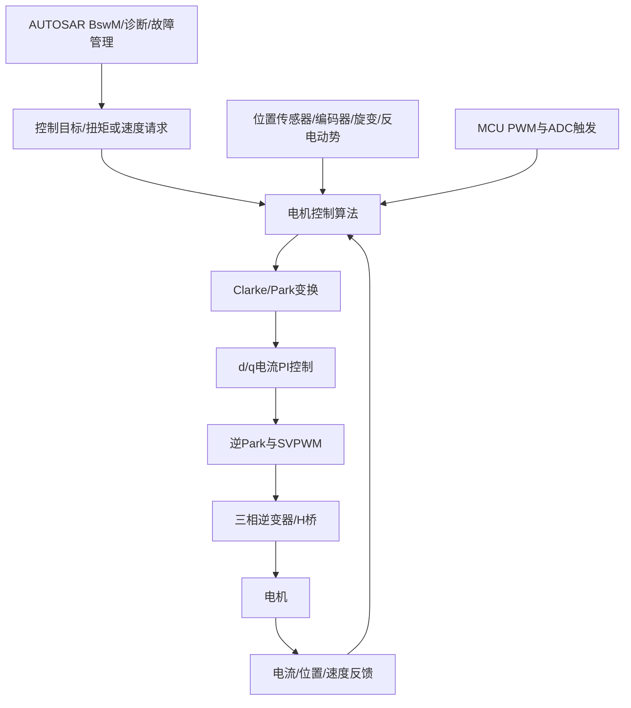
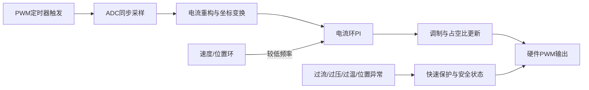

# 电机控制专题：从 H 桥到 FOC

本专题汇总 Flomo「电机控制」专栏导航、10 篇主线文章。按功率级、调制、电流/位置闭环、传感器和汽车软件集成形成完整工程链。以下保留原始笔记正文、来源 ID 和 Flomo 链接。

## 系统架构

## 控制软件时序与保护

## 工程审查要点

- 先明确电机类型、母线电压、峰值/持续电流、转速范围和负载惯量。
- 功率级检查 MOSFET/IGBT 额定值、栅极驱动、死区、续流路径、母线电容与热设计。
- 采样检查电流传感器量程、偏置、带宽、同步采样点、ADC 触发和噪声。
- FOC 检查电角度方向、极对数、Clarke/Park 定义、PI 限幅与抗积分饱和、SVPWM 饱和处理。
- 位置方案要评估零速能力、低速精度、成本、EMC、故障诊断和降级策略。
- 汽车集成要明确 ISR 与任务边界、BswM 状态切换、诊断事件、看门狗和故障安全输出。

## 原始 Flomo 笔记（完整内容）

### 1. 专栏⑪·第十篇：电机控制配置自检清单——上车前逐项打勾的 15 项

- Flomo ID：`MjQ5OTUxNzQy`
- 创建时间：2026-08-03T20:05:23+08:00
- 原文：[在 Flomo 中打开](https://v.flomoapp.com/mine/?memo_id=MjQ5OTUxNzQy)
- 标签：Area/技术/电机控制、Archive/MigratedNotion、Archive/DeleteCandidate

**专栏⑪·第十篇：电机控制配置自检清单——上车前逐项打勾的 15 项**

前九篇从电机类型（第1篇）、功率级（第2篇）、PWM调制（第3篇）、FOC算法（第4篇）、位置检测（第5篇）、汽车实战（第6篇）、反电动势（第7篇）、双环调度（第8篇）、AUTOSAR集成（第9篇）铺完整个链路。收官篇把整个专栏压缩成上车前逐项打勾的清单。

**清单分 4 组：硬件与功率级（4项）→ PWM 与采样（4项）→ 控制算法（4项）→ 系统集成（3项）**

**组 A：硬件与功率级**

1. 功率管选型核对——耐压/电流裕量足够、体二极管 Qrr 满足 EMI 要求（第2篇）

2. 死区时间配置——不直通也不畸变，典型 100-500ns，实测验证（第2篇）

3. 自举电容容量——高占空比/低频下能充满，上臂不丢相（第2篇）

4. 电流采样链路——Shunt 布局、ADC 同步、采样精度满足 FOC 需求（第4篇）

**组 B：PWM 与采样**

1. PWM 频率选型——10-20kHz 常规区间，开关损耗与纹波平衡（第3篇）

2. SVPWM 电压利用率确认——母线电压够不够，SPWM vs SVPWM 差 15.5%（第3篇）

3. 采样窗口与 PWM 中心对齐——避开开关噪声，电流值不畸变（第8篇）

4. 死区补偿——低速/过零畸变是否补偿（第3篇）

**组 C：控制算法**

1. 电流环带宽 = PWM 频率 1/10~1/20——PI 参数有推导有记录（第4篇）

2. 位置传感器选型——先问"需不需要零速大转矩"，再选旋变/编码器/霍尔/无感（第5篇）

3. 无感方案边界清楚——低速盲区、启动三段式、切换平滑（第7篇）

4. 双环优先级——电流环 \> 位置环，位置环脏活挪出中断（第8篇）

**组 D：系统集成**

1. 故障切断路径——危险故障 ISR 直切（微秒级），不依赖 BswM 仲裁（第9篇）

2. 电机使能/禁止走 BswM——命令与执行有确认机制，状态不同步要防（第9篇）

3. AUTOSAR 集成——Complex Driver 外设所有权分配、诊断异步上报、关机先停电机（第9篇）

**一句话总结**：电机控制的清单 15 项，本质是三条线：功率级别炸管（A/B 组）、算法别失控（C 组）、集成别打架（D 组）。每一条都是前九篇里的一个坑，上车前逐项打勾，省的是一次返工。

📎 第9篇：AUTOSAR 集成 → [https://v.flomoapp.com/mine/?memo\_id=MjQ5OTUxNzM2](https://v.flomoapp.com/mine/?memo_id=MjQ5OTUxNzM2)  📎 专栏⑩·第10篇：多核自检清单 → [https://v.flomoapp.com/mine/?memo\_id=MjQ5NTY2Njg2](https://v.flomoapp.com/mine/?memo_id=MjQ5NTY2Njg2)  📎 电机控制专题导航 → [https://v.flomoapp.com/mine/?memo\_id=MjQ4NjM0MTIy](https://v.flomoapp.com/mine/?memo_id=MjQ4NjM0MTIy)

**专栏⑪进度：10/10篇 ✅ 全部完成**

#Area/技术/电机控制

#Archive/MigratedNotion 
#Archive/DeleteCandidate

---

### 2. 专栏⑪·第9篇：AUTOSAR 集成深化——电机控制 × BswM 状态机

- Flomo ID：`MjQ5OTUxNzM2`
- 创建时间：2026-08-03T20:05:15+08:00
- 原文：[在 Flomo 中打开](https://v.flomoapp.com/mine/?memo_id=MjQ5OTUxNzM2)
- 标签：Area/技术/电机控制、Archive/MigratedNotion、Archive/DeleteCandidate

**专栏⑪·第9篇：AUTOSAR 集成深化——电机控制 × BswM 状态机**

**场景：电机控制走 Complex Driver 跑在 ISR 里（第6篇讲过），但"电机什么时候转、什么时候停、故障时怎么办"——这些是模式管理的事，归 BswM**

先点破一个巧合：BLDC 六步换相本质上就是一个状态机——状态（扇区/导通组合）+ 条件（霍尔信号）+ 动作（切换导通相）。你第一次看它时想到的就是 BswM 的规则链（7/28 三问其一）。这个直觉是对的——电机控制和模式管理的底层是同一套思维。真正的坑在两层怎么分工。

**两层分工的边界：**

- **实时性在 ISR（微秒级）**：FOC 电流环、过流保护、PWM 更新——必须 ISR 直做，不能等任何仲裁

- **模式管理在 BswM（毫秒级）**：电机使能/禁止、运行模式切换、故障后的降级策略——BswM 仲裁

**AUTOSAR 集成里三个必踩的接口问题：**

1. **电机使能/禁止作为 BswM 的 Action**：比如"点火 ON + 无故障 → 使能电机"。但 BswM 的 Action 只是"发命令"，真正执行在 Complex Driver——命令和执行的间隙要处理（BswM 说"电机停了"，ISR 可能还在跑最后一个周期）。

2. **故障响应路径要分两级**：过流/堵转这类危险故障，必须 ISR 直切 PWM（微秒级），不能等 BswM 仲裁（毫秒级）。但切完要同步通知 BswM（置故障标志），让上层知道"电机被切了"——否则 BswM 还以为是正常运行。

3. **与 EcuM 的关机交互**：EcuM 要睡眠时，必须先停电机再睡——BswM 的关机 Action 链里要包含"电机停止并确认"这一步（呼应专栏④/⑤的关机握手），否则电机 ISR 还在跑，休眠电流下不来、甚至唤醒。

**三个坑：**

- **BswM 和 ISR 状态不同步**：BswM 维护"电机使能"标志，ISR 维护"实际运行"状态——两者可能不一致（命令已发、执行未完成）。要有明确的确认机制（ISR 回写状态）。

- **安全切断依赖 BswM**：过流时等 BswM 仲裁（毫秒级）再切——电机已经烧了。安全路径必须 ISR 直切。

- **诊断上报阻塞 FOC**：故障进 DEM 要调 Dem 服务——但 FOC ISR 不能被阻塞。故障标志异步传递（慢速任务上报），别在 ISR 里调 DEM（第6篇提过，这是高危操作）。

**一句话总结**：电机控制的实时性靠 ISR（微秒级保命），模式管理靠 BswM（毫秒级协调）——两层分工明确。别让 BswM 去做微秒级的事（会死人），也别让 ISR 去管模式（会乱套）。

📎 第8篇：双环调度 → [https://v.flomoapp.com/mine/?memo\_id=MjQ5OTUxNzEy](https://v.flomoapp.com/mine/?memo_id=MjQ5OTUxNzEy)  📎 三问·其一：BLDC换相 × BswM → [https://v.flomoapp.com/mine/?memo\_id=MjQ5MDI3Mjg4](https://v.flomoapp.com/mine/?memo_id=MjQ5MDI3Mjg4)  📎 专栏⑤·第7篇：BswM 和 SWC 接口 → [https://v.flomoapp.com/mine/?memo\_id=MjQ5NTY2MjE3](https://v.flomoapp.com/mine/?memo_id=MjQ5NTY2MjE3)

**专栏⑪进度：9/10篇**

#Area/技术/电机控制

#Archive/MigratedNotion 
#Archive/DeleteCandidate

---

### 3. 专栏⑪·第8篇：电流环 vs 位置环——双环调度与中断优先级

- Flomo ID：`MjQ5OTUxNzEy`
- 创建时间：2026-08-03T20:05:05+08:00
- 原文：[在 Flomo 中打开](https://v.flomoapp.com/mine/?memo_id=MjQ5OTUxNzEy)
- 标签：Area/技术/电机控制、Archive/MigratedNotion、Archive/DeleteCandidate

**专栏⑪·第8篇：电流环 vs 位置环——双环调度与中断优先级**

**场景：PWM 中断（电流环，10-20kHz）和霍尔/编码器中断（位置环）抢同一个 CPU——优先级先排谁？**

答案很硬： **电流环 \> 位置环**。原因不是"电流更重要"，是"失控的代价不同"——电流失控 = 过流炸管/烧电机；位置误差最多是性能差、手感差。

**两个环的实时性画像：**

- **电流环**（PWM 中断触发）：周期 = PWM 周期（50-100μs@10-20kHz）。每个周期必须跑完：ADC 采样 → Clark → Park → PI → 逆变换 → SVPWM 更新寄存器。超时 = 电流失控。

- **位置环**（霍尔/编码器事件触发）：换向/位置更新。可被电流环抢占——位置处理晚几个周期没事，电流晚一个周期可能出事。

**CPU 预算怎么算：**

10kHz 电流环 = 100μs 周期。FOC 链路（含 ADC）要压到 30-50μs（30-50% CPU）——剩下的时间给位置环、通信、上层任务。电流环超预算，整个系统跟着超。

**四个坑：**

- **位置中断抢占电流中断**：位置环处理时间长（滤波、观测器、查表），把电流环挤到超时——电流失控。位置环的脏活（滤波）要挪到低速任务，中断里只做必要的。

- **ADC 采样窗口没跟 PWM 对齐**：采样点落在 PWM 开关沿上——采到开关噪声，电流值畸变——PI 输出抖动。采样要在 PWM 中心（开关噪声最小处）触发。

- **电流环里做位置环的事**：把位置估算、观测器塞进电流环——超时是必然的。电流环只做电流的事，位置估算放慢速循环。

- **中断嵌套 vs 优先级翻转**：裸机里中断随便嵌；进 AUTOSAR 后是 Cat1/Cat2 中断模型（第9篇展开）——优先级和禁止嵌套的规则不一样，沿用裸机习惯会翻车。

**一句话总结**：双环优先级不是"看哪个重要"，是"看哪个失控会毁掉系统"——电流环先保命，位置环让路。采样对齐 PWM 中心、脏活挪出中断、预算留余量，双环就稳了。

📎 第7篇：反电动势实战 → [https://v.flomoapp.com/mine/?memo\_id=MjQ5OTUxNjky](https://v.flomoapp.com/mine/?memo_id=MjQ5OTUxNjky)  📎 三问·其二：双环优先级 → [https://v.flomoapp.com/mine/?memo\_id=MjQ5MDI3MzE4](https://v.flomoapp.com/mine/?memo_id=MjQ5MDI3MzE4)  📎 专栏⑩·第7篇：多核调试 → [https://v.flomoapp.com/mine/?memo\_id=MjQ5NTY2NjM5](https://v.flomoapp.com/mine/?memo_id=MjQ5NTY2NjM5)

**专栏⑪进度：8/10篇**

#Area/技术/电机控制

#Archive/MigratedNotion 
#Archive/DeleteCandidate

---

### 4. 专栏⑪·第7篇：反电动势实战——省掉位置传感器，怎么知道转子在哪

- Flomo ID：`MjQ5OTUxNjky`
- 创建时间：2026-08-03T20:04:58+08:00
- 原文：[在 Flomo 中打开](https://v.flomoapp.com/mine/?memo_id=MjQ5OTUxNjky)
- 标签：Area/技术/电机控制、Archive/MigratedNotion、Archive/DeleteCandidate

**专栏⑪·第7篇：反电动势实战——省掉位置传感器，怎么知道转子在哪**

**场景：想省掉旋变/霍尔（省几十块），但电机转起来后不知道转子在哪——反电动势就是那个"免费的传感器"**

第5篇讲过无传感器方案：中高速用反电动势（BEMF），零速/低速用高频注入。这篇把 BEMF 讲透——它在工程上不是"一个概念"，是一条需要实现的高频采样通道。

**BEMF 的三种工程实现：**

1. **过零检测（Zero Crossing）——无感 BLDC 的经典方案**
   - 比较端电压与中点电压，BEMF 过零 = 换向时机（过零后再等 30° 电角度换向）

   - 硬件：比较器电路；软件：ADC 采样端电压
2. **相电压/线电压比较法**
   - 用硬件比较器比较两相端电压，输出换向信号——最简单、延迟最小
3. **观测器（滑模/龙伯格）——正弦波 FOC 的软件方案**
   - 用电机模型 \+ 采样电流/电压，实时估算 BEMF 矢量 → 提取角度

**三个坑：**

- **低速时 BEMF 太小，根本测不到**：BEMF 与转速成正比——低于 5% 额定转速时信号淹没在噪声里（第5篇）。所以无感启动要"开环强拉"：先按固定频率换向把转子拉起来，转速够了再切闭环。

- **PWM 开关噪声里的"假过零"**：PWM 开关瞬间、续流二极管压降都会制造假过零——采样窗口要避开开关沿（PWM 中心对齐采样），过零检测要有滤波/去抖。

- **启动三段式的切换冲击**：开环强拉 → 检测到 BEMF → 切闭环，切换瞬间角度估算有跳变 → 电流冲击。切换要平滑（渐入渐出），别一把切。

**还有两个常被忽略的细节：**

- **中点电压怎么取**：硬件中点（绕组星点直接采样）最准但电机可能没引出中点；虚拟中点（电阻分压）在高频噪声下会漂移——漂移 = 过零判断偏移 = 换向提前/滞后。

- **BEMF 采样与 PWM 占空比耦合**：占空比太高/太低时，采样窗口被压缩——BEMF 采样的有效时间窗口随工况变化，要动态调整采样时刻。

**一句话总结**：BEMF 是免费的传感器，但它是"转速的函数"——转得越快越准，零速/低速是它的天生盲区。无感方案省的是钱，付的是"低速段性能"和"启动复杂度"。

📎 第6篇：汽车实战场景 → [https://v.flomoapp.com/mine/?memo\_id=MjQ4NjM1NDE4](https://v.flomoapp.com/mine/?memo_id=MjQ4NjM1NDE4)  📎 三问·其三：BEMF 是结果还是原因 → [https://v.flomoapp.com/mine/?memo\_id=MjQ5MDI3MzQ0](https://v.flomoapp.com/mine/?memo_id=MjQ5MDI3MzQ0)

**专栏⑪进度：7/10篇**

#Area/技术/电机控制

#Archive/MigratedNotion 
#Archive/DeleteCandidate

---

### 5. 专栏⑪·第6篇：汽车实战场景——EPS、电子水泵、EV主驱、AUTOSAR集成

- Flomo ID：`MjQ4NjM1NDE4`
- 创建时间：2026-07-26T12:20:42+08:00
- 原文：[在 Flomo 中打开](https://v.flomoapp.com/mine/?memo_id=MjQ4NjM1NDE4)
- 标签：Area/技术/电机控制、Archive/MigratedNotion、Archive/DeleteCandidate

**专栏⑪·第6篇：汽车实战场景——EPS、电子水泵、EV主驱、AUTOSAR集成**

前5篇从基础到算法铺了一整条链路。这篇回到你的主场—— **汽车上哪些地方在用电机控制，每个场景的约束条件是什么。**

**▎场景一：EPS（电动助力转向）——最精密的 12V BLDC 应用**

EPS 电机装在转向管柱上或齿条上，驾驶员打方向时电机提供辅助力矩。12V 系统，功率 300-800W。

**约束条件：**

- **手感**——不是"电机转得准"，是"驾驶员觉得方向盘轻了但又不发飘"。转矩脉动 < 1% 才能让驾驶员感觉不到电机介入的"颗粒感"。FOC 是必须的，6步换向手感发硬

- **零速输出最大转矩**——车停着打方向（原地转向）需要的助力最大。电机在零速/近零速下输出额定转矩——FOC 的零速闭环能力至关重要

- **冗余**——功能安全要求 ASIL D。EPS 失效后驾驶员还能靠机械系统转向（但很重）。电机控制器通常是"双芯片"架构——主芯片+监控芯片，互相校验

**EPS 的控制回路（比你想象的复杂）：**

驾驶员方向盘扭矩（扭矩传感器）→ EPS控制器算"需要多大助力"（根据车速、方向盘角度、车速感应梯度）→ 目标电流 Iq\_ref → FOC 电流环 → PWM → BLDC电机输出助力

EPS 的"手感"好坏来自上层算法（扭矩梯度/阻尼补偿/末端保护）——FOC 电流环只是执行层。FOC 的电流纹波和延迟——直接影响驾驶员手感。

**EPS 中的位置传感器**：EPS 电机通常用磁编码器或低成本的旋变（24V 以下用磁传感器，24V 以上用旋变）。霍尔在 EPS 上不够——60° 分辨率带来的转矩脉动驾驶员能感觉到。

**▎场景二：电子水泵 / 电子风扇——最松的约束，最便宜的成本**

电子水泵和电子风扇——电机 \+ 叶轮/风扇叶片 \+ 控制器三合一。12V 系统，功率 50-200W。

**约束条件：**

- **成本第一**——水泵和风扇是"能转就行"的功能。控制器成本高 5 块钱——总监会让你换方案

- **不需要零速大转矩**——启动后才需要转动，零速没有负载要求

- **转速范围固定**——通常 1000-6000rpm，不需要宽调速

**控制方案选择：**

- 最便宜：BLDC 6步换向 + 霍尔传感器（不需要 FOC）

- 中档：BLDC FOC + 霍尔（用霍尔观测器 + 插值，省掉编码器/旋变的钱）

- 省掉传感器的：无传感器 FOC（BEMF 观测器 + 高频注入）

水泵和风扇项目上 90% 用"BLDC + 6步换向 + 霍尔"——成本最低、MCU 为 8 位/简单的 32 位、FOC 的算力开销和 PI 整定工作在量产中省了。

**▎场景三：EV 主驱电机控制——PMSM+FOC 的极致平台**

EV 主驱：400V/800V 高压系统，功率 100-300kW+，PMSM 或 ACIM。

**约束条件：**

- **效率决定续航**——FOC 的效率从 90% 提到 93%——同样的电池跑更远。SiC MOSFET 比 IGBT 的效率提升是 EV 主驱换 SiC 的核心驱动力

- **宽调速范围**——从 0 rpm（坡道起步）到 15000-20000 rpm（高速巡航）。FOC 在低速段靠 Id=0 控制，高速段靠弱磁控制（Id < 0 削弱永磁体磁场）

- **NVH（噪声/振动/平顺性）**——PMSM 的转矩脉动和齿槽转矩会传到车内。FOC 的电流谐波补偿 + 硬件上的斜槽设计

- **功能安全**——ASIL C/D。国际标准 ISO 26262 + ISO 21434（网络安全）。电机控制器双芯片冗余 + 转矩监控（转矩安全 > 诊断扭矩监控 → 切断 PWM 输出）

**弱磁控制为什么叫"弱磁"**——PMSM 的转子是永磁体，磁场强度固定。转速升高时反电动势升高 → 接近母线电压 → 不能再提速。控制 Id < 0，电流产生的磁场抵消一部分永磁体磁场 → 反电动势降低 → 可以继续提速。代价：效率下降（增加的 Id 电流产生 I²R 铜损）。

**▎AUTOSAR 集成：电机控制不走标准 BSW**

电机控制——从 PWM 生成到 ADC 采样到 FOC 算法——对实时性要求极高（通常 10-100μs 的控制周期）。AUTOSAR 标准 BSW（COM/PduR/CanIf/RTE 等）的延迟在毫秒级——跟不上电机控制的需求。

在 AUTOSAR 架构中，电机控制通常被实现为：

- **Complex Driver（复杂驱动）**——最常用的方式。一个特殊的 SWC，绕过标准 BSW，直接访问 MCU 的 PWM 定时器、ADC、GPIO。RTE 只用来做"诊断上报"（电机状态/故障码通给 DEM）和"控制指令"（目标转速/转矩从 CAN 诊断报文传进来）

- **Autosar OS 的 Cat2 ISR**——FOC 控制回路在 Cat2 ISR 里跑（中断上下文，优先级最高，不经过 OS 调度延迟）

- **外围独立控制器**——有些架构直接用独立的电机控制 MCU（便宜的小 MCU）做 FOC，主 MCU 通过 SPI/UART 给目标转矩/转速指令。主 MCU 跑 AUTOSAR 标准软件，电机控制 MCU 跑裸机代码

**AUTOSAR 集成时最容易出现的接口问题：**

1. **Complex Driver 跟 BSW 的时序冲突**——Complex Driver 占了 PWM/ADC 外设，BSW 的 CanIf 也想用同一个定时器通道。需要在 EcuM 的初始化阶段分配外设的"所有权"

2. **诊断接口**——DEM 需要接收电机故障（过流/过温/失步），但不能中断正在跑的 FOC ISR。故障状态通过"非关键路径"（慢速 Task）上报

3. **OTA 升级**——电机控制的标定参数（PI 系数/死区时间/过流阈值）存在 NvM 里。升级后如果标定参数不兼容——FOC 算法行为异常——电机会抖

**🍎 电机控制专栏的核心结论**

整个系列用一个图总结：

\[电机类型\] → \[功率级电路\] → \[PWM调制\] → \[FOC算法\] → \[位置检测\]  ↕  \[汽车实战\]

最贵的环节不是算力（MCU），是传感器（旋变/编码器 + 电流传感器 + 栅极驱动隔离）。最难的环节不是 PI 整定，是"无传感器低速段的 HFI 高频注入——怎么在噪声中提取转子位置信息"。最容易被忽视的环节——AUTOSAR 集成中的时序冲突（Complex Driver 占外设不释放）。

你在汽车行业做 AUTOSAR BSW——电机控制是 Complex Driver 这个概念的典型应用场景，也是把"底层硬件控制"和"上层 AUTOSAR 架构"衔接起来的最佳练习。

📎 电机控制专题导航 → [https://v.flomoapp.com/mine/?memo\_id=MjQ4NjM0MTIy](https://v.flomoapp.com/mine/?memo_id=MjQ4NjM0MTIy)  📎 第5篇：位置/速度检测 → [https://v.flomoapp.com/mine/?memo\_id=MjQ4NjM1MDE3](https://v.flomoapp.com/mine/?memo_id=MjQ4NjM1MDE3)  📎 AUTOSAR知识体系导航 → [https://v.flomoapp.com/mine/?memo\_id=MjQ4MDU3MzE3](https://v.flomoapp.com/mine/?memo_id=MjQ4MDU3MzE3)

**专栏⑪进度：6/10篇**

#Area/技术/电机控制

#Archive/MigratedNotion 
#Archive/DeleteCandidate

---

### 6. 专栏⑪·第5篇：位置/速度检测——霍尔、编码器、旋转变压器、无传感器控制

- Flomo ID：`MjQ4NjM1MDE3`
- 创建时间：2026-07-26T12:17:07+08:00
- 原文：[在 Flomo 中打开](https://v.flomoapp.com/mine/?memo_id=MjQ4NjM1MDE3)
- 标签：Area/技术/电机控制、Archive/MigratedNotion、Archive/DeleteCandidate

**专栏⑪·第5篇：位置/速度检测——霍尔、编码器、旋转变压器、无传感器控制**

第4篇的 FOC 链路里每一步都需要 **转子角度 θ**。没有准确的角度——Park/逆Park 就错了——电流控制就跑偏了。位置传感器是 FOC 精度的天花板。

**▎霍尔传感器——最简单、最廉价，精度最低**

**原理**：三个霍尔开关安装在定子上，间隔 120°（电角度）。转子永磁体的N/S极经过霍尔时——霍尔输出高低电平——三个霍尔组合出 6 种状态——对应 6 个 60° 扇区。

**精度**：60° 电角度分辨率。FOC 需要连续的 θ——但霍尔只能告诉"你在第 3 个扇区"。中间角速度用插值估算：已知上一时刻的角度 + 当前速度 × 时间差。

**速度估算**：霍尔换向频率 × 60° / 换向时间 = 转速。

**为什么有些项目用霍尔做 FOC**——成本。霍尔传感器芯片不到 1 块钱，旋变要几十块。在电动自行车/小型水泵这些"不需要极致低速性能"的场景——霍尔 FOC 够用。

**痛点**：霍尔安装位置偏差（机械公差 ±5° 电角度）→ 角度误差 → 电流控制偏差 → 转矩脉动。需要"霍尔标定"——上电时识别 6 个扇区的实际边界，补偿安装偏差。

**▎编码器——精度高，但怕振动**

**原理**：码盘上有光学/磁性的刻线或图案。读头扫描码盘运动，输出 A/B/Z 脉冲。

**增量式编码器**：

- A/B 两相差 90° 电角度的脉冲——正反转靠 A/B 的相位差判断

- Z 脉冲——每圈一个——"零点"参考

- 分辨率：2500 PPR（pulses per revolution）是常见规格→ 2500 × 4（四倍频）= 10000 个位置/圈 → 0.036° 角度分辨率

**绝对式编码器**：

- 直接输出绝对位置值（EnDat / BiSS / SSI 协议）

- 上电不需要寻零——立刻知道转子在哪

- 分辨率和精度高于增量式

- 用于 ADAS 转向系统/线控制动——启动瞬间就要知道方向盘位置

**编码器的弱点**：

- 怕振动：码盘碎裂/光路偏——编码器失效

- 温度范围窄：光学编码器 -1070°C——汽车发动机舱 -40125°C 不能用

- 需要开孔安装：码盘要套在转子轴上，电机壳体要开孔走信号线——增加成本

**▎旋转变压器（Resolver）——汽车级 FOC 的标配**

**原理**：本质是一个小型的"旋转变压器"。定子上有励磁线圈（Excitation），转子上的绕组感应出励磁信号——转子转动时感应信号的幅值随转子角度成正/余弦变化。

**输出**：两路信号——SIN 和 COS。比值为 tan(θ) = SIN / COS → 查 arctan 算角度。

**精度**：0.1-1° 电角度——比编码器低但够 FOC 用（PMSM 对 1° 以内的角度误差不敏感）。真正的优势在可靠性：

- **无接触**——没有码盘、没有光学器件、没有磨损。寿命超过电机本体

- **宽温度**——-55~175°C（满足汽车发动机舱要求）

- **抗振动**——无光学器件，不会碎裂

- **EMC 免疫**——变压器原理，共模噪声不敏感

**代价**：

- 需要专用的 **激励信号源**（5-10kHz 正弦波，幅值 5-15V）——需要额外的芯片或 MCU 的 DAC + 运放

- 需要对 SIN/COS 信号做 **解码**（RDC—Resolver-to-Digital Converter）——集成在 MCU 内部（如 TC3xx 的 DSADC）或外置芯片（如 AU6802）

- 旋变本身的成本 \+ 解码芯片 \+ 信号调理电路——整套下来几十到几百块

**为什么 EV 主驱几乎全用旋变**——PMSM 零速需要最大转矩（坡道起步）。霍尔 60° 分辨率做不了低速 FOC（角度不够细，电流误差大），编码器耐不了振动和高温。旋变是汽车环境下唯一同时满足"精度+可靠性+温度"的方案。

**▎无传感器控制——省掉传感器，但低速段是硬伤**

**原理**：不装位置传感器，通过电机自身的电特性反推转子位置。

**中高速段（\> 5% 额定转速）**： **反电动势观测器**——转子转动时在定子绕组上感应出反电动势（BEMF）。BEMF 的相位包含了转子位置信息。滑模观测器（Sliding Mode Observer）或龙伯格观测器（Luenberger Observer）实时估算 BEMF → 提取角度。

**零速/低速段（< 5% 额定转速）**：反电动势太小测不到——需要 **高频注入（HFI, High-Frequency Injection）**。在 d 轴上注入一个高频电压信号（通常 500Hz-1kHz），检测 q 轴上的电流响应——利用 PMSM 的"磁凸极性"（d 轴和 q 轴的阻抗不同）推算出转子位置。

**无传感器的局限性**：

- 零速启动需要 HFI，但 HFI 依赖电机的凸极率——内嵌式 PMSM（IPM）可以，表贴式 PMSM（SPM）几乎不行

- 堵转和低速大负载——HFI 的信噪比变差

- 控制系统在"速度 \> 阈值时切换到 BEMF 观测器、< 阈值时切换到 HFI"——切换时有角度跳变

**汽车上什么时候用无传感器**——电动水泵/电子风扇（启动后一直在转，不需要零速大转矩）。EPS/EV 主驱——必须要有传感器（零速需要转矩 + 功能安全要求冗余位置信号）。

**▎一张表总结**

霍尔、增量编码器、绝对编码器、旋变、无传感器：角度分辨率（60°/0.01-0.1°/0.001-0.1°/0.1-1°/中高速5-10°零速差）；零速检测（❌扇区内插值不确定/✅/✅/✅/❌HFI有盲区）；温度范围（-40150°C/-1070°C/-4085°C/-55175°C/—不用外部传感器）；抗振动（✅/❌/❌/✅/✅）；成本（<1$/10-50$/30-100$/20-50$+解码/0$硬件省了软件复杂）；汽车场景（水泵风扇/实验室工业非车规/ADAS转向线控制动/EV主驱EPS线控/水泵风扇家用电器）；FOC适用（勉强需标定和插值/✅/✅/✅/中高速✅低速❌）

**🍎 选位置传感器的本质问题：你的电机需不需要在零速输出大转矩**

需要（EV 主驱、EPS、刹车）→ 旋变或绝对编码器。不需要（水泵、风扇、电动工具）→ 霍尔（配 FOC）或无传感器。绝大多数汽车电机控制项目的传感器成本和选型争议，根源都在这一个问题。

📎 电机控制专题导航 → [https://v.flomoapp.com/mine/?memo\_id=MjQ4NjM0MTIy](https://v.flomoapp.com/mine/?memo_id=MjQ4NjM0MTIy)  📎 第4篇：FOC算法 → [https://v.flomoapp.com/mine/?memo\_id=MjQ4NjM0OTQw](https://v.flomoapp.com/mine/?memo_id=MjQ4NjM0OTQw)  📎 第6篇：汽车实战场景 → [https://v.flomoapp.com/mine/?memo\_id=MjQ4NjM1NDE4](https://v.flomoapp.com/mine/?memo_id=MjQ4NjM1NDE4)

**专栏⑪进度：5/10篇**

#Area/技术/电机控制

#Archive/MigratedNotion 
#Archive/DeleteCandidate

---

### 7. 专栏⑪·第4篇：FOC 算法——Clark / Park / PI / SVPWM 的完整链路

- Flomo ID：`MjQ4NjM0OTQw`
- 创建时间：2026-07-26T12:16:26+08:00
- 原文：[在 Flomo 中打开](https://v.flomoapp.com/mine/?memo_id=MjQ4NjM0OTQw)
- 标签：Area/技术/电机控制、Archive/MigratedNotion、Archive/DeleteCandidate

**专栏⑪·第4篇：FOC 算法——Clark / Park / PI / SVPWM 的完整链路**

前3篇做了铺垫——知道"有个电机"（第1篇）、"用功率管让它转"（第2篇）、"PWM 信号怎么变成电流"（第3篇）。这篇讲 **怎么精确控制电流的大小和方向**——FOC 的核心算法链路。

**▎FOC 的本质：把"控制三相交流"变成"控制两个直流"**

BLDC 和 PMSM 是三相电机，需要控制三相电流（Ia, Ib, Ic）——三相电流相位差 120°，互相耦合，不是独立的变量。

FOC 的核心思路： **通过坐标变换，把三个互相耦合的交流量变成两个互相独立的直流量。**

Clark 变换（三相→两相正交）→ Park 变换（静止→旋转）→ PI 调节（对直流量用经典控制）→ 逆 Park/逆 Clark → SVPWM。

**▎第1步：Clark 变换（三相→两相静止坐标系）**

把从 ADC 采到的三相电流（Ia, Ib, Ic）投影到两相静止坐标系（α, β）。

公式（等幅值变换）：

Iα = Ia - 0.5 × Ib - 0.5 × Ic  Iβ = (√3/2) × (Ib - Ic)

物理直觉：电机有三相绕组（空间上相隔 120°），但电磁场可以只用两个互相垂直的轴（α, β）来描述——多余的第三轴是冗余的。Clark 变换就是去掉这个冗余。

**▎第2步：Park 变换（两相静止→两相旋转坐标系）**

Iα 和 Iβ 还是交流量（随着转子转动而正弦变化）。Park 变换把它们变成直流量（Id, Iq）——因为是跟着转子一起旋转的坐标系。

公式：

Id = Iα × cos(θ) + Iβ × sin(θ)  Iq = -Iα × sin(θ) + Iβ × cos(θ)

θ：转子的电角度（从位置传感器读到的角度 × 电机极对数）。

Id（直轴电流）：产生磁场，但不产生转矩。在 PMSM 中，Id 通常控制为 0（因为转子已经有永磁体了——不需要额外励磁）——Id ≠ 0 时可以做弱磁控制（高速时削弱永磁体磁场，换取更高转速）。

Iq（交轴电流）：产生转矩——电机的输出转矩 ≈ Kt × Iq（Kt 是转矩常数）。

**这就是 FOC 的核心"解耦"：把转矩和磁场分开控制。** Id 管磁场、Iq 管转矩——两个独立的 PI 调节器分别控制。

**▎第3步：PI 调节器**

现在是两个直流量（Id, Iq）——可以用经典的 PI（比例积分）调节器了。

电流环 PI 调节器：

Vd\_ref = Kp\_d × (Id\_ref - Id\_measured) + Ki\_d × ∫(Id\_ref - Id\_measured) dt  Vq\_ref = Kp\_q × (Iq\_ref - Iq\_measured) + Ki\_q × ∫(Iq\_ref - Iq\_measured) dt

Id\_ref（目标直轴电流）：通常 = 0（不额外励磁），弱磁时为负值。

Iq\_ref（目标交轴电流）：来自速度环或转矩指令——你想要多少转矩。

PI 参数（Kp, Ki）的整定——经典方法是"整定电流环带宽"。经验法则：电流环带宽设为 PWM 频率的 1/10 ~ 1/20。PWM 10kHz → 电流环带宽 500-1000Hz → 对应的 PI 参数可以推导出来。

**▎第4步：逆 Park + 逆 Clark**

PI 调节器输出的是旋转坐标系下的 Vd\_ref, Vq\_ref（直流量）。要驱动三相全桥，需要把它们变回三相 PWM 占空比。

逆 Park：

Vα\_ref = Vd\_ref × cos(θ) - Vq\_ref × sin(θ)  Vβ\_ref = Vd\_ref × sin(θ) + Vq\_ref × cos(θ)

逆 Clark（两相→三相）：

Va\_ref = Vα\_ref  Vb\_ref = -0.5 × Vα\_ref + (√3/2) × Vβ\_ref  Vc\_ref = -0.5 × Vα\_ref - (√3/2) × Vβ\_ref

得到的 Va\_ref, Vb\_ref, Vc\_ref 就是三相电压指令——送进 SVPWM 模块（第3篇讲的），算出 6 个功率管的导通时间。

**▎完整的 FOC 控制回路（一个 PWM 周期的快照）**

ADC 采样三相电流（Ia, Ib, Ic）+ 位置传感器读角度θ  ↓  Clark 变换: Ia,Ib,Ic → Iα,Iβ  ↓  Park 变换: Iα,Iβ → Id,Iq（用 θ）  ↓  PI 调节器：Id\_ref-Id → Vd\_ref；Iq\_ref-Iq → Vq\_ref  ↓  逆 Park: Vd\_ref,Vq\_ref → Vα\_ref,Vβ\_ref（用 θ）  ↓  逆 Clark: Vα\_ref,Vβ\_ref → Va\_ref,Vb\_ref,Vc\_ref  ↓  SVPWM: 算 6 个占空比 → 更新 PWM 寄存器  ↓  PWM 硬件输出 → Gate Driver → MOSFET → 电机端电压 → 电机电流变化  ↓  下一个 PWM 周期，从头再来

整个回路在一个 PWM 周期内（100μs@10kHz）跑完。这是电流环——控制的延迟决定了 FOC 的性能上限。

**▎FOC 为什么比 6 步换向好**

6步换向 vs FOC：转矩脉动（15-20% 每60°换相跳变 / <1% 连续平滑）；噪声（"咔咔"换相音 / 几乎无声）；低速性能（差 低速转矩抖动 / 好 零速也能输出最大转矩）；MCU算力（8位够用 / 32位+DSP+硬件乘法器）；效率（85-90% / >93%）；位置传感器（6个扇区霍尔60°分辨率 / 连续角度 编码器旋变观测器）

FOC 的代价：算力需求高了 10 倍、电流采样需要高精度同步 ADC、位置传感器需要连续角度而不是 6 步霍尔。

**🍎 FOC 的"钱"花在哪**

FOC 链条上最贵的不是算法本身（MCU 几十块钱就够），是 **电流采样精度和位置传感器精度**。低端方案（Shunt 电阻 + 霍尔）可以跑 FOC 但是 Id/Iq 的精度差、低速性能不理想。高端方案（隔离式电流传感器 + 旋转变压器）可以跑出教科书级别的 FOC 波形——但一套下来贵几千块。你工作中看到的电机控制——是低成本方案还是高性能方案？

📎 电机控制专题导航 → [https://v.flomoapp.com/mine/?memo\_id=MjQ4NjM0MTIy](https://v.flomoapp.com/mine/?memo_id=MjQ4NjM0MTIy)  📎 第3篇：PWM调制 → [https://v.flomoapp.com/mine/?memo\_id=MjQ4NjM0NjAz](https://v.flomoapp.com/mine/?memo_id=MjQ4NjM0NjAz)  📎 第5篇：位置/速度检测 → [https://v.flomoapp.com/mine/?memo\_id=MjQ4NjM1MDE3](https://v.flomoapp.com/mine/?memo_id=MjQ4NjM1MDE3)

**专栏⑪进度：4/10篇**

#Area/技术/电机控制

#Archive/MigratedNotion 
#Archive/DeleteCandidate

---

### 8. 专栏⑪·第3篇：PWM 调制——从 SPWM 到 SVPWM，电压怎么变成电流

- Flomo ID：`MjQ4NjM0NjAz`
- 创建时间：2026-07-26T12:13:20+08:00
- 原文：[在 Flomo 中打开](https://v.flomoapp.com/mine/?memo_id=MjQ4NjM0NjAz)
- 标签：Area/技术/电机控制、Archive/MigratedNotion、Archive/DeleteCandidate

**专栏⑪·第3篇：PWM 调制——从 SPWM 到 SVPWM，电压怎么变成电流**

第1篇讲了四种电机区别，第2篇讲了功率管怎么组成桥电路。这篇讲 **MCU 的 PWM 信号怎么变成电机绕组里流动的电流。**

**▎PWM 的"翻译"过程**

MCU 发出 PWM 占空比 → Gate Driver 放大 → MOSFET 开关 → 电机端子上产生脉冲电压 → 电机绕组的电感把脉冲电压"滤波"成连续电流 → 电流产生磁场 → 磁场驱动转子旋转。

关键中间步骤： **电感把脉冲电压滤波成连续电流**。电机的绕组是电感（L），电感上的电流不能突变——PWM 的高电平期间电流上升、低电平期间电流通过续流二极管下降——一升一降之间，平均电流 = 平均电压 / 电阻。脉冲频率越高（10kHz vs 1kHz），纹波电流越小——因为你上次在硬件第3阶写过的"100Hz 提到 10kHz 丝滑了"。

**▎SPWM（正弦 PWM）——最直观的调制方式**

想让电机产生正弦电流——就需要正弦电压。但功率管只能输出"开"或"关"两种状态，不能输出"50% 的正弦"。

SPWM 的解决方案： **用一个高频三角波（载波）跟一个低频正弦波（调制波）比较**。调制波 \> 载波 → 输出高电平；调制波 < 载波 → 输出低电平。输出脉冲的平均值 = 正弦波在该点的瞬时值。

三相 SPWM 就是三个相位差 120° 的正弦波分别跟同一个三角波比较——产生三路 PWM 信号驱动三相全桥的 6 个开关管。

SPWM 的电压利用率： **直流母线电压的 50%**。什么意思？如果母线电压是 12V，SPWM 输出的基波有效值最大只有 6V。因为正弦波峰值为 0.5×Vbus 时刚好不进入过调制区——超过就失真了。

**▎SVPWM（空间矢量 PWM）——电压利用率高 15.5% 的原因**

SVPWM 不直接比较三角波和正弦波——它把三相电压看成一个旋转的空间矢量。8 种开关组合（6 个有效矢量 + 2 个零矢量），用相邻两个有效矢量合成任意方向的电压矢量。

**直观理解**：三相全桥有 6 个开关管，对于每个开关管（上管导通=1，下管导通=0），三相一共有 2^3=8 种组合。其中 6 种是有效矢量（V1-V6，每 60° 一个方向），2 种是零矢量（V0/V7——全部上管通或全部下管通，电机端子上没有电压差）。

SVPWM 在每个 PWM 周期里算——"目标矢量在哪两个有效矢量之间"，然后按"伏秒平衡"算出两个矢量和零矢量的作用时间。

**SVPWM 的电压利用率：Vbus/√3 ≈ 57.7%**——比 SPWM 的 50% 高了 15.5%。高出的部分来自 SVPWM 注入了三次谐波——在相电压上叠加了同频三次谐波，线电压不受影响。三次谐波不产生转矩（转矩由基波产生），只提高母线电压利用率。

**▎死区时间对电流波形的影响**

第2篇讲过死区时间（防止上下管直通）。在 SPWM/SVPWM 调制中，死区时间会导致 **电压误差**：

理想情况：上管关断瞬间→下管导通。实际：上管关断→等待死区→下管导通。在死区等待期间，两个管都关断——电流通过体二极管续流——这个续流方向决定了电压误差的极性。

死区时间导致的结果：

- **电流过零点畸变**：电流在过零附近（接近 0A 时），死区时间占比最大——电压误差最明显

- **转矩脉动增大**：电流波形畸变→转矩有低频抖动

- **低速时更明显**：电机转速低时反电动势小，死区引起的电压误差占比大

补偿： **死区补偿算法**——根据电流方向预测死区期间的电压误差，在 PWM 占空比中叠加一个修正量。

**▎PWM 频率的选择——什么时候该高、什么时候该低**

频率、优点、缺点、适用：2-5kHz（开关损耗低/电流纹波大、电机有"嗡嗡"声/大功率 IGBT EV主驱早期）；10-20kHz（无噪声、纹波适中/开关损耗中等/常规电机控制 水泵EPS）；40-100kHz（电流正弦度极高/开关损耗大、MCU 算力高/SiC MOSFET EV主驱现在）；>100kHz（可用极小的滤波电感/损耗极大/只有 GaN 能做到 航空航天服务器电源）

SiC 和 GaN 能工作在更高频率——不是因为它们"更快"（开关速度确实更快），而是因为它们的开关损耗更小（低 Qg + 低 Qrr + 零反向恢复）。

**🍎 电机控制从 PWM 到 FOC 是一条连续的思维链**

PWM（产生脉冲电压）→ 电感滤波（脉冲→连续电流）→ 电流产生磁场 → 磁场驱动转子。

如果你在 MCU 上改一下 PWM 占空比——电机端的电压变了——电流变了——转矩变了——转速变了。控制 PWM 占空比 = 控制转矩/转速。这就是电机控制的核心： **MCU 的定时器/GPT 模块输出 PWM 信号的高低——直接决定了电机动不动、转多快、力矩多大。** 理解 PWM 到电流的"翻译"过程，是理解后面 FOC 算法（Clark/Park 变换 + PI 调节器 + SVPWM）的前提。

📎 电机控制专题导航 → [https://v.flomoapp.com/mine/?memo\_id=MjQ4NjM0MTIy](https://v.flomoapp.com/mine/?memo_id=MjQ4NjM0MTIy)  📎 第1篇：电机类型对比 → [https://v.flomoapp.com/mine/?memo\_id=MjQ4NjM0MzAw](https://v.flomoapp.com/mine/?memo_id=MjQ4NjM0MzAw)  📎 第2篇：H桥/三相逆变器 → [https://v.flomoapp.com/mine/?memo\_id=MjQ4NjM0NTI2](https://v.flomoapp.com/mine/?memo_id=MjQ4NjM0NTI2)  📎 第4篇：FOC算法 → [https://v.flomoapp.com/mine/?memo\_id=MjQ4NjM0OTQw](https://v.flomoapp.com/mine/?memo_id=MjQ4NjM0OTQw)

**专栏⑪进度：3/10篇**

#Area/技术/电机控制

#Archive/MigratedNotion 
#Archive/DeleteCandidate

---

### 9. 专栏⑪·第2篇：功率级电路——H桥到三相逆变器

- Flomo ID：`MjQ4NjM0NTI2`
- 创建时间：2026-07-26T12:12:34+08:00
- 原文：[在 Flomo 中打开](https://v.flomoapp.com/mine/?memo_id=MjQ4NjM0NTI2)
- 标签：Area/技术/电机控制、Archive/MigratedNotion、Archive/DeleteCandidate

**专栏⑪·第2篇：功率级电路——H桥到三相逆变器**

第1篇讲了四种电机的区别。这篇讲 **怎么用功率管让电机转起来**——从最简单的 H 桥到汽车主驱用的三相全桥。

**▎H 桥：两个半桥拼起来的"四开关"结构**

H 桥的命名来自电路拓扑——四个开关管（Q1-Q4）加一个负载（电机），画出来像个 H。

**四个开关管的导通组合：**

- Q1+Q4 导通：电流从左到右 → 电机正转

- Q2+Q3 导通：电流从右到左 → 电机反转

- Q1+Q2 导通（或 Q3+Q4 导通）：上下直通→短路！→ 必须避免

- 全部关断：电机自由停转（惯性滑行）

**H 桥驱动的电机——PWM 调速**

有刷 DC 电机的转速跟两端电压成正比。用 PWM 斩波控制平均电压：占空比 50% → 平均电压 = 电源电压 × 50% → 转速减半。

PWM 频率的选择：

- **< 1kHz**：电机能听到 PWM 的"嗡嗡"声（人耳可听频段），且电流纹波大（转矩抖动明显）

- **10-20kHz**：人耳听不到了（超音频），电流纹波明显减小——但你写的"100Hz 提到 10kHz 丝滑了"就是这个道理

- **\> 50kHz**：开关损耗上升（MOSFET 每开关一次都有能量损耗），且要选高频 MOSFET，成本上升

**死区时间（Dead Time）**

H 桥的上下管不能同时导通——否则 VCC 通过 Q1 和 Q2 直接到 GND——短路。但 MOSFET 的关断比开通慢——关断需要几 ns 到几百 ns。所以 PWM 信号里必须插入一个"等待时间"——Q1 关了后等一小段时间再开 Q2。这个等待时间就是死区时间。

死区时间设太长 → 电机电流畸变（电压利用率降低）。设太短 → 有直通风险。典型值：100-500ns（取决于 MOSFET 的开关速度）。

**▎从 H 桥到三相全桥：多了两相而已**

H 桥控制有刷 DC 电机（两线：正+负）。BLDC 和 PMSM 是三相绕组——需要三组 H 桥（6 个开关管）。

三相全桥有 6 个开关管（Q1-Q6），分成三个半桥（Phase A/B/C）。 **任何时候只导通三个管**（上臂一个+下臂两个，或者上臂两个+下臂一个）——这就是 6 步换向。

**6 步换向的导通表（以 BLDC 为例）：**

扇区1: Q1(Q6 + Q5导通，其他三个关断)  扇区2: Q5(Q4 + Q6导通)  扇区3: Q4(Q3 + Q5导通)  扇区4: Q3(Q2 + Q4导通)  扇区5: Q2(Q1 + Q3导通)  扇区6: Q6(Q5 + Q1导通)

每步导通 60° 电角度，一圈 360° 分 6 步。这就是 BLDC 最简单的 6 步换向——霍尔传感器检测到转子到了下一个扇区边界，控制器切换到下一组导通组合。

**▎栅极驱动（Gate Driver）——功率管靠什么打开**

MOSFET 是电压控制器件——栅极电压 > 阈值电压时导通。但 MCU 的 GPIO 只能输出 3.3V 或 5V，驱动不了功率 MOSFET（需要 10-15V 的栅极电压）。

栅极驱动芯片（Gate Driver）做三件事：

1. **电平升压**——把 MCU 的 3.3V PWM 信号升到 10-15V（驱动 MOSFET 完全导通）

2. **电流放大**——MOSFET 的栅极有寄生电容（Cgs / Cgd），每次开关都需要充放电。Gate Driver 提供高峰值电流（1-5A）来快速充放电——实现高速开关

3. **隔离（可选）**——对于高压电机（400V EV 主驱），控制电路和功率电路之间需要隔离。光耦隔离或变压器隔离

**自举电容（Bootstrap Capacitor）**

三相全桥的上臂 MOSFET（Q1/Q3/Q5）的源极是浮动的（不接地）。Gate Driver 给上臂供电靠自举电容。

自举原理：下臂导通时，VCC 通过二极管给自举电容充电。下臂关断，上臂要导通时——自举电容里存的那点电就是上臂栅极驱动的唯一电源。

如果 PWM 占空比太高（>95%）或者频率太低——自举电容在关断时间内充不满电——上臂无法导通——电机缺相——转矩跳动。

**▎汽车电机控制功率级的典型架构**

12V 小功率（EPS/水泵/风扇）：

MCU → 3.3V PWM → Gate Driver（带自举） → 6个MOSFET → BLDC电机  → 电流采样（Shunt电阻 / 低边）  → 霍尔/编码器（位置反馈）

48V 中功率（轻混皮带电机/线控转向）：

同上，但 MOSFTET 耐压从 30V 提升到 80V  → 需要更大的自举电容（占空比范围更宽）

400V/800V 高功率（EV 主驱）：

MCU → 隔离式 Gate Driver → SiC 或 IGBT 模块 → PMSM 电机  → 隔离电流传感器（霍尔式/磁通门）  → 旋转变压器（位置反馈——高压电机不能用霍尔和编码器）

**🍎 功率级中最容易被忽视的参数——不是你算的电流，是"反向恢复电荷"**

MOSFET 和 IGBT 的"体二极管"在电机控制中承担续流作用。每次下管关断时，电机电流通过体二极管续流。下次上管导通——体二极管反向恢复（从正向导通到反向阻断需要时间）。如果体二极管的反向恢复电荷（Qrr）太大——上管导通瞬间有一个"电流尖峰"——导致 EMI 超标甚至炸管。

在 SiC MOSFET 中，体二极管的 Qrr 很小（几乎为零）——这是 SiC 在 EV 主驱上的一个核心优势：可以工作在更高频率、更低的开关损耗、更小的 EMI。

📎 电机控制专题导航 → [https://v.flomoapp.com/mine/?memo\_id=MjQ4NjM0MTIy](https://v.flomoapp.com/mine/?memo_id=MjQ4NjM0MTIy)  📎 第1篇：电机类型对比 → [https://v.flomoapp.com/mine/?memo\_id=MjQ4NjM0MzAw](https://v.flomoapp.com/mine/?memo_id=MjQ4NjM0MzAw)  📎 第3篇：PWM调制 → [https://v.flomoapp.com/mine/?memo\_id=MjQ4NjM0NjAz](https://v.flomoapp.com/mine/?memo_id=MjQ4NjM0NjAz)

**专栏⑪进度：2/10篇**

#Area/技术/电机控制

#Archive/MigratedNotion 
#Archive/DeleteCandidate

---

### 10. 专栏⑪·第1篇：电机核心类型对比——有刷、BLDC、PMSM、ACIM

- Flomo ID：`MjQ4NjM0MzAw`
- 创建时间：2026-07-26T12:10:33+08:00
- 原文：[在 Flomo 中打开](https://v.flomoapp.com/mine/?memo_id=MjQ4NjM0MzAw)
- 标签：Area/技术/电机控制、Archive/MigratedNotion、Archive/DeleteCandidate

**专栏⑪·第1篇：电机核心类型对比——有刷、BLDC、PMSM、ACIM**

**▎最直观的区分：看"谁产生磁场"**

所有电机的工作原理都一样——通电导体在磁场中受力。区别在于：

- **磁场谁提供的？** 永磁体（永磁电机）还是线圈通电（励磁/感应）

- **换向谁做的？** 机械方式（电刷+换向器）还是电子方式（控制器+功率管）

**▎有刷 DC 电机——最简单、最便宜，但电刷是短板**

**原理**：转子上的线圈通过电刷（碳刷）和换向器供电。转子转动时换向器自动切换线圈的电流方向——不需要外部控制器。

**优点**：<u><mark>控制最简单——通电就转、反接就反转、PWM 就能调速。成本最低</mark></u>。

**缺点**：电刷磨损（寿命 1000-3000 小时）、换向火花（电磁干扰）、效率低（60-75%）。

**汽车场景**：座椅调节、车窗升降、雨刮电机（低成本短寿命场景）。

**电刷磨损为什么是硬伤**——电刷和换向器是滑动接触，碳粉会积累在电机内部。在 EPS（电动助力转向）这种长达 10 年寿命要求的产品上，有刷电机在 3-4 年就可能出问题。

**▎BLDC（无刷直流电机）——梯形波反电动势，霍尔换向**

**原理**：转子是永磁体，定子是绕组线圈。通过霍尔传感器检测转子位置，控制器按"6步换向"顺序给绕组通电。

**优点**：无电刷——寿命长（>10000 小时）、效率高（85-90%）、噪声低。控制比有刷复杂但比 PMSM 简单（6步换向 = 查表，不需要复杂的坐标变换）。

**缺点**：转矩脉动大（6步换向在每步切换时有明显的转矩跳变）、低速段噪声（步进感）。

**什么是 6 步换向**——一圈分 6 个扇区，每个扇区导通其中两相（一相高压、一相低压、一相关断）。转子到了某个扇区边界——霍尔信号变化——控制器切换到下一组导通相。这就是 BLDC 最简单的控制方式，不需要电流环、不需要坐标变换——在 8 位 MCU 上都能跑。

**跟有刷的本质区别**——定子和转子反过来了：有刷是转子通电（定子永磁），BLDC 是定子通电（转子永磁）。所以 BLDC 更"凉"——热量（铜损）在机壳上，更容易散去。

**▎PMSM（永磁同步电机）——正弦波反电动势，FOC 控制**

**原理**：跟 BLDC 物理结构几乎一样——转子也是永磁体。但 BLDC 的定子绕组是"集中绕组"，PMSM 是"分布绕组"——导致反电动势波形不同：BLDC 是梯形波，PMSM 是正弦波。

**优点**：比 BLDC 更平滑（PMSM+FOC 的转矩脉动 < 1%，BLDC 的转矩脉动可以达到 15-20%）。效率最高（>93%），功率密度最大。

**缺点**：控制最复杂——需要 FOC（Clark/Park/逆变换 + PI + SVPWM），对 MCU 算力要求高（至少 32 位 MCU + 硬件 PWM + 高速 ADC + 电流采样）。

**为什么汽车主驱都用 PMSM + FOC**——EV 主驱要求：① 零速有最大转矩（起步响应）、② 宽调速范围（0-15000rpm）、③ 高效率（续航）、④ 低噪声/低振动（NVH）。PMSM+FOC 四项都满足，BLDC 做不到的平滑度和效率在 EV 主驱上是不可接受的。

**▎ACIM（感应电机 / 异步电机）——没有永磁体，靠感应产生磁场**

**原理**：转子没有永磁体，是"鼠笼"结构（铝条或铜条）。定子的旋转磁场在转子中感应出电流，感应电流的磁场与定子磁场相互作用产生转矩。

**优点**：没有永磁体——永磁体需要稀土（钕铁硼），成本高且供应不稳定。ACIM 用普通铜/铝，材料成本低，且没有退磁风险（永磁体在高温下会退磁）。

**缺点**：效率比 PMSM 低（85-90% vs >93%），转子铜损在低速段大。控制也需要 FOC，控制器成本跟 PMSM 一样。

**为什么有些 EV 用 ACIM 不用 PMSM**——特斯拉 Model S/X 早期用 ACIM（不需要稀土），为了省成本和稳定供应链。但后来 Model 3/Y 换了 PMSM——因为效率差 3-5% 对续航影响太大了。一句话：追求极致效率→PMSM，追求材料成本可控→ACIM。

**▎一张表对比**

有刷DC、BLDC、PMSM、ACIM：换向方式（机械电刷/电子6步/电子FOC/电子FOC）、反电动势（—/梯形波/正弦波/正弦波）、效率（60-75%/85-90%/>93%/85-90%）、寿命（1000-3000h/>10000h/>10000h/>10000h）、控制方式（PWM/6步换向/FOC/FOC）、MCU要求（8位/8-32位/32位+DSP+高精度ADC/32位+DSP）、成本（最低/中等/高稀土永磁/中等无稀土）、转矩脉动（有换向火花/大15-20%/小<1%/小）、汽车场景（座椅车窗雨刮/EPS水泵风扇/EV主驱强混/部分EV主驱）

**🍎 核心追问**：电机选型的本质，是"你能接受的转矩脉动多少"和"你能接受的控制器成本多少"之间的权衡。有刷最廉价但短板最明显（寿命/EMC），BLDC 是性价比之王（不需要稀土 + 简单控制），PMSM + FOC 是性能巅峰但贵在稀土和算力。你工作中遇到的是哪种电机——EPS 助力电机大概率是 BLDC（6步换向就够了），还是 EV 主驱（PMSM+FOC）？

📎 电机控制专题导航 → [https://v.flomoapp.com/mine/?memo\_id=MjQ4NjM0MTIy](https://v.flomoapp.com/mine/?memo_id=MjQ4NjM0MTIy)  📎 第2篇：功率级电路 → [https://v.flomoapp.com/mine/?memo\_id=MjQ4NjM0NTI2](https://v.flomoapp.com/mine/?memo_id=MjQ4NjM0NTI2)

**专栏⑪进度：1/10篇**

#Area/技术/电机控制

#Archive/MigratedNotion 
#Archive/DeleteCandidate

---

### 11. 专栏⑪·导航：电机控制专题——从H桥到FOC

- Flomo ID：`MjQ4NjM0MTIy`
- 创建时间：2026-07-26T12:08:42+08:00
- 原文：[在 Flomo 中打开](https://v.flomoapp.com/mine/?memo_id=MjQ4NjM0MTIy)
- 标签：Area/技术/电机控制、Archive/MigratedNotion、Archive/DeleteCandidate

**专栏⑪·导航：电机控制专题——从H桥到FOC**

**▎背景**

你在硬件第3阶写过一个H桥驱动电机的例子：PWM频率从100Hz提到10kHz电流纹波就小了，电机丝滑了。这已经是你笔记里电机控制的起点。汽车上电机无处不在——EPS助力电机、电子水泵、电子风扇、变速箱油泵、车窗升降、天窗、座椅调节、甚至主驱电机（EV）。电机控制在汽车电子里面是一个横跨"软件算法 + 硬件驱动 + 单片机外设"的综合性专题。

**▎现有笔记关联**

- 硬件第3阶（半导体器件）：H桥原理、续流二极管、PWM频率 vs 电气时间常数

- 硬件1000问：电阻/电容/电感基础、MOSFET驱动特性

- 电气工程10000问：电路原理、电磁场基础

- AUTOSAR生态：电机控制通常通过复杂驱动（Complex Driver）或专用电机控制ASIC（如TLE9185/DRV3205）接入AUTOSAR架构

**▎专题知识架构（10篇专栏）**

**第1篇：电机基础——不同类型的原理和区别**

- 有刷DC电机：最简单的模型（电压→转速），但电刷磨损是寿命瓶颈

- 无刷DC电机（BLDC）：梯形波反电动势，霍尔传感器换向

- 永磁同步电机（PMSM）：正弦波反电动势，FOC控制

- 感应电机（ACIM）：转子无永磁体，靠磁场感应产生转矩

- 开关磁阻电机（SRM）：结构简单但噪声/转矩脉动大

**第2篇：功率级电路——从H桥到三相逆变器**

- H桥拓扑：4个开关管，控制DC电机正反转

- 三相全桥：6个开关管，驱动BLDC/PMSM

- 栅极驱动电路（Gate Driver）：自举电容/隔离/死区时间

- 电流采样：Shunt电阻 / 霍尔电流传感器 / 磁通门

- 功率器件选型：MOSFET vs IGBT vs SiC

**第3篇：PWM调制——如何让电机转得稳**

- 单极性PWM vs 双极性PWM

- 空间矢量调制（SVPWM）：比SPWM电压利用率高15%

- 死区时间（Dead Time）：防止上下管直通，但太大会畸变电流波形

- PWM频率选择：低Hz抖动，高Hz开关损耗大（典型10-20kHz）

**第4篇：控制算法——FOC核心**

- Clark变换（a,b,c→α,β）

- Park变换（α,β→d,q）：把交流变直流

- PI调节器：d轴控制磁通、q轴控制转矩

- SVPWM：把d,q电压变回三相PWM占空比

- 无传感器FOC：滑模观测器/反电动势观测器估算转子位置

**第5篇：位置/速度检测——知道转子在哪**

- 霍尔传感器：6步换向，分辨率60°电角度

- 编码器（EnDat/BiSS）：高精度绝对位置

- 旋转变压器（Resolver）：最高可靠性，需要激励+解码芯片

- 无传感器估算：中高速可以用反电动势，零速/低速需要高频注入

**第6篇：汽车电子中的电机控制实战**

- EPS电机控制（12V/48V，<1kW）→ 常用BLDC + FOC

- 电子水泵/风扇（12V，<200W）→ 低成本方案：BLDC 6步换向

- EV主驱（400V/800V，100kW+）→ PMSM + FOC + SiC逆变器

- 故障诊断：过流/过压/过热/失步/堵转检测

- AUTOSAR集成：电机控制通常不走标准BSW，走Complex Driver + SWC直接驱动

**第7-10篇**：反电动势实战（无感FOC）、电流环vs位置环（双环调度）、AUTOSAR集成深化（电机控制 × BswM）、自检清单15项

**📎 关联笔记**

- 硬件第3阶·H桥/PWM → [https://v.flomoapp.com/mine/?memo\_id=MjQ3NTQ2Mzk4](https://v.flomoapp.com/mine/?memo_id=MjQ3NTQ2Mzk4)

- 硬件1000问 → [https://v.flomoapp.com/mine/?memo\_id=MjQ3NTQ2MDE3](https://v.flomoapp.com/mine/?memo_id=MjQ3NTQ2MDE3)

- 电气工程10000问 → [https://v.flomoapp.com/mine/?memo\_id=MjQ2Mzc1MTM2](https://v.flomoapp.com/mine/?memo_id=MjQ2Mzc1MTM2)

- 第1篇：电机类型对比 → [https://v.flomoapp.com/mine/?memo\_id=MjQ4NjM0MzAw](https://v.flomoapp.com/mine/?memo_id=MjQ4NjM0MzAw)

**专栏⑪进度：导航 \+ 第1-6篇已完成，7-10篇整理中**

#Area/技术/电机控制

#Archive/MigratedNotion 
#Archive/DeleteCandidate

## 迁移记录

- 来源标签：`Area/技术/电机控制`
- 纳入：11 条（导航 1 条、正文 10 条）。
- 已完整读取原文；保留来源 ID 与原始 Flomo 链接。
