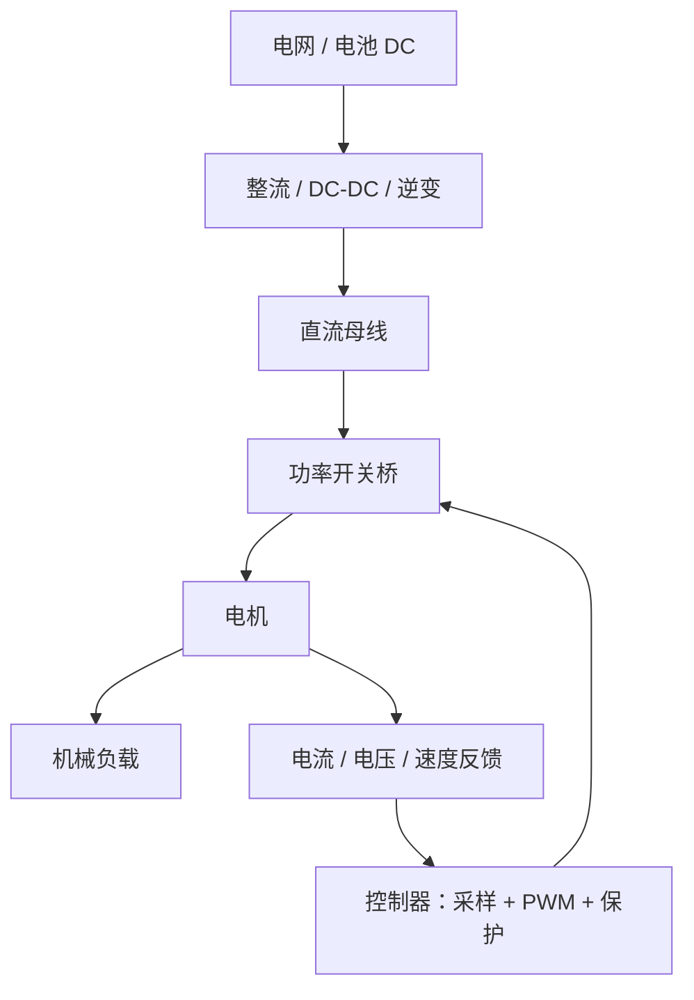

# 电气工程10000问：传感器、电力系统、控制、电机与 PLC

本篇补充 Flomo 电气工程 10000 问中已经形成独立答案卡的 16 道题。覆盖传感器、电力系统、自动控制、电机拖动、电力电子与 PLC。公式和结论均需结合器件参数、控制对象、额定工况与标准版本；教学模型不等同于设备选型或安全设计依据。

## 逐题问答

### 1. 传感器Q1：电阻式、电容式、电感式传感器各适合测什么？为什么工业现场测温最多的是热电偶和 PT100？

**答案与解析（Flomo 原始答案卡）**

▎ 五大学习法：费曼学习法——把「三种传感原理」和「两种测温王者」讲成人话

**三种原理各适合测什么**

- 电阻式：被测物理量 → 电阻变化
  - 应变片（形变→电阻）、热电阻 PT100（温度→电阻）、电位器（位移→电阻）
  - 适合：应变/力/温度/位移——变化缓慢、精度要求高的量
- 电容式：被测物理量 → 电容变化
  - 极板间距/面积/介电常数变化——位移、液位、压力、接近检测
  - 适合：微位移、液位、非接触测量（高分辨率但怕湿度/寄生电容）
- 电感式：被测物理量 → 电感/互感变化
  - 线圈与铁芯距离变化、涡流效应——位移、压力、金属接近检测
  - 适合：金属目标检测（接近开关）、大位移、恶劣环境（不怕油污灰尘）

**为什么工业测温最多的是热电偶和 PT100**

- 热电偶（K 型等）：原理 = 塞贝克效应（两种不同金属结点温差 → 热电动势）
  - 优点：测温范围宽（K 型 -200~1300℃）、响应快、探头小、便宜
  - 缺点：精度一般（±2℃ 级）、需要冷端补偿、输出非线性（mV 级小信号）
- PT100（铂热电阻）：原理 = 铂电阻随温度变化（0℃ 时 100Ω）
  - 优点：精度高（±0.1~0.5℃）、线性好、稳定
  - 缺点：范围窄（-200~850℃）、响应慢、贵
- 为什么是这俩：范围互补（热电偶管高温宽范围、PT100 管中低温高精度）+ 成熟可靠 + 标准化（分度表统一）+ 信号好处理（都能进变送器转 4-20mA）
- 半导体温度传感器（DS18B20 / NTC）精度和范围都不如它们，工业主流还是热电偶 + 热电阻

**一句话总结**：电阻式靠电阻变化（应变/温度/位移）、电容式靠极板变化（液位/微位移/压力）、电感式靠磁路变化（金属接近/大位移）；工业测温两大王——热电偶管宽范围高温（K 型 -200~1300℃）、PT100 管高精度中低温，互补覆盖 + 标准化 + 信号好处理，所以最普及。

📎 题目（10000问）→ [https://v.flomoapp.com/mine/?memo\_id=MjQ2Mzc1MTM2](https://v.flomoapp.com/mine/?memo_id=MjQ2Mzc1MTM2) 
📎 PLC工控Q1（工业现场信号处理——4-20mA 的下游）→ [https://v.flomoapp.com/mine/?memo\_id=MjUzMTQyNzc1](https://v.flomoapp.com/mine/?memo_id=MjUzMTQyNzc1)

来源：https://v.flomoapp.com/mine/?memo_id=MjUzMzkwMzE4

---

### 2. 传感器Q2：测量系统的静态/动态特性是什么？「精度±0.5%FS」的 FS 是什么意思？量程选大选小对误差有什么影响？

**答案与解析（Flomo 原始答案卡）**

▎ 五大学习法：西蒙学习法——把「FS 与量程选择」这个工程细节钻透

**静态特性 vs 动态特性**

- 静态特性：输入恒定/缓慢变化时，输出与输入的关系——精度、线性度、迟滞、重复性、灵敏度、漂移
- 动态特性：输入快速变化时，输出跟随输入的能力——时间常数、响应时间、带宽、超调
- 例：温度传感器静态特性好（稳态读数准）但动态差（升温要几十秒才跟上）——两者是独立指标

**「±0.5%FS」是什么意思**

- FS = Full Scale，满量程——误差 = 0.5% × 量程上限（不是 × 当前读数）
- 例：量程 0-100℃，±0.5%FS = ±0.5℃ 误差（无论测 10℃ 还是 90℃，误差都按满量程算）
- 注意：%FS 和 %读数（%RD）不同——%RD 是读数的 0.5%，读数小时误差更小；%FS 在小读数时相对误差更大

**量程选大选小对实际测量误差的影响**

- 误差绝对值固定（FS 定）：量程越大，同样的 ±0.5%FS 误差绝对值越大
  - 0-100℃ 量程：±0.5℃；0-1000℃ 量程：±5℃——测同一个 500℃ 温度，前者误差 ±0.5℃、后者 ±5℃
- 量程选太大：绝对误差大、小信号段分辨率差（浪费精度）
- 量程选太小：超过量程就饱和/损坏——必须覆盖最大可能测量值还要留余量
- 工程原则：量程选「覆盖最大值 \+ 20-30% 余量」——既不浪费精度又不冒饱和风险
- 关联概念：分辨率（最小可分辨变化）也随量程变化——量程大、每 bit 代表的物理量大，分辨率差

**一句话总结**：静态特性管稳态读数（精度/线性/迟滞）、动态特性管跟随速度（时间常数/带宽），两个独立指标；±0.5%FS 的误差按满量程算（不是按读数）——量程选大误差绝对值变大、选小怕饱和，所以按「最大值 + 20-30% 余量」选量程最合理。

📎 题目（10000问）→ [https://v.flomoapp.com/mine/?memo\_id=MjQ2Mzc1MTM2](https://v.flomoapp.com/mine/?memo_id=MjQ2Mzc1MTM2) 
📎 传感器Q1（三种传感器原理）→ [https://v.flomoapp.com/mine/?memo\_id=MjUzMzkwMzE4](https://v.flomoapp.com/mine/?memo_id=MjUzMzkwMzE4)

来源：https://v.flomoapp.com/mine/?memo_id=MjUzMzkwMzI5

---

### 3. 电力系统Q1：电力系统为什么要用「标幺值」计算？跟实际值算差别在哪？

**答案与解析（Flomo 原始答案卡）**

▎ 五大学习法：西蒙学习法——把「标幺值」这个工程惯例钻透

**标幺值是什么**

- 标幺值 = 实际值 / 基准值（pu = actual/base）——把物理量变成无量纲的倍数
- 例：基准电压选 10kV，实际 9.5kV → 0.95pu
- 需要选基准：基准功率（通常 100MVA）、基准电压（各级电压等级）、基准阻抗 = 基准电压²/基准功率

**为什么要用标幺值**

1. 消除电压等级差异：220kV、110kV、35kV、10kV 不同等级的电压，实际值没法直接比——标幺值后 1.0pu 就是额定水平，跨等级一目了然
2. 变压器自动归一：变压器的变比在标幺值下接近 1:1——不同变比的变压器可以近似合并，不用逐个折算（选对基准电压按变比递推）
3. 计算简化：功率、电压、电流、阻抗的关系在标幺值下公式干净（S = V·I、V = I·Z 不再带 √3、1000 等系数）
4. 数值稳定：实际值可能跨几个数量级（500kV 和 0.1Ω），标幺值都在 0.01~10 之间——计算机数值计算更稳

**跟实际值算差别在哪**

- 实际值算：每台变压器都要按变比折算到统一等级，公式带系数，容易错、容易数值溢出
- 标幺值算：全系统一个基准，变压器近乎 1:1，公式简洁，结果直观（0.95pu 就是 95% 额定）
- 注意：标幺值是线性缩放，不改变物理本质——只是换个单位系

**一句话总结**：标幺值 = 实际值/基准值，把不同电压等级、不同容量设备统一到「1.0 = 额定」的刻度上——变压器近乎 1:1、公式无系数、数值稳定、跨等级可比，是电力系统计算的标准语言。

📎 题目（10000问）→ [https://v.flomoapp.com/mine/?memo\_id=MjQ2Mzc1MTM2](https://v.flomoapp.com/mine/?memo_id=MjQ2Mzc1MTM2) 
📎 电力电子Q3（Buck/Boost——占空比也是标幺思想）→ [https://v.flomoapp.com/mine/?memo\_id=MjUzMTQyMDIy](https://v.flomoapp.com/mine/?memo_id=MjUzMTQyMDIy)

来源：https://v.flomoapp.com/mine/?memo_id=MjUzMTQyNjA4

---

### 4. 电力系统Q2：潮流计算在算什么？节点有 P、Q、V、θ 四个量，一般给定哪两个、求解哪两个？

**答案与解析（Flomo 原始答案卡）**

▎ 五大学习法：费曼学习法——把「潮流计算」讲成「全网同时满足 KCL 的分配问题」

**潮流计算在算什么**

- 给定电网拓扑、线路参数、各节点发电和负荷——求全网各节点的电压幅值 V、相角 θ、以及各支路功率
- 本质：求解一组非线性方程组（每节点功率平衡：注入 = 流出），让全网同时满足 KCL 和元件特性
- 用途：规划（电网扩建行不行）、运行（过载/电压越限检查）、调度（经济调度的基础）

**节点的四个量 P、Q、V、θ**

- 每个节点有 4 个电气量：有功 P、无功 Q、电压幅值 V、电压相角 θ
- 潮流方程给 2 个方程（有功平衡 + 无功平衡），所以每个节点要给定 2 个量、求解 2 个量

**节点分类（给哪两个、求哪两个）**

1. PQ 节点（负荷节点）：给定 P、Q，求 V、θ——最常见（负荷已知，电压待求）
2. PV 节点（发电机节点）：给定 P、V，求 Q、θ——发电机有功和机端电压可控，无功待定
3. 平衡节点（Vθ / Slack 节点）：给定 V、θ（通常 1.0∠0°），求 P、Q——全网只有一个，吸收不平衡功率（填补全网有功缺额）、提供相角参考

**一句话总结**：潮流计算 = 求全网电压分布和功率分布的非线性方程组求解；每个节点 4 个量给 2 求 2——PQ 节点给功率求电压（负荷）、PV 节点给有功和电压求无功（发电机）、平衡节点给电压和相角吸收差额（全网参考）——三个角色配合，全网才闭合。

📎 题目（10000问）→ [https://v.flomoapp.com/mine/?memo\_id=MjQ2Mzc1MTM2](https://v.flomoapp.com/mine/?memo_id=MjQ2Mzc1MTM2) 
📎 电力系统Q1（标幺值）→ [https://v.flomoapp.com/mine/?memo\_id=MjUzMTQyNjA4](https://v.flomoapp.com/mine/?memo_id=MjUzMTQyNjA4)

来源：https://v.flomoapp.com/mine/?memo_id=MjUzMTQyNjE0

---

### 5. 电力系统Q3：什么叫短路？三相、两相、单相接地短路——哪种最严重、哪种最常发生？

**答案与解析（Flomo 原始答案卡）**

▎ 五大学习法：西蒙学习法——把「短路类型」讲清

**什么叫短路**

- 不同电位的导体（相与相、相与地）之间出现低阻抗路径——电流不再走正常负荷回路
- 后果：电流急剧增大（故障电流可达额定电流的几倍到几十倍）、电压骤降、设备发热烧毁
- 短路是电力系统最常见、最危险的故障

**三种短路的严重程度和发生频率**

- 三相短路：最严重——对称故障，短路电流最大（三相对称，无零序），对系统冲击最大
  - 但发生概率最低（需要三相同时出问题）
- 两相短路：电流介于中间——不对称故障，有负序分量
- 单相接地短路：最常发生（占 80% 以上）——多数电网故障都是单相接地
  - 电流大小取决于中性点接地方式：直接接地系统单相短路电流大（可超过三相短路），不接地/消弧线圈系统接地电流很小（是接地故障不是大电流短路）

**为什么严重程度和发生频率错位**

- 最严重的三相短路最罕见；最常见的单相接地反而常常不是最致命的
- 工程上：短路电流计算、设备选型按最大短路电流校核（通常看三相或单相最大者）；保护配置按最常发生的故障设计（单相接地要专门检测）
- 统计规律：单相接地约 80%、两相短路约 10-15%、三相短路约 5%——设计时两者都要管：按最严重校核设备、按最常见配置保护

**一句话总结**：短路是相间/相地低阻抗路径导致的大电流故障；三相短路电流最大最严重但最罕见（约 5%），单相接地最常发生（约 80%）——设备按最严重校核（三相），保护按最常见设计（单相接地专门检测）。

📎 题目（10000问）→ [https://v.flomoapp.com/mine/?memo\_id=MjQ2Mzc1MTM2](https://v.flomoapp.com/mine/?memo_id=MjQ2Mzc1MTM2) 
📎 电力系统Q2（潮流计算——短路是潮流分析的边界情形）→ [https://v.flomoapp.com/mine/?memo\_id=MjUzMTQyNjE0](https://v.flomoapp.com/mine/?memo_id=MjUzMTQyNjE0)

来源：https://v.flomoapp.com/mine/?memo_id=MjUzMTQyNjM2

---

### 6. 自动控制Q1：开环控制和闭环控制的本质区别是什么？为什么说反馈是自动控制的基石？

**答案与解析（Flomo 原始答案卡）**

▎ 五大学习法：费曼学习法——把「开环 vs 闭环」讲成「喊话 vs 对话」

**开环控制**

- 控制指令单向流动：输入 → 控制器 → 被控对象 → 输出；输出不回来影响输入
- 特点：简单、便宜、没有稳定性问题；但输出受扰动影响，无法纠正
- 例：定时洗衣机（按时间表转，不管衣服洗没洗净）、老式风扇档位、步进电机开环定位

**闭环控制（反馈控制）**

- 多了反馈通道：输出被测量 → 与目标值比较 → 得到误差 → 控制器按误差修正
- 特点：能抵抗扰动、能跟踪目标变化；但引入了稳定性问题（反馈过强会振荡）
- 例：空调恒温（温度反馈）、伺服电机（编码器反馈）、巡航定速、家用稳压器

**为什么说反馈是自动控制的基石**

- 反馈把「我做得怎么样」告诉系统，系统才能自我修正——没有反馈就没有自动调节，只有自动执行
- 反馈的本质：用误差驱动控制——目标与实际的差就是控制信号来源
- 几乎所有现代控制（PID、状态空间、自适应、鲁棒控制）都是反馈框架的变体
- 经典比喻：开环是蒙眼开车（方向盘固定转多少算多少），闭环是看着路开（不断对比偏差修正）

**一句话总结**：开环是单向执行（不回头看结果），闭环是误差驱动（测量输出、对比目标、修正输入）——反馈给了系统自我修正的能力，是所有自动控制方法的共同地基。

📎 题目（10000问）→ [https://v.flomoapp.com/mine/?memo\_id=MjQ2Mzc1MTM2](https://v.flomoapp.com/mine/?memo_id=MjQ2Mzc1MTM2) 
📎 模拟电子Q4（反相放大器——负反馈的实例）→ [https://v.flomoapp.com/mine/?memo\_id=MjUyOTU0NTcw](https://v.flomoapp.com/mine/?memo_id=MjUyOTU0NTcw)

来源：https://v.flomoapp.com/mine/?memo_id=MjUyOTU0ODE0

---

### 7. 自动控制Q2：传递函数是什么？为什么控制工程师喜欢用拉普拉斯变换把微分方程变成代数方程？

**答案与解析（Flomo 原始答案卡）**

▎ 五大学习法：西蒙学习法——把「拉氏变换的动机」钻透

**传递函数是什么**

- 在零初始条件下，系统输出的拉氏变换 / 输入的拉氏变换：G(s) = Y(s)/U(s)
- 它把系统的微分方程打包成一个关于复变量 s 的代数表达式——系统的全部动态特性都在里面
- 例：一阶惯性系统 G(s) = K/(Ts+1)——T 是时间常数、K 是增益

**为什么用拉普拉斯变换**

- 微分方程 → 代数方程：拉氏变换把求导变成乘 s、积分变成除 s——解方程从解微分方程变成解多项式/代数方程
- 卷积变乘法：时域的卷积（难算）变成 s 域的乘法（好算）——串联系统的传递函数直接相乘
- 直观的频域视角：s = σ + jω，令 s = jω 就得到频率响应——波特图、稳定性分析都能做
- 系统联结简单化：串联相乘、并联相加、反馈用 G/(1+GH) 公式——整个控制框图都是代数运算

**工程师怎么用**

- 建模：物理定律写微分方程 → 拉氏变换 → 传递函数
- 分析：从 G(s) 的零极点看系统动态特性（极点决定暂态、零点影响形状）
- 设计：加控制器 C(s) 改变闭环传递函数——极点搬到想要的位置
- 本质：拉氏变换是「把时间域问题搬到复数域，算完再搬回来」——工具性的变换，和傅里叶是同一家族

**一句话总结**：传递函数是系统微分方程的 s 域打包形式；拉氏变换把求导变乘 s、卷积变乘法——解微分方程变成算代数式，系统串联反馈都能简单表达，这是控制工程师的分析语言。

📎 题目（10000问）→ [https://v.flomoapp.com/mine/?memo\_id=MjQ2Mzc1MTM2](https://v.flomoapp.com/mine/?memo_id=MjQ2Mzc1MTM2) 
📎 自动控制Q1（开环闭环）→ [https://v.flomoapp.com/mine/?memo\_id=MjUyOTU0ODE0](https://v.flomoapp.com/mine/?memo_id=MjUyOTU0ODE0)

来源：https://v.flomoapp.com/mine/?memo_id=MjUyOTU0ODI2

---

### 8. 自动控制Q3：PID 控制器为什么应用这么广？P、I、D 三个分量各自的作用是什么？

**答案与解析（Flomo 原始答案卡）**

▎ 五大学习法：费曼学习法——把「PID」讲成「现在、过去、未来」三个视角

**PID 是什么**

- 控制器输出 = Kp·误差 + Ki·∫误差dt + Kd·d(误差)/dt——三个分量按不同方式利用误差
- 只需要测量一个量（被控量），不需要被控对象的精确模型——这是它应用广的根本原因

**P（比例）：看现在**

- 输出正比于当前误差：误差大、出力大
- 作用：快速响应、减小误差；但单独用有稳态误差（系统要留一点误差才有出力）
- 调大 Kp：响应快但容易振荡；调小：稳但慢

**I（积分）：看过去**

- 输出正比于误差的累积：只要历史上有误差就一直加力
- 作用：消除稳态误差——把 P 留下的那点残差慢慢磨掉
- 风险：积分饱和（windup）——误差一直大导致积分爆表，超调变严重；要限幅/抗饱和

**D（微分）：看未来**

- 输出正比于误差的变化率：误差在快速变大时提前刹车/加速
- 作用：预测趋势、抑制超调、增加阻尼，让系统更稳
- 风险：对噪声敏感——测量噪声的微分很大，会放大抖动；要滤波

**为什么应用这么广**

- 无需模型：三个系数调好就能用，老师傅靠经验就能整定
- 鲁棒：对象特性变化一点（负载变了），PID 还能工作
- 实现简单：一个公式，模拟电路或单片机几行代码
- 覆盖大多数线性+部分非线性过程的控制需求——占工业控制回路 90% 以上

**一句话总结**：P 看现在（快速响应、留稳态误差）、I 看过去（累积误差、消除残差、防饱和）、D 看未来（预测趋势、抑制超调、防噪声）——三个视角互补，且不需要对象模型，所以 90% 的工业回路都是 PID。

📎 题目（10000问）→ [https://v.flomoapp.com/mine/?memo\_id=MjQ2Mzc1MTM2](https://v.flomoapp.com/mine/?memo_id=MjQ2Mzc1MTM2) 
📎 自动控制Q2（传递函数）→ [https://v.flomoapp.com/mine/?memo\_id=MjUyOTU0ODI2](https://v.flomoapp.com/mine/?memo_id=MjUyOTU0ODI2)

来源：https://v.flomoapp.com/mine/?memo_id=MjUzMTM5ODc5

---

### 9. 自动控制Q4：系统的「稳定性」是什么意思？一个不稳定的系统长什么样？

**答案与解析（Flomo 原始答案卡）**

▎ 五大学习法：费曼学习法——把「稳定性」讲成「扰动之后回不回来」

**稳定性是什么**

- 定义（李雅普诺夫意义）：系统在扰动消失后，能否回到原来的平衡状态
- 通俗：推它一下，它自己回得来 = 稳定；越推越远/越荡越大 = 不稳定
- 数学判据：系统极点（传递函数分母的根）是否都在 s 平面左半平面——全部在左半 = 稳定

**一个不稳定的系统长什么样**

- 例 1：倒立摆——不推它都倒（开环不稳定）；杆子初始倾斜一点，会越倒越快（发散）
- 例 2：飞机俯仰——设计不好的飞控，机头一抬，越来越抬直到翻过来（发散振荡）
- 例 3：温控系统——比例增益调太大，温度来回振荡、幅度越来越大（极限环→不稳定）
- 例 4：电网——发电机励磁调节不当，功率角振荡发散 → 失步（低频振荡发散）

**为什么不稳定危险**

- 发散 = 物理量无限增大/剧烈振荡 → 机械损坏、安全事故、系统崩溃
- 稳定的系统允许微小的振荡（衰减振荡），只要幅度随时间减小就是稳定

**稳定性的类型**

- 稳定（渐近稳定）：扰动后回到原平衡点（衰减振荡归零）
- 临界稳定：等幅振荡不衰减（极点在虚轴上）——边界情况，工程上算不稳定
- 不稳定：发散（极点在右半平面）

**一句话总结**：稳定性 = 扰动后能不能自己回到平衡——回得来稳定、等幅振荡临界、越荡越大不稳定；判据是闭环极点是否全在 s 左半平面；倒立摆、失控的温控、失步的发电机都是不稳定的例子。

📎 题目（10000问）→ [https://v.flomoapp.com/mine/?memo\_id=MjQ2Mzc1MTM2](https://v.flomoapp.com/mine/?memo_id=MjQ2Mzc1MTM2) 
📎 自动控制Q3（PID）→ [https://v.flomoapp.com/mine/?memo\_id=MjUzMTM5ODc5](https://v.flomoapp.com/mine/?memo_id=MjUzMTM5ODc5)

来源：https://v.flomoapp.com/mine/?memo_id=MjUzMTM5ODg0

---

### 10. 自动控制Q5：根轨迹法怎么判断系统稳定性？为什么闭环极点在 s 左半平面就是稳定的？

**答案与解析（Flomo 原始答案卡）**

▎ 五大学习法：西蒙学习法——把「根轨迹」这个可视化工具钻透

**根轨迹是什么**

- 根轨迹（Root Locus）：当某个参数（通常是开环增益 K）从 0 变到 ∞ 时，闭环极点在 s 平面上画出的轨迹
- 闭环极点 = 闭环特征方程的根 = 系统动态特性的决定者
- 根轨迹让你「看着极点怎么移动」，而不必每次都解方程

**为什么左半平面就是稳定**

- 闭环极点 s = σ + jω 决定暂态响应：e^(σt)·sin(ωt)——实部 σ 决定衰减/发散
- σ < 0（左半平面）：e^(σt) 随 t 衰减 → 响应收敛 → 稳定
- σ = 0（虚轴）：等幅振荡 → 临界稳定
- σ \> 0（右半平面）：e^(σt) 指数增长 → 发散 → 不稳定
- 本质：极点的实部就是模态的增长率——负数衰减、正数发散，所以左半 = 稳定

**根轨迹法怎么判断稳定性**

1. 画根轨迹：K 从 0→∞，闭环极点从开环极点（K=0）走向开环零点（K→∞）
2. 看轨迹何时穿越虚轴：穿越点对应的 K 就是临界增益 K\_cr
3. 判断：当前 K 下所有极点都在左半平面 → 稳定；有极点穿过虚轴到右半 → 不稳定
4. 设计视角：调 K 让根轨迹留在左半平面，还能看阻尼（极点与实轴的夹角决定超调）

**工程意义**

- 根轨迹不只是稳定/不稳定的开关判断，还能看：响应快慢（实部绝对值）、振荡程度（虚部）、整定增益
- 是「调 K 观察系统行为」的可视化工具——比代数判据（劳斯）直观

**一句话总结**：极点实部是模态增长率——实部<0 衰减（左半稳定）、>0 发散（右半不稳定）；根轨迹把 K 变化时极点的移动画出来，看轨迹穿不穿越虚轴就知道系统稳不稳、临界增益是多少。

📎 题目（10000问）→ [https://v.flomoapp.com/mine/?memo\_id=MjQ2Mzc1MTM2](https://v.flomoapp.com/mine/?memo_id=MjQ2Mzc1MTM2) 
📎 自动控制Q4（系统稳定性）→ [https://v.flomoapp.com/mine/?memo\_id=MjUzMTM5ODg0](https://v.flomoapp.com/mine/?memo_id=MjUzMTM5ODg0)

来源：https://v.flomoapp.com/mine/?memo_id=MjUzMTM5OTA1

---

### 11. 电机拖动Q1：直流电机的转速和什么有关？为什么「调压调速」和「调磁调速」原理不同？

**答案与解析（Flomo 原始答案卡）**

▎ 五大学习法：费曼学习法——把「直流电机调速」讲成「调速的本质是改变反电动势平衡」

**转速公式**

- 他励直流电机：n = (U - Ia·Ra) / (Ce·Φ)
- n 转速、U 电枢电压、Ia 电枢电流、Ra 电枢电阻、Ce 电机常数、Φ 每极磁通
- 转速由「电压降掉电阻压降后，除以磁通」决定——三个可调量：U、Ra、Φ

**调压调速（U ↓）**

- 原理：降低电枢电压 U → 转速 n 下降
- 特点：机械特性硬度不变（斜率不变，只是平行下移）——调速前后负载变化时转速跌落一致，稳
- 范围：从额定转速往下调（0 ~ n\_N），调速范围宽、平滑
- 实现：可控整流 / PWM 斩波——现代直流调速主流

**调磁调速（Φ ↓）**

- 原理：减小励磁磁通 Φ → 转速 n 上升
- 特点：只能往上调（n\_N 以上）；磁通太弱会导致电枢电流过大、换向恶化
- 机械特性变软（斜率变陡）——负载稍变转速跌落大
- 实现：调励磁电流；通常是辅助调速（配合调压）

**为什么原理不同**

- 调压是改变驱动电压（像油门），调磁是改变电机内部的磁场强度（像换挡）
- 调压调速恒转矩特性（转矩不变、功率随转速变），调磁调速恒功率特性（功率不变、转矩随转速变）——两类应用场景不同
- 记住：电压管「往下调」、磁通管「往上调」；一个调驱动、一个调内部

**一句话总结**：直流电机转速 n=(U-IaRa)/(CeΦ)——调压调速往下调、特性硬、恒转矩（主流）；调磁调速往上调、特性软、恒功率（辅助）——一个改驱动电压、一个改内部磁场，所以原理不同。

📎 题目（10000问）→ [https://v.flomoapp.com/mine/?memo\_id=MjQ2Mzc1MTM2](https://v.flomoapp.com/mine/?memo_id=MjQ2Mzc1MTM2) 
📎 自动控制Q3（PID——调速系统的控制核心）→ [https://v.flomoapp.com/mine/?memo\_id=MjUzMTM5ODc5](https://v.flomoapp.com/mine/?memo_id=MjUzMTM5ODc5)

来源：https://v.flomoapp.com/mine/?memo_id=MjUzMTQxODcx

---

### 12. 电机拖动Q2：异步电机的「转差率」是什么？为什么异步电机转速永远小于同步转速？

**答案与解析（Flomo 原始答案卡）**

▎ 五大学习法：西蒙学习法——把「转差 = 发电的根因」钻透

**同步转速**

- 定子旋转磁场转速：n₁ = 60f/p——f 是电源频率、p 是极对数
- 例：50Hz、4 极（p=2）→ n₁ = 60×50/2 = 1500 rpm

**转差率**

- s = (n₁ - n)/n₁——同步转速和实际转速之差占同步转速的比例
- 异步电机转速 n = (1-s)·n₁，运行在 0 < s < 1（电动状态）
- 例：n₁=1500，n=1440 → s = 60/1500 = 0.04（4%）

**为什么转速永远小于同步转速**

- 感应原理：转子电流是「转子导体切割旋转磁场」感应出来的
- 如果转子转速 = 同步转速：转子与磁场相对静止 → 没有感应电动势 → 没有转子电流 → 没有转矩 → 转不动
- 所以必须有转差（相对运动）才有感应电流、才有转矩——「异步」的名字就来自这里
- 转矩越大转差越大：负载重 → 转速掉一点 → 转差大 → 感应电流大 → 转矩大（自平衡）

**几个状态**

- s=0：同步转速（理想空载，实际做不到——空载也有摩擦损耗，s 略大于 0）
- 0<s<1：电动状态（正常运行）
- s=1：堵转/启动瞬间（转子不动）
- s<0：转速超过同步——发电状态（回馈制动/超同步运行）

**一句话总结**：转差率 s=(n₁-n)/n₁ 是转子与旋转磁场的相对落后量；转子靠切割磁场感应电流产生转矩，一旦追上同步转速就没有感应、没有转矩——所以异步电机必须永远「差一步」，转速恒小于同步转速。

📎 题目（10000问）→ [https://v.flomoapp.com/mine/?memo\_id=MjQ2Mzc1MTM2](https://v.flomoapp.com/mine/?memo_id=MjQ2Mzc1MTM2) 
📎 电机拖动Q1（直流电机调速）→ [https://v.flomoapp.com/mine/?memo\_id=MjUzMTQxODcx](https://v.flomoapp.com/mine/?memo_id=MjUzMTQxODcx)

来源：https://v.flomoapp.com/mine/?memo_id=MjUzMTQxODc4

---

### 13. 电力电子Q1：不控整流和可控整流的区别？晶闸管（SCR）在可控整流里起什么作用？

**答案与解析（Flomo 原始答案卡）**

▎ 五大学习法：费曼学习法——把「不控 vs 可控」讲成「二极管只会过、晶闸管能等」

**不控整流（二极管整流）**

- 用二极管：正向导通、反向截止——导通时机完全由电压极性决定，不可控
- 输出：固定的直流电压（平均值不可调）——AC 电压定了，输出就定了
- 例：手机充电器前级、直流电源的输入整流桥

**可控整流（晶闸管整流）**

- 用晶闸管（SCR）：在正向电压下还不会导通，必须给门极触发脉冲才导通
- 触发角 α：从交流电压过零到触发导通的电角度——α 决定导通早晚，α 越大输出越低
- 输出：直流电压连续可调——Ud = Ud0·cosα（α 从 0 到 180°，电压从最大到 0）
- 例：直流电机调速的老式方案、电镀电解电源、HVDC 整流站

**晶闸管（SCR）起什么作用**

- SCR = 硅控整流器：单向导电 + 可控导通（门极触发）+ 自锁（导通后门极失去作用，靠电流过零关断）
- 关键特性：导通条件 = 正向偏置 \+ 门极脉冲；关断条件 = 电流降到维持电流以下（自然换相）
- 它让整流从「不可调的固定输出」变成「可调的输出」——可控整流的核心器件
- 半控 vs 全控：SCR 是半控器件（能控开、不能控关，靠交流自然过零关断）；IGBT/MOSFET 是全控（能控开也能控关）

**一句话总结**：不控整流用二极管（导通时机由电压极性定、输出固定），可控整流用晶闸管（正向偏置还得等门极触发、触发角 α 决定输出大小）——SCR 是「能控开不能控关」的半控器件，靠交流过零自然关断，它是可控整流和 HVDC 的基石。

📎 题目（10000问）→ [https://v.flomoapp.com/mine/?memo\_id=MjQ2Mzc1MTM2](https://v.flomoapp.com/mine/?memo_id=MjQ2Mzc1MTM2) 
📎 电机拖动Q1（直流电机调速——可控整流的应用）→ [https://v.flomoapp.com/mine/?memo\_id=MjUzMTQxODcx](https://v.flomoapp.com/mine/?memo_id=MjUzMTQxODcx)

来源：https://v.flomoapp.com/mine/?memo_id=MjUzMTQxOTg3

---

### 14. 电力电子Q2：PWM 逆变怎么把直流变交流？为什么输出波形不是完美正弦波？

**答案与解析（Flomo 原始答案卡）**

▎ 五大学习法：西蒙学习法——把「PWM 逆变」的脉宽调制思想钻透

**逆变是什么**

- DC→AC：把直流母线电压变成交流输出
- 基础结构：H 桥（4 个开关管）——对角交替导通，输出极性交替变化
- 单相：一个 H 桥；三相：三个桥臂（6 个开关管）

**PWM 怎么生成交流**

- 正弦脉宽调制（SPWM）：拿一个低频正弦波（调制波）和高频三角波（载波）比较
- 正弦波 \> 三角波 → 输出高；否则输出低——输出一串脉宽按正弦规律变化的方波脉冲
- 开关管在高频开关（几 kHz 到几十 kHz），输出脉冲的平均值跟随正弦波
- 滤波后：脉冲串经过 LC 低通滤波，平滑成近似正弦波

**为什么不是完美正弦波**

- 输出本质是一串方波脉冲，只有经过滤波才是正弦——滤波不完美就有谐波
- 谐波来源：开关频率附近的边带谐波（载波频率及其倍数）、死区时间（防止上下管直通而插入的延迟）造成的低次谐波
- 频率越高谐波越容易滤掉（载波比高），但开关损耗也越大——折中选择
- 结果：输出是「基波 \+ 谐波」——谐波含量用 THD（总谐波失真）衡量

**关键参数**

- 调制度 m = 调制波幅值/载波幅值——m ≤ 1 线性区（输出电压与 m 成正比），m > 1 过调制（输出饱和、谐波增大）
- 载波频率：越高谐波越小但损耗越大；工业变频器常用 2-20kHz

**一句话总结**：PWM 逆变 = H 桥开关管按 SPWM 高频通断，输出脉宽按正弦变化的脉冲串，滤波后近似正弦；不是完美正弦是因为输出本质是方波脉冲——谐波来自载波边带和死区，用 THD 衡量，载波频率越高越接近正弦但损耗越大。

📎 题目（10000问）→ [https://v.flomoapp.com/mine/?memo\_id=MjQ2Mzc1MTM2](https://v.flomoapp.com/mine/?memo_id=MjQ2Mzc1MTM2) 
📎 电力电子Q1（可控整流）→ [https://v.flomoapp.com/mine/?memo\_id=MjUzMTQxOTg3](https://v.flomoapp.com/mine/?memo_id=MjUzMTQxOTg3)

来源：https://v.flomoapp.com/mine/?memo_id=MjUzMTQxOTky

---

### 15. PLC工控Q1：PLC 的扫描周期包含哪几个阶段？为什么 PLC 是「循环执行」而不是「事件驱动」？

**答案与解析（Flomo 原始答案卡）**

▎ 五大学习法：西蒙学习法——把「PLC 的时序模型」钻透

**扫描周期（Scan Cycle）的几个阶段**

1. 读输入（Input Scan）：把输入端子状态统一读入输入映像区（Input Image）
2. 执行程序（Program Scan）：CPU 按程序顺序执行用户程序，从输入映像区读、往输出映像区写
3. 写输出（Output Scan）：把输出映像区统一写到输出端子
4. 加上系统服务（通信、自诊断）：扫描周期前后或间隙处理通信、诊断

- 一个扫描周期 = 读输入 → 执行程序 → 写输出（\+ 系统服务），循环往复

**为什么是「循环执行」而不是「事件驱动」**

- 单片机事件驱动：外部中断来了才跳去处理，平时跑主循环/睡眠——响应是按事件触发的，实时性强但程序结构分散
- PLC 循环扫描：不管有没有事件，固定节奏从头到尾扫一遍——所有输入变化都在下一个周期被看到
- 结果：PLC 对输入变化的响应有一个扫描周期的延迟（响应时间 = 扫描周期 × 1~2），这是它的固有特性
- 好处：程序结构确定、时序可预测（每个周期都一样跑一遍）、调试直观——工业现场要的就是确定性
- 代价：事件响应不及时（周期毫秒级，够工控用；高速事件要专门的输入中断/高速计数模块）

**关键概念**

- 映像区机制：程序里读的是输入映像（周期开始时快照），写的是输出映像（周期结束时统一输出）——保证一个周期内程序看到的是同一时刻的输入
- 扫描周期长短：取决于程序量，典型 1-20ms；周期太长发散要优化

**一句话总结**：PLC 扫描周期 = 读输入 → 执行程序 → 写输出，循环往复；它是循环执行不是事件驱动——固定节奏扫一遍、响应延迟约一个周期，换来的是程序结构确定、时序可预测，工业现场要的正是这种确定性（高速事件靠专用硬件模块补）。

📎 题目（10000问）→ [https://v.flomoapp.com/mine/?memo\_id=MjQ2Mzc1MTM2](https://v.flomoapp.com/mine/?memo_id=MjQ2Mzc1MTM2) 
📎 继电保护Q2（三段配合——工业控制的阶梯思维）→ [https://v.flomoapp.com/mine/?memo\_id=MjUzMTQyNjkw](https://v.flomoapp.com/mine/?memo_id=MjUzMTQyNjkw)

来源：https://v.flomoapp.com/mine/?memo_id=MjUzMTQyNzc1

---

### 16. PLC工控Q2：梯形图的常开/常闭触点在硬件继电器和软件里怎么对应？为什么梯形图里经常出现「自锁」电路？

**答案与解析（Flomo 原始答案卡）**

▎ 五大学习法：费曼学习法——把「梯形图」讲成「画电路图编程」

**常开/常闭触点**

- 常开（NO，Normally Open）：平时断开，线圈得电才闭合——对应输入常开触点 / 输出线圈
- 常闭（NC，Normally Closed）：平时闭合，线圈得电才断开
- 硬件继电器：触点状态由线圈有没有电决定（物理接触）
- PLC 软件里：触点不是物理的，是读映像区里的位——常开触点 = 该位为 1 时导通；常闭触点 = 该位为 0 时导通（取反）
- 对应关系：梯形图常开触点 ←→ 输入映像某位为 1；常闭触点 ←→ 该位为 0（或另一个取反的逻辑）

**为什么经常出现「自锁」电路**

- 自锁（Latch / Seal-in）：输出线圈动作后，用自己的一对常开触点把回路锁住，即使启动按钮松开了，回路仍然保持导通
- 典型场景：电机启停控制——按启动按钮 → 接触器 KM 得电（电机转）；KM 的辅助常开触点并联在启动按钮上 → 按钮松开后 KM 靠自己的触点继续得电（自锁）；按停止按钮（串在回路里的常闭）→ 断开 → 停止
- 为什么必须自锁：按钮是瞬间信号，电机要持续运行——瞬间信号要变成持续状态，就得靠自锁保持
- 这也解释了为什么梯形图里「启动用常开并联自锁、停止用常闭串联」——是继电器控制时代留下的经典范式，PLC 继承下来

**一句话总结**：梯形图常开触点 = 映像位为 1 导通、常闭 = 映像位为 0 导通（软件取反，不是物理触点）；自锁电路 = 输出用自己的常开触点并联保持——因为按钮是瞬间信号而电机要持续运行，所以「启动常开并联自锁、停止常闭串联」成了梯形图最经典的范式。

📎 题目（10000问）→ [https://v.flomoapp.com/mine/?memo\_id=MjQ2Mzc1MTM2](https://v.flomoapp.com/mine/?memo_id=MjQ2Mzc1MTM2) 
📎 PLC工控Q1（扫描周期）→ [https://v.flomoapp.com/mine/?memo\_id=MjUzMTQyNzc1](https://v.flomoapp.com/mine/?memo_id=MjUzMTQyNzc1)

来源：https://v.flomoapp.com/mine/?memo_id=MjUzMTQyNzgw

## 关键工程链路图

### 1. 传感器测量链

### 2. 自动控制闭环

### 3. 电力电子变换与电机驱动

## 工程核验要点

- 传感器：核对量程、精度定义、温漂、动态响应、安装位置和信号调理电路。
- 电力系统：区分稳态潮流、短路暂态与保护动作过程；标幺值必须统一基准容量和基准电压。
- 自动控制：先确认被控对象模型、采样周期、执行器限幅和传感器噪声，再整定 PID。
- 电机驱动：确认电机类型、极对数、额定电压/电流、热设计、逆变器拓扑和保护策略。
- PLC：明确扫描周期、输入输出刷新时序、任务优先级和通信刷新机制；安全功能按相应安全标准设计。

## Flomo 原始来源

- 电气工程及其自动化 10000 问主问题库：https://v.flomoapp.com/mine/?memo_id=MjQ2Mzc1MTM2
- 每道题的原始答案卡链接已附在对应题目下。

> 本篇是原始 Flomo 答案卡的结构化迁移副本。未在 Flomo 中找到独立答案卡的问题，仍留在总问题库盘点清单中，不以猜测补齐。