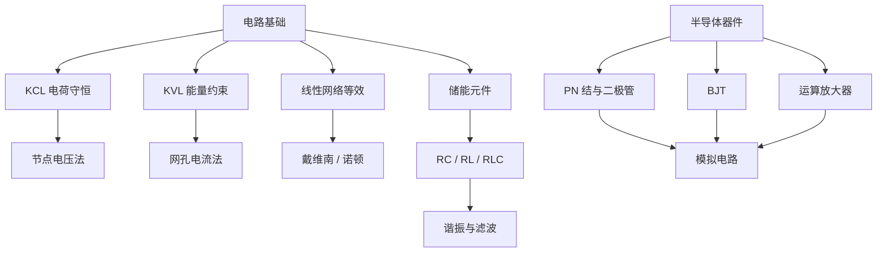

# 电气工程10000问：电路原理与模拟电子基础

本篇补齐此前电气工程专题中尚未落入 NotesBook 的 7 张基础题卡，涵盖 KCL/KVL、戴维南/诺顿等效、储能元件、RLC 谐振、PN 结、BJT 与运放分析。保留 Flomo 原始答案与来源，后续可继续在此基础上补充推导、仿真和实验验证。

## 知识关系图

## 工程学习与验证建议

- 电路定律：用节点电压法与网孔电流法分别求解同一网络，交叉验证结果。
- 等效定理：对比原网络与戴维南/诺顿等效网络在不同负载下的端口电压、电流。
- 储能元件：用示波器观察 RC 充放电、RL 暂态及 RLC 阻尼响应。
- 半导体器件：通过器件曲线验证二极管 I-V、BJT 输出特性和运放负反馈工作区。
- 结论边界：理想模型用于建立直觉；真实器件还需考虑温度、频率、寄生参数、饱和、压摆率、输入失调和安全工作区。

---

## 1. 电气 10000问 · 模拟电子Q3：运放的「虚短」和「虚断」本质是什么？为什么是运放电路分析的全部？

**Flomo 来源：** https://v.flomoapp.com/mine/?memo_id=MjUyOTU0NTY0

**电气 10000问 · 模拟电子Q3：运放的「虚短」和「虚断」本质是什么？为什么是运放电路分析的全部？**

▎ 五大学习法：费曼学习法——把「虚短虚断」讲成「两个近似」

**前提：理想运放的两个特性**

- 开环增益无穷大（A→∞）
- 输入阻抗无穷大（Ri→∞）

**虚断（输入电流 ≈ 0）**

- 输入阻抗无穷大 → 流入运放输入端的电流 ≈ 0——好像「断开」一样
- 注意是「虚」断：实际有极微小电流，但分析时按 0 算
- 推论：所有输入电流都走外部电阻网络，不进入运放

**虚短（两输入端电压相等）**

- 因为 A→∞：输出电压 Vout = A×(V+ - V-) 是有限值 → V+ - V- ≈ 0 → V+ ≈ V-
- 两输入端电位近似相等——好像「短路」在一起
- 注意是「虚」短：不是真的短路（没有电流流过），只是电位相等
- 只在负反馈闭环时成立：反馈把输出拉回使 V- 追 V+（深度负反馈）

**为什么是分析的全部**

- 虚短给出输入端电压关系、虚断给出输入端电流关系——两个约束一立，配合外部电阻网络的 KCL/KVL，所有运放电路都能解
- 反相放大、同相放大、跟随器、加法器、积分器、差分放大——全是「虚短 \+ 虚断 \+ 外部网络」三件套
- 黄金流程：虚断写节点电流方程 → 虚短给电压关系 → 解出 Vout/Vin

**一句话总结**：理想运放开环增益和输入阻抗无穷大 → 输入端电流≈0（虚断）、两输入端电位相等（虚短，负反馈闭环才成立）——这两个近似是运放电路分析的全部工具，任何运放电路都靠「虚短+虚断+外部电阻网络」解出来。

📎 题目（10000问）→ [https://v.flomoapp.com/mine/?memo\_id=MjQ2Mzc1MTM2](https://v.flomoapp.com/mine/?memo_id=MjQ2Mzc1MTM2)  
📎 模拟电子Q2（BJT 放大）→ [https://v.flomoapp.com/mine/?memo\_id=MjUyOTQ1OTM2](https://v.flomoapp.com/mine/?memo_id=MjUyOTQ1OTM2)

#Area/技术/电气与电子

#Archive/MigratedNotion 
#Archive/DeleteCandidate

---

## 2. 电气 10000问 · 模拟电子Q2：三极管（BJT）的放大原理是什么？为什么叫「电流控制电流源」？β 受什么影响？

**Flomo 来源：** https://v.flomoapp.com/mine/?memo_id=MjUyOTQ1OTM2

**电气 10000问 · 模拟电子Q2：三极管（BJT）的放大原理是什么？为什么叫「电流控制电流源」？β 受什么影响？**

▎ 五大学习法：费曼学习法——把「BJT 放大」讲成「小闸门控大水流」

**结构**

- NPN：两个 PN 结背靠背——发射结（B-E）+ 集电结（B-C），中间是很薄的基区
- 三极：发射极 E（重掺杂）、基极 B（很薄很轻掺杂）、集电极 C（大面积的收集极）

**放大原理**

- 发射结正偏：基极注入小电流 IB，大量电子从发射区涌入基区
- 基区极薄：大部分电子来不及复合就穿过基区，被集电结（反偏）收集——形成 IC
- 关键：IC ≈ β·IB，IE = IB + IC ≈ IC——小 IB 控制大 IC，这就是电流放大
- 比喻：基极是水闸的小手柄，集电极电流是被放大的水流；β（hFE）就是放大倍数

**为什么叫电流控制电流源**

- 输入是电流（IB），输出是电流（IC）——电流控电流（CCCS）
- 对比：MOSFET 是电压控电流（VCCS）——栅极电压控制漏极电流
- 这是两种器件最本质的区别：BJT 要基极电流（要输入电流）、MOS 只要栅极电压（几乎不要电流）

**β 受什么影响**

- 基区宽度：越薄复合越少、β 越大（但太薄耐压变差——工艺权衡）
- 掺杂浓度：发射区重掺杂、基区轻掺杂（利于注入和少复合）
- 温度：温度升高 β 增大（BJT 的热稳定性问题——需要偏置电路补偿）
- 电流：大电流和小电流时 β 都会下降（中间区间 β 最大）

**一句话总结**：BJT 靠「发射结正偏注入 + 基区极薄 + 集电结反偏收集」实现 IC=β·IB——小基极电流控大集电极电流（电流控电流）；β 由基区宽度、掺杂、温度、工作点共同决定，热稳定性要靠偏置电路补偿。

📎 题目（10000问）→ [https://v.flomoapp.com/mine/?memo\_id=MjQ2Mzc1MTM2](https://v.flomoapp.com/mine/?memo_id=MjQ2Mzc1MTM2)  
📎 模拟电子Q1（PN 结）→ [https://v.flomoapp.com/mine/?memo\_id=MjUyOTQ1OTI5](https://v.flomoapp.com/mine/?memo_id=MjUyOTQ1OTI5)

#Area/技术/电气与电子

#Archive/MigratedNotion 
#Archive/DeleteCandidate

---

## 3. 电气 10000问 · 模拟电子Q1：二极管为什么单向导电？PN 结的耗尽区怎么形成？为什么耗尽区宽度随电压变化？

**Flomo 来源：** https://v.flomoapp.com/mine/?memo_id=MjUyOTQ1OTI5

**电气 10000问 · 模拟电子Q1：二极管为什么单向导电？PN 结的耗尽区怎么形成？为什么耗尽区宽度随电压变化？**

▎ 五大学习法：费曼学习法——把「PN 结」讲成「两个大门对开」

**PN 结的形成**

- 把 P 型半导体（多子=空穴）和 N 型半导体（多子=电子）结合
- 扩散运动：浓度差让 P 的空穴往 N 跑、N 的电子往 P 跑
- 复合与耗尽：跑到对面复合掉，交界处留下不能移动的离子（P 侧剩负离子、N 侧剩正离子）——这个没有自由载流子的区域就是耗尽区（空间电荷区）
- 内建电场：正负离子形成从 N 指向 P 的电场，阻止扩散继续——扩散和漂移平衡时，耗尽区稳定

**为什么单向导电**

- 正向偏置（P 接正）：外加电场和内建电场相反，削弱内建电场 → 耗尽区变窄 → 扩散恢复 → 电流导通（开启后约 0.6-0.7V 压降）
- 反向偏置（P 接负）：外加电场和内建电场同向，增强内建电场 → 耗尽区变宽 → 少数载流子漂移形成极小反向漏电流 → 截止
- 单向导电 = 正偏导通、反偏截止——这就是二极管的开关本质

**耗尽区宽度随电压变化**

- 反向电压越大 → 耗尽区越宽（像把门推得更开，但方向是挡人）
- 正向电压越大 → 耗尽区越窄（直到导通）
- 这个宽度可变直接引出两个衍生器件：变容二极管（利用耗尽区电容可变）、稳压二极管（利用反向击穿电压稳定）

**一句话总结**：PN 结的耗尽区是扩散和漂移平衡的产物；正偏削弱内建电场、耗尽区变窄→导通，反偏增强内建电场、耗尽区变宽→截止——单向导电性是耗尽区宽度随电压变化的直接结果。

📎 题目（10000问）→ [https://v.flomoapp.com/mine/?memo\_id=MjQ2Mzc1MTM2](https://v.flomoapp.com/mine/?memo_id=MjQ2Mzc1MTM2)  
📎 电路原理Q3（电容电感储能）→ [https://v.flomoapp.com/mine/?memo\_id=MjUyOTQyNDE1](https://v.flomoapp.com/mine/?memo_id=MjUyOTQyNDE1)

#Area/技术/电气与电子

#Archive/MigratedNotion 
#Archive/DeleteCandidate

---

## 4. 电气 10000问 · 电路原理Q4：RLC 串联谐振频率怎么算？谐振时电压电流的相位关系是什么？

**Flomo 来源：** https://v.flomoapp.com/mine/?memo_id=MjUyOTQyNDI4

**电气 10000问 · 电路原理Q4：RLC 串联谐振频率怎么算？谐振时电压电流的相位关系是什么？**

▎ 五大学习法：西蒙学习法——把「谐振 = 电抗抵消」钻透

**谐振频率怎么算**

- RLC 串联：感抗 XL = 2πfL，容抗 XC = 1/(2πfC)
- 谐振条件：XL = XC（感抗和容抗相等，互相抵消）→ 2πfL = 1/(2πfC)
- 解出：f₀ = 1/(2π√(LC))——谐振频率只由 L 和 C 决定，和 R 无关
- 换个说法：ω₀ = 1/√(LC)（角频率）

**谐振时的状态**

- 阻抗最小：Z = R + j(XL - XC) = R——纯电阻！总阻抗 = R
- 电流最大：I = V/R（谐振时电流达到最大，R 越小电流越大）
- 相位关系：电压和电流同相（相位差 = 0）——电路表现为纯电阻
- 储能振荡：L 和 C 之间能量来回交换（磁场能 ↔ 电场能），电阻只耗散不参与振荡

**特性参数**

- 品质因数 Q = ω₀L/R = 1/(ω₀CR)——Q 越高，谐振峰越尖、选择性越好
- 带宽 BW = f₀/Q——Q 高则带宽窄（选频能力强）
- 分压现象：谐振时 L 和 C 两端电压是电源电压的 Q 倍（可远高于输入）——LC 串联谐振也叫电压谐振

**工程场景**

- 收音机选频：调节 C 让 f₀ 对准电台频率，其他频率被抑制
- 陷波/带通滤波器、晶振等效电路（RLC 模型）
- 嵌入式注意：晶振/陶瓷谐振器就是 RLC 谐振；走线寄生 L、去耦电容 C 可能形成意外谐振（EMC 问题）

**一句话总结**：谐振频率 f₀ = 1/(2π√LC)，只由 L、C 决定；谐振时感抗容抗抵消、阻抗=R、电流最大、电压电流同相，L/C 上还有 Q 倍的高压——选频和滤波都靠它。

📎 题目（10000问）→ [https://v.flomoapp.com/mine/?memo\_id=MjQ2Mzc1MTM2](https://v.flomoapp.com/mine/?memo_id=MjQ2Mzc1MTM2)  
📎 电路原理Q3（电容电感储能）→ [https://v.flomoapp.com/mine/?memo\_id=MjUyOTQyNDE1](https://v.flomoapp.com/mine/?memo_id=MjUyOTQyNDE1)

#Area/技术/电气与电子

#Archive/MigratedNotion 
#Archive/DeleteCandidate

---

## 5. 电气 10000问 · 电路原理Q3：电容和电感的储能怎么工作？为什么直流稳态里电容像开路、电感像短路？

**Flomo 来源：** https://v.flomoapp.com/mine/?memo_id=MjUyOTQyNDE1

**电气 10000问 · 电路原理Q3：电容和电感的储能怎么工作？为什么直流稳态里电容像开路、电感像短路？**

▎ 五大学习法：费曼学习法——把「电容存电压、电感存电流」讲成人话

**电容的储能**

- 电容存的是电场能：E = ½CV²——存的是电压，两板之间建立电场
- 电流和电压的关系：i = C·dv/dt——电流正比于电压的变化率
- 关键推论：电压不变（dv/dt = 0）→ 电流 = 0 → 直流稳态里电容 = 开路（隔直）

**电感的储能**

- 电感存的是磁场能：E = ½LI²——存的是电流，线圈周围建立磁场
- 电压和电流的关系：v = L·di/dt——电压正比于电流的变化率
- 关键推论：电流不变（di/dt = 0）→ 电压 = 0 → 直流稳态里电感 = 短路（通直）

**为什么「电容开路、电感短路」**

- 直流稳态：所有电压电流都稳定了，不再变化
- 电容：电压稳定 → 没有充电/放电电流 → 像开路（但两端还有电压，储能还在）
- 电感：电流稳定 → 没有感应电压 → 像短路（但电流还在流，储能还在）
- 记忆法：电容电压不能突变（所以稳定后没电流），电感电流不能突变（所以稳定后没电压）

**工程意义**

- 电源滤波：电容并联在电源上——纹波是电压变化，被电容吸收（变成充放电电流）
- 电感滤波/扼流：串联电感挡电流变化——纹波电流被抑制
- 分析直流电路：先让电容开路、电感短路，算稳态工作点——这是所有「先直流后交流」分析的第一步

**一句话总结**：电容存电压（i=C·dv/dt，电压稳了就没电流=开路）、电感存电流（v=L·di/dt，电流稳了就没电压=短路）——直流稳态分析先做这两个替换，是所有电子电路的第一板斧。

📎 题目（10000问）→ [https://v.flomoapp.com/mine/?memo\_id=MjQ2Mzc1MTM2](https://v.flomoapp.com/mine/?memo_id=MjQ2Mzc1MTM2)  
📎 电路原理Q2（戴维南等效）→ [https://v.flomoapp.com/mine/?memo\_id=MjUyOTQyMzE3](https://v.flomoapp.com/mine/?memo_id=MjUyOTQyMzE3)

#Area/技术/电气与电子

#Archive/MigratedNotion 
#Archive/DeleteCandidate

---

## 6. 电气 10000问 · 电路原理Q2：戴维南定理和诺顿定理说的是同一件事吗？等效在实际设计里有什么用？

**Flomo 来源：** https://v.flomoapp.com/mine/?memo_id=MjUyOTQyMzE3

**电气 10000问 · 电路原理Q2：戴维南定理和诺顿定理说的是同一件事吗？等效在实际设计里有什么用？**

▎ 五大学习法：西蒙学习法——把「戴维南-诺顿等效」钻透

**是同一件事吗**

- 是：同一个线性含源二端网络，两种表达方式——戴维南用「电压源 \+ 串联电阻」、诺顿用「电流源 \+ 并联电阻」
- 互相转换：Vth = IN × RN（开路电压 = 短路电流 × 等效电阻）
- 等效是对外电路而言：端口外的电压电流完全一致，内部完全不同（被替换掉了）
- 条件：网络本身线性（含独立源、线性电阻/受控源）；负载可以是非线性的

**实际设计里有什么用**

1. 最大功率传输：负载电阻 = 戴维南等效电阻时，负载获得最大功率——音频功放、天线匹配、传感器输出的负载选择
2. 复杂网络简化：多电源多电阻的网络，算「接上某负载后的电压电流」——先等效成一个电压源+电阻，一次算清
3. 负载变化分析：负载改了（换传感器、加第二路）不用重算整个网络，只更新端口外的部分
4. 电源模块特性：输出特性就是戴维南等效——空载电压、等效内阻、短路电流一图看清
5. 内阻估算：测开路电压（Vth）和短路电流（IN），内阻 = Vth / IN——电池内阻就是这么估的

**一句话总结**：戴维南和诺顿是同一等效的两张脸（电压源 vs 电流源，可互换）；它的价值是「把复杂网络压成一个源+一个电阻」——算负载、配最大功率、估内阻全用它。

📎 题目（10000问）→ [https://v.flomoapp.com/mine/?memo\_id=MjQ2Mzc1MTM2](https://v.flomoapp.com/mine/?memo_id=MjQ2Mzc1MTM2)  
📎 电路原理Q1（KCL/KVL）→ [https://v.flomoapp.com/mine/?memo\_id=MjUyOTQyMzA1](https://v.flomoapp.com/mine/?memo_id=MjUyOTQyMzA1)

#Area/技术/电气与电子

#Archive/MigratedNotion 
#Archive/DeleteCandidate

---

## 7. 电气 10000问 · 电路原理Q1：KCL 和 KVL 本质上分别守恒了什么？为什么是电路分析的「宪法」？

**Flomo 来源：** https://v.flomoapp.com/mine/?memo_id=MjUyOTQyMzA1

**电气 10000问 · 电路原理Q1：KCL 和 KVL 本质上分别守恒了什么？为什么是电路分析的「宪法」？**

▎ 五大学习法：费曼学习法——把「两个定律 = 两个守恒律」讲成人话

**KCL 守恒了什么**

- 电流：流入节点的电流之和 = 流出之和——电荷守恒（电荷不会在节点堆积）
- 本质：连续性方程的电路版——节点不是蓄水池，进多少出多少
- 适用：任意节点、任意时刻（包括暂态）；广义到「超节点」（闭合面）也成立

**KVL 守恒了什么**

- 电压：沿任意闭合回路，电压升之和 = 电压降之和——能量守恒（静电场是保守场）
- 本质：绕一圈回到原点，电位必须回到同一个值——电位是单值函数
- 适用：任意回路、任意时刻；不依赖元件类型（电阻、电容、电源都适用）

**为什么是「宪法」**

- 它们不依赖任何元件特性：不管你是电阻、电容、二极管还是芯片，都必须满足
- 元件特性（欧姆定律等）是地方性法律，KCL/KVL 是上位法——求解任何电路都从这两个定律出发
- 电路分析的全部方法（节点电压法、网孔电流法、叠加、戴维南）都是这两个定律的推导
- 类比：KCL 是「钱不消失」（电荷守恒）、KVL 是「转一圈回到原处」（能量守恒）

**一句话总结**：KCL 是电荷守恒（节点进出相等），KVL 是能量守恒（回路绕一圈电位归零）——它们不依赖元件类型，是电路分析的宪法级约束，所有求解方法都是它们的推论。

📎 题目（10000问）→ [https://v.flomoapp.com/mine/?memo\_id=MjQ2Mzc1MTM2](https://v.flomoapp.com/mine/?memo_id=MjQ2Mzc1MTM2)  
📎 电气学习目录卡 → [https://v.flomoapp.com/mine/?memo\_id=MjQ2NTQxMjUw](https://v.flomoapp.com/mine/?memo_id=MjQ2NTQxMjUw)

#Area/技术/电气与电子

#Archive/MigratedNotion 
#Archive/DeleteCandidate

