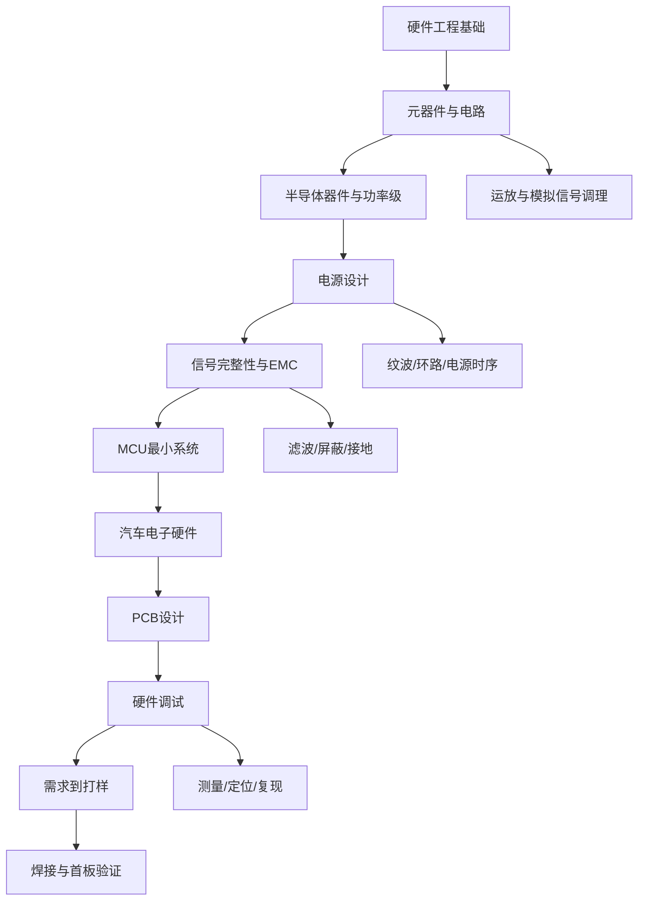

# 硬件从0到精通：从元器件到首板验证

本专题整理 Flomo「硬件从0到精通」专栏的导航、10 篇主线文章、4 篇补充文章，以及 CAN 故障案例。内容保留原始笔记的技术细节与问题脉络，并增加统一学习地图、工程验证路径和来源索引。原始 Flomo 笔记不删除。

## 专题学习地图

## 首板验证闭环

## 工程检查重点

- 电源：输入范围、瞬态、纹波、负载阶跃、环路稳定性、上/下电时序。
- MCU：供电去耦、晶振负载、复位时序、启动配置、调试接口与引脚复用。
- 通信：收发器供电和模式脚、终端匹配、共模范围、信号质量及错误计数。
- PCB：回流路径、开关电流环路、敏感模拟区、阻抗/等长、热设计与可制造性。
- 验证：先目检和断电测量，再限流上电；一次只改一个变量，保留波形、测量值和复现条件。

## 原始 Flomo 笔记（完整内容）

### 1. 专栏⑬·补充四：焊接与样板验证——从打样回来到点亮第一块板

- Flomo ID：`MjUxMDMwMDIw`
- 创建时间：2026-08-09T18:32:09+08:00
- 原文链接：[在 Flomo 中打开](https://v.flomoapp.com/mine/?memo_id=MjUxMDMwMDIw)
- 原始标签：Area/技术/硬件、Archive/MigratedNotion、Archive/DeleteCandidate

**专栏⑬·补充四：焊接与样板验证——从打样回来到点亮第一块板**

**▎第10篇到「打样」结束，这篇接上「怎么验证」**

打样回来的板子，软件工程师的第一块板怎么焊、怎么查、怎么通电——这是从「设计过」到「真跑起来」的分水岭。很多人第一块板回来直接上电冒烟，就是因为跳过了验证步骤。

**▎手工焊接基本功（贴片为主）**

1. 工具：恒温烙铁（350°C 左右）+ 助焊剂 + 镊子 + 放大镜/显微镜
2. 焊接顺序：矮的先焊（电阻/电容）→ 高的后焊（电感/插座）→ 芯片最后
3. 芯片焊接三招：拖焊（引脚多的）、定位（先焊对角固定）、回流检查（虚焊用放大镜 \+ 万用表蜂鸣档量相邻引脚短路）
4. 常见翻车：虚焊（锡没吃透）、桥连（相邻引脚粘连）、焊盘脱落（温度过高/反复焊）

**▎DFM 回看：焊的时候才发现的坑**

1. 元件间距太近：烙铁头伸不进去
2. 极性元件没标：电解电容/二极管方向看不清
3. 焊盘太小：手工焊难度大
4. 通孔元件背面焊盘被覆铜吃掉：散热太快焊不实  
   ——这些问题设计时就要避免，焊接时发现已经晚了（呼应你 7/28 记的硬件容差思维）

**▎首板通电流程（按顺序，错一步烧一块板）**

1. 目检 \+ 万用表短路检查：先量电源对地电阻（3.3V 对地不能是 0Ω）——短路没查出来就上电必烧
2. 空载上电：不焊 MCU，只焊电源部分，量各路电压对不对（5V/3.3V/1.8V 误差内）
3. 带载上电：焊上 MCU，限流上电（可调电源限流 100mA 起步），观察电流——电流异常大说明有短路/接错
4. 最小系统点亮：时钟（示波器看晶振起振）、复位（复位脚电平）、调试接口（能连上烧录器）
5. 外设逐个验证：GPIO 点灯 → 通信（UART 打印）→ 传感器 → 总线

**▎三个坑**

1. 不上电先量短路：这是唯一能救板子的步骤，跳过 = 送人头
2. 限流上电：可调电源设限流，电流异常立刻断电，保护板和元件
3. 一次只动一处：改一处测一处，别同时改三处再上电——出问题不知道是谁干的

**▎一句话总结**：样板验证四步——短路检查 → 空载量电压 → 限流带载 → 最小系统点亮；「一次只动一处」是硬件调试和软件 debug 唯一相通的美德。

📎 第10篇：完整项目（需求到打样）→ [https://v.flomoapp.com/mine/?memo\_id=MjQ3NTQ2NjU0](https://v.flomoapp.com/mine/?memo_id=MjQ3NTQ2NjU0)  
📎 第9篇：硬件调试（示波器）→ [https://v.flomoapp.com/mine/?memo\_id=MjQ3NTQ2NjE2](https://v.flomoapp.com/mine/?memo_id=MjQ3NTQ2NjE2)  
📎 第6篇：MCU 最小系统 → [https://v.flomoapp.com/mine/?memo\_id=MjQ3NTQ2NTA5](https://v.flomoapp.com/mine/?memo_id=MjQ3NTQ2NTA5)  
📎 专栏⑬导航 → [https://v.flomoapp.com/mine/?memo\_id=MjQ3NTQ2MDE3](https://v.flomoapp.com/mine/?memo_id=MjQ3NTQ2MDE3)

**专栏⑬进度：10/10 + 补充四（共 14 篇）**

#Area/技术/硬件

#Archive/MigratedNotion 
#Archive/DeleteCandidate

---

### 2. 专栏⑬·补充三：电源深入——从「能出电压」到「纹波达标、环路稳定」

- Flomo ID：`MjUxMDMwMDAz`
- 创建时间：2026-08-09T18:31:59+08:00
- 原文链接：[在 Flomo 中打开](https://v.flomoapp.com/mine/?memo_id=MjUxMDMwMDAz)
- 原始标签：Area/技术/硬件、Archive/MigratedNotion、Archive/DeleteCandidate

**专栏⑬·补充三：电源深入——从「能出电压」到「纹波达标、环路稳定」**

**▎第4篇只解决了「有电」，这篇解决「电好不好」**

第4篇讲了 LDO 和 DC-DC 怎么工作。但实际项目里：电源纹波把 ADC 精度吃掉、DC-DC 啸叫、负载跳变电压跌落、多路电源上电顺序不对导致 MCU 死锁——这些才是电源设计的后半场。

**▎纹波：DC-DC 的固有噪声**

1. 纹波来源：开关纹波（开关频率基波 \+ 谐波）\+ 输出电容 ESR 尖峰
2. 降纹波三板斧：加大输出电容（降 ESR，用 MLCC 并联）、加 LC 后级滤波、选更低 ESR 电容
3. LDO 的噪声是宽带噪声，DC-DC 是开关纹波——混合供电时：敏感模拟电路用 LDO 接在 DC-DC 后面（级联）
4. 纹波规格怎么定：ADC 参考电压纹波要求最严，一般 < 10mVpp 才安全

**▎环路稳定：为什么啸叫、为什么振荡**

1. DC-DC 是负反馈系统，环路增益相位裕度不够 → 振荡/啸叫
2. 输出电容 ESR 太低（全 MLCC）会让环路不稳定——很多 DC-DC 数据手册要求 ESR 有下限或加纹波注入
3. 判断标准：负载瞬态响应——跳变后有没有振铃，振铃几下
4. 排查：拿示波器看 SW 节点，开关占空比抖动 = 环路在临界

**▎布局：电源工程师 80% 的活**

1. 开关回路（输入电容 → MOS → 电感 → 输出电容）面积最小化——回路面积大 = 辐射大（接补充二 EMC）
2. 反馈走线远离电感/SW 节点，从输出电容根部取（Kelvin 接法）
3. 功率地 vs 模拟地：单点连接，别让开关电流流过模拟地

**▎多路电源树：上电顺序**

1. 车规 ECU 常见：12V → 5V（DC-DC）→ 3.3V / 1.8V / 1.2V（LDO 或 DCDC）
2. 上电顺序坑：MCU 内核先于 IO 供电，IO 会漏电/闩锁——按数据手册要求排序
3. 常用手段：使能脚顺序控制（EN 级联）、电源监控芯片（PMIC / 复位监控）
4. 下电顺序同样要管：掉电不同步可能写坏 Flash

**▎三个坑**

1. 电容全上 MLCC：ESR 太低环路不稳定、啸叫——看手册要不要加电解/钽电容
2. 反馈取线从负载端拉：压降导致采样不准——从输出电容根部取
3. 上电顺序不管：MCU 死锁、Flash 写坏——上电时序图和 PMIC 是标配

**▎一句话总结**：电源后半场是「纹波、环路、布局、时序」四件事——降纹波靠电容和滤波，防振荡看环路和 ESR，减辐射靠回路面积，保稳定靠上电顺序。

📎 第4篇：电源设计（LDO/DC-DC 基础）→ [https://v.flomoapp.com/mine/?memo\_id=MjQ3NTQ2NDQ5](https://v.flomoapp.com/mine/?memo_id=MjQ3NTQ2NDQ5)  
📎 第6篇：MCU 最小系统 → [https://v.flomoapp.com/mine/?memo\_id=MjQ3NTQ2NTA5](https://v.flomoapp.com/mine/?memo_id=MjQ3NTQ2NTA5)  
📎 第8篇：PCB设计 → [https://v.flomoapp.com/mine/?memo\_id=MjQ3NTQ2NTg2](https://v.flomoapp.com/mine/?memo_id=MjQ3NTQ2NTg2)  
📎 专栏⑬导航 → [https://v.flomoapp.com/mine/?memo\_id=MjQ3NTQ2MDE3](https://v.flomoapp.com/mine/?memo_id=MjQ3NTQ2MDE3)

**专栏⑬进度：10/10 + 补充三**

#Area/技术/硬件

#Archive/MigratedNotion 
#Archive/DeleteCandidate

---

### 3. 专栏⑬·补充二：EMC 与整改——汽车电子逃不掉的试验台

- Flomo ID：`MjUxMDI5OTc5`
- 创建时间：2026-08-09T18:31:48+08:00
- 原文链接：[在 Flomo 中打开](https://v.flomoapp.com/mine/?memo_id=MjUxMDI5OTc5)
- 原始标签：Area/技术/硬件、Archive/MigratedNotion、Archive/DeleteCandidate

**专栏⑬·补充二：EMC 与整改——汽车电子逃不掉的试验台**

**▎为什么 EMC 是汽车电子的生死线**

第7篇讲了 AEC-Q100（元件级），第8篇讲了 PCB 层叠——但整车厂验收的最后一关是 EMC 测试：传导发射（CE）、辐射发射（RE）、传导抗扰（CS）、辐射抗扰（RS）。过不了就上不了车。这不是玄学，是可分析、可整改的工程问题。

**▎电磁干扰三要素（所有 EMC 问题的分析框架）**

干扰源 → 耦合路径 → 敏感设备。整改就是干三件事：削弱源、切断路径、加固受害者。

**▎四个耦合路径**

1. 传导耦合：干扰沿导线/电源线直接走——电源线上串磁珠/共模电感
2. 辐射耦合：空间电磁波——屏蔽罩 \+ 接地
3. 容性耦合：相邻走线间寄生电容——拉开间距（3W 原则）
4. 感性耦合：相邻回路互感——减小回路面积

**▎你项目里最常见的干扰源**

1. DC-DC 开关节点（第4篇电源）：高频开关噪声，dV/dt 大——布局时开关回路尽量小
2. PWM 驱动（电机控制）：相线电压跳变——输出端加 RC 吸收
3. CAN/LIN 总线：共模噪声——共模扼流圈
4. 时钟线：谐波丰富——串阻降振铃

**▎整改三板斧（按顺序试）**

1. 滤波：电源入口 π 滤波（磁珠 \+ 电容）、信号线串阻/磁珠、共模扼流圈
2. 屏蔽：敏感器件加屏蔽罩、线束用屏蔽线、屏蔽层单点接地（低频）/多点接地（高频）
3. 接地：单点 vs 多点——低频信号单点地防地环路，高频多点地降回路电感；地平面永远优先于走线

**▎测试不过的排查顺序**

1. 先看超标频点：是开关频率的谐波（DC-DC/PWM）还是时钟谐波（晶振/总线）——频点会告诉你干扰源在哪
2. 对应频点去找源：100MHz 附近一般是时钟/数字信号，几十 MHz 一般是开关电源
3. 对症下药：源端串阻降振铃、电源加磁珠、IO 加滤波、线束加屏蔽

**▎一句话总结**：EMC 三要素（源/路径/受害）是分析框架，整改三板斧（滤波/屏蔽/接地）是手段；测试超标先看频点定干扰源，别上来就瞎加磁珠。

📎 第7篇：汽车电子硬件（AEC-Q100）→ [https://v.flomoapp.com/mine/?memo\_id=MjQ3NTQ2NTQ1](https://v.flomoapp.com/mine/?memo_id=MjQ3NTQ2NTQ1)  
📎 第8篇：PCB设计 → [https://v.flomoapp.com/mine/?memo\_id=MjQ3NTQ2NTg2](https://v.flomoapp.com/mine/?memo_id=MjQ3NTQ2NTg2)  
📎 第4篇：电源设计 → [https://v.flomoapp.com/mine/?memo\_id=MjQ3NTQ2NDQ5](https://v.flomoapp.com/mine/?memo_id=MjQ3NTQ2NDQ5)  
📎 专栏⑬导航 → [https://v.flomoapp.com/mine/?memo\_id=MjQ3NTQ2MDE3](https://v.flomoapp.com/mine/?memo_id=MjQ3NTQ2MDE3)

**专栏⑬进度：10/10 + 补充二**

#Area/技术/硬件

#Archive/MigratedNotion 
#Archive/DeleteCandidate

---

### 4. 专栏⑬·补充一：运放实战——软件工程师最容易忽略的模拟核心

- Flomo ID：`MjUxMDI5OTU4`
- 创建时间：2026-08-09T18:31:38+08:00
- 原文链接：[在 Flomo 中打开](https://v.flomoapp.com/mine/?memo_id=MjUxMDI5OTU4)
- 原始标签：Area/技术/硬件、Archive/MigratedNotion、Archive/DeleteCandidate

**专栏⑬·补充一：运放实战——软件工程师最容易忽略的模拟核心**

**▎为什么嵌入式工程师要懂运放**

传感器信号调理全靠它：电流采样（电机控制里放大分流电阻的毫伏级压降）、NTC 测温、光敏检测。第1篇只做了认知（虚短/虚断概念），这篇是实战电路。你电机控制专栏⑪的电流环采样，前级就是运放。

**▎两条黄金法则（能解 90% 的运放电路）**

1. 虚短：负反馈下同相端 = 反相端（电压相等）
2. 虚断：输入端不取电流（输入阻抗无穷大）
3. 注意：只在负反馈成立——开环做比较器时没有虚短

**▎五种实战电路**

1. 跟随器（缓冲）：高输入阻抗、低输出阻抗，隔离信号源——ADC 前级标配
2. 同相放大：G = 1 + Rf/Rg，输入阻抗高
3. 反相放大：G = -Rf/Rg，输入阻抗 = Rg（注意这个坑）
4. 差分放大：减法器，电流采样用——但普通差分共模抑制有限，高精度要仪表放大器
5. 有源滤波：Sallen-Key 低通，比 RC 无源滤波强在能带负载

**▎电流采样实战（接你的电机控制）**

- 分流电阻 \+ 差分/仪表放大：低端采样（地端）简单，高端采样（相线端）共模电压高
- 共模电压问题：电机相线电压能到母线电压，普通差分放大器共模抑制不够——上仪表放大器（INA 系列）
- 单电源运放输出到不了 GND：要加偏置，把信号抬到 VCC/2 附近

**▎三个坑**

1. 单电源输出摆幅到不了轨：rail-to-rail 也到不了完全 0V/VCC，ADC 满量程用不满——偏置到 VCC/2
2. 带宽不够：增益 × 带宽 = GBW 是常数——1MHz 增益带宽积的运放放大 100 倍，实际带宽只有 10kHz
3. 比较器抖动：开环输入接近阈值时输出来回跳——加正反馈迟滞（同相端串电阻分压）

**▎一句话总结**：运放是传感器信号的翻译官——虚短虚断解电路，电流采样靠它放大分流电阻的毫伏信号，单电源偏置和 GBW 是两个最常见的坑。

📎 第1篇：元器件认知（运放）→ [https://v.flomoapp.com/mine/?memo\_id=MjQ3NTQ2MjY3](https://v.flomoapp.com/mine/?memo_id=MjQ3NTQ2MjY3)  
📎 第4篇：电源设计 → [https://v.flomoapp.com/mine/?memo\_id=MjQ3NTQ2NDQ5](https://v.flomoapp.com/mine/?memo_id=MjQ3NTQ2NDQ5)  
📎 电机控制专栏⑪导航（电流采样）→ [https://v.flomoapp.com/mine/?memo\_id=MjQ5OTUxNzQy](https://v.flomoapp.com/mine/?memo_id=MjQ5OTUxNzQy)  
📎 专栏⑬导航 → [https://v.flomoapp.com/mine/?memo\_id=MjQ3NTQ2MDE3](https://v.flomoapp.com/mine/?memo_id=MjQ3NTQ2MDE3)

**专栏⑬进度：10/10 + 补充一**

#Area/技术/硬件

#Archive/MigratedNotion 
#Archive/DeleteCandidate

---

### 5. 专栏⑬·第10篇：完整项目——从需求到打样的全流程

- Flomo ID：`MjQ3NTQ2NjU0`
- 创建时间：2026-07-19T18:47:29+08:00
- 原文链接：[在 Flomo 中打开](https://v.flomoapp.com/mine/?memo_id=MjQ3NTQ2NjU0)
- 原始标签：Area/技术/硬件、Archive/MigratedNotion、Archive/DeleteCandidate

**专栏⑬·第10篇：完整项目——从需求到打样的全流程**

📎 第9篇：硬件调试 → [https://v.flomoapp.com/mine/?memo\_id=MjQ3NTQ2NjE2](https://v.flomoapp.com/mine/?memo_id=MjQ3NTQ2NjE2)

▎ **一、需求定义——你要做什么、做到什么程度**

1. 硬件需求文档该写什么——功能需求（"MCU从CAN总线接收扭矩请求，输出PWM控制电机"）、性能需求（"PWM频率50Hz-20kHz可配置"、满足AUTOSAR通信要求）、环境需求（"工作温度-40℃到+85℃"、满足ISO 16750的供电环境要求）、EMC需求（"通过CISPR 25 Class 5"）、接口需求（"供电12V/500mA峰值"）。为什么写需求文档比直接画原理图更重要——因为每个需求都会影响元器件选型和成本

2. 成本预算——一个用于量产的产品，BOM成本是决定性的。一个10μF MLCC，X5R（±15%温漂，1元）vs X7R（±15%温漂，1.5元）vs C0G（±30ppm/℃，5元）——在什么场景下必须用贵5倍的C0G——当这个电容是ADC的采样保持电容时，C0G的极低温度系数保证了ADC在全温范围内的精度。但在一个去耦电容上——用X5R就足够了

▎ **二、原理图设计——每个元件的选择背后都有一个理由**

1. 元器件选型的顺序：先选MCU（核心）→ 再选电源方案（MCU用什么电压供电、电流多大）→ 再选通信接口（CAN收发器型号）→ 再选传感器和执行器接口。为什么先选MCU——MCU决定了软件平台和开发工具链，换了MCU等于换了整个项目

2. 物料（BOM）的三点易错项：封装（0805 vs 0603能不能焊上去）、温度范围（工业级-4085℃ vs 汽车级-40125℃）、供货周期（这个料是不是Lifetime Buy的——你是第一批买到的吗？如果是停产料的话就找替代料吧）。为什么很多硬件项目在"最终BOM评审"阶段发现了不可供货的物料——选型的时候没查供货状态，用了推荐列表中都没问题但买不到的冷门料？

▎ **三、PCB Layout——把原理图变成真实的板子**

1. Layout的完整流程：板框（机械结构决定板子尺寸和安装孔位）→ 布局（固定连接器→大元件→MCU→小元件）→ 扇出（MCU的BGA带出到内层或扇出）→ 走线→ 覆铜→ DRC检查（设计规则检查）→ 导出Gerber文件。为什么"走线"这一步占了Layout时间的50%以上——因为要同时处理线宽规则（满足阻抗要求）、间距规则（满足制造要求）、长度匹配（差分等长）

2. Layout评审清单——电源部分：输入回路面积最小化了吗？去耦电容贴紧IC引脚了吗？模拟和数字地分开布局了吗？高速信号（CAN/以太网）的阻抗匹配和长度匹配做了吗？每一个问题都可能决定第一板能不能"一次点亮"

▎ **四、PCB打样——从文件到实物的最后一步**

1. PCB打样的关键参数——板厚（1.6mm标准）、铜厚（1oz标准）、阻焊颜色（绿色标准）、表面处理（HASL（热风整平）便宜但平整度差，ENIG（化学镀金）贵但平整度好，适合细间距BGA）。为什么你的第一板样机建议用ENIG——因为HASL的表面不平整，在焊接QFN/BGA时可能导致虚焊？

2. Gerber文件的"鹰眼检查"——把每一层Gerber生成PDF，逐层检查：顶层铜皮看起来对吗？阻焊层覆盖了不需要焊接的地方吗？钻孔文件的大小和位置对吗？为什么这一步被很多人跳过但后果严重——如果阻焊层做错了（本该开窗的地方没开窗），回流焊时引脚上的锡全部爬不上PCB焊盘——整板报废。返工重新打样的时间=2周

▎ **五、焊接与调试——从空板到能跑程序**

1. 第一板焊接——先焊电源部分（LDO/DC-DC、MCU的最小系统电源），不焊MCU和任何其他IC。上电量电源输出是否正常（3.3V/5V）。如果电源正常——再焊MCU的最小系统（晶振、复位电路、去耦电容）。再上电量晶振是否起振。再焊下载接口（JTAG/SWD）。下载一个点灯程序——如果LED亮了，MCU硬件确认OK了。这个"逐级焊接+逐级测试"的方法可以避免"焊了全部元件才发现有短路，不知道短路在哪里"

2. 第一版样机常见的"翻车"问题——电源焊反了极性（没加反接保护时）、晶振不匹配（负载电容没算对）、复位电路时间常数不对（MCU还没准备好就上电了）、JTAG/SWD的调试口没拉出来——你2023年记过的SWD接口设计就在讲这个问题

3. 从样机到量产的转换——样机阶段可以手工焊接（人工补焊、飞线），但量产必须考虑可制造性（DFM/DFA）。为什么样机通过了但量产批次出问题——因为手工焊接的焊点饱满度和回流焊的焊点形状不同，一些"虚焊"在手工焊接时靠锡量补上了，回流焊时焊点形状不合格，批量失效？

▎ **六、从你已有的知识出发——硬件全流程跟软件开发流程的对照**

1. 硬件开发流程跟你熟悉的软件开发流程的对照——需求定义（等同于软件的需求分析）→ 原理图设计（等于软件的概要设计）→ PCB Layout（等于软件的详细设计）→ 打样（等于编译生成可执行文件）→ 焊接调试第一板（等于软件调试）→ 验证测试（等于系统测试）→ 小批量试产（等于Beta测试）→ 量产（等于发布）。你已经有软件开发完整流程的经验，把同样的系统化思维迁移到硬件上？

2. 你跟纯硬件工程师的最大不同——你懂得AUTOSAR的BSW配置和CAN通信栈的每层细节。你在设计ECU的硬件时，知道MCU需要哪些外设（CAN、SPI用于调试、PWM用于驱动）、电源的纹波要求（ADC的参考电压如何）、CAN收发器的标准（TJA1040/TCAN1042）。大部分硬件工程师不懂AUTOSAR的通信栈，大部分软件工程师不懂硬件设计——你是两个世界的桥接者。所以你的硬件学习目标不是"成为硬件专家"，是"能独立完成从需求到第一板样机的完整硬件设计，并在硬件和软件之间建立有效的沟通"

📎 第9篇：硬件调试 → [https://v.flomoapp.com/mine/?memo\_id=MjQ3NTQ2NjE2](https://v.flomoapp.com/mine/?memo_id=MjQ3NTQ2NjE2)

📎 专栏⑬导航 → [https://v.flomoapp.com/mine/?memo\_id=MjQ3NTQ2MDE3](https://v.flomoapp.com/mine/?memo_id=MjQ3NTQ2MDE3)

**专栏⑬进度：10/10篇 ✅ 全部完成**

#Area/技术/硬件

#Archive/MigratedNotion 
#Archive/DeleteCandidate

---

### 6. 专栏⑬·第9篇：硬件调试——把你的CAN排查经验泛化

- Flomo ID：`MjQ3NTQ2NjE2`
- 创建时间：2026-07-19T18:47:06+08:00
- 原文链接：[在 Flomo 中打开](https://v.flomoapp.com/mine/?memo_id=MjQ3NTQ2NjE2)
- 原始标签：Area/技术/硬件、Archive/MigratedNotion、Archive/DeleteCandidate

**专栏⑬·第9篇：硬件调试——把你的CAN排查经验泛化**

📎 第8篇：PCB设计 → [https://v.flomoapp.com/mine/?memo\_id=MjQ3NTQ2NTg2](https://v.flomoapp.com/mine/?memo_id=MjQ3NTQ2NTg2)

**一、示波器——硬件工程师的第一工具**

1. 示波器的"Auto Set"按钮什么时候该按、什么时候不该按——Auto Set会自动调整时基和电压档位，适合快速看一个未知信号。但对于捕捉偶发异常（如电源上电瞬间的过冲）——Auto Set可能会调整到你根本看不出来有异常？正确的做法：用手动设置——时基调到合适的范围、触发模式设为"正常"或"单次"（Normal/Single）、触发电平设到你要捉的电压值。

2. 探头的"地线夹"有多影响测量——探头前端的地线夹（约10cm长）的寄生电感约100nH。测量频率较高的信号（>10MHz）时，地线夹的电感和探头的输入电容（约10pF）形成谐振，可能在波形上叠加"振铃"——你看到的不一定是真实的信号，可能是探头自己的谐振？正确的做法：用 **弹簧地线**（短地线）直接拧在测量点旁边的GND孔上，地线长度<5mm

**二、硬件调试的"三板斧"——80%的问题三步定位**

1. 第一板：量电源——是否在规格内、纹波是否正常、上电时序是否对。你记过的ECU上电后CAN不通信的案例：第一步量了VDD（3.3V正常）和CAN收发器的VCC（5V正常）后，继续查STB引脚。但如果VDD只有2.8V（LDO输出电压偏低）——MCU的IO口驱动能力下降（CMOS输出高电平可能只有2.4V而不是3.3V），CAN收发器接收不到足够的电压吗？

2. 第二板：量时钟——晶振是否起振、频率是否正确、幅度是否足够。晶振不起振的常见原因：负载电容配错了（太大或太小），或晶振焊接不良（虚焊）。用示波器的10×档（衰减10倍，输入电容约10pF）直接测量晶振引脚——探头的10pF电容会改变晶振的振荡频率？这时建议用FET探头？

3. 第三板：量复位——复位引脚是否在高电平、上电时复位时序是否正确。一个常见的问题：复位引脚被外部的某个IC拉低了（比如一个外部看门狗芯片在超时输出复位），MCU一直处于复位状态，永远不会运行

**三、电源的纹波测量技巧**

1. 测量DC-DC输出纹波时，一定要限制带宽（通常设为20MHz）。为什么？因为示波器本身的带宽会采集高频噪声（>20MHz），这些噪声可能是由探头自身的环境电磁场耦合进来的——不是DC-DC的真实纹波。20MHz以下的纹波分量才是你需要关心的？（DC-DC的开关频率通常几百kHz，它的谐波在几十MHz已经很小了）

2. DC-DC纹波测量的另一个关键：探头的GND不能用地线夹——要用弹簧地线直接拧在DC-DC输出电容的GND端。为什么？因为地线夹加长导线（10cm）在DC-DC的开关频率下会引入噪声，测量出来的纹波可能比实际值大几倍？

**四、I2C/SPI的总线调试——时钟和数据线的时序验证**

1. I2C总线调试最常用的工具是逻辑分析仪（Logic Analyzer）而不是示波器——因为I2C的SCL/SDA是数字信号，逻辑分析仪能自动解码出"哪个地址、读/写、数据是什么"。但为什么看I2C的波形还需要示波器——因为逻辑分析仪只能告诉你"信号是0还是1"，不能告诉你信号的幅度、上升时间、噪声——用示波器看SDA的上升沿，如果上升时间太长，可能是上拉电阻太大了

2. SPI调试——四个信号线：SCK（时钟）、MOSI（主输出从输入）、MISO（主输入从输出）、CS（片选）。SPI常见的问题：时钟极性（CPOL）和相位（CPHA）在主从设备间不匹配——主设备在时钟上升沿采样、从设备在时钟下降沿输出数据，这一帧就永远读不到正确的数据。不过这在软件里配置一下就可以改

**五、把已有CAN排查经验扩展到通用排查流程**

1. 你排查CAN问题时有一个非常成熟的方法论（终端电阻→电源→收发器模式引脚→逐层排查）。这个方法论可以泛化成通用的硬件排查流程：物理层（供电、连接、断路短路）→ 信号层（用示波器看波形）→ 协议层（用逻辑分析仪/总线分析仪）→ 上层软件。为什么这个"从下往上"的排查顺序最有效——因为物理层问题（电源没接到、线断了）会在所有上层都表现为异常，先从最底层确认了，才能放心地往上层查

2. 你排查CAN终端电阻时，用万用表量了60Ω→正确。如果不是60Ω，可能是（1）120Ω（缺一个）、（2）0Ω（短路）、（3）其他值（组装件接错了或虚焊）。这个排查逻辑也适用于通用硬件：先确认"应该是什么值"，再量"实际是什么值"，差值告诉你"什么出了错"——这个逻辑是电子设计的核心基础

**六、热成像仪——看到你看不到的温度**

1. 热成像仪（Thermal Camera）是硬件调试的"作弊器"——接上电源但不运行软件，看有没有不正常发热的地方。如果某个芯片在不上电时就发热——可能是电源短路了（IC内部短路）。上电但不运行代码时，如果某个MOSFET烫手——可能是栅极被意外拉高了（MOSFET部分导通，大电流通过）。你平时的硬件调试中，用手摸一下或者用热成像定位高温点往往能快速找到故障原因？

📎 第8篇：PCB设计 → [https://v.flomoapp.com/mine/?memo\_id=MjQ3NTQ2NTg2](https://v.flomoapp.com/mine/?memo_id=MjQ3NTQ2NTg2)

📎 第10篇：完整项目 → [https://v.flomoapp.com/mine/?memo\_id=MjQ3NTQ2NjU0](https://v.flomoapp.com/mine/?memo_id=MjQ3NTQ2NjU0)

📎 专栏⑬导航 → [https://v.flomoapp.com/mine/?memo\_id=MjQ3NTQ2MDE3](https://v.flomoapp.com/mine/?memo_id=MjQ3NTQ2MDE3)

**专栏⑬进度：9/10篇**

#Area/技术/硬件

#Archive/MigratedNotion 
#Archive/DeleteCandidate

---

### 7. 专栏⑬·第8篇：PCB设计——从原理图到打样

- Flomo ID：`MjQ3NTQ2NTg2`
- 创建时间：2026-07-19T18:46:47+08:00
- 原文链接：[在 Flomo 中打开](https://v.flomoapp.com/mine/?memo_id=MjQ3NTQ2NTg2)
- 原始标签：Area/技术/硬件、Archive/MigratedNotion、Archive/DeleteCandidate

**专栏⑬·第8篇：PCB设计——从原理图到打样**

📎 第7篇：汽车电子硬件 → [https://v.flomoapp.com/mine/?memo\_id=MjQ3NTQ2NTQ1](https://v.flomoapp.com/mine/?memo_id=MjQ3NTQ2NTQ1)

**一、PCB层叠结构——几层板、怎么排**

1. 两层板的典型结构：顶层（信号+少量地）+底层（信号+少量地）。为什么两层板的EMC性能不好——因为信号的回流路径不连续。假设顶层走了一条信号线，它的回流电流必须通过GND走线回到源端——但GND走线可能绕了一大圈，形成的电流回路面积大，这个回路就是发射天线

2. 四层板的典型叠层：顶层（信号+元件）→GND层（完整地平面）→电源层（完整电源平面）→底层（信号+元件）。为什么这个叠层EMC性能好很多——因为每一条顶层信号的回流电流直接在下面的GND平面上流回去，回路面积≈0？而且GND平面也提供了屏蔽（顶层信号向下的电磁场被GND平面吸收）

3. 六层板的叠层选择：最多推荐Top→GND→SIG1→SIG2→PWR→Bottom，或者Top→SIG1→GND→PWR→SIG2→Bottom。为什么电源层和地平面要相邻放置——因为这样形成了一对"平行平板电容"，提供了高频去耦（类似于一个分布式去耦电容），减少了电源纹波？你的四层板项目中，电源层和GND层的间距就是PCB板材的厚度（核心层约0.2-0.5mm）

**二、走线规则——线宽、间距、长度**

1. 走线宽度由电流决定——1oz（约35μm厚）铜箔，10℃温升下，1mm宽的走线可以通过约1.8A的电流。如果你在电源线上走了2A的电流但只用了0.5mm宽的走线——温升超过30℃，长期可靠性下降。更关键的是——保险丝不会因为你的走线细了就提前熔断，走线先烧了保险丝还没断？

2. 走线的特性阻抗由线宽、到参考平面的距离、铜厚、介电常数决定。50Ω微带线的典型设计：在FR4（εr≈4.5，板厚1.6mm，顶层到GND层距离0.2mm的四层板中）线宽约0.35mm。在你做高速信号（CAN FD、Ethernet）的PCB时，如果信号线的特性阻抗偏离50Ω太多——信号反射增加，EMI增加。你的Layout工具（如Altium Designer、KiCad）里怎么设置阻抗控制的走线规则——用"阻抗计算器"输入层叠参数算出目标线宽

3. 等长走线——差分信号（CAN\_H/CAN\_L、USB\_DP/DM、以太网）需要等长。如果CAN\_H走线比CAN\_L长5mm——信号在两条线上到达的时间差约30ps（PCB上信号速度约150ps/cm）。在500kbps（位时间2μs）的CAN上没有影响（30ps<<2μs）。但在USB 2.0（480Mbps，位时间约2ns）——30ps的偏差是位时间的1.5%，可能已经超标了？

4. 过孔（Via）对信号的影响——一个过孔的寄生电容约0.3-1pF，寄生电感约0.5-2nH。在高速信号中，过孔相当于一个阻抗不连续点——引起信号反射。为什么在高速信号（如DDR内存、以太网）中建议少用过孔——因为每个过孔增加约几ps的延迟和阻抗突变。但在你的CAN设计中，几个过孔影响不大（CAN速度相对较低）

**三、布局原则——从哪里开始、怎么放元件**

1. PCB布局的顺序：先固定连接器位置（决定板子的外形和输入输出位置）→ 放大功率元件（DC-DC、MOSFET）→ 放MCU → 放小元件。为什么先放大功率元件——因为大功率元件的散热和走线宽度要求最高，先安排好它们的位置，再用MCU的布局"填空"？

2. 模拟电路和数字电路要分区域布局——在你的ECU设计里，ADC的前端调理电路（运放、分压电阻）应该远离DC-DC的开关管和电感？因为DC-DC的开关管在每M个开关周期中产生的高频电磁场（磁场从电感和开关环路辐射出来）会耦合到模拟电路里——ADC读数跳动。分区域布局+单点接地是解决方法

**四、接地——最重要但最容易被搞错的概念**

1. Star Ground（星形接地）vs Ground Plane（地平面）——低频模拟电路（<1MHz）适合星形接地（所有电路的地线汇到一个点，防止大电流地回路干扰小信号地）。高频数字电路（>1MHz）适合地平面（大面积GND铜皮，提供低阻抗回路）。为什么你的混合信号电路（既有CAN的几十MHz信号又有MCU的MHz时钟）应该用地平面而不是星形接地——因为地平面的阻抗远小于星形接地的地线，在高频下减少共模噪声

2. 为什么不能在PCB上"飞一根GND线"——因为导线的寄生电感约1nH/mm。如果GND线长10cm，L=100nH。在100MHz的谐波下，GND线的阻抗=2π×100M×100nH≈63Ω——这根GND线在那个频率下相当于一个63Ω的电阻（不是0Ω！）。而地平面的阻抗（同样100MHz下，1平方英寸的GND铜皮阻抗<1mΩ）

3. 单点接地——模拟GND和数字GND在哪里连起来？在你记过的ADC设计里，MCU内部有VDDA和VDD、VSSA和VSS。在PCB上，模拟地（VSSA相关的GND）和数字地（VSS）应该在MCU的VSSA引脚附近通过一个0Ω电阻或磁珠连在一起——防止数字地的大电流回流通过模拟地，干扰ADC

**五、热设计——不散热就会烧**

1. PCB散热最主要靠铜皮。一个SOT-223封装的LDO，数据手册说θJA≈150℃/W（在标准JEDEC测试板上）。但如果你在PCB上给LDO的散热焊盘加了一大片顶层铜皮+通过过孔连接到内层和底层的完整铜皮——θJA可以降到50-60℃/W。为什么同样一个芯片在两个PCB上散热能力差3倍——因为散热的关键是把热量从封装传导到PCB铜皮，再由铜皮散到空气中

2. 为什么PCB上的散热过孔（Thermal Via）要密集排列在散热焊盘下方——因为铜的导热系数约400W/(m·K)，FR4的导热系数约0.3W/(m·K)。热量通过FR4传导的速率是铜的1/1000，所以必须用过孔把热量从顶层传到内层和底层的铜皮——过孔的作用是"打破FR4的隔热层"，用铜的孔壁把热量导下去

3. 自然对流散热——在ECU外壳上设计散热片或利用外壳本身散热。为什么你的ECU外壳是带散热鳍片的铝合金外壳——铝合金导热系数约200W/(m·K)，外壳把内部热量传导到大面积的散热鳍片上，再由空气流动带走热量。如果壳体是塑料的——导热系数约0.2W/(m·K)——热量基本传不出来

📎 第7篇：汽车电子硬件 → [https://v.flomoapp.com/mine/?memo\_id=MjQ3NTQ2NTQ1](https://v.flomoapp.com/mine/?memo_id=MjQ3NTQ2NTQ1)

📎 第9篇：硬件调试 → [https://v.flomoapp.com/mine/?memo\_id=MjQ3NTQ2NjE2](https://v.flomoapp.com/mine/?memo_id=MjQ3NTQ2NjE2)

📎 专栏⑬导航 → [https://v.flomoapp.com/mine/?memo\_id=MjQ3NTQ2MDE3](https://v.flomoapp.com/mine/?memo_id=MjQ3NTQ2MDE3)

**专栏⑬进度：8/10篇**

#Area/技术/硬件

#Archive/MigratedNotion 
#Archive/DeleteCandidate

---

### 8. 专栏⑬·第7篇：汽车电子硬件——从AEC-Q100到抛负载

- Flomo ID：`MjQ3NTQ2NTQ1`
- 创建时间：2026-07-19T18:46:24+08:00
- 原文链接：[在 Flomo 中打开](https://v.flomoapp.com/mine/?memo_id=MjQ3NTQ2NTQ1)
- 原始标签：Area/技术/硬件、Archive/MigratedNotion、Archive/DeleteCandidate

**专栏⑬·第7篇：汽车电子硬件——从AEC-Q100到抛负载**

📎 第6篇：嵌入式MCU硬件设计 → [https://v.flomoapp.com/mine/?memo\_id=MjQ3NTQ2NTA5](https://v.flomoapp.com/mine/?memo_id=MjQ3NTQ2NTA5)

**一、汽车级元器件认证——为什么汽车上的芯片比消费级贵几倍**

1. AEC-Q100是汽车级IC的可靠性标准。Grade 1（-40℃到+125℃）用于乘客舱内的ECU，Grade 0（-40℃到+150℃）用于发动机舱。为什么Grade 0这么难做到——因为在150℃的高温下，半导体载流子浓度大幅增加，漏电流变大，阈值电压漂移，芯片内部互连的金属层（铝/铜）也会加速电迁移。一个在25℃时工作正常的芯片在150℃下的功耗提升了多少——泄漏电流每10℃翻倍，从25℃到150℃，泄漏电流增加了2^12.5≈5000倍？

2. 为什么消费级芯片（手机/电脑）不能直接用车上——因为车上的温度范围更宽（-40℃到+85℃是基本要求）、振动更大、湿度更高、EMC环境更恶劣。一个iPhone的SoC在-20℃下可能无法启动，但你的ECU必须在-40℃下也正常工作——冷启动时电解电容的容值下降30%以上，晶振在低温下起振时间增加。你记过的CAN终端电阻在高低温下阻值变化——这些都会影响ECU的可靠性

**二、抛负载（Load Dump）——汽车电子最危险的瞬态**

1. 抛负载：当汽车电池在发电机充电时突然断开（比如碰撞中电池线断了），发电机突然失去负载——发电机的励磁电流不能瞬间降为0，输出电压飙升到60V以上，持续200-400ms。ISO 16750-2和ISO 7637-2定义了抛负载波形（Pulse 5a/5b），峰值电压可达87V（24V系统更高）。如果你在12V电池供电的ECU的电源入口没有加足够大功率的TVS管——抛负载发生时，TVS管能量吸收不够，或者TVS管本身的功率不够大就会直接击穿，然后整个60V直接加到LDO/DC-DC上——烧毁？

2. TVS管的选型是怎么算的——V\_RWM（反向工作电压）要略高于电源最高电压（汽车12V系统一般按16V算，因为发电机充电时可达14.5V+余量）。V\_BR（击穿电压）约18V。V\_C（钳位电压）约30V。峰值脉冲功率P\_PPM = V\_C × I\_PP。如果抛负载的峰值电流I\_PP=10A，P\_PPM=30×10=300W——需要选SMF系列（200W）还是SMC系列（1500W）？保守设计选SMC系列，因为抛负载持续时间长（几百ms），TVS管的脉冲能量E=P\_PPM×t=300W×0.4s=120J——大多数TVS管只能承受ms级的脉冲，几百ms可能超了？

**三、反接保护——电池接反了不能烧**

1. 反接保护最简单的方案——在电源入口串一个二极管。但效率损失（肖特基0.3V×2A=0.6W）在功耗敏感的ECU里不可接受。所以用PMOS方案：PMOS的源极接电源输入，漏极接ECU的电源入口，栅极通过一个电阻下拉到GND。电池正接时栅极电压=GND，源极电压=12V，Vgs=-12V（PMOS导通）。电池反接时源极电压=-12V，栅极电压=GND（通过下拉电阻），Vgs=12V——注意，PMOS的Vgs\_max通常±20V——反接时Vgs=12V在规格内（不会超过最大额定值），但源极和漏极交换了？

2. 为什么NMOS不能直接用于反接保护？因为NMOS做高边开关时，源极电压=输出电压。电池反接时，源极=GND？其实NMOS也可以做反接保护——但需要栅极驱动电压高于源极（高边开关的问题），需要额外的自举电路，不划算

**四、ESD保护——人手触碰的接口必须防护**

1. ISO 10605（道路车辆—静电放电电气试验）要求汽车电子设备能承受：接触放电±8kV、空气放电±15kV（人体手持金属工具接触ECU引脚时）。为什么CAN\_H/CAN\_L引脚上都加了TVS管——因为CAN总线线束在人可接触的地方，人身上的静电可能直接放到CAN线上。静电通过CAN收发器的内部ESD保护结构泄放到GND——但如果静电能量过大（>8kV），内部ESD结构承受不了——收发器烧了？

2. TVS管的结电容（C\_j）会在高速信号线上引入信号完整性问题。一个用于ESD保护的TVS管C\_j=5pF。CAN总线上的容性负载如果超过收发器的驱动能力（典型值为总电容负载<100pF），CAN信号波形会变差。如果你在CAN\_H和CAN\_L上各加一个5pF的TVS管，给总线上加了10pF——如果原来总线有5个ECU（每个ECU有30pF的对地电容），总电容=5×30+10+Cable≈200pF——超过了100pF的推荐值，CAN通信距离会缩短

**五、休眠电流——跟你记过的EcuM唤醒验证直接相关**

1. 汽车的12V电池容量约60Ah。如果停驶时所有ECU的静态电流总和=10mA（每ECU100μA×100个ECU），可以停放60Ah/0.01A=6000小时≈250天。如果某个ECU的休眠电流超标到1mA（因为唤醒验证配置不对——你记过的EcuM案例），静态总电流=1mA×100+其他≈100mA，停放时间=60Ah/0.1A=600小时≈25天——两周车就启动不了了。所以ECU休眠电流<100μA这个要求对整车来说有多关键？

2. 怎么在硬件上保证休眠电流<100μA——电源设计上，ECU在休眠时应该把大部分电路（MCU内核、外设）的电源切断（通过一个负载开关或PMOS控制），只保留唤醒模块（CAN收发器的待机模式+一个定时器）的供电。如果你用LDO给整个MCU供电——MCU在睡眠模式下的功耗可能已经在μA级了，但LDO本身的静态电流（I\_q）可能是几十μA——单这个LDO就占了休眠功耗的大半？

**六、ECU的电源架构——从电池到MCU的完整路径**

1. 一个典型的汽车ECU电源架构：12V电池 → 反接保护（PMOS）→ ESD/TVS保护 → 输入滤波（LC）→ DC-DC（12V→5V）→ LDO（5V→3.3V给MCU，5V→1.2V给内核）。为什么不用12V直接LDO到3.3V？因为效率太低——你算过DC-DC+LDO两级方案（第一级85%+第二级66%=总效率56%）比单级LDO（效率27.5%）高出一倍。同时热量也分散了？

2. 为什么汽车电子中电源芯片通常选"集成MOSFET的DC-DC"而不是"外部MOSFET的DC-DC控制器"？因为外部MOSFET方案需要额外的PCB面积和精心设计的Layout（开关回路等）。集成方案（如TPS54360、LMR14030）把MOSFET和驱动电路封装在一起——Layout更简单，可靠性更高。但代价是什么——最大输出电流受限（集成方案通常<3A，外部MOSFET方案可做到10A+）。你的ECU通常需要多大电流——一般<1A，所以集成方案足够？

📎 第6篇：嵌入式MCU硬件设计 → [https://v.flomoapp.com/mine/?memo\_id=MjQ3NTQ2NTA5](https://v.flomoapp.com/mine/?memo_id=MjQ3NTQ2NTA5)

📎 第8篇：PCB设计 → [https://v.flomoapp.com/mine/?memo\_id=MjQ3NTQ2NTg2](https://v.flomoapp.com/mine/?memo_id=MjQ3NTQ2NTg2)

📎 专栏⑬导航 → [https://v.flomoapp.com/mine/?memo\_id=MjQ3NTQ2MDE3](https://v.flomoapp.com/mine/?memo_id=MjQ3NTQ2MDE3)

**专栏⑬进度：7/10篇**

#Area/技术/硬件

#Archive/MigratedNotion 
#Archive/DeleteCandidate

---

### 9. 专栏⑬·第6篇：嵌入式MCU硬件设计——从原理图到上电

- Flomo ID：`MjQ3NTQ2NTA5`
- 创建时间：2026-07-19T18:46:00+08:00
- 原文链接：[在 Flomo 中打开](https://v.flomoapp.com/mine/?memo_id=MjQ3NTQ2NTA5)
- 原始标签：Area/技术/硬件、Archive/MigratedNotion、Archive/DeleteCandidate

**专栏⑬·第6篇：嵌入式MCU硬件设计——从原理图到上电**

📎 第5篇：信号完整性 → [https://v.flomoapp.com/mine/?memo\_id=MjQ3NTQ2NDgw](https://v.flomoapp.com/mine/?memo_id=MjQ3NTQ2NDgw)

**一、最小系统——MCU能跑起来的最少条件**

1. MCU的最小系统由四部分组成：电源、时钟、复位、调试接口。缺了任何一个MCU都跑不起来。为什么先把这四个搞通再管其他的——因为你做一块新板子，回来第一件事就是焊最小系统、烧一个LED闪烁的程序。如果LED不闪，是软件还是硬件的问题——这四个里的哪一个出了问题？

2. 每个电源引脚配一个去耦电容——这是PCB Layout的"第一铁律"。0.1μF+1μF（或4.7μF）并联，紧贴MCU的电源引脚。为什么两个电容？因为0.1μF的自谐振频率约几十MHz，负责高频去耦；1-10μF的自谐振频率约几MHz，负责中频去耦。如果Layout空间不够只能放一个——放0.1μF（高频去耦更重要）

3. 模拟电源（VDDA/VREF+）的供电应该独立于数字电源吗？在STM32中，VDDA必须连接到VDD，即使不使用ADC。如果用且只用VDD给VDDA供电——数字电路的高频噪声会通过电源耦合到ADC的参考电压，导致ADC读数跳动。所以建议在VDDA和VDD之间加一个磁珠（Ferrite Bead）或低通滤波器（如10Ω+1μF的RC）？

**二、时钟电路——晶振的设计与布局**

1. 晶振为什么需要负载电容（C\_L）？晶振的振荡频率由它的机械尺寸决定，但外接电容会微调振荡频率。负载电容C\_L由两个外部电容C1和C2串联（加上PCB和引脚寄生电容C\_stray）计算：C\_L = (C1×C2)/(C1+C2) + C\_stray。如果C1=C2=22pF、C\_stray≈5pF，C\_L≈16pF——如果你买的晶振标称负载电容是20pF，实际16pF会导致晶振频率偏移几十到几百ppm——可能影响CAN的位定时精度？

2. 晶振最大的Layout禁忌——晶振下方的PCB的所有层都不能走任何信号线。为什么？晶振的高阻抗振荡回路对寄生电容极度敏感——如果晶振下方有一根信号线经过，信号线与晶振焊盘之间的寄生电容会改变振荡频率。同时晶振产生的电磁场也会干扰下方的信号线？

3. 为什么MCU的PLL（锁相环）需要独立的电源引脚（如STM32的VDD\_PLL或VCAP）——PLL内部是一个模拟电路（振荡器+相位比较器+环路滤波器），对电源噪声非常敏感。数字电路的高频噪声如果耦合到PLL的电源上，PLL输出时钟的抖动（Jitter）会增加——最终影响CAN和Ethernet的时序精度

**三、复位电路——上电那一刻的顺序**

1. MCU的复位引脚在正常工作时是高电平（通常内部上拉到VDD）。为什么复位电路需要加一个外部电容（通常0.1μF）？上电时电容两端电压不能突变，复位引脚电压缓慢上升，给MCU的内部振荡器足够的时间稳定。这个RC常数（R×C）一般设多大——如果复位引脚内部有40kΩ上拉，外接0.1μF，τ=4ms——大概3τ=12ms后复位引脚才到达高电平？但对于某些MCU来说这个时间可能太长，需要查数据手册的"最小复位脉冲宽度"

2. 外部看门狗（External Watchdog）——在安全关键系统（你记过的AUTOSAR功能安全ISO 26262）中，MCU内部看门狗（IWDG）的可靠性不够（如果MCU主时钟停了，IWDG也无法工作）。所以需要外部的独立看门狗芯片，有自己的独立时钟源，在MCU没按时喂狗时直接复位MCU或切断电源再上电？

**四、调试接口——JTAG/SWD的硬件设计**

1. 你2023年记过JTAG的4线接口：TMS（模式选择）、TCK（时钟）、TDI（数据输入）、TDO（数据输出）。为什么现在大多数MCU还支持SWD（2线：SWDIO+SWCLK），且SWD能实现跟JTAG同样的调试功能？因为SWD在SWCLK时钟线上复用：在SWCLK的上升沿传输"请求"，在SWCLK的下降沿传输"响应"——一根数据线实现了双向通信

2. JTAG/SWD的信号是否需要上拉/下拉电阻？通常：JTAG的TMS/TDI需要有上拉电阻（使默认状态为高），nTRST需要上拉（上电时不触发复位），TDO不需要（由MCU驱动）。SWD的SWDIO（双向线）需要一个上拉电阻（约10kΩ）——如果没有上拉，调试器第一次连接MCU时可能发现不了设备。这个细节被多少硬件工程师忽略了导致第一板烧录不进去？

3. SWD接口只用了2根线，为什么不能省掉RST（复位）线——因为当SWD调试器需要连接一个"被锁死"的MCU（比如烧了错误的时钟配置导致MCU无法运行），它可以通过RST引脚复位MCU，在复位后立即发送SWD连接请求——在晶振起振前就抢占SWD总线。如果没有RST线——MCU被锁死时只能通过断电重试来恢复？

**五、实际Layout中的MCU周边电路设计**

1. ADC输入电路的阻抗匹配——你记过ADC采样异常（读数偏高）的案例，原因是采样时间不够、源阻抗太高。硬件设计时怎么避免——在ADC输入引脚和信号源之间加一个运放电压跟随器（缓冲），它的输入阻抗极高（GΩ级），输出阻抗极低（几十Ω），保证ADC的采样电容能在采样时间内完全充电。如果成本敏感不加运放——信号源的输出阻抗必须< MCU的ADC输入阻抗的1/10

2. GPIO的驱动能力——MCU的GPIO可以输出多少电流？STM32的GPIO典型值为±8mA（推挽输出）。如果你要用GPIO直接驱动一个LED（LED电流通常20mA）——已经超了！如果超载使用，长期可靠性会下降吗——不会立即烧毁，但GPIO的电压输出会偏离VDD（从3.3V降到2.8V），LED亮度不够。同时多个引脚超载会使MCU内部电源产生压降？

3. 为什么裸露焊盘（Exposed Pad / Thermal Pad）必须焊接到GND上——裸露焊盘有两个功能：散热（芯片的热量通过它传到PCB上的铜皮）和接地（提供一个低阻抗的GND连接）。如果裸露焊盘没焊好——芯片散热不良，轻则温度升高（影响MCU性能），重则热保护关机？

4. 未使用的IO引脚怎么处理——浮空？接固定电平？如果你在驱动GPIO时水平不够，就会留下一堆悬空的IO引脚——这些引脚可能是高阻抗输入，容易感应外部噪声，使MCU进入意外的状态。一般的做法是：通过软件配置为输出低或内部下拉——如果配置为内部上拉模式也可以

📎 第5篇：信号完整性 → [https://v.flomoapp.com/mine/?memo\_id=MjQ3NTQ2NDgw](https://v.flomoapp.com/mine/?memo_id=MjQ3NTQ2NDgw)

📎 第7篇：汽车电子硬件 → [https://v.flomoapp.com/mine/?memo\_id=MjQ3NTQ2NTQ1](https://v.flomoapp.com/mine/?memo_id=MjQ3NTQ2NTQ1)

📎 专栏⑬导航 → [https://v.flomoapp.com/mine/?memo\_id=MjQ3NTQ2MDE3](https://v.flomoapp.com/mine/?memo_id=MjQ3NTQ2MDE3)

**专栏⑬进度：6/10篇**

#Area/技术/硬件

#Archive/MigratedNotion 
#Archive/DeleteCandidate

---

### 10. 专栏⑬·第5篇：信号完整性——你已经会了一半

- Flomo ID：`MjQ3NTQ2NDgw`
- 创建时间：2026-07-19T18:45:38+08:00
- 原文链接：[在 Flomo 中打开](https://v.flomoapp.com/mine/?memo_id=MjQ3NTQ2NDgw)
- 原始标签：Area/技术/硬件、Archive/MigratedNotion、Archive/DeleteCandidate

**专栏⑬·第5篇：信号完整性——你已经会了一半**

📎 第4篇：电源设计 → [https://v.flomoapp.com/mine/?memo\_id=MjQ3NTQ2NDQ5](https://v.flomoapp.com/mine/?memo_id=MjQ3NTQ2NDQ5)

**一、传输线理论与阻抗匹配——从你的CAN笔记出发**

1. 你2024年7月记过的CAN终端电阻案例——为什么CAN总线两端各需要120Ω终端电阻？因为CAN总线的双绞线特性阻抗约120Ω，在两端并联120Ω使总端接电阻=60Ω，匹配了传输线的特性阻抗。如果终端电阻不匹配——信号在总线末端遇到阻抗突变（从120Ω变成开路∞或短路0），一部分能量反射回来，反射波叠加在原始信号上，产生信号完整性问题

2. 反射的本质可以用一个公式量化：反射系数Γ=(Z\_load-Z0)/(Z\_load+Z0)。如果Z\_load=∞（开路），Γ=(∞-120)/(∞+120)≈1——信号全反射，电压翻倍。如果Z\_load=0（短路），Γ=(0-120)/(0+120)=-1——信号完全反射但极性反转。如果Z\_load=120Ω（匹配），Γ=0——没有反射。你记过的那次CAN排查：量到120Ω（缺一个终端电阻），说明Z\_load是从一端120Ω+另一端开路=开路端反射系数≈1？

3. 上升时间（Rise Time）决定了信号完整性问题有多严重——一个上升时间1ns的数字信号在PCB上的"电气长度"约15cm（信号在FR4的传播速度约15cm/ns）。如果PCB走线长度超过这个电气长度的1/6（约2.5cm），就必须考虑传输线效应。你的CAN总线走线长度可能超过1米，上升时间约50ns——传输线效应在CAN上很明显，所以需要终端电阻。但在MCU内部的短走线（<2.5cm）上——终端电阻反而是多余的？

4. 为什么PCB走线不能走直角——直角走线的外侧线宽增加（外侧弧长>内侧弧长），导致特性阻抗突变约10-15%，产生反射。但更重要的是——直角尖角处电场集中，容易产生EMI辐射。45度角走线的阻抗变化只有直角的1/5——所以Layout规范要求走线不能走直角

**二、地弹（Ground Bounce）——IO口同时切换时发生了什么**

1. 地弹的本质——当MCU的多个IO口同时从高切换到低时，每个IO的放电电流I\_OL通过GND引脚上的寄生电感L\_gnd回到地。瞬态电流变化di/dt可达几十mA/ns，L\_gnd×di/dt产生的电压尖峰（地弹噪声）可以达到几百mV——足够把同一个芯片上其他输入引脚的低电平读成高电平？

2. 为什么FPGA比MCU更容易出现地弹问题——因为FPGA的IO口数量多（几百个可能同时切换）、切换速度快（皮秒级边沿）。一个容纳200个IO同时翻转的FPGA，地弹可能超过1V——如果这个FPGA驱动另一个芯片的输入引脚，那个芯片的输入低电平阈值是0.8V（LVTTL）——1V的地弹让它误认为高电平？

3. 减少地弹的方法：（1）每个电源引脚配去耦电容（就近提供瞬态电流）、（2）多个GND引脚（并联降低L\_gnd）、（3）控制同时翻转的IO数量（软件上分时切换）。在你的STM32项目里，如果你用一个GPIO Port的16个引脚同时驱动LED——你会不会测到地弹信号？通常不会，因为LED驱动电流小（几mA），切换速度也慢（软件控制，不是同步时钟边沿）

**三、串扰——两条平行走线之间的"窃听"**

1. 串扰分两种：容性串扰（通过寄生电容耦合）和感性串扰（通过互感耦合——你在记过的CAN双绞线里用过"双绞线抑制共模噪声"的原理反过来理解就可以）。两条平行走线之间的串扰跟线间距成反比。为什么"3W规则"（线间距≥3倍线宽）可以把串扰抑制到<1%——因为间距从1W增加到3W时，耦合电容和互感都大幅下降？

2. 微带线（外层走线）和带状线（内层走线）的串扰特性不同——带状线在两层参考平面之间，电场被限制在参考平面之间，串扰比微带线小得多。所以在多层板设计中，高速信号（时钟、CAN、以太网）应该走内层（带状线）还是外层（微带线）——内层串扰更小但信号传播速度更慢（需根据具体情况选择）

**四、去耦与旁路——为什么数字电路离不开小电容**

1. 去耦电容的"本地能量池"模型——当MCU内部在时钟跳变时需要瞬态电流（可达几A/ns），电源的响应速度跟不上（电源走线有寄生电感）。去耦电容就放在MCU电源引脚旁边，提供这个瞬态电流。为什么需要多个不同容值的电容并联——小电容（0.1μF/0.01μF）自谐振频率高，负责高频部分的去耦；大电容（1μF/10μF）负责低频去耦

2. 去耦电容的布局比容值更重要——一个10μF电容放在离MCU电源引脚5cm处，效果不如一个0.1μF电容紧贴引脚放。因为5cm的走线寄生电感约50nH，在100MHz下的阻抗=2πfL≈31Ω。加个0.1μF电容要想达到31Ω的阻抗，频率需要f=1/(2π×31×0.1μF)≈51kHz——远低于100MHz，说明这个电容在100MHz时已经不起作用了。所以去耦电容不能远离引脚

**五、EMC——你已在实际项目中积累了经验**

1. EMI（电磁干扰）的三要素：干扰源（你记过的Buck开关管）、耦合路径（走线和电缆）、敏感设备。减少EMI的通用方法——减少干扰源的di/dt和dv/dt（加缓冲电路（Snubber））、减少耦合路径的效率（屏蔽/滤波）、降低敏感设备的敏感度

2. 为什么四层板比两层板的EMC性能好很多——两层板没有完整的GND平面，信号的回流路径必须绕道（经过GND走线），形成的电流环路面积大——这个环路就是发射天线。四层板有完整的GND平面，每个信号的回流就在信号正下方，环路面积≈0。层数多一点能减少EMI问题——这对AUTOSAR来说更加重要

3. 共模扼流圈（Common Mode Choke）——你在CAN总线上可能见过它（一个扁平的磁环，两对引脚）。它对差模信号（CAN\_H和CAN\_L的差分信号）阻抗很小（通过），对共模干扰（两条线上相同的噪声）阻抗很大（阻止）。为什么CAN总线需要共模扼流圈——因为汽车里的电磁环境非常恶劣（发电机、12V电源线上有大量噪声），共模扼流圈可以防止这些噪声通过CAN线缆辐射出去或耦合进ECU

📎 硬件三问·共模电感案（软件兜底但硬件根因）→ [https://v.flomoapp.com/mine/?memo\_id=MjQ5MDI4NTQ1](https://v.flomoapp.com/mine/?memo_id=MjQ5MDI4NTQ1)

📎 第4篇：电源设计 → [https://v.flomoapp.com/mine/?memo\_id=MjQ3NTQ2NDQ5](https://v.flomoapp.com/mine/?memo_id=MjQ3NTQ2NDQ5)

📎 第6篇：嵌入式MCU硬件设计 → [https://v.flomoapp.com/mine/?memo\_id=MjQ3NTQ2NTA5](https://v.flomoapp.com/mine/?memo_id=MjQ3NTQ2NTA5)

📎 专栏⑬导航 → [https://v.flomoapp.com/mine/?memo\_id=MjQ3NTQ2MDE3](https://v.flomoapp.com/mine/?memo_id=MjQ3NTQ2MDE3)

**专栏⑬进度：5/10篇**

#Area/技术/硬件

#Archive/MigratedNotion 
#Archive/DeleteCandidate

---

### 11. 专栏⑬·第4篇：电源设计——从LDO到DC-DC

- Flomo ID：`MjQ3NTQ2NDQ5`
- 创建时间：2026-07-19T18:45:17+08:00
- 原文链接：[在 Flomo 中打开](https://v.flomoapp.com/mine/?memo_id=MjQ3NTQ2NDQ5)
- 原始标签：Area/技术/硬件、Archive/MigratedNotion、Archive/DeleteCandidate

**专栏⑬·第4篇：电源设计——从LDO到DC-DC**

📎 第3篇：半导体器件实战 → [https://v.flomoapp.com/mine/?memo\_id=MjQ3NTQ2Mzk4](https://v.flomoapp.com/mine/?memo_id=MjQ3NTQ2Mzk4)

**一、LDO（低压差线性稳压器）——简单但效率有代价**

1. LDO的核心结构：一个调整管（MOSFET或三极管）+ 一个误差放大器（运放）+ 一个参考电压。它的工作原理是 **线性调整**——调整管像一个"可变电阻"，通过控制它的导通程度来稳定输出电压。为什么LDO被称为"线性"稳压器——因为调整管工作在 **线性区**（不是饱和区），一直在消耗功率？

2. LDO的效率 = Vout/Vin × 100%。你的ECU从12V电池取电，用LDO降到3.3V给MCU供电——效率=3.3/12=27.5%。剩下72.5%的能量变成热量。如果MCU功耗200mA，LDO的功耗=(12-3.3)×0.2=1.74W——一个SOT-223封装（θJA约150℃/W）会升温261℃，远超芯片限制。这就是为什么汽车电子的MCU供电不能只用一级LDO从12V降到3.3V——必须先用DC-DC降到5V，再用LDO从5V降到3.3V？

3. LDO的压差（Dropout Voltage）——普通LDO（如LM1117）的压差约1.3V，你要输出3.3V至少输入4.6V。LDO的压差取决于调整管的类型——PNP管压差高（~1V）、N沟道MOSFET压差低（因需要高于输出的栅极驱动）、P沟道MOSFET做调整管的LDO压差可以做到<100mV（如TPS7A16）。在给你的3.3V MCU供电时，5V→3.3V用普通LDO没问题（压差1.3V在你算够用），但3.3V→1.2V（给MCU内核）时——普通LDO已经不够用了？

4. LDO的PSRR（电源抑制比）——衡量LDO滤除输入纹波的能力。一个LDO在100Hz时PSRR=60dB，意味着输入端的1V纹波在输出端被衰减到1mV。为什么MCU的模拟部分（ADC）对电源纹波特别敏感——因为你的ADC的参考电压通常来自MCU的电源引脚或独立的VREF引脚。如果电源纹波有10mV，12位ADC的3.3V参考电压的LSB=3.3/4096≈0.8mV——10mV纹波=12.5个LSB的噪声，ADC读数跳个不停？

**二、DC-DC开关电源——Buck（降压）电路详解**

1. Buck电路的工作原理——开关管以高频（几百kHz）通断，通过电感的"伏秒平衡"来降压。完整的过程：开关管导通时，电感储存能量、电流上升；开关管关断时，电感释放能量、电流通过续流二极管继续流动。输出电压由占空比决定：Vout = Vin × D（连续导通模式下）

2. Buck电路的效率为什么远高于LDO——因为开关管要么全通（Vds≈0，无功耗）要么全断（Ids≈0，无功耗），理想情况下没有任何功耗。实际损耗来自：开关管的Rds\_on导通损耗、开关切换损耗（V×I×t\_sw×f\_sw）、电感的铜损和磁芯损耗、续流管的导通损耗。一个设计良好的Buck电路效率在85-95%之间

3. 电感的选择决定了Buck电路的性能。电感值L = (Vin-Vout)×D×T / ΔI\_L。ΔI\_L是电感纹波电流，通常设成负载电流的20-40%。如果L选大了——纹波电流小但尺寸大、瞬态响应差（负载突变时电压会掉很多）。L选小了——纹波电流大、输出纹波电压大。为什么在汽车电子中需要偏大的电感——因为负载可能从10mA（休眠）突然跳到500mA（激活），需要足够的电感储能来支撑这个瞬态？

4. 输出电容的选择——Buck的输出电容决定了输出纹波电压ΔVout = ΔI\_L / (8×Cout×f\_sw)（等效串联电阻ESR假设为0）。如果f\_sw=500kHz、ΔI\_L=100mA、需要的纹波<10mV——Cout > 100mA/(8×500k×10mV)=2.5μF。但实际上还要考虑电容的ESR（等效串联电阻）导致的电压跌落ΔV\_ESR=ΔI\_L×ESR——一个MLCC电容的ESR约几mΩ，如果ESR=5mΩ，ΔV\_ESR=100mA×5mΩ=0.5mV（很小）。但如果是电解电容（ESR可能几百mΩ），ΔV\_ESR会主导纹波？

**三、DC-DC——Boost（升压）和Buck-Boost**

1. Boost电路的工作原理——跟Buck相反，开关管导通时电感储能（二极管截止，负载由电容供电）；开关管关断时，电感能量+输入电压同时给负载供电。输出电压Vout = Vin / (1-D)。为什么Boost电路不能做到占空比D接近1——因为D接近1时，开关管的关断时间太短，电感没有足够的时间把能量释放到负载，同时输出二极管的反向恢复时间也可能引起问题？

2. Buck-Boost（升降压）——输入电压可能高于或低于输出电压。比如汽车电池电压在9V（启动时）到16V（发电机充电时）之间变化，你需要稳定的12V输出——这时候需要Buck-Boost。为什么Buck-Boost的效率和体积都比单独Buck或Boost差——因为需要四个开关管（或者两个开关管+一个电容，即SEPIC拓扑）

**四、电源设计中的实际工程问题**

1. 上电浪涌电流（Inrush Current）——一个电容很大的负载在上电瞬间相当于短路，瞬间电流可达稳态电流的10-100倍。如果你的ECU在12V输入端有一个100μF的电容，上电瞬间的浪涌电流I=C×dV/dt——如果电源的上升时间是1ms，I=100μF×12V/1ms=1.2A。如果电源的电流限制不够大，上电瞬间电压被拉低，MCU可能"掉电重启"？

2. 电源的"软启动"——用一个MOSFET+RC电路来控制上电的斜率（gradually turn on），限制浪涌电流。为什么汽车电子的ECU通常不能省掉软启动电路——因为多个ECU同时上电，每个都有大浪涌电流，总电流可能超过保险丝的额定值，保险丝熔断？

3. 输入欠压锁定（UVLO，Under Voltage Lockout）——MCU需要一个最低工作电压（比如2.7V）。当电池电压低到某个值以下时，DC-DC输出失控。为什么DC-DC芯片通常有UVLO引脚——在输入电压低于设定阈值时关断DC-DC，防止"半工作半不工作"状态下的不稳定输出烧毁后面的MCU？

**五、PCB上的电源Layout——理论到实践的桥梁**

1. 为什么Buck电路的输入回路（VCC→开关管→电感）的走线必须又短又粗——因为这个回路在开关管导通时通过的是不连续的大电流（PWM的脉冲电流），这个回路产生的电磁辐射直接决定了整板的EMC性能。输入回路面积越大，辐射越强——你的四层板在电源层下方就是地平面，可以最小化这个回路的面积

2. 去耦电容为什么必须紧贴IC的电源引脚——因为电源走线有寄生电感（约1nH/mm），如果去耦电容离MCU的电源引脚的走线长了10mm，寄生电感约10nH。当MCU在时钟上升沿取用的瞬态电流di/dt=10mA/ns时，L×di/dt=10nH×10mA/ns=100mV的电压尖峰——这个尖峰足以让MCU内部逻辑产生误动作

📎 第3篇：半导体器件实战 → [https://v.flomoapp.com/mine/?memo\_id=MjQ3NTQ2Mzk4](https://v.flomoapp.com/mine/?memo_id=MjQ3NTQ2Mzk4)

📎 第5篇：信号完整性 → [https://v.flomoapp.com/mine/?memo\_id=MjQ3NTQ2NDgw](https://v.flomoapp.com/mine/?memo_id=MjQ3NTQ2NDgw)

📎 专栏⑬导航 → [https://v.flomoapp.com/mine/?memo\_id=MjQ3NTQ2MDE3](https://v.flomoapp.com/mine/?memo_id=MjQ3NTQ2MDE3)

**专栏⑬进度：4/10篇**

#Area/技术/硬件

#Archive/MigratedNotion 
#Archive/DeleteCandidate

---

### 12. 专栏⑬·第3篇：半导体器件——二极管、三极管、MOSFET实战

- Flomo ID：`MjQ3NTQ2Mzk4`
- 创建时间：2026-07-19T18:44:42+08:00
- 原文链接：[在 Flomo 中打开](https://v.flomoapp.com/mine/?memo_id=MjQ3NTQ2Mzk4)
- 原始标签：Area/技术/硬件、Archive/MigratedNotion、Archive/DeleteCandidate

**专栏⑬·第3篇：半导体器件——二极管、三极管、MOSFET实战**

📎 第2篇：电路分析基础 → [https://v.flomoapp.com/mine/?memo\_id=MjQ3NTQ2MzQ0](https://v.flomoapp.com/mine/?memo_id=MjQ3NTQ2MzQ0)

**一、二极管的实战场景**

1. 续流二极管（Flyback Diode）——你驱动一个继电器线圈或直流电机时，断开瞬间线圈产生反向感应电动势（电压= L×di/dt，可达上百伏）。为什么续流二极管必须反并联在线圈两端——因为断开瞬间电压极性反转，二极管提供电流续流的路径，不让这个高压加到驱动管上。如果忘了加续流管——驱动MOSFET的漏源电压超过V(BR)DSS，击穿烧毁

2. 防反接保护——用二极管串联在电源入口是最简单的方案：正接时导通，反接时截止。但代价是正向压降（普通硅管0.7V）导致功耗：如果ECU正常工作电流是500mA，0.7V×0.5A=0.35W——一个SOD-323封装的二极管（约0.5W额定）会发热严重但勉强可用。如果工作电流是2A，功耗=1.4W——必须换大封装的肖特基（0.3V压降，功耗减半）或者用PMOS方案

3. 齐纳管做简单的电压参考——用齐纳管+限流电阻产生一个稳定的参考电压（如5V→3.3V用3.3V齐纳管）。但齐纳管的稳压精度只有±5%，且随温度漂移（齐纳管的温度系数典型值±0.5mV/℃）。为什么在12位ADC的参考电压电路里不能用齐纳管——因为0.5mV/℃的温度漂移在10℃温变下产生5mV的漂移，对于3.3V参考电压就是0.15%的误差，超过了12位ADC的1个LSB（0.024%）

**二、三极管——数字电路里只工作在开关状态**

1. 三极管做开关——基极加一个高电平（>0.7V），三极管饱和导通，集电极-发射极电压Vce\_sat≈0.2V。基极加低电平，三极管截止。为什么基极需要串联一个限流电阻——因为基极-发射极是一个二极管，不加电阻的话基极电流会无限大烧坏IO口。R\_b = (V\_IO - 0.7) / I\_b，I\_b一般设为I\_c/10到I\_c/20（保证饱和）

2. 达林顿管（Darlington Pair）——两个三极管串联，电流增益是β1×β2（如100×100=10000）。所以一个小基极电流可以驱动一个很大的负载电流。但为什么达林顿管的饱和压降比单管大得多——第一个三极管的Vce\_sat（0.2V）加上第二个三极管的Vbe（0.7V）= 0.9V。在低压电路里这个大压降可能导致负载无法正常工作

3. 为什么现在大多数低电压/低功耗设计里三极管被MOSFET取代——三极管是电流控制器件（需要基极电流），MOSFET是电压控制器件（栅极不需要直流电流）。在电池供电设备里，节省的基极电流乘以工作时间可以延长待机时间？但三极管的一个优点是——价格更便宜（几分钱一个），且不容易被静电损坏

**三、MOSFET——嵌入式工程师最常用的功率器件**

1. MOSFET的"三个区的故事"——截止区（Vgs<Vth，不导通）、线性区/可变电阻区（Vgs>Vth但Vds很小——此时MOSFET像一个小电阻）、饱和区（Vgs>Vth且Vds较大——此时MOSFET像一个恒流源）。数字开关应用中我们只用截止区和 **线性区**（Rds\_on最小，Vds最低）——不是在饱和区

2. MOSFET的Rds\_on为什么随温度升高而增大（正温度系数）？因为高温下载流子迁移率下降。这个特性对并联使用有好处——如果一个管子的温度比另一个高，它的Rds\_on增大，自动少分电流，温度下降——热均衡。三极管是负温度系数（温度越高电流越大），并联使用时必须加均流电阻

3. MOSFET的开关损耗和导通损耗怎么估算？导通损耗 = I²×Rds\_on×D（D是占空比）。开关损耗 = 0.5×V×I×(t\_rise+t\_fall)×f\_sw。低频（<50kHz）下导通损耗主导，高频（>500kHz）下开关损耗主导。为什么在汽车电子里（开关频率通常100-400kHz）要平衡这两个——因为在这段频率下导通和开关损耗差不多，不能只考虑一个

4. 为什么N沟道MOSFET做高边开关需要"自举"——因为NMOS的栅极电压必须比源极高4-10V才能充分导通。源极电压=VCC（负载电压），所以栅极需要VCC+4V~VCC+10V。自举电路用一个电容：当低边导通时（如果H桥有低边管），自举电容被充电到VCC；当高边需要导通时，电容上的电压被"泵"到栅极。但如果系统长时间保持100%占空比（低边不导通），自举电容没法刷新——这时需要"电荷泵"电路？

5. P沟道MOSFET做高边开关不需要自举（GND就可以导通），那为什么项目里P沟道用得那么少——P沟道是空穴导电，迁移率只有N沟道的1/3，同样尺寸下Rds\_on是N沟道的2-3倍。同样Rds\_on=10mΩ的NMOS只卖1元，PMOS可能要3元且体积更大

**四、H桥——电机控制的核心**

1. H桥的四个开关管：Q1/Q2高边，Q3/Q4低边。正转：Q1+Q4导通，Q2+Q3截止。反转：Q2+Q3导通，Q1+Q4截止。刹车：同时导通两个低边（Q3+Q4）或两个高边（Q1+Q2）。为什么不能同时导通同侧的高边和低边（如Q1+Q3）——电源到地直接短路（Shoot-through），瞬间大电流烧毁MOSFET

2. 死区时间（Dead Time）——当从正转切换到反转时，先关Q1，等一小段时间（死区），再开Q2。为什么需要死区——因为MOSFET的关断需要时间（典型几十ns到几百ns），如果Q1还没关完就打开了Q2，同样发生Shoot-through。死区时间太短不安全，太长会造成电机电流波形失真。典型的死区时间：100-500ns？

**五、从软件的角度理解半导体器件**

1. "MOSFET相当于一个电压控制的开关"——但跟软件中的"开关"不同，硬件中的开关有一堆非理想特性（导通电阻、开关时间、漏电流）。写代码时设一个GPIO为HIGH去驱动一个MOSFET——如果不查这个MOSFET的Vgs(th)阈值电压（一般在2-4V之间），3.3V的GPIO可能刚好在阈值边界——MOSFET没有完全导通，Rds\_on很大，发热严重

2. 你记过的H桥驱动电机PWM的例子——PWM频率从100Hz提到10kHz电机就丝滑了。这背后是电气时间常数τ=L/R在起作用——PWM周期必须远小于τ，电流才不会有太大纹波。如果PWM频率太低（<500Hz），每个PWM周期内电机电流会完全衰减到0（因为电感储能耗尽了），电机在"转→停→转→停"之间抖动。频率越高，电流纹波越小——但开关损耗也越大

📎 第2篇：电路分析基础 → [https://v.flomoapp.com/mine/?memo\_id=MjQ3NTQ2MzQ0](https://v.flomoapp.com/mine/?memo_id=MjQ3NTQ2MzQ0)

📎 第4篇：电源设计 → [https://v.flomoapp.com/mine/?memo\_id=MjQ3NTQ2NDQ5](https://v.flomoapp.com/mine/?memo_id=MjQ3NTQ2NDQ5)

📎 专栏⑬导航 → [https://v.flomoapp.com/mine/?memo\_id=MjQ3NTQ2MDE3](https://v.flomoapp.com/mine/?memo_id=MjQ3NTQ2MDE3)

**专栏⑬进度：3/10篇**

#Area/技术/硬件

#Archive/MigratedNotion 
#Archive/DeleteCandidate

---

### 13. 专栏⑬·第2篇：电路分析基础——从KCL/KVL到戴维南等效

- Flomo ID：`MjQ3NTQ2MzQ0`
- 创建时间：2026-07-19T18:44:19+08:00
- 原文链接：[在 Flomo 中打开](https://v.flomoapp.com/mine/?memo_id=MjQ3NTQ2MzQ0)
- 原始标签：Area/技术/硬件、Archive/MigratedNotion、Archive/DeleteCandidate

**专栏⑬·第2篇：电路分析基础——从KCL/KVL到戴维南等效**

📎 第1篇：元器件认知 → [https://v.flomoapp.com/mine/?memo\_id=MjQ3NTQ2MjY3](https://v.flomoapp.com/mine/?memo_id=MjQ3NTQ2MjY3)

**一、基尔霍夫定律——电路分析的"宪法"**

1. KCL（基尔霍夫电流定律）——"流入一个节点的电流之和等于流出之和"。本质上讲的是 **电荷守恒**：电荷不会在节点处凭空产生或消失。在多层PCB的电源设计中，这个定律意味着什么——MCU消耗的总电流必须等于所有电源引脚的电流之和，而所有返回GND的电流必须最终回到电源的GND端？

2. KVL（基尔霍夫电压定律）——"一个回路中的电压升之和等于电压降之和"。讲的是 **能量守恒**：在一个闭合回路里，你绕一圈回来，总能量变化为零。在电机驱动电路里——当你用PWM驱动H桥时，电源电压=电机绕组上的电压降+MOSFET的导通压降+线路电阻压降。如果某个环节的压降没算进去——实际加在电机上的电压就比预期低，电机转速达不到目标？

3. 两个定律组合使用的典型场景——用KCL+KVL解一个"三电阻两电源"的复杂网络？最实用的方法是 **节点电压法**（选一个参考点（GND），对每个节点列KCL方程）。为什么在EDA工具（如SPICE仿真器）里内部用的就是节点电压法——因为它是唯一可以系统化编程的电路求解方法？

**二、戴维南等效——复杂网络简化的最强工具**

你已经记过戴维南定理的卡片。在这个基础上再深一步：

1. 戴维南定理说"任何一个线性二端网络都可以等效成一个电压源Vth串联一个电阻Rth"。但怎么在电路板上实际"测量"一个端口的戴维南等效参数—— **开路电压就是Vth**（什么都不接时量两端电压）， **短路电流再算Rth=Vth/Isc**（短路两端量电流——但大多数电路不能短路，会冒烟）？安全的测量方法：接一个已知负载R\_load，量负载电压V\_load，然后解方程？

2. 在你的实际工作中，戴维南等效最常见的应用—— **MCU的ADC引脚读一个传感器信号**。传感器端等效成Vth+Rth，ADC引脚等效成R\_adc（输入阻抗）。ADC读到的电压 = Vth × R\_adc / (Rth + R\_adc)。如果Rth=10kΩ、R\_adc=10kΩ，误差就是50%——ADC读数只有实际传感器电压的一半？

3. 戴维南等效的"反直觉"之处——Rth不是"电路里所有电阻的串联/并联值"，而是"把所有独立电压源短路、电流源开路后，从端口看进去的等效电阻"。为什么要把电压源短路（电压源内阻很小=理想情况下0Ω）、电流源开路（电流源内阻很大=理想情况下∞Ω）？

**三、叠加定理——多个源同时作用时怎么分析**

1. 叠加定理：在线性电路中，多个电源（多个电压源/电流源）同时作用时的响应，等于 **每个电源单独作用时响应的代数和**。为什么这个定理在开关电源的纹波分析里有用——可以把VBAT的噪声和DC-DC开关管产生的噪声分开分析？

2. 叠加定理的实际案例——一个电路同时接了5V电源和传感器信号输出。想单独看传感器信号对输出端的影响时——把5V电源短路（保留内阻），只留下传感器信号源，分析信号通路。反过来，想分析5V电源的纹波对输出的影响——把传感器信号源开路（保留内阻），只留下5V电源？

**四、RC电路的暂态响应——时间常数决定了一切**

1. RC电路的时间常数τ=RC——经过了1τ，电容上的电压充电到最终值的63%（或放电到初始值的37%）。经过5τ，基本上认为"稳定了"。为什么你记过的CAN总线终端电阻要跟总线电容一起考虑——CAN总线的等效RC决定了信号上升时间，影响了最大通信速率？

2. 低通滤波器的截止频率fc=1/(2πRC)。一个由1kΩ电阻和1μF电容构成的低通滤波器，fc≈159Hz。低于159Hz的信号通过，高于159Hz的被衰减。在你的EcuM电源设计里，为什么在电源入口处放一个RC低通滤波器（通常fC≈几十Hz）——为了滤除12V电源线上来自发电机的噪声（几百Hz到几十kHz）？

3. 高通滤波器和低通滤波器的对偶关系——交换R和C的位置就可以从低通变高通。为什么在音频电路中用高通滤波器来切除"咔"声（直流偏移）——但如果你在你的CAN收发器的电源引脚上意外串了一个高通滤波器（隔直电容），CAN收发器会因为没有直流供电而完全不工作？

**五、分压器与分流器——最常用也最容易忽视**

1. 分压器的输出Vout = Vin × R2 / (R1 + R2)。这个公式的前提是——负载电流远小于流过R1+R2的电流。如果负载（如ADC的输入阻抗）不是无穷大，分压比就变了，Vout = Vin × (R2 // R\_load) / (R1 + (R2 // R\_load))。为什么你记过的ADC采样笔记里强调信号源阻抗要足够低——因为一旦源阻抗大于ADC输入阻抗的1/10，分压误差就会超过1个LSB？

2. 分压器的功耗——R1+R2的总功耗P = Vin² / (R1+R2)。一个5V分压，用10kΩ+10kΩ，功耗=5²/20k=1.25mW（可接受）。用1kΩ+1kΩ，功耗=12.5mW。在电池供电的设备里，这个额外功耗可能使待机时间缩短多少——几个月还是几天？

**六、实际工具——怎么在Multisim/Falstad里验证计算**

1. 你不需要买一堆元器件来学电路分析。Falstad Circuit Simulator（免费在线）可以实时拖拽元件观察波形——把R从1kΩ拉到10kΩ，看分压器输出电压的变化是即时的。 **R从10k→20k，Vout怎么变**——在分压器里，R2从10k增加到20k，Vout从Vin/2变成Vin×2/3，这个变化从波形上能直观看到

2. 什么时候应该用仿真代替手算——3个元件以下的电路手算最快（分压器、RC滤波器）。5个元件以上的电路手算容易出错，仿真更可靠。你的CAN终端电阻问题用欧姆定律手算就够了——但一个多级运放滤波电路必须用仿真？

**七、从KCL到实际Layout——理论怎么落地**

1. KCL在PCB Layout上的直接体现—— **所有回流路径必须遵循KCL**，但现实中如果GND层被切断了，电流找不到低阻抗的回流路径，它会通过高阻抗路径绕回去——形成的电流环路就是天线，向外辐射EMI。为什么四层板的EMC性能比两层板好很多——因为四层板有完整的GND平面，所有信号的回流都在信号正下方走，环路面积最小

2. 为什么你不能在原理图上把多个GND节点连在一个"网络标号"上就完事了——因为实际的GND走线有电阻（PCB铜箔的方块电阻约0.5mΩ/方块），多个大电流回流路径共享同一段GND走线时，GND上会有电压差——你记过的"地弹"问题就是这么来的

📎 第1篇：元器件认知 → [https://v.flomoapp.com/mine/?memo\_id=MjQ3NTQ2MjY3](https://v.flomoapp.com/mine/?memo_id=MjQ3NTQ2MjY3)

📎 第3篇：半导体器件实战 → [https://v.flomoapp.com/mine/?memo\_id=MjQ3NTQ2Mzk4](https://v.flomoapp.com/mine/?memo_id=MjQ3NTQ2Mzk4)

📎 专栏⑬导航 → [https://v.flomoapp.com/mine/?memo\_id=MjQ3NTQ2MDE3](https://v.flomoapp.com/mine/?memo_id=MjQ3NTQ2MDE3)

**专栏⑬进度：2/10篇**

#Area/技术/硬件

#Archive/MigratedNotion 
#Archive/DeleteCandidate

---

### 14. 专栏⑬·第1篇：元器件认知（从组件到系统）

- Flomo ID：`MjQ3NTQ2MjY3`
- 创建时间：2026-07-19T18:43:37+08:00
- 原文链接：[在 Flomo 中打开](https://v.flomoapp.com/mine/?memo_id=MjQ3NTQ2MjY3)
- 原始标签：Area/技术/硬件、Archive/MigratedNotion、Archive/DeleteCandidate

**专栏⑬·第1篇：元器件认知（从组件到系统）**

📎 专栏⑬导航 → [https://v.flomoapp.com/mine/?memo\_id=MjQ3NTQ2MDE3](https://v.flomoapp.com/mine/?memo_id=MjQ3NTQ2MDE3)

▎ **一、电阻——最简单的元件，最深的坑**

1. 电阻的物理本质是"载流子碰撞"——自由电子在晶格中运动时跟原子核碰撞，能量转化为热能。为什么这个微观过程决定了电阻的宏观特性——温度升高时晶格振动加剧，碰撞更频繁，电阻值变大（PTC正温度系数）？

2. 碳膜电阻（最便宜、噪声最大）vs 金属膜电阻（精度高、噪声低、温度系数小）vs 绕线电阻（功率大、体积大、有电感）。在模拟信号调理电路里为什么不能用碳膜电阻——因为碳膜电阻的噪声（1/f噪声和热噪声）会被运放放大？

3. 电阻的0603/0805/1206封装——一个0805电阻的功率是多少（通常1/8W）？在一个5V的电路里，如果通过0805电阻的电流是50mA，功率=0.05²×R——如果R=100Ω，功率=0.25W——一个0805只有0.125W，烧了。这个简单的计算被多少工程师在Layout阶段忽略了？

4. 电阻的温漂（TCR）对精密电路的影响——一个100ppm/℃的10kΩ电阻，温度从25℃升到85℃（温差60℃），阻值变化=10k×100ppm×60 = 10k×0.006 = 60Ω。在一个12位ADC的参考电压分压电路里，这个60Ω的变化导致的电压偏移可能超过1个LSB？

5. 上拉电阻（Pull-up）的选型——一个I2C总线的上拉电阻怎么选？I2C总线电容约10pF/每米走线，上拉电阻如果太大（如100kΩ），信号上升沿太慢（τ=RC=100k×10pF=1μs），400kHz的I2C信号上升时间要求<300ns——所以上拉电阻不能太大。但如果太小（如1kΩ），总线驱动器件（开漏输出）的灌电流IOL=VCC/1k=3.3mA——超过了标准I2C的3mA灌电流能力——所以上拉电阻有一个计算范围？

▎ **二、电容——看似简单、实际最复杂**

1. 电解电容的"极性"怎么来的——铝电解电容内部是用电化学方法在铝箔上形成一层氧化铝介质层，这层介质在反向电压下会被还原（消失），电容短路。钽电容更危险——反向电压或过压会引发"燃烧"，钽电容着火是已知的失效模式

2. 陶瓷电容（MLCC）的DC偏压特性——一个标称10μF的0805 X5R陶瓷电容，在0V时确实是10μF，但在5V DC偏压下实测可能只有4μF。为什么——陶瓷电容的介电常数（K值）随外加电场强度增加而下降。X5R/X7R/C0G的DC偏压特性差异有多大——C0G（NP0）几乎没有DC偏压效应，但容值做不大（最大也就几nF）

3. 铝电解电容的"寿命"是什么决定的——电解液会随时间蒸发，温度越高蒸发越快。一个标称"105℃/2000小时"的电解电容，每降低10℃，寿命翻倍（Arrhenius定律）。在85℃下工作寿命=2000×2^(2)=8000小时，约1年。如果电容靠近发热的MOSFET或LDO——寿命可能比整机寿命短

4. 去耦电容为什么需要"多个不同容值并联"——一个0.1μF MLCC的自谐振频率约几十MHz，在更高频率下它变成一个电感（不再有去耦效果）。所以需要1μF+0.1μF+0.01μF三个并联——各自的谐振频率覆盖不同的频段，保证从低频到高频都有低阻抗？

▎ **三、电感——电源设计里最关键的元件**

1. 电感的感值怎么算——L= (μ×N²×A)/l。μ是磁芯磁导率、N是匝数、A是磁芯截面积、l是磁路长度。所以为什么开关电源的电感通常有磁芯——因为空气的μ=1，铁氧体的μ在2000-10000之间，加了磁芯可以在更小的体积下获得更大感值

2. 电感的饱和电流（Isat）意味着什么——当通过电感的电流大到一定程度，磁芯的磁通密度达到饱和（不能存更多能量了），电感值急剧下降，L变成空心电感的值（只有原来的1/1000-1/100），电流失控。在Buck电路中电感饱和了会怎样——开关管导通时电感不限制电流，电流飙升，开关管过流烧毁

3. 电感在DC-DC电路中的"伏秒平衡"——在稳态下，电感在一个开关周期内的"伏秒积"（电压×时间的积分）必须等于0。这个原理是Buck/Boost/ Buck-Boost所有开关电源拓扑的基础——不理解伏秒平衡，就无法理解DC-DC怎么稳压的

▎ **四、二极管——不只是"正向导通"**

1. 肖特基二极管的正向压降只有0.3-0.4V，但反向漏电流比普通二极管大得多（μA级vs nA级）。在低功耗电路里，用肖特基做防反接或OR-ing（多个电源合路）——待机时的反向漏电流可能超过ECU的休眠电流指标（<100μA）？

2. 齐纳二极管的稳压原理——工作在反向击穿区，电压稳定在Vz附近。但齐纳管的稳压精度不高（±5%），功耗也大（击穿时电流流过稳压管产生热量）。为什么现在的低压电路（3.3V/1.8V）很少用齐纳管做稳压——因为LDO比齐纳管效率更高、精度更好、噪声更低？

3. TVS管（瞬态抑制二极管）和齐纳管的区别——都能工作在反向击穿区，但TVS管的功率容量大得多（几百W到几千W的峰值功率），响应速度快（ps级）。汽车电子的电源入口为什么必须加TVS——因为抛负载（Load Dump）可达60V/几百ms，普通齐纳管扛不住

▎ **五、MOSFET——嵌入式工程师每天都在用但未必理解透了**

1. MOSFET的导通电阻Rds\_on为什么随温度升高而变大——因为载流子迁移率随温度升高而下降。这个"正温度系数"其实是个优点：多个MOSFET并联时，如果一个温度高了，它的Rds\_on变大，电流自动分配更少——不会出现"热集中"导致烧毁

2. 栅极电荷Qg——到底选MOSFET时看Rds\_on就够了还是也要看Qg？Rds\_on小的管子通常Qg大（需要更多电荷来充满栅极），开关损耗大。Rds\_on大的管子通常Qg小，开关损耗小。实际选型的权衡——低频开关（<100kHz）选Rds\_on小的（导通损耗为主），高频开关（>100kHz）选Qg小的（开关损耗为主）

3. 为什么N沟道MOSFET做高边驱动（高位开关）需要栅极电压比源极高——因为源极电压约等于电源电压，栅极要导通必须高于源极4-10V，所以栅极电压要VCC+4V~VCC+10V。这就是为什么有"自举电路"（Bootstrap）——用一个电容把栅极电压泵到电源以上？

4. P沟道MOSFET可以避免自举的麻烦（栅极拉到GND就导通了），但为什么在电源设计里P沟道用得比N沟道少得多——因为同样尺寸下P沟道的Rds\_on比N沟道大2-3倍（空穴迁移率只有电子迁移率的1/3）

▎ **六、运算放大器——模拟信号链的核心**

1. 运放的"虚短"和"虚断"——这两个概念是理解所有运放电路的基础。"虚短"（同相端和反相端电压相等）成立的前提是负反馈和开环增益足够大。"虚断"（输入电流≈0）成立的前提是输入阻抗足够高。实际运放的输入阻抗是多少——通用运放（LM358/TL071）输入阻抗约几MΩ到几十MΩ，FET输入运放（TL082/OPA系列）输入阻抗>1TΩ

2. 电压跟随器（Buffer）有什么用——输入阻抗很高（不向前级电路吸取电流）、输出阻抗很低（可以提供足够的电流驱动下一级）。在ADC前端加一个电压跟随器，可以避免MCU的ADC输入阻抗对传感器信号的分压效应

3. 同相放大器和反相放大器的输入阻抗差异——同相放大器的输入阻抗≈运放的共模输入阻抗（非常高），反相放大器的输入阻抗≈R\_in（输入电阻的值，一般几kΩ到几百kΩ）。如果前级是一个高输出阻抗的传感器（如压电传感器输出阻抗>10MΩ），反相放大器的输入阻抗太低会吃掉信号——必须用同相放大器

▎ **核心理念：** 你写嵌入式代码时操作的每一个GPIO、读的每一个ADC值、发的每一帧CAN报文——最终都是由这些基本元器件在物理上实现的。一个电阻选型失误可以导致整批ECU返修。你2024年7月17日记过的那条CAN终端电阻笔记，本质就是在讲一个电阻的选型错误怎么导致5%的产线故障率——从软件里永远看不到这个问题，要在硬件层面才能理解。

📎 硬件三问·容差思维（软→硬最难转的思维）→ [https://v.flomoapp.com/mine/?memo\_id=MjQ5MDI4NTE3](https://v.flomoapp.com/mine/?memo_id=MjQ5MDI4NTE3)

📎 硬件三问·滤波 vs 去耦（电容误解最深）→ [https://v.flomoapp.com/mine/?memo\_id=MjQ5MDI4NTg4](https://v.flomoapp.com/mine/?memo_id=MjQ5MDI4NTg4)

📎 第2篇：电路分析基础 → [https://v.flomoapp.com/mine/?memo\_id=MjQ3NTQ2MzQ0](https://v.flomoapp.com/mine/?memo_id=MjQ3NTQ2MzQ0)

**专栏⑬进度：1/10篇**

#Area/技术/硬件

#Archive/MigratedNotion 
#Archive/DeleteCandidate

---

### 15. 专栏⑬·导航：硬件从0到精通——软件工程师的硬件全景

- Flomo ID：`MjQ3NTQ2MDE3`
- 创建时间：2026-07-19T18:41:30+08:00
- 原文链接：[在 Flomo 中打开](https://v.flomoapp.com/mine/?memo_id=MjQ3NTQ2MDE3)
- 原始标签：Area/技术/硬件、Archive/MigratedNotion、Archive/DeleteCandidate

**专栏⑬·导航：硬件从0到精通——软件工程师的硬件全景**

**▎背景**

你的 10 年嵌入式软件/AUTOSAR 经验做底，缺的是"能独立完成从需求到第一板样机的完整硬件设计"——软件和硬件两个世界的桥接。2024 年 7 月 17 日那条 CAN 终端电阻笔记是第一个硬件认知突破：一个电阻选型失误导致 5% 产线故障率——从软件里永远看不到这个问题，要在硬件层面才能理解。

**▎专栏⑬目录（10篇）**

01. 元器件认知——电阻/电容/电感/二极管/MOSFET/运放，软件工程师的第一个硬件门槛
02. 电路分析基础——从 KCL/KVL 到戴维南等效
03. 半导体器件实战——二极管/三极管/MOSFET/H桥
04. 电源设计——从 LDO 到 DC-DC
05. 信号完整性——传输线/反射/地弹/串扰/EMC
06. 嵌入式 MCU 硬件设计——最小系统/晶振/复位/调试接口
07. 汽车电子硬件——AEC-Q100/抛负载/ESD/休眠电流
08. PCB 设计——层叠/走线/布局/接地/热设计
09. 硬件调试——示波器三板斧/纹波测量/总线调试
10. 完整项目——从需求到打样的全流程

**▎补充篇（4篇）**

1. 补充一：运放实战——软件工程师最容易忽略的模拟核心 → [https://v.flomoapp.com/mine/?memo\_id=MjUxMDI5OTU4](https://v.flomoapp.com/mine/?memo_id=MjUxMDI5OTU4)

2. 补充二：EMC 与整改——汽车电子逃不掉的试验台 → [https://v.flomoapp.com/mine/?memo\_id=MjUxMDI5OTc5](https://v.flomoapp.com/mine/?memo_id=MjUxMDI5OTc5)

3. 补充三：电源深入——从「能出电压」到「纹波达标、环路稳定」 → [https://v.flomoapp.com/mine/?memo\_id=MjUxMDMwMDAz](https://v.flomoapp.com/mine/?memo_id=MjUxMDMwMDAz)

4. 补充四：焊接与样板验证——从打样回来到点亮第一块板 → [https://v.flomoapp.com/mine/?memo\_id=MjUxMDMwMDIw](https://v.flomoapp.com/mine/?memo_id=MjUxMDMwMDIw)

**▎设计原则**

- 每个概念都从你的真实项目出发：CAN 终端电阻→信号完整性，EcuM 唤醒验证→休眠电流，ADC 采样→分压器与源阻抗
- 软件背景视角：先回答"这跟我写的代码有什么关系"，再讲硬件原理
- 目标不是成为硬件专家，是能独立完成从需求到第一板样机的完整硬件设计，并在硬件和软件之间建立有效沟通

**📎 关联笔记**

- 硬件三问·容差思维（软→硬最难转的思维）→ [https://v.flomoapp.com/mine/?memo\_id=MjQ5MDI4NTE3](https://v.flomoapp.com/mine/?memo_id=MjQ5MDI4NTE3)

- 硬件三问·共模电感案（软件兜底但硬件根因）→ [https://v.flomoapp.com/mine/?memo\_id=MjQ5MDI4NTQ1](https://v.flomoapp.com/mine/?memo_id=MjQ5MDI4NTQ1)

- 硬件三问·滤波 vs 去耦（电容误解最深）→ [https://v.flomoapp.com/mine/?memo\_id=MjQ5MDI4NTg4](https://v.flomoapp.com/mine/?memo_id=MjQ5MDI4NTg4)

- 单片机深入学习计划（UART 寄存器级）→ [https://v.flomoapp.com/mine/?memo\_id=MjQ2NzY5Njgw](https://v.flomoapp.com/mine/?memo_id=MjQ2NzY5Njgw)

- 通信专栏⑫导航（协议全景）→ [https://v.flomoapp.com/mine/?memo\_id=MjQ4NjM0MjE0](https://v.flomoapp.com/mine/?memo_id=MjQ4NjM0MjE0)

- 电机控制专栏⑪导航 → [https://v.flomoapp.com/mine/?memo\_id=MjQ5OTUxNzQy](https://v.flomoapp.com/mine/?memo_id=MjQ5OTUxNzQy)

**专栏⑬进度：导航 \+ 10/10篇 + 补充一~四（共 14 篇）✅ 全部完成**

#Area/技术/硬件

#Archive/MigratedNotion 
#Archive/DeleteCandidate

---

### 16. 专栏⑥ · 第一篇样章：三用万用表，找到了一个CAN节点消失的原因

- Flomo ID：`MjQ3MzMxMTY1`
- 创建时间：2026-07-18T06:50:35+08:00
- 原文链接：[在 Flomo 中打开](https://v.flomoapp.com/mine/?memo_id=MjQ3MzMxMTY1)
- 原始标签：Area/技术/硬件、Archive/MigratedNotion、Archive/DeleteCandidate

**专栏⑥ · 第一篇样章：三用万用表，找到了一个CAN节点消失的原因**

— 也是这个专栏的"引子"文章 —

事情发生在一个周二的下午。

产线反馈：一批ECU在终端测试时，大约5%的板子CAN通信失败。具体现象是——ECU上电后，CAN总线上的其他节点收不到这台ECU发送的报文。但换一块板子就好了。

硬件同事说"软件问题"。软件同事说"硬件问题"。

我去产线现场的时候手里只带了一把万用表。

**第一件事：量终端电阻**

CAN总线的终端电阻标准值是60Ω（两端各120Ω并联）。我量了一下测试工装上的CAN\_H和CAN\_L之间的电阻：120Ω。

这意味着什么？工装上只有一个120Ω的终端电阻——缺了另一个。但之前几千块板子测得好好的，说明问题不在这里。

量完放着，继续往下看。

**第二件事：量VDD和地**

把ECU接上工装，上电。量MCU的VDD引脚：3.3V，正常。量GND：通，正常。

量CAN收发器的VCC：5V，正常。量CAN收发器的GND：通，正常。

电源没问题。

**第三件事：量CAN收发器的STB引脚（这是找到问题的那一下）**

高速CAN收发器（如TJA1040/TJA1043）有一个STB（Standby）引脚。STB为高电平时，收发器进入待机模式——不发送也不接收，总线呈现隐性电平。

量了一下STB引脚电压： **2.8V**。

但MCU给STB的GPIO配置的是低电平输出（正常模式）。

所以：MCU确实输出了低电平（软件配置没错），但STB引脚量出来是2.8V——问题出在硬件：MCU的GPIO到STB引脚之间的串联电阻分压了？

找硬件同事查了PCB才发现：STB引脚的上拉电阻（R\_pu）和MCU的GPIO输出电阻（R\_out）组成的分压网络，在某个容差范围内刚好把STB拉到了1.8V以上（收发器的V\_IH(min)）。于是大约5%的板子——因为电阻的批次容差正好凑到了这个临界值——STB电压超过了高电平阈值，收发器进入了Standby模式，CAN不发也不收。

**结论：** 一个0402封装的上拉电阻选型，导致了5%的返修率。

**这个案例说明了几件事：**

1. CAN通信出问题的时候，不要一上来就怀疑软件。先量三样东西：终端电阻→收发器电源→收发器模式引脚

2. 5%的故障率——如果问题出在软件，不会是5%，要么全坏要么全好。批次性的问题大概率在硬件容差

3. 产线现场排查CAN问题，一把万用表能解决80%的问题，剩下的才需要用CANoe

这篇是专栏⑥的第一篇。整个专栏会按这个结构来写——从一个真实故障案例出发，带出排查思路，最后给出可复用的排查清单。

**专栏⑥的完整目录：**

第1篇：三用万用表，找到了一个CAN节点消失的原因（如上）  第2篇：终端电阻的数学：为什么是60Ω不是50Ω  第3篇：CAN\_H和CAN\_L短路了——从故障现象反推物理缺陷  第4篇：采样点偏移：一个让所有报文都出错的"软故障"  第5篇：错误帧分析入门：位错误 / CRC错误 / 填充错误各代表什么  第6篇：CAN FD的"数据相位加速"为什么在老收发器上会翻车  第7篇：Bus Off了——节点自动离线的机制与重现  第8篇：长总线灾难：300米CAN线缆上的信号反射故事  第9篇：CANoe Trace窗口里读得懂的信息：从红色错误帧开始  第10篇：CAN排查工具箱：随身携带的排查清单（附可打印PDF）

#Area/技术/硬件

#Archive/MigratedNotion 
#Archive/DeleteCandidate

## 迁移记录

- 来源：Flomo `Area/技术/硬件`
- 本次纳入：16 条完整笔记（导航 1、主线与补充文章 14、CAN 故障样章 1）。
- 迁移策略：保留原文、来源 ID 与 Flomo 链接；专题图和验证流程为归档补充。
- 核验：所有来源笔记均通过 `memo_batch_get` 读取，未发现截断或遗漏。
