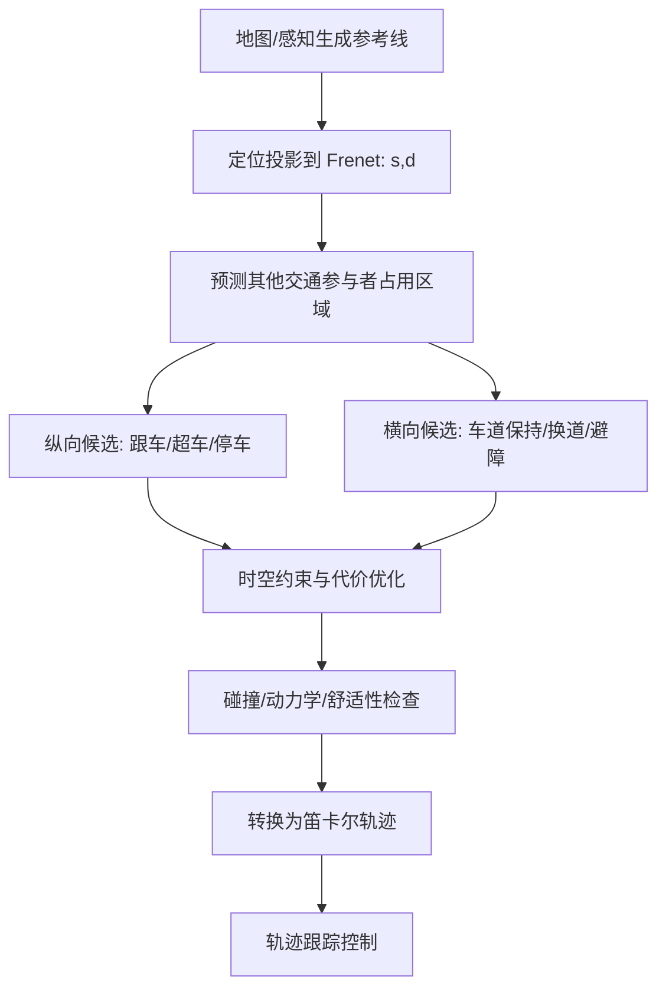

# 自动驾驶 1000问 · 五 · 第 15 题：轨迹规划为什么常用 Frenet 坐标系？

原始 Flomo：https://v.flomoapp.com/mine/?memo_id=MjU2MTg3NDkw

**自动驾驶 1000问 · 五 · 第 15 题：轨迹规划为什么常用 Frenet 坐标系？**

先定义：Frenet 坐标（SL / 赛道坐标）以道路中心线为参考——s = 沿中心线的纵向弧长，d = 相对中心线的横向偏移。

为什么用它：

1. 纵横向解耦（降维）：笛卡尔下是 2D 自由空间搜索，复杂。Frenet 下纵向（s）和横向（d）天然分开——纵向管速度 / 跟车，横向管换道 / 避让。于是规划被拆成一维纵向 + 一维横向两个简单问题。

2. 贴合道路结构：道路本质就是「沿中心线 \+ 横向偏移」。车道线就是 d 的等值线——车道保持 = d 恒定，换道 = d 变化。

3. 约束表达简单：车道边界、可行驶区域在 Frenet 下变成对 d 的简单约束（\|d\| < 半车道宽）。

4. 横向平滑 ≈ 舒适性：d 的平滑度直接对应横向加速度，便于约束舒适性。

5. 计算高效：比笛卡尔下做 2D 运动规划简单、快。

做法：把障碍物投影到 (s, d)，在 (s, d) 空间采样 / 优化出候选轨迹（横向 + 纵向多项式），再变换回笛卡尔供控制执行。

局限：

- 依赖道路中心线（需地图 / 感知提供参考线）——停车场、非结构化道路不适用。
- 大曲率弯道下，Frenet 与笛卡尔的转换有畸变。

一句话：Frenet 把「沿路走」天然拆成「纵向走多远 + 横向偏多少」，规划和约束都简单了——但前提是有一条参考中心线。

📎 导航：<https://v.flomoapp.com/mine/?memo_id=MjU2MDMwMzA0> 
📎 上一题：<https://v.flomoapp.com/mine/?memo_id=MjU2MTg3NDQ5>

#Area/技术/自动驾驶

## 工程推导与验证

### 坐标定义与转换

参考线以弧长 (s) 参数化，中心线位置为 (r(s))，单位切向量为 (t(s))，单位法向量为 (n(s))。车辆位置可写为：

[
p(s,d)=r(s)+d,n(s)
]

其中 (d) 是相对参考线的横向偏移。Frenet 规划先在 ((s,d)) 空间生成候选轨迹，再结合参考线曲率、航向和车辆姿态转换回笛卡尔坐标供控制器执行。

### 规划链路

### 不能忽略的数学与工程边界

- Frenet 坐标并非任何道路都能全局唯一表示。参考线自交、交叉口、多分支道路和定位投影歧义都需要额外处理。
- 当参考线曲率为 (kappa_r)、横向偏移为 (d) 时，坐标变换的局部尺度包含 (1-kappa_r d) 项；当其接近 0 时，坐标变换会病态，应拒绝该参考线/候选轨迹或切换规划表示。
- 横向舒适性不能只看 (d) 是否平滑，还要计算车辆实际横向加速度、横向 jerk、曲率变化和轮胎/底盘约束。
- 障碍物在 Frenet 空间通常形成随时间变化的 (s-d-t) 占用区域；投影误差、车辆外形膨胀和预测不确定性必须纳入碰撞检查。
- 非结构化道路、泊车场、无明确车道线区域可采用笛卡尔/栅格/采样规划，或动态构造局部参考线，不应强行使用单一 Frenet 参考线。

### 验证方法

1. 用已知直线、恒曲率圆弧和 S 弯测试 Cartesian↔Frenet 往返误差。
2. 对交叉口、多参考线、定位跳变和大曲率路段做投影唯一性检查。
3. 统计轨迹碰撞率、最小安全距离、横向加速度、jerk、曲率连续性和规划耗时。
4. 对感知障碍物位置加噪声，验证轨迹是否仍满足安全裕量。

**结论：** Frenet 的优势来自道路几何结构化后纵横向约束更容易表达；它是规划坐标工具，不是自动保证安全或降低所有场景复杂度的算法。
