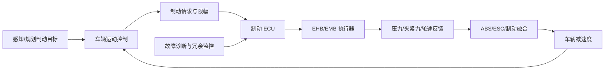

# 自动驾驶 1000问 · 六 · 第 17 题：线控制动比传统液压快在哪？为什么快很重要？

原始 Flomo：https://v.flomoapp.com/mine/?memo_id=MjU2MTg3NTgz

**自动驾驶 1000问 · 六 · 第 17 题：线控制动比传统液压快在哪？为什么快很重要？**

传统液压制动：踩踏板 → 液压助力 → 液体传递压力到卡钳。从「发指令」到「建立压力」要经历液压传递 \+ 助力建立，几十到上百 ms。

线控制动（EHB 电子液压 / EMB 电子机械）快在：

1. 电信号传递：制动指令用电信号到执行器，几乎瞬时，不用等液压建压。

2. 电机 / 电磁直接建压：EMB 用电机直接推制动，响应几个 ms ~ 十几 ms；EHB 也比传统快。

3. 建压时间短：传统液压 0 → 目标压力要几十 ~ 上百 ms；线控可压到十几 ~ 几十 ms。

4. 精确快速调节：便于 ABS / ESC / 精确制动的快速闭环。

为什么快很重要：

1. 缩短制动距离：响应每减少 100ms，100km/h（≈27.8m/s）就是约 2.8m 制动距离——救命。

2. AEB 的命门：从「判定要撞」到「建立制动」的时间，直接决定能否避免碰撞。

3. 自动驾驶控制精度：需要高频、精确、舒适地控制制动。

4. 冗余配合：作执行层要能快速可靠执行制动指令。

5. 能量回收协同：便于协调再生制动与机械制动（新能源）。

补充：EMB 响应最快但发热 / 可靠性难；EHB 更成熟。线控制动仍是安全件，要 fail-operational 冗余。

一句话：线控制动用「电」代替「油」传力，响应快一个量级；而制动这件事上，快 100ms，可能就是撞与不撞的区别。

📎 导航：<https://v.flomoapp.com/mine/?memo_id=MjU2MDMwMzA0> 
📎 上一题：<https://v.flomoapp.com/mine/?memo_id=MjU2MTg3NTM0>

#Area/技术/自动驾驶

## 响应时间如何定义与验收

### 先统一测量起点和终点

“响应时间”不是一个单一数值，至少拆成：

- 命令链路延迟：自动驾驶控制器发出制动请求，到制动 ECU 接收并确认。
- 执行器响应：电机/泵/阀开始动作，到压力或夹紧力开始建立。
- 建压时间：从规定起始压力到目标压力区间的时间。
- 车辆减速度响应：制动请求到车轮制动力/车辆纵向减速度达到规定阈值的时间。

因此不能直接把不同厂商宣称的“几毫秒”“几十毫秒”放在一起比较，必须先确认测试条件、压力区间、温度、电压、载荷和终点定义。

### EHB 与 EMB 的差异

| 方案 | 执行机理 | 典型工程关注 |
|---|---|---|
| EHB | 电机驱动液压泵/阀建立液压，部分方案保留液压备份路径 | 建压速度、液压回路、蓄能/助力、失电降级 |
| EMB | 电机/减速机构直接驱动卡钳夹紧 | 电机峰值力矩、热管理、夹紧力估计、机械释放与失效安全 |

EHB/EMB 的响应取决于具体设计和工况，不能笼统断言所有 EMB 都快于所有 EHB。传统液压系统也可能有电控助力和快速建压功能。

### 100 ms 的距离意义

若车辆速度为 100 km/h，即约 27.78 m/s，在制动尚未产生明显减速度的 100 ms 内，车辆仍会前进约：

[
d=v t=27.78	imes0.1approx2.78	ext{ m}
]

这表示额外的无减速度行驶距离，不等于总制动距离只减少/增加 2.78 m；实际制动距离还由初速度、减速度曲线、路面附着、轮胎、载荷和控制策略决定。

### 制动控制与安全链路

### 验收指标

- 命令到执行器动作延迟、开始建压延迟、规定压力建压时间。
- 目标压力/夹紧力跟踪误差、左右轮差异、压力波动。
- 制动距离、减速度建立时间、制动稳定性和方向稳定性。
- 低电压、高低温、满载、低附着、单点故障和通信丢失工况。
- 失电、传感器故障、执行器卡滞时的冗余路径、降级能力和驾驶员接管策略。

**安全边界：** 线控制动属于安全关键系统，冗余与 fail-operational 目标要由危害分析和车辆安全概念确定；不能仅凭“线控”二字推断所有产品都具备完全冗余。
