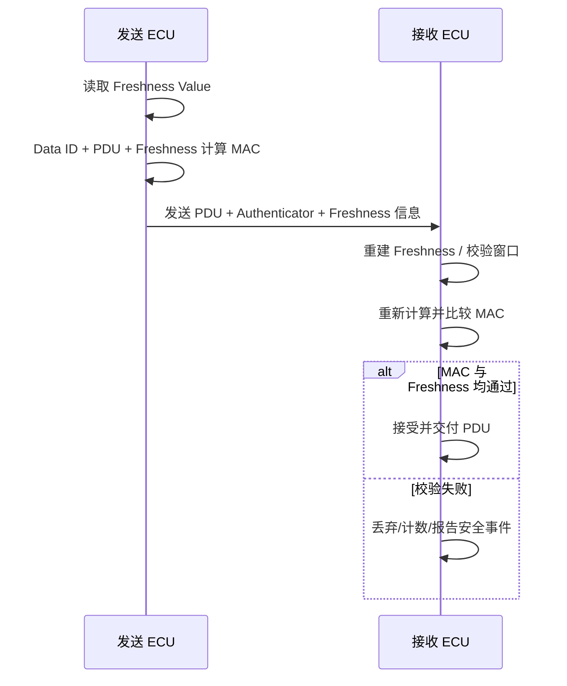

# 自动驾驶 1000问 · 十 · 第 28 题：CAN 报文注入怎么防？SecOC 靠什么工作？

> 来源：Flomo 原始笔记｜[查看原笔记](https://v.flomoapp.com/mine/?memo_id=MjU2MjY1NTgz)｜迁移日期：2026-10-31

**自动驾驶 1000问 · 十 · 第 28 题：CAN 报文注入怎么防？SecOC 靠什么工作？**

**先看威胁**：CAN 是广播总线，报文没有发送者身份、没有真实性校验——任何人挂上总线，就能伪造 ID 发报文。攻击者注入一条「刹车信号 = 松开」或「车速 = 100」，其他 ECU 分不出真假。

**CAN 本身的弱点**

- 无认证：不验发送者。
- 无加密：明文传输。
- 无完整性：CRC 只防传输错误，防不了恶意篡改（攻击者能重算 CRC）。
- 广播式：谁都能听、都能发。

**SecOC（Secure Onboard Communication）怎么防**

核心是给每条报文补上「验真」信息：

1. 认证码（MAC）：发送方用密钥对「报文数据 + 新鲜度」算一个 MAC（如 CMAC-AES）附在报文里；接收方用同一密钥重算，对不上就丢弃。保证完整性 + 真实性。

2. 新鲜度值（Freshness Value）：防重放。每条报文带递增计数，接收方校验是否在合理窗口内。攻击者录一条合法报文重发，新鲜度对不上，被拒。

3. 密钥管理：密钥要安全分发和存储，不能明文放代码里；通常配合 HSM（硬件安全模块）做加解密与密钥保存。

4. 同步机制：收发双方的新鲜度要同步，一般靠专门的 SYNC 报文维持窗口一致。

**代价与折中**

- 报文变长：MAC + 新鲜度要占字节，CAN 一帧才 8 字节（CAN FD 64），只能挑关键报文做。
- 计算开销交给 HSM 扛。
- 实践做法：刹车、转向、动力等关键报文做 SecOC，非关键的放宽。

**边界**：SecOC 防的是「伪造和重放」，它假设总线本身是封闭的，防不了「总线被物理接上」。更强的防护要配合网关隔离、入侵检测（IDS）、域划分。

一句话：CAN 没有身份和完整性，谁都能注入；SecOC 用「MAC 验真 + 新鲜度防重放 + HSM 管密钥」给关键报文补上这两样。它是补丁，真正的安全靠网关隔离 + 域划分 + 分层防御。

📎 导航：<https://v.flomoapp.com/mine/?memo_id=MjU2MDMwMzA0>

📎 上一题：<https://v.flomoapp.com/mine/?memo_id=MjU2MjY1MTE5>

#Area/技术/自动驾驶

## SecOC 报文处理与工程验证

### 认证数据如何组成

典型 SecOC 认证输入由配置的数据标识（Data ID）、受保护的 I-PDU 数据以及 Freshness Value 等组成；发送端用共享密钥计算认证器（Authenticator/MAC），再按配置截断并与报文数据/新鲜度字段一起发送。接收端重建认证输入并验证 MAC 和 Freshness，只有通过策略检查后才把数据交给上层。

### 对原答案的边界修正

- Freshness 的同步与恢复并不必然依赖一条名为“SYNC”的专用报文。Freshness Value Manager/Provider、计数器、同步数据和恢复策略取决于 AUTOSAR Release、系统设计和供应商实现。
- MAC 通常可能被截断以适配总线负载；截断长度越短，伪造成功概率和安全强度的权衡越明显，必须由安全分析确定。
- SecOC 提供真实性/完整性和新鲜度检查，不提供机密性；CAN 报文内容仍可能被监听。
- SecOC 不能阻止物理接入总线、总线 DoS、合法 ECU 被攻陷或密钥泄露；需要网关过滤、IDS、密钥生命周期管理和网络分区配合。
- CRC 主要检测传输错误，不能替代密码学 MAC；CAN 帧 CRC 通过也不代表发送者可信。

### 项目验证清单

1. 检查 Data ID、受保护 PDU、Authenticator 长度、Freshness 长度和截断配置是否两端一致。
2. 测试正常报文、MAC 篡改、数据篡改、重放、乱序、计数器回绕和同步丢失。
3. 检查接收端拒绝策略、错误计数、Dem/安全事件记录和恢复窗口。
4. 验证密钥注入、HSM 使用、调试口关闭、密钥更新/吊销和 ECU 更换流程。
5. 在目标 CAN/CAN FD 总线负载下测量额外字节、CPU/HSM 开销和最坏时延。

**结论：** SecOC 是报文级认证与新鲜度保护机制，不是加密或总线隔离方案；安全性取决于密钥、Freshness 管理、MAC 长度、接收策略和系统级防御共同设计。
