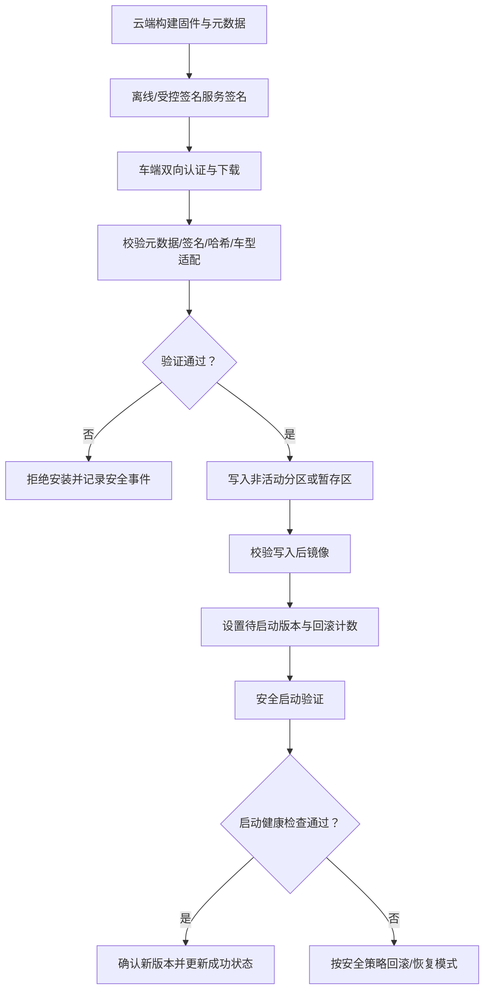

# 自动驾驶 1000问 · 十 · 第 29 题：OTA 被劫持的后果，怎么防？

> 来源：Flomo 原始笔记｜[查看原笔记](https://v.flomoapp.com/mine/?memo_id=MjU2MjY1NjEw)｜迁移日期：2026-10-31

**自动驾驶 1000问 · 十 · 第 29 题：OTA 被劫持的后果，怎么防？**

**先看后果**：OTA 本质是「远程改代码」，一旦被劫持——

- 可刷入恶意固件，控制刹车、转向、动力，直接变成安全事件。
- 可窃密钥、植后门、长期潜伏。
- 影响面大：一辆车的漏洞能顺着 OTA 通道扩散到整个车队，等于「一次成功攻击 = 召回级」。

**攻击面在哪**

1. 传输链路：云端到车端（TLS 被降级、中间人）。
2. 云侧：签名服务器、后台账号被入侵。
3. 车端：下载后存储、校验、写入过程被篡改。
4. 供应链：第三方固件、开发工具链被投毒。

**怎么防（分层）**

1. 签名与验签（地基）：固件包用厂商私钥签名，车端用公钥验签，验不过不刷。保证来源 \+ 完整性。

2. 加密传输：TLS / HTTPS 保护通道，防中间人。

3. 安全启动链（Secure Boot）：验签通过后，固件加载时由 bootloader 再校验一次，和启动信任链衔接，防止「验了却没真正执行」。

4. 双向认证 \+ 证书管理：车端与云端互认身份，证书有生命周期、可吊销。

5. 回滚保护：防降级到有已知漏洞的旧版本（anti-rollback），常用单调计数器 / eFuse 实现。

6. 密钥与权限保护：私钥放 HSM / 安全芯片；云端签名服务器隔离、最小权限、可审计。

7. 灰度 \+ 可回滚：先小批量、盯异常，出问题能回滚，压小影响面。

8. 供应链安全：SBOM、来源可信、工具链防护。

**关键理解**

- OTA 的信任根在「签名密钥」和「安全启动」，这两个破了，其他都是摆设。
- 防的是端到端：云侧签名服务器 → 车端验签 → 安全启动 → 回滚保护，哪一环松都等于没有。
- 它和 SecOC 一样，是纵深防御里的一层，要配网关、IDS、域隔离。

一句话：OTA 被劫持等于把方向盘交给攻击者；防线是「签名验签（地基）→ 加密通道 → 安全启动 → 密钥保护 → 回滚防护 → 灰度可回滚」，哪一环都不能松。

📎 导航：<https://v.flomoapp.com/mine/?memo_id=MjU2MDMwMzA0>

📎 上一题：<https://v.flomoapp.com/mine/?memo_id=MjU2MjY1NTgz>

#Area/技术/自动驾驶

## OTA 安全更新的端到端状态机

### 必须分清的安全机制

- **传输安全：** TLS/双向认证保护下载链路，但不能替代固件签名；云端或车端传输端点被攻陷时仍需独立验证。
- **包签名与元数据：** 签名覆盖镜像及必要元数据（版本、车型/硬件兼容性、依赖、分区、长度等），车端验证签名链和目标适配关系。
- **安全启动：** 启动阶段再次验证将要执行的镜像，防止下载后、写入后或存储阶段被篡改。
- **防回滚：** 通过可信单调版本状态/安全存储等策略阻止降级到不允许的旧版本；要考虑维修恢复和紧急回退的受控例外。
- **原子更新与恢复：** A/B 分区、恢复分区或双镜像方案可降低断电风险，但是否具备取决于硬件分区、Bootloader 和存储容量设计。
- **云端签名安全：** 私钥应放在受控签名设施/HSM 中，实行角色分离、双人审批、审计和密钥轮换；不能把签名私钥放在普通构建机或车端固件中。

### 更新失败与安全回退

| 故障 | 预期行为 |
|---|---|
| 下载中断 | 保留旧版本可启动，支持断点续传或清理不完整包 |
| 签名/哈希失败 | 拒绝安装，不改变当前可运行镜像 |
| 写入时掉电 | 重启后能识别不完整分区，不执行半成品 |
| 新版本启动失败 | 进入恢复模式或按设计回滚到已知可用版本 |
| 版本降级请求 | 校验防回滚策略和授权例外 |
| 云端密钥疑似泄露 | 吊销/轮换证书，阻断受影响签名链并评估车队风险 |

### 工程验收

- 测试错误签名、错误车型、旧版本降级、依赖不满足和镜像篡改。
- 在下载、擦除、写入、校验、切换启动分区等关键时刻注入掉电。
- 验证新版本启动健康检查、回滚条件、计数器更新时机和恢复模式。
- 审查签名密钥保管、证书生命周期、供应链 SBOM、发布审批和车队灰度策略。
- OTA 管理体系还应结合适用的法规、网络安全管理体系及软件更新工程流程进行组织级审核。

**结论：** OTA 安全不是“HTTPS 下载成功”就结束，而是从可信构建、签名、车端适配验证、写入后校验、安全启动到健康确认/回滚的完整信任链。
