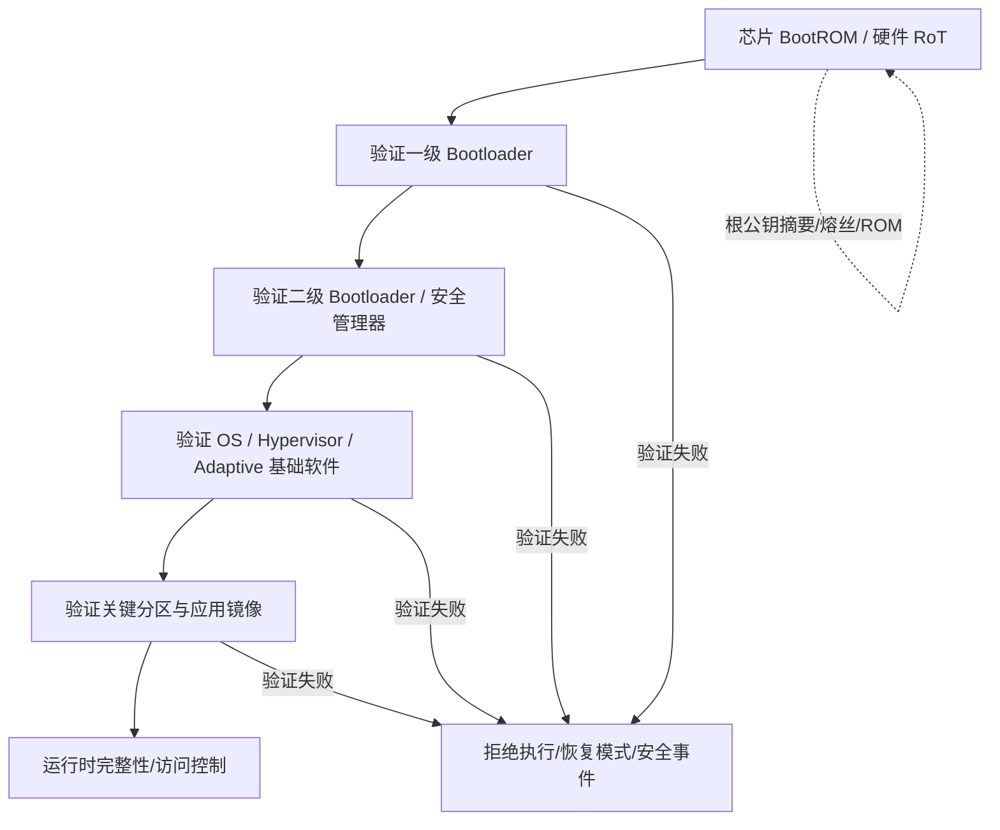

# 自动驾驶 1000问 · 十 · 第 30 题：安全启动的「信任链」怎么一环扣一环？

> 来源：Flomo 原始笔记｜[查看原笔记](https://v.flomoapp.com/mine/?memo_id=MjU2MjY2MDg3)｜迁移日期：2026-10-31

**自动驾驶 1000问 · 十 · 第 30 题：安全启动的「信任链」怎么一环扣一环？**

**核心思想**：安全启动的信任链（Chain of Trust）是「逐级验签、逐级交棒」——从一个不可篡改的信任根出发，每一级在运行下一级前，先用密钥验证下一级的签名，验过才交棒。任何一环被换成恶意代码，都过不了上一环的验签，链条就断。

**起点：信任根（Root of Trust）**

- 通常由芯片内固化在 ROM 的一小段代码 + eFuse 里烧好的公钥哈希组成。
- 开机就跑，且改不了（远程改不了、烧死在里面），是整条链的种子。
- 所有信任都从这里传出去。

**一环扣一环的过程**

1. 上电，CPU 从 ROM 执行固化代码（BootROM）。
2. BootROM 用 eFuse 里的公钥 / 哈希，验证第一级 bootloader 的签名。
3. 验过 → 控制权交给第一级 bootloader。
4. 第一级 bootloader 用自己信任的公钥，验证第二级 bootloader / OS 镜像。
5. 验过 → 交给 OS（Linux / QNX / Adaptive 平台）。
6. OS 再逐个验证应用程序（APP）的签名，验过才加载。

公钥从哪来？由上一级的签名保护：上一级验过下一级的 pubkey，就用它去验下下级的镜像——信任像接力棒一样传下去。

**断链会怎样**

- 任何一级验签失败 → 停止启动 / 进恢复模式 / 报警，不执行可疑代码。

**几个关键点**

- 信任根必须不可改（ROM + eFuse）——它一旦能被改，整条链就没意义。
- 验签用「哈希 \+ 非对称签名」，不是简单校验和。
- 和 OTA 的关系：OTA 刷进去的固件，下次启动要能通过安全启动的验签，两者共用同一套签名体系。
- 启动只是第一环，之后还有运行时保护、HSM 等。

一句话：安全启动 = 从不可改的硬件信任根出发，每级先验下一级签名再交棒，信任像接力一样传下去；任何一环被换掉都过不了验签。信任根不可改，是这一切的前提。

📎 导航：<https://v.flomoapp.com/mine/?memo_id=MjU2MDMwMzA0>

📎 上一题：<https://v.flomoapp.com/mine/?memo_id=MjU2MjY1NjEw>

#Area/技术/自动驾驶

## 工程中的信任链与失效处理

### 典型启动链

每一级并非都一定“用同一把公钥直接验证下一级”。更准确地说，是由硬件信任根保护的密钥/证书链、签名元数据和启动策略建立验证关系；具体可以采用公钥摘要、证书链、镜像签名和安全启动固件框架。

### 安全启动与测量启动

- **Secure Boot：** 验证镜像是否由受信任签名者签署、是否满足版本/策略要求；验证失败时阻止执行或进入恢复流程。
- **Measured Boot：** 对启动组件计算度量值并记录到受保护寄存器/日志，供远程证明或事后审计；测量本身不一定阻止启动。
- 两者可以组合使用，但不能把“记录了哈希”直接等同于“阻止了恶意镜像执行”。

### 工程上必须考虑的失效场景

1. 根密钥/签名密钥轮换、吊销和多密钥过渡。
2. 防回滚计数器与合法维修降级流程的冲突。
3. 验签失败后的恢复镜像是否也经过认证。
4. 调试接口、Boot Mode、外部 Flash 和 DMA 是否绕过启动信任链。
5. 断电、升级中断、镜像损坏和密钥存储异常时的恢复行为。
6. 多核启动时各核释放顺序、共享资源初始化和安全状态同步。

**验收：** 注入错误签名、镜像篡改、旧版本、损坏元数据和启动中断，验证系统不会执行未授权镜像；同时证明恢复路径本身受信任并可审计。
