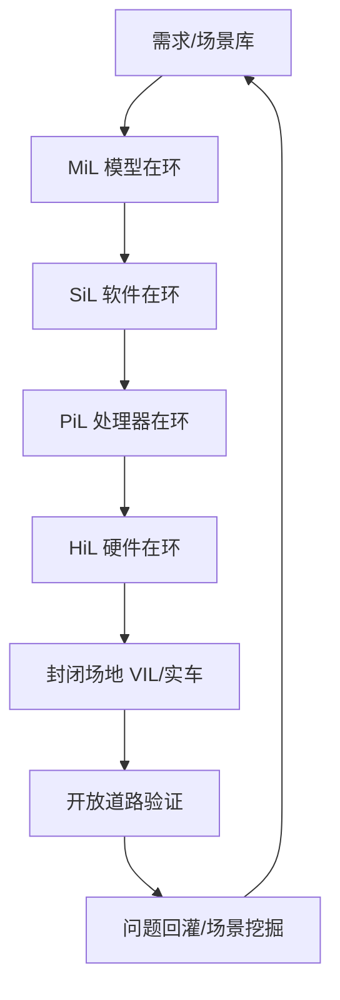

# 自动驾驶 1000问 · 十一 · 第 31 题：自动驾驶为什么必须靠仿真？纯路测不够吗？

> 来源：Flomo 原始笔记｜[查看原笔记](https://v.flomoapp.com/mine/?memo_id=MjU2MjY2NDQ2)｜迁移日期：2026-10-31

**自动驾驶 1000问 · 十一 · 第 31 题：自动驾驶为什么必须靠仿真？纯路测不够吗？**

**先算一笔账：纯路测数学上过不去**

- 要证明「比人安全」，需要海量里程——常引用的是要跑到上亿甚至上百亿公里量级。
- 一个车队一年能跑多少？几百辆 × 每天几百公里，一年也就千万公里级，差好几个数量级。
- 长尾场景（corner case）靠随机路测遇到，概率极低，为看一个罕见场景可能要跑几百万公里。

**仿真不可替代的四点**

1. 覆盖长尾：突然窜出的行人、掉落物、极端天气，仿真里可无限复现、可参数化生成，路测覆盖不了。

2. 效率与成本：仿真可并行、24 小时跑、加速时间（一天模拟几千次）；路测每公里都是油费、人力、场地。

3. 安全与责任：故意撞、极限避险这类危险场景只能仿真，真车测有事故和伦理风险。

4. 可复现：路测遇到问题很难精确复现，仿真里同一场景能反复跑、调参数、定位原因，对 DEBUG 太关键。

**但仿真不能代替路测**

- 软肋是保真度：物理模型、传感器模型（噪声、材质、天气）不可能完全真实，仿真过了不代表真车没问题（sim-to-real gap）。
- 真实世界有建模不了的复杂性：其他交通参与者的随机行为、道路施工、非标场景。
- 所以业界是「仿真为主、路测验证」的组合。

**结论**

- 纯路测不够——跑不到那个里程，也覆盖不了长尾。
- 纯仿真也不够——保真度有天花板，sim-to-real 有鸿沟。
- 正确做法：仿真 \+ 路测 \+ 实车数据回灌，三者闭环。

一句话：路测受限于里程和长尾覆盖率，仿真能无限复现、加速、还能安全测危险场景；但仿真有保真度天花板，最终得靠路测验证真实性——是组合，不是替代。

📎 导航：<https://v.flomoapp.com/mine/?memo_id=MjU2MDMwMzA0>

📎 上一题：<https://v.flomoapp.com/mine/?memo_id=MjU2MjY2MDg3>

#Area/技术/自动驾驶

## 仿真验证体系与指标

### 从模型到实车的验证分层

不同团队对 VIL、场景仿真、驾驶员在环等缩写的定义可能略有差异，项目测试计划应明确被测对象、仿真边界和真实硬件范围。

### 仿真必须验证什么

- **功能正确性：** 交通规则、行为决策、轨迹规划、控制输出是否符合需求。
- **安全性：** 碰撞、最小 TTC/距离、越界、接管、制动/转向能力边界。
- **鲁棒性：** 传感器噪声、遮挡、天气、定位偏差、通信延迟和执行器退化。
- **实时性：** 端到端时延、帧率、CPU/GPU 负载、最坏执行时间和超时。
- **回归性：** 软件版本、地图、场景、参数和随机种子可追溯并可复现。

### 不能只看仿真里程

自动驾驶安全论证不能简单用“累计仿真里程”替代场景覆盖、统计置信度和真实世界验证。测试里程需求取决于目标风险、事件发生率假设、ODD、场景分布、统计方法和安全论证框架；公开流传的“需要跑多少亿公里”只能作为说明随机路测局限的例子，不是所有项目通用的验收阈值。

### 场景覆盖与证据闭环

| 维度 | 例子 | 证据 |
|---|---|---|
| 道路结构 | 高速、城市路口、匝道、施工区 | 场景覆盖矩阵 |
| 交通参与者 | 行人、两轮车、大车、异常车辆 | 目标检测/预测与决策日志 |
| 环境条件 | 夜间、逆光、雨雪、隧道 | 传感器模型校准与真实数据对比 |
| 故障注入 | 摄像头失效、雷达污染、定位漂移、网络延迟 | 故障检测与降级记录 |
| 安全指标 | 碰撞、TTC、最小间距、急减速、越界 | 可复现测试报告 |
| 实时指标 | 规划耗时、控制周期、CPU/GPU 峰值 | 时间戳与性能剖析 |

**结论：** 仿真扩大覆盖、加速回归并安全地测试危险场景；道路与封闭场地测试验证真实物理世界。两者通过真实数据校准模型、通过仿真复现问题形成闭环。
