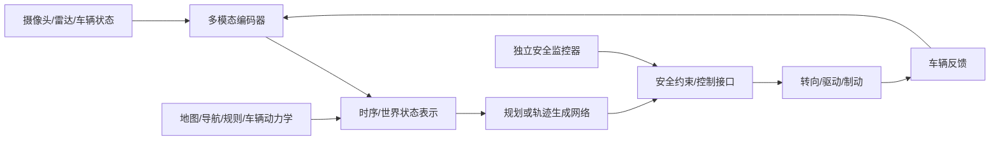
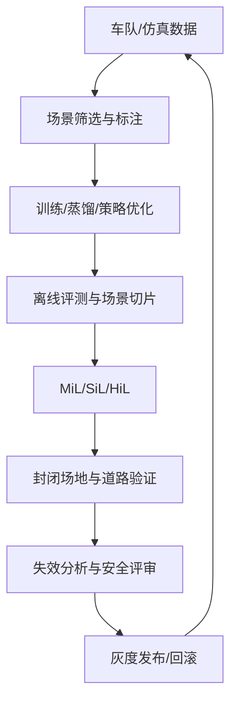

# 自动驾驶 1000问 · 补充Q1：什么是端到端（End-to-End）自动驾驶？

原始 Flomo：https://v.flomoapp.com/mine/?memo_id=MjU2NTMzMzMx

**自动驾驶 1000问 · 补充Q1：什么是端到端（End-to-End）自动驾驶？**

▎ 五大学习法：费曼学习法——用一句话把它讲给外行听

**一句话**

把「传感器输入 → 车辆动作（转向 / 油门 / 刹车）」这一整条链交给一个学习模型整体学会，不再拆成感知、预测、规划、控制各自写规则再拼。

**和传统模块化比**

- 模块化：每块单独设计优化、可解释、能独立升级；但模块间接口靠人工设计，误差会一路累积放大。
- 端到端：一张大网直接从输入学到输出，围绕最终驾驶目标联合优化，减少信息损失和误差传导。

**狭义 vs 广义**

- 狭义：单一大网络，从原始信号直接映射到控制指令（最彻底）。
- 广义：感知 \+ 决策规划用网络，模块间仍保留人工接口，甚至不含控制。

**怎么来的**

- BEV 感知把多传感器统一到「上帝视角」，打通了模块壁垒。
- 2023 年 UniAD（CVPR 最佳论文）把感知 / 预测 / 规划统一进一个模型，端到端时代开启。
- 量产代表：特斯拉 FSD v12——用端到端神经网络替掉 30 万行 C++ 规则，靠车队数据训练。

**优势 / 挑战**

- 优势：联合优化、无误差累积、数据驱动解决长尾、算力共享。
- 挑战：可解释性差、安全验证难（黑盒）、吃海量数据；Waymo 认为「纯黑盒不现实」，走「端到端 + 结构化中间表示」。
- 方向：一段式 / 二段式（自车规划也用模型），再往 VLA（视觉-语言-动作）大模型走。

📎 导航：<https://v.flomoapp.com/mine/?memo_id=MjU2MDMwMzA0>

📎 系列上一题（第 37 题）：<https://v.flomoapp.com/mine/?memo_id=MjU2MzA4ODAy>

#Area/技术/自动驾驶

## 端到端系统的工程架构与验证

### “端到端”不是只有一种定义

- **感知到控制（狭义）：** 输入传感器数据，直接输出控制量或轨迹。
- **感知到规划（常见广义）：** 模型输出目标轨迹/动作 token，底层控制器仍负责跟踪。
- **模块化混合：** 学习模型负责感知、预测或规划，系统保留结构化中间表示、规则约束和独立安全监控。

因此端到端不是“系统里没有模块”，而是学习模块的训练目标和信息流跨越了传统模块边界。

### 需要修正的常见误区

1. **不代表误差不再累积：** 联合优化可以减少人为接口损失，但模型仍会受到数据偏差、分布漂移、感知错误和闭环反馈影响。
2. **不代表天然可解释：** 中间特征可能难以直接解释，必须结合可视化、反事实测试、场景切片和安全监控分析。
3. **不代表不需要地图/规则/控制：** 产品可根据 ODD 保留导航、交通规则、车辆动力学、轨迹约束和独立安全保护。
4. **不代表海量数据就自动解决长尾：** 长尾覆盖需要主动挖掘、仿真生成、数据质量控制和针对性评估。
5. **公开案例要谨慎引用：** 特定公司关于代码行数、网络替换范围或量产表现的描述属于其特定版本/公开表述，不应直接推广成所有端到端系统的事实。

### 训练与验证闭环

### 最低评估维度

- 轨迹安全：碰撞率、最小间距、TTC、越界和交通规则违反。
- 驾驶品质：横纵向加速度、jerk、舒适性和行为一致性。
- 鲁棒性：遮挡、恶劣天气、传感器故障、定位漂移、罕见道路参与者。
- 泛化：不同城市、车型、道路结构、季节和传感器配置。
- 实时性：感知到控制端到端延迟、最坏执行时间和降级时延。
- 可恢复性：模型置信度低、输出越界或模型服务失效时，安全监控器能否及时接管。

**结论：** 端到端的价值是跨模块联合学习与优化；量产落地仍需要结构化接口、安全约束、可追溯数据、独立验证和故障降级，不是把传统系统简单换成一个黑盒网络。
