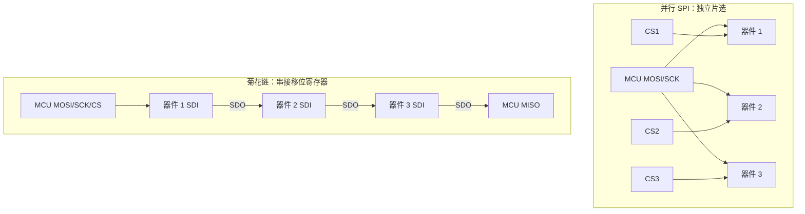

# SPI 菊花链——一根 CS 串起 N 个从机

原始 Flomo：https://v.flomoapp.com/mine/?memo_id=MjUxMTkxNDk3

**SPI 菊花链——一根 CS 串起 N 个从机**

▎ **两种接法**

- 并行：各从机独立 CS，共享 MOSI/MISO/SCK——从机多时 CS 不够用、MISO 负载重
- 菊花链：SDO 接下一级 SDI，像移位寄存器逐级传，全链只用一根 CS。典型：74HC595 级联、LED 驱动

▎ **时序**

- 一个 CS 周期内 SCK 打 8×N 拍（N = 从机数），数据从链头进、链尾回
- 命令按「末端先进」排序——先发的最后到链尾，写代码要倒着想

▎ **用 vs 不用**

- 用：从机多、CS 不够、芯片支持级联（datasheet 有 SDO）、顺序处理即可
- 不用：要随机寻址、芯片不支持、每片要独立实时响应
- 代价：每次刷新整条链要移入 N 份数据，单个器件的更新频率通常随 N 增大而下降；SPI 线上仍以配置的 SCK 速率逐 bit 传输，不能简单说总线 bit rate 除以 N。

▎ **三个坑**

- 普通 SPI 芯片没 SDO 级联脚，不能硬串——先查 datasheet
- 链上节点有传播延迟，SCK 拉太快链尾收错
- 命令/数据顺序是反的，调试最容易懵

▎ **一句话**：用时间换引脚——适合数量多、顺序处理、带宽要求不高的场景；要随机寻址或高吞吐就回并行接法。

📎 专栏⑫·第2篇 四大协议 → [https://v.flomoapp.com/mine/?memo\_id=MjQ4NjM1NjM4](https://v.flomoapp.com/mine/?memo_id=MjQ4NjM1NjM4) 
📎 通信1000问 → [https://v.flomoapp.com/mine/?memo\_id=MjQ4ODcyNjYw](https://v.flomoapp.com/mine/?memo_id=MjQ4ODcyNjYw) 
📎 通信导航 → [https://v.flomoapp.com/mine/?memo\_id=MjQ4NjM0MjEw](https://v.flomoapp.com/mine/?memo_id=MjQ4NjM0MjEw)

#Area/技术/通信

## 工程原理与时序补充

### 并行与菊花链的连接差异

菊花链不是“普通 SPI 器件任意串联”。只有芯片明确提供级联移位数据路径（例如 SDO/串行级联输出）并定义链式帧格式时才成立。某些器件会在 CS 上升沿锁存移位寄存器，有些有独立 LE/LATCH 引脚；必须按数据手册的时序图实现。

### 帧长度与刷新率估算

若每颗器件每帧需要 (W) bit，链上有 (N) 颗器件，SCK 频率为 (f_{SCK})，忽略 CS 建立/保持、锁存和软件开销，则一帧移位时间近似为：

\[
T_{shift} \approx \frac{N W}{f_{SCK}}, \qquad f_{refresh} \lesssim \frac{f_{SCK}}{N W}
\]

例如 8 颗器件、每颗 16 bit、SCK=4 MHz，纯移位时间约 32 μs，理论帧刷新上限约 31.25 kHz；实际还要扣除锁存间隔、DMA/中断调度和器件规定的时序裕量。这里下降的是整链完整刷新频率，不是 SPI 物理时钟被除以器件数。

### 实现时要确认的参数

- SPI Mode（CPOL/CPHA）、bit order（MSB/LSB first）和字长是否与所有器件一致。
- 每个器件的 shift register 长度、级联方向、帧对齐和无效填充位。
- CS/LE 的建立、保持、脉宽以及锁存边沿。
- SDO 输出延迟、最大 SCK、板级走线/负载和电平兼容性。
- 是否支持 DMA 连续传输；若用中断逐字节填充，最坏调度延迟是否影响帧间隔。

### 调试步骤

1. 先只接一颗器件，确认 CPOL/CPHA、位序和锁存边沿。
2. 接两颗器件，发送不同且易识别的测试图案（例如 0xA5、0x3C），确认移位方向和数据顺序。
3. 用逻辑分析仪同时观察 CS、SCK、MOSI、MISO/SDO、LE。
4. 逐步增加器件数量并降低/提高 SCK，定位链尾错误的时序边界。
5. 在最大刷新负载下测量 CPU 占用、帧刷新率和输出抖动。

**验收标准：** 所有级联器件在最坏 SCK、温度、电压和负载条件下均能稳定接收完整帧；输出锁存时刻一致，异常帧不会造成部分器件更新、部分器件保留旧值的不可控状态。
