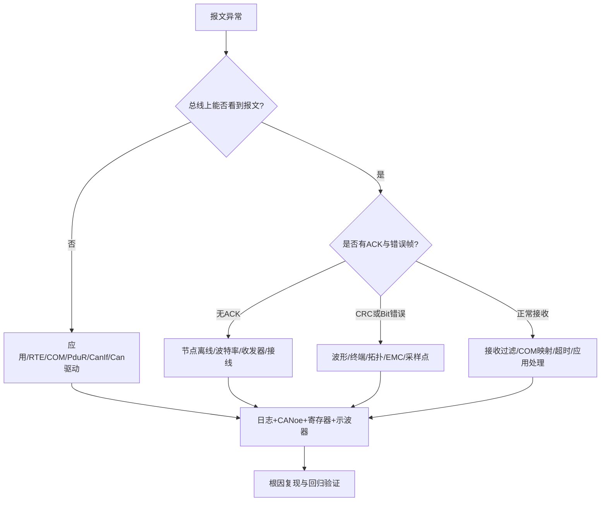

# CAN网络（通用概念参考，来自Kimi）

原始 Flomo：https://v.flomoapp.com/mine/?memo_id=MTIyNzQ1MDgx

**CAN网络（通用概念参考，来自Kimi）**

📎 你的实战排查内容在此 → CAN终端电阻物理含义 [https://v.flomoapp.com/mine/?memo](https://v.flomoapp.com/mine/?memo)\_id=MjQ3Njc1ODYz

📎 CAN排查工具箱清单 [https://v.flomoapp.com/mine/?memo](https://v.flomoapp.com/mine/?memo)\_id=MjQ3Njc2MTY1

📎 CAN通信栈七层数据流 [https://v.flomoapp.com/mine/?memo](https://v.flomoapp.com/mine/?memo)\_id=MjQ2MjY5Njc0

（原文为2024-06-11 Kimi生成的CAN总线基础介绍，已被后续实战笔记覆盖）

#Area/技术/通信
## CAN 网络基础问答补全

## Q1. CAN 总线为什么采用差分信号？

CAN_H 与 CAN_L 形成差分电压，接收器主要检测两线之间的差值，能够在一定范围内抑制两线共同受到的共模噪声。差分传输并不意味着不受 EMC、接地偏移、线束阻抗和共模范围限制；仍需遵守收发器数据手册和布线规范。

## Q2. 显性位和隐性位是什么？为什么显性位能实现仲裁？

经典高速 CAN 中，显性位逻辑 0 会主动驱动总线，隐性位逻辑 1 由总线偏置形成。多个节点同时发送时，显性位覆盖隐性位。节点边发送边采样，如果发送隐性却读到显性，就知道自己失去仲裁并停止发送。标识符越小（按标准位序列比较）通常优先级越高；仲裁过程不会破坏获胜报文。

## Q3. CAN 帧包含哪些字段？

经典 CAN 数据帧主要包含 SOF、仲裁字段（标识符与 RTR 等）、控制字段（含 DLC 等）、数据字段、CRC 字段、ACK 字段和 EOF。标准帧使用 11-bit Identifier，扩展帧使用 29-bit Identifier。CAN FD 扩展了数据阶段速率与数据长度能力，但控制字段与 CRC 规则也有所不同。

## Q4. CAN 终端电阻为什么通常在总线两端各放一个？

高速 CAN 双绞线是传输线，终端电阻用于匹配线缆特性阻抗，减少信号反射。常见 120Ω 是典型线缆的标称值；两端并联后，从总线测量常见约 60Ω。这个测量值仅适用于断电且网络拓扑/节点连接符合预期的情况。不能在每个 ECU 上都放 120Ω，也不能在星形长支线拓扑中简单照搬总线两端终端方案。

## Q5. CAN Bit Timing 中 Sync、Prop、PhaseSeg1、PhaseSeg2 和 SJW 有什么作用？

Bit Timing 将一个 bit 时间划分为同步段、传播补偿段和相位缓冲段。采样点位于 PhaseSeg1 之后；SJW 限制重同步时相位调整幅度。配置需综合 CAN 时钟、Prescaler、总线传播延迟、收发器延迟、网络长度和节点振荡器误差。仅按“常见 80% 采样点”设置不能保证所有网络可靠。

## Q6. ACK 错误、Bit Error、Stuff Error、CRC Error、Form Error 分别说明什么？

这些错误反映不同层次的问题：ACK Error 常意味着没有其他节点正确接收并应答；Bit Error 是发送节点采样到与自己发送不一致的总线电平（仲裁阶段有例外）；Stuff Error 违反位填充规则；CRC Error 表示接收帧校验失败；Form Error 表示固定格式字段出现非法位。诊断时要结合错误计数器、节点状态、总线波形和其他 ECU 行为分析，不能只凭一种错误码认定唯一根因。

## Q7. Error Active、Error Passive 和 Bus Off 有什么区别？

CAN 控制器根据发送/接收错误计数器等规则进入不同错误状态。Error Active 节点可发送主动错误标志；Error Passive 节点错误影响受限；Bus Off 节点因严重发送错误退出总线通信。BusOff 恢复应遵循控制器和 AUTOSAR CanSM 配置的恢复策略，并记录根因，不能通过无限自动重启掩盖物理层故障。

## Q8. CAN 和 CAN FD 有什么差异？

CAN FD 支持更长数据字段（最多 64 字节）及可选的数据阶段更高速率，仲裁阶段仍按兼容机制工作。网络中所有节点、收发器、控制器、波特率配置和网关策略必须兼容；不支持 CAN FD 的经典 CAN 节点不能直接参与 FD 帧通信。还要关注 BRS、ESI、DLC 映射和 CRC 规则。

## Q9. CAN 报文发不出去，如何分层定位？

1. 应用层确认发送条件、数据更新和触发周期。
2. COM 检查 I-PDU 模式、信号映射、发送模式和 Tx deadline。
3. PduR 检查路由、PDU ID 和目标模块。
4. CanIf 检查 Tx PDU、HTH、Controller 状态和 Buffer。
5. Can Driver 检查邮箱、发送请求和错误状态。
6. 收发器检查供电、使能/待机脚和物理总线。
7. 总线检查终端、拓扑、短路、差分波形、ACK 和错误帧。

## Q10. CAN 排障最小证据集是什么？

至少保存：DBC/ARXML 信号和 PDU 映射、波特率与采样点、控制器/收发器配置、总线拓扑、断电终端电阻测量、CANoe 日志、错误帧与 BusOff 时间戳、控制器错误计数器、示波器差分波形、相关 ECU 软件版本。证据应覆盖故障前后时间段，并区分“未发送”“总线上有但对端未接收”“对端接收但应用未处理”。

## 来源关联

- [基础协议与四大协议](./基础协议与四大协议)
- [车载通信专题索引](../index)
- Flomo 原始 CAN 基础卡：https://v.flomoapp.com/mine/?memo_id=MTIyNzQ1MDgx
