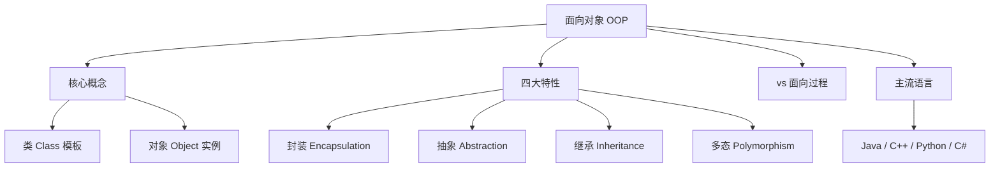

> [!info] 一句话定位
> OOP = 把数据和操作数据的方法打包成「对象」，用对象之间的协作来构建复杂系统。

## 知识体系

面向对象程序设计（Object-Oriented Programming，简称 OOP）是一种以“对象”为中心的核心编程范式与抽象方针。它将计算机程序视为一组彼此相关的对象集合，每个对象将数据（属性）与操作数据的函数（方法）封装在一起，通过对象之间传递消息来解决复杂的软件开发问题。 [1, 2]
相比传统的面向过程编程（如 C 语言），OOP 的诞生是为了提高软件的重用性、灵活性和扩展性，使其更适合开发大型复杂系统。 [1]

---

## 🧱 核心概念：类与对象

理解 OOP 的第一步是分清“类”和“对象”的区别： [3]

- 类（Class）：是创建对象的模板或蓝图。它定义了一类事物共同拥有的属性和行为，属于抽象的概念。
- 对象（Object）：是类的具体实例（Instance）。它是真实存在于内存中的实体。 [1, 3, 4]

💡 经典比喻：
“汽车设计图纸”就是一个类，它规定了车有颜色、排量（属性），以及能启动、刹车（行为）；而你家车库里停着的那辆“红色奔驰车”，就是根据图纸造出来的具体对象。 [3]

---

## 🏛️ 面向对象的四大基石（四大特性）

面向对象程序设计之所以强大，主要依赖于以下四大基础特性： [5]

| 特性                 | 核心定义                                                                           | 通俗解释与价值                                                                                                               |
| -------------------- | ---------------------------------------------------------------------------------- | ---------------------------------------------------------------------------------------------------------------------------- |
| 封装 (Encapsulation) | 将数据和处理数据的方法绑定在对象内部，隐藏内部实现细节，仅通过公共接口与外界交互。 | 信息隐藏。就像你用电视机只需按遥控器，不需要知道内部电路如何工作，防止了外部代码无意中破坏内部状态。                         |
| 抽象 (Abstraction)   | 忽略与当前目标无关的次要细节，只关注与当前业务相关的本质特征。                     | 简化复杂性。例如在设计学校管理系统时，将“学生”抽象为包含学号、成绩的结构，而忽略其身高、血型等不相关信息。                   |
| 继承 (Inheritance)   | 允许一个新类（子类）继承已存在类（父类）的属性和方法。                             | 代码复用。例如定义了一个“哺乳动物”类，再创建“猫”和“狗”类时，直接继承即可，无需重复编写呼吸、心跳等公共行为。                 |
| 多态 (Polymorphism)  | 同一操作作用于不同的对象，可以有不同的解释并产生不同的执行结果。                   | 接口复用与扩展。例如给“猫”和“狗”同时发送一个“叫”的指令，猫会“喵喵”，狗会“汪汪”。允许程序在不修改原有结构的情况下扩展新功能。 |

---

## 🔄 面向过程 VS 面向对象

以“用洗衣机洗衣服”为例，两种思想的思考方式截然不同： [6]

- 面向过程（Process-Oriented）：
  把洗衣服拆解成一步步的动作（函数）：打开洗衣机() → 放衣服() → 倒洗衣粉() → 加水() → 开始洗涤()。数据通常与这些动作分离，程序是一系列指令的顺序执行。 [2, 6]
- 面向对象（Object-Oriented）：
  先划分出两个对象：人 和 洗衣机。
- 给人赋予方法：加洗衣粉()、放衣服()；
  - 给洗衣机赋予属性和方法：洗涤()、脱水()。
    最终通过对象间的交互解决问题：人.放衣服() → 洗衣机.开始洗涤()。 [6]

## 💻 主流的面向对象编程语言

目前世界上绝大多数主流开发语言都深度支持或完全基于 OOP 思想：

- Java：经典的纯面向对象语言，广泛应用于企业级后端开发与 Android 编程。
- C++：支持面向对象的多范式语言，兼具底层的高效与 OOP 的抽象能力，常用于游戏开发与图形学。
- Python：一切皆对象的动态语言，将 OOP 的灵活性发挥到了极致，广泛用于数据科学与 AI。
- C#：微软推出的现代化 OOP 语言，与 Java 类似，深植于 .

## 用 C++ 理解 OOP：一个可运行的最小例子

在嵌入式 C++ 中，面向对象的价值不是“所有东西都做成类”，而是把状态、接口和资源生命周期组织清楚。

~~~~cpp
#include <cstdint>

class Sensor {
public:
    virtual ~Sensor() = default;
    virtual std::uint16_t readRaw() = 0;  // 抽象接口
};

class AdcSensor final : public Sensor {
public:
    std::uint16_t readRaw() override {
        // 实际项目中读取 ADC 驱动/MCAL 接口
        return 1234U;
    }
};

class SensorService {
public:
    explicit SensorService(Sensor& sensor) : sensor_(sensor) {}

    std::uint16_t sample() {
        return sensor_.readRaw();  // 运行时多态
    }

private:
    Sensor& sensor_;              // 依赖抽象，不依赖具体 ADC 类
};
~~~~

这个例子分别体现：
- **封装**：SensorService 隐藏采样流程，只暴露 sample()。
- **抽象**：Sensor 定义“能读取原始值”的接口，不暴露 ADC 寄存器细节。
- **继承**：AdcSensor 实现 Sensor 接口。
- **多态**：SensorService 可以使用 AdcSensor，也可以换成模拟传感器或测试桩。

## 面向对象设计的工程原则

1. **高内聚、低耦合**：一个类围绕单一职责组织；类之间通过稳定接口协作。
2. **优先组合而非继承**：只有确实存在可替代的“is-a”关系时才继承；功能拼装通常用组合更灵活。
3. **依赖抽象**：业务逻辑依赖接口，硬件驱动、文件系统、网络等具体实现通过注入或工厂提供。
4. **明确所有权与生命周期**：C++ 优先使用 RAII、值语义和智能指针表达资源所有权；裸指针默认不代表所有权。
5. **控制动态分配**：嵌入式实时系统要评估堆碎片、分配时延和失败路径；可使用静态对象、对象池或受控内存资源。
6. **谨慎使用虚函数**：虚函数带来间接调用和 vtable 成本；在性能/内存敏感路径评估开销，但不要为了“零开销”过早牺牲可维护性。

## 面向对象与面向过程如何选择？

- 适合 OOP：存在清晰状态和生命周期、多个实现共享接口、模块需要替换/测试隔离、复杂系统需要边界管理。
- 适合过程式：简单算法、无状态转换、对内存布局和调用路径有严格约束的底层代码。
- 混合使用通常最实际：C 驱动/寄存器层保持简单，C++ 服务层用类封装资源与接口，系统集成层通过明确的依赖关系组合模块。

## 相关专题

- [[设计模式]]
- [[CPP]]
- [[C语言]]
- [[程序员修养]]

---
> 参考链接： 

* [1] [https://zh.wikipedia.org](https://zh.wikipedia.org/zh-cn/%E9%9D%A2%E5%90%91%E5%AF%B9%E8%B1%A1%E7%A8%8B%E5%BA%8F%E8%AE%BE%E8%AE%A1)
* [2] [https://liaoxuefeng.com](https://liaoxuefeng.com/books/python/oop/index.html)
* [3] [https://www.cnblogs.com](https://www.cnblogs.com/bossma/p/17897584.html)
* [4] [https://www.ibm.com](https://www.ibm.com/docs/zh/ws-and-kc?topic=language-object-oriented-programming)
* [5] [https://www.cnblogs.com](https://www.cnblogs.com/taylorshi/p/16640751.html)
* [6] [https://zhuanlan.zhihu.com](https://zhuanlan.zhihu.com/p/75265007)
* [7] [https://www.icourse163.org](https://www.icourse163.org/course/TONGJI-1207069801?outVendor=zw_mooc_pclszykctj_)
