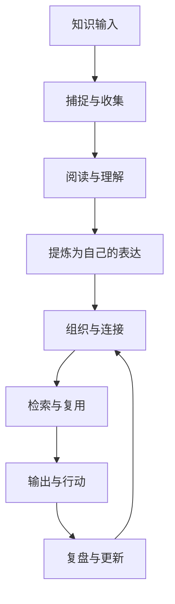

**KM（Knowledge Management，知识管理）** 关注如何高效地**收集、理解、组织、连接和复用**个人知识。它不只是工具问题，更是一套帮助思考与行动持续改进的方法。

> [!info] 一句话定位
> 让知识「进得来、找得到、连得上、用得上」，并最终转化为判断、作品与行动。

## 知识管理地图

## 本区域导航

### 核心方法

- [[知识管理]]：知识管理的原则、笔记类型与质量标准
- [[知识管理工作流]]：从临时收集到输出复盘的具体操作流程
- [[渐进阅读]]：分阶段阅读、标记、提炼与复用
- [[微信读书到永久笔记]]：将自动同步的书籍与划线加工成自己的观点
- [[数字花园]]：持续发布、迭代和连接公开知识

### 日常维护

- [[inbox]]：临时收集与待处理事项
- [[工具]]：根据场景选择工具，而不是让工具决定方法
- [[Git提交规范]]：维护知识库时的提交约定

### 沟通与问题解决

- [[Resource/沟通与协作/提问的智慧|提问的智慧]]：在求助前完成检索与实验，用目标、环境、现象、证据和具体请求组织问题；问题解决后将经验回写知识库。

## 推荐使用路径

1. **刚开始整理：** 先阅读 [[知识管理]]，确定笔记的基本原则。
2. **建立日常习惯：** 按 [[知识管理工作流]] 处理收件箱与每周复盘。
3. **提升阅读质量：** 使用 [[渐进阅读]] 与 [[微信读书到永久笔记]] 将输入转化为自己的观点。
4. **提升技术沟通：** 阅读 [[Resource/沟通与协作/提问的智慧|提问的智慧]]，练习结构化提问、最小复现和答案验证。
5. **对外发布：** 通过 [[数字花园]] 把成熟内容整理成可持续更新的网页。

## 维护原则

- 不追求把所有信息都保存下来，优先保留对当前问题或长期方向有价值的内容。
- 重要笔记尽量使用自己的语言，区分事实、引用、推断和待验证假设。
- 链接要有语义：写清楚两条笔记之间的关系。
- 允许内容渐进完善；发现错误时更新正文，并保留必要的来源线索。
- 定期从知识库中产出文章、代码、方案或决策，检验系统是否真的有用。

## 相关入口

- [[Area/index|Area]]：长期维护的领域总览
- [[Project/index|Project]]：有明确目标和完成条件的项目
- [[Resource/index|Resource]]：参考资料与外部资源
- [[Archive/index|Archive]]：当前不再活跃但仍需保留的内容
