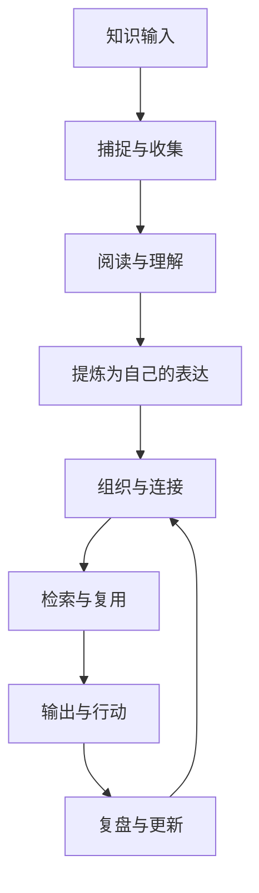

**KM（Knowledge Management，知识管理）** 关注如何高效地**收集、理解、组织、连接和复用**个人知识。它不只是工具问题，更是一套帮助思考与行动持续改进的方法。

> [!info] 一句话定位
> 让知识「进得来、找得到、连得上、用得上」，并最终转化为判断、作品与行动。

## 知识管理地图

## 本区域导航

### 核心方法

- [[知识管理]]：知识管理的原则、笔记类型与质量标准
- [[知识管理工作流]]：从临时收集到输出复盘的具体操作流程
- [[渐进阅读]]：分阶段阅读、标记、提炼与复用
- [[微信读书到永久笔记]]：将自动同步的书籍与划线加工成自己的观点
- [[数字花园]]：持续发布、迭代和连接公开知识

### 日常维护

- [[inbox]]：临时收集与待处理事项
- [[工具]]：根据场景选择工具，而不是让工具决定方法
- [[Git提交规范]]：维护知识库时的提交约定

### 沟通与问题解决

- [[Resource/沟通与协作/提问的智慧|提问的智慧]]：在求助前完成检索与实验，用目标、环境、现象、证据和具体请求组织问题；问题解决后将经验回写知识库。

## 推荐使用路径

1. **刚开始整理：** 先阅读 [[知识管理]]，确定笔记的基本原则。
2. **建立日常习惯：** 按 [[知识管理工作流]] 处理收件箱与每周复盘。
3. **提升阅读质量：** 使用 [[渐进阅读]] 与 [[微信读书到永久笔记]] 将输入转化为自己的观点。
4. **提升技术沟通：** 阅读 [[Resource/沟通与协作/提问的智慧|提问的智慧]]，练习结构化提问、最小复现和答案验证。
5. **对外发布：** 通过 [[数字花园]] 把成熟内容整理成可持续更新的网页。

## 维护原则

- 不追求把所有信息都保存下来，优先保留对当前问题或长期方向有价值的内容。
- 重要笔记尽量使用自己的语言，区分事实、引用、推断和待验证假设。
- 链接要有语义：写清楚两条笔记之间的关系。
- 允许内容渐进完善；发现错误时更新正文，并保留必要的来源线索。
- 定期从知识库中产出文章、代码、方案或决策，检验系统是否真的有用。

## 相关入口

- [[Area/index|Area]]：长期维护的领域总览
- [[Project/index|Project]]：有明确目标和完成条件的项目
- [[Resource/index|Resource]]：参考资料与外部资源
- [[Archive/index|Archive]]：当前不再活跃但仍需保留的内容

## 专栏⑲｜知识管理六层闭环（Flomo 原始笔记）

- [[专栏⑲原始笔记/导航-知识管理全景]]：从卡片盒到六层闭环的全景导航。
- [[专栏⑲原始笔记/第1篇-为什么知识管理]]：从记笔记转向建立思想之网。
- [[专栏⑲原始笔记/第2篇-六层闭环]]：知识管理系统的六层结构。
- [[专栏⑲原始笔记/第3篇-输入层闪念文献与对话]]：闪念、文献、问题和对话的输入管理。
- [[专栏⑲原始笔记/第4篇-整理层原子性与费曼转译]]：原子化、费曼转译与整理规则。
- [[专栏⑲原始笔记/第5篇-存储层标签PARA与双链]]：标签、PARA 与双向链接。
- [[专栏⑲原始笔记/第6篇-输出层卡片网络到文章]]：从卡片网络生成文章与专栏。
- [[专栏⑲原始笔记/第7篇-实践层知识转化为行动]]：让知识变成行动，区分 question 与 problem。
- [[专栏⑲原始笔记/第8篇-回顾机制]]：设计主动与被动回顾机制。
- [[专栏⑲原始笔记/第9篇-AI与知识管理]]：AI 工作流与数字分身。
- [[专栏⑲原始笔记/第10篇-知识管理15项自检清单]]：检查知识管理体系的健康度。

## 卡片笔记与学习方法｜Flomo 原始笔记

- [[卡片笔记与方法原始笔记/我的知识管理体系总览]]：个人知识管理体系的整体结构与实践规则。
- [[卡片笔记与方法原始笔记/卡片笔记内容总图]]：卡片笔记主题地图。
- [[卡片笔记与方法原始笔记/七种卡片笔记模板]]：不同用途的卡片模板。
- [[卡片笔记与方法原始笔记/海马记忆法]]：利用记忆规律辅助学习。
- [[卡片笔记与方法原始笔记/学习的十个层次]]：从被动学习到主动理解与创造的层次框架。

## 卡片盒与间隔重复｜Flomo 原始笔记

- [[卡片笔记与方法原始笔记/SuperMemo工作原理]]：SuperMemo 间隔重复系统的工作原理。
- [[卡片笔记与方法原始笔记/SuperMemo二十条规则]]：知识表达与记忆卡片设计规则。
- [[卡片笔记与方法原始笔记/数字卡片盒软件功能需求]]：数字化卡片盒软件应具备的功能。
- [[卡片笔记与方法原始笔记/卡片盒笔记法基础]]：卢曼卡片盒笔记法的基础概念。
- [[卡片笔记与方法原始笔记/Zettelkasten定义与链接网络]]：Zettel、闪念、文献、永久笔记与思想之网等术语。

## 其他知识管理实践卡片｜Flomo 原始笔记

- [[卡片笔记与方法原始笔记/数字花园搭建资源]]：数字花园搭建与发布资源线索。
- [[卡片笔记与方法原始笔记/PARA个人知识管理清单]]：个人知识、项目、领域、资源与归档的组织清单。
- [[卡片笔记与方法原始笔记/SQ3R阅读法]]：Survey、Question、Read、Recite、Review 五步阅读法。
- [[卡片笔记与方法原始笔记/卡片盒笔记法操作步骤]]：闪念、文献与永久笔记的加工步骤。
- [[卡片笔记与方法原始笔记/程序员笔记整理方法]]：代码示例、结构、标签与图表等程序员笔记实践。

## 其他学习与问题解决资源｜Flomo 原始笔记

- [[卡片笔记与方法原始笔记/墨水屏单词记忆小游戏构想]]：结合墨水屏、词典与记忆算法的学习工具构想。
- [[卡片笔记与方法原始笔记/笨方法学写作卡片创作书单]]：卡片写作与书籍创作参考清单。
- [[卡片笔记与方法原始笔记/问题解决树培训资料]]：Problem Solving Tree 培训目标与应用场景。
- [[卡片笔记与方法原始笔记/SuperMemo渐进阅读资源]]：SuperMemo 渐进阅读学习资源。
- [[卡片笔记与方法原始笔记/常见笔记术对比]]：线性、大纲、脑图、卡片、Cornell 与数字笔记法。

## 补充阅读方法与历史卡片

- [[卡片笔记与方法原始笔记/SQ4R阅读法补充]]：在 SQ3R 基础上加入修订（Revise）。
- [[卡片笔记与方法原始笔记/SQ3R阅读法历史来源]]：SQ3R 方法的历史背景补充。
- [[卡片笔记与方法原始笔记/卡片笔记思维导图资源]]：卡片笔记相关思维导图资源。
- 另有 4 条 Flomo 旧笔记已标记“已整合”，其核心内容并入 [[卡片笔记与方法原始笔记/我的知识管理体系总览]]，不重复创建页面。
