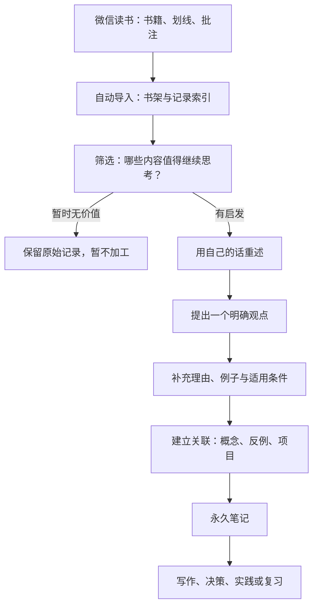
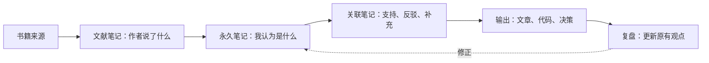

# 微信读书到永久笔记：从摘录到知识

微信读书适合保存阅读轨迹、划线和即时想法；数字花园适合保存经过理解、能脱离原书独立成立的观点。**同步数据只是输入自动化，知识转化仍需要主动思考。**

## 一、整体流程



## 二、四类内容分别处理

| 内容类型 | 处理方式 | 是否直接作为永久笔记 |
| --- | --- | --- |
| 原文划线 | 保留原书、章节和上下文，避免脱离语境误读 | 通常不直接使用 |
| 即时批注 | 记录当时的疑问、联想或情绪反应 | 经复核后再提炼 |
| 阅读摘要 | 归纳作者的论证结构，并区分事实与观点 | 可作为文献笔记 |
| 自己形成的观点 | 用独立语言表达，补充理由、例证和限制条件 | 适合成为永久笔记 |

## 三、永久笔记模板

可以复制以下模板，创建新的 Markdown 页面：

```markdown
---
title: 一个明确的问题或观点
tags:
  - 永久笔记
source:
  - 书名｜作者｜章节
---

# 核心观点

用一到三句话表达自己的判断。

## 为什么我认为它成立？

- 理由一：
- 理由二：
- 支持案例：

## 适用边界与反例

什么情况下，这个观点可能不成立？

## 与已有知识的联系

- [[相关概念]]
- [[相反观点]]
- [[可应用的项目]]

## 下一步

- [ ] 验证、实践或继续阅读
```

## 四、从阅读到知识网络



文献笔记回答“作者说了什么”，永久笔记回答“我理解后认为是什么”。两者应通过来源和链接关联，但不要混成一段无法区分的文字。

## 五、每周阅读复盘

- [ ] 处理本周新划线：删除无意义内容，保留有价值的问题。
- [ ] 至少提炼一条独立观点，而不是只累计摘录。
- [ ] 为新观点添加一个支持案例或一个反例。
- [ ] 检查它与既有笔记是否重复；优先更新旧笔记或建立链接。
- [ ] 选一条知识用于实践、表达或复习。

## 六、隐私与版权边界

- NotesBook 的自动导入默认只发布书籍元数据和记录数量。
- 开启 `WEREAD_PUBLISH_NOTES=true` 会把个人划线与批注发布到公开站点；这可能暴露个人信息，也可能涉及受版权保护的内容。公开前应逐项审查。
- 不要把 API Key、Cookie 或认证信息写入笔记、仓库或截图。
- 公开数字花园更适合展示自己的理解、评论与有限引用，并清晰标注来源。

## 相关入口

- [[渐进阅读]]
- [[数字花园]]
- [[知识管理工作流]]
- [[Resource/微信读书/index|微信读书书架]]
