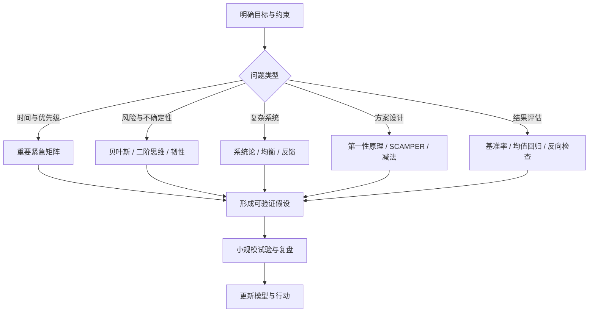

# 思维模型与决策工具箱

思维模型是帮助理解问题、形成假设和选择行动的简化工具，不是真理，也不是可以机械套用的答案。一个问题通常需要多个模型交叉检查：先界定系统边界，再识别因果与不确定性，最后设计可验证的行动。

> [!tip] 使用原则
> **先描述问题，再选模型；先找证据，再下判断；先做小实验，再扩大投入。** 不要拿着模型到处找例子，也不要把模型的比喻当成严格的科学定律。

## 模型选择流程

## 一、决策与优先级

1. **艾森豪威尔矩阵**：按重要性与紧急性划分任务。重要且紧急的先处理，重要不紧急的安排时间；紧急但不重要的尽量委派，不重要不紧急的减少投入。适合任务排序，不适合替代复杂的价值判断。
2. **二阶思维（多米诺效应）**：不仅问“这一步会怎样”，还要追问后续连锁反应。适合评估政策、架构变更和长期决策。
3. **可逆决策**：把决策分为容易撤回和难以撤回两类。可逆事项可快速试验；不可逆事项应增加证据、评审和风险缓冲。
4. **满意度原则（Satisficing）**：当方案满足关键约束且边际收益已低于继续搜索的成本时，可以停止寻找。前提是先定义“足够好”的验收标准。
5. **40–70% 信息启发式**：在信息不完备时寻找行动窗口，避免信息不足时盲目行动，也避免等待绝对确定。它是管理经验法则，不是统计定律；高风险、安全关键决策不能机械套用。
6. **遗憾最小化**：从长期视角思考“未来最可能后悔没有做什么”。适合价值澄清，不应取代成本、风险和现实约束分析。

## 二、证据、不确定性与判断

7. **黑天鹅与韧性**：极端事件往往难以精确预测。重点不是忽略风险，而是避免单点失效、保留冗余、设置止损与应急预案。
8. **均衡思维**：观察系统中相互作用的力量及其稳定状态，而不是只盯住某个瞬时指标。均衡可能稳定，也可能是低效或脆弱的。
9. **均值回归**：极端表现之后，后续结果可能向长期平均水平靠近。判断时要区分真实结构变化与随机波动，不能把均值回归当作必然保证。
10. **贝叶斯更新**：把先验判断与新证据结合，动态更新结论。关键是证据质量、基准率和似然，而不是只挑支持原观点的信息。
11. **进化与多样性**：保留多个候选方案，通过反馈筛选更适应环境的方案。适合探索性研发；需要控制试验成本和淘汰标准。
12. **双系统思维**：快速直觉有速度优势，慢速分析有审慎优势。高影响、低频、难逆转的决策应主动放慢并检查直觉偏差。

## 三、问题解决与方案创新

13. **同行评议**：让关键观点接受独立审查。提前说明假设、证据和反例，避免把评审变成观点站队。
14. **主动寻找缺陷**：用反证、失败案例和反方观点检验方案，降低确认偏误。可采用预演失败（pre-mortem）列出可能失败原因。
15. **相关性不等于因果**：共同变化不证明一个变量导致另一个变量。需要考虑混杂因素、时间顺序、机制解释和对照实验。
16. **结果反推原因**：从目标结果向前追踪必要条件和关键路径，再检查当前差距。适合规划，但要避免把事后解释误当成真实因果。
17. **SCAMPER 创新法**：从替代、组合、调整、修改、他用、消除、重排七个方向改造现有方案。适合头脑风暴，生成候选项后仍需验证可行性。
18. **第一性原理**：把问题拆解为可验证的基本事实、物理约束和成本，再从基础条件重新推导方案。不要把“反常识”误当作第一性原理。

## 四、反向检查与减法

19. **目标反思**：检查目标是否只是代理指标。先问真正要改善的结果是什么，再决定是否需要直接追逐当前指标。
20. **专家盲区**：专业经验能提高效率，也可能让人忽略新约束。面对跨领域问题时，重新检查隐含假设，并邀请不同背景的人审视。
21. **能力边界意识**：识别自己缺少知识、资源或经验的部分，及时求助、学习或缩小问题范围；这不是放弃挑战，而是管理风险。
22. **结果优先于待办清单**：清单只是记忆辅助，不代表产出。每项任务应连接到可观察的结果、完成标准和反馈。
23. **阻力最小路径检查**：默认选项常常只是最熟悉、最省力的路径。比较替代方案时，也要检查长期代价与机会成本；并非越困难就越正确。

## 五、经典启发式

24. **墨菲定律**：复杂系统中故障和意外不可避免。工程上的正确用法是做失效分析、故障隔离和恢复设计，而不是把它理解成悲观宿命。
25. **奥卡姆剃刀**：在解释力相当时，优先选择额外假设更少的解释。简单不等于正确，不能为了简洁而忽略证据。
26. **汉隆剃刀**：在证据不足时，先考虑能力、信息或流程问题，而非立即假定恶意；若出现明确证据，仍需认真处理责任与动机。
27. **帕累托法则（80/20）**：结果可能集中由少数关键因素贡献。80/20 是观察启发，不是固定比例；应通过数据识别真正的关键因素。
28. **史特金定律**：在大量产出中，低质量内容可能占很大比例。它提醒我们建立筛选标准，不应把“90%”当作可直接套用的统计结论。
29. **帕金森定律（时间膨胀）**：工作可能膨胀到填满分配给它的时间。通过明确交付物、时间盒和阶段检查控制范围。
30. **帕金森定律（组织膨胀）**：组织可能把越来越多时间花在内部事务和协调上。要检查会议、审批和管理活动是否真正改善交付。

## 工程与学习中的应用

| 场景 | 可组合的模型 | 实际做法 |
|---|---|---|
| AUTOSAR 配置排障 | 第一性原理 + 因果分析 + 同行评议 | 先确认规范/配置/生成代码/运行时证据，再逐层缩小范围 |
| 嵌入式故障分析 | 墨菲定律 + 二阶思维 + 可逆决策 | 识别失效模式，先做低风险实验，保留回滚路径 |
| 学习路线规划 | 艾森豪威尔矩阵 + 80/20 + 满意度 | 优先补关键基础，以可验证项目作为阶段验收 |
| 知识库整理 | 减法思维 + 奥卡姆剃刀 + 进化筛选 | 合并重复入口，保留来源，定期淘汰无用结构 |
| 技术方案评审 | 贝叶斯更新 + 反向检查 + 同行评议 | 明确假设、证据等级、反例和失败预案 |

## 使用自检

- 我是否把问题和解决方案区分开了？
- 模型的适用前提是否满足？
- 是否存在更简单的解释或反例？
- 我使用的是事实、推断还是价值判断？
- 是否有可以低成本验证的实验？
- 如果结果不符合预期，我会如何更新判断？

## Flomo 来源

- 原始笔记：30 个思维模型（MCP 用）—— https://v.flomoapp.com/mine/?memo_id=MjU3MzczNzcw
- 参考书：《思维模型：建立高品质思维的30种模型》，彼得·霍林斯。以上为学习用的简要归纳与应用提示，不替代原书内容。
