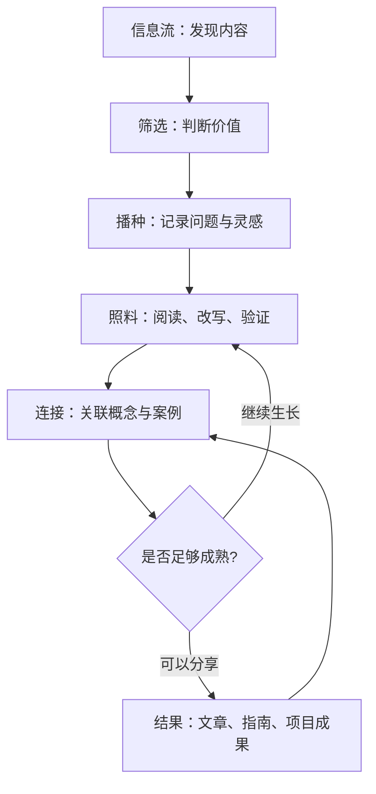

# 数字花园

数字花园（Digital Garden）是一种持续维护知识的方式：笔记不是写完就封存的文章，而是可以不断修订、建立关联、逐渐成熟的内容。它既可以完全私有，也可以公开发布；公开程度由作者自己决定。

> [!quote] 核心隐喻
> 播种想法，照料笔记，连接观点，收获作品。

## 花园与信息流

信息流擅长帮助我们发现新内容，但内容通常按时间或推荐机制排列；数字花园则强调主题、链接和长期维护。两者并非非此即彼：信息流可以提供种子，花园负责把值得保留的种子培育成知识。

## 三个阶段

### 1. 播种：捕捉值得继续追问的东西

种子可以是一段阅读摘录、工作中遇到的问题、一段代码、一个反例，或者尚未成形的想法。

记录时尽量留下三个信息：

- **内容：** 我发现了什么？
- **来源：** 这个信息来自哪里？
- **问题：** 它为什么让我在意？还想弄清楚什么？

不必在捕捉的当下就完成分类和长篇写作。

### 2. 照料：让笔记逐渐长成知识

- 用自己的语言解释核心观点，而不只复制原文。
- 补充证据、案例、反例和适用边界。
- 链接已有笔记，并说明它们之间的关系。
- 当新证据出现时修正旧结论，必要时标记不确定性。
- 定期清理重复、失效或不再有价值的内容。

笔记可以处于不同成熟度：草稿、正在整理、已验证、可分享。不要因为内容尚不完整就急着发布，也不要把“未完成”当成永远不更新的理由。

### 3. 结果：让知识参与真实任务

成熟的笔记可以进一步成为：

- 一篇文章或短视频脚本；
- 一份学习指南、技术方案或面试材料；
- 一个可复用的代码模块或排障流程；
- 一次更有依据的判断或决策；
- 一组帮助他人理解问题的专题页面。

发布不是每条笔记的必经步骤。私人笔记也可以有价值，关键在于它能否帮助未来的自己思考和行动。

## 推荐的目录与链接策略

不要为了追求完美分类设计过多层级。目录负责提供入口，内部链接负责表达知识之间的关系。

- **领域入口：** 说明一个长期主题包含什么，以及从哪里开始。
- **专题页面：** 汇总某个问题的核心概念、实践方法和相关笔记。
- **原子笔记：** 尽量聚焦一个可独立理解的观点。
- **项目页面：** 记录目标、行动、决策、交付物与复盘。
- **来源笔记：** 保存书籍、文章、视频或文档的可追溯信息。

## 每周维护清单

- [ ] 从搜集箱挑选少量真正值得处理的材料。
- [ ] 至少把一个摘录改写为自己的观点。
- [ ] 为新笔记补充一个有意义的关联，或记录待连接的问题。
- [ ] 检查一个旧专题，修正过时内容或补充新证据。
- [ ] 选择一个知识点用于写作、项目或实际决策。

## 如何判断花园在成长

不要只用页面数量衡量。更有意义的信号包括：

- 能更快找到并理解以前记录的内容；
- 新笔记能够与旧笔记互相解释或形成争论；
- 旧观点会因新证据而得到修订；
- 知识能支持真实的工作、学习和创作；
- 读者能够沿着链接找到上下文与进一步阅读的入口。

## 与本知识库的关系

- [[KM]]：知识管理领域入口
- [[知识管理]]：笔记类型与质量标准
- [[知识管理工作流]]：从输入到复盘的操作流程
- [[inbox]]：暂存待处理的信息
- [[渐进阅读]]：分阶段阅读与提炼材料
- [[工具]]：按场景选择知识管理工具

> [!tip] 实践建议
> 先让一个小专题持续生长，再扩展整座花园。一个不断被使用和修订的页面，比一百个只有标题的页面更有价值。
