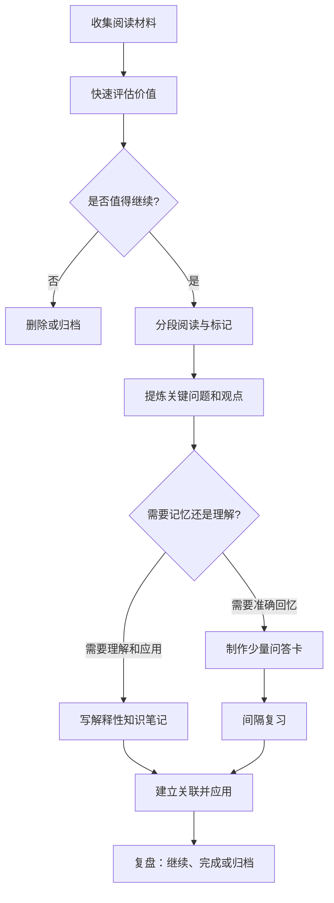

# 渐进阅读（Incremental Reading）

渐进阅读是一种分阶段处理大量阅读材料的方法，常与间隔重复、主动回忆和知识笔记结合使用。它不要求每次从头到尾读完一篇文章，而是允许材料被多次阅读、提取、排序和加工。

它尤其适合长期积累的论文、技术文档和主题阅读；但不代表所有材料都应该拆碎，也不保证读过的内容就会永久记住。

## 核心流程

## 实操步骤

### 1. 收集并排序

给材料保留标题、作者、来源链接、日期和阅读目的。根据相关性、可信度、时效性和预期用途安排优先级，而不是因为收藏了就必须读完。

### 2. 分段阅读

先快速浏览结构，识别核心问题；再按需要深入阅读相关章节。每次结束时留下一句进度说明，例如“已读到方法部分，下一步核对实验条件”。

### 3. 提炼，而不是只划线

对重要段落，尝试回答：

- 作者提出了什么主张？
- 依据或证据是什么？
- 这个结论有哪些前提和限制？
- 我认同吗？有哪些反例？
- 它能解释哪个实际问题？

摘录应保留出处；自己的解释要明确区分于作者原话。

### 4. 按目标转化

- **需要准确记忆的内容：** 制作简短、明确、可回答的问答卡，例如术语定义、协议字段或关键步骤。
- **需要理解的内容：** 写解释性笔记，说明机制、因果关系、前提与边界。
- **需要解决的问题：** 转化为实验、代码验证、项目行动或待确认事项。

不是所有阅读内容都需要做成闪卡。记忆卡适合检查回忆，不应代替完整理解。

### 5. 安排复习与回访

使用间隔重复工具安排事实性知识的回忆；对长篇材料则可安排后续阅读任务。复习时若发现只记住词句却无法解释含义，应回到上下文，补充理解，而不是一味增加卡片。

## 一个技术文档示例

假设正在学习 CAN 协议或 AUTOSAR 通信栈：

1. 收集规范章节，并记录当前想解决的问题。
2. 初读章节结构，标记与问题直接相关的部分。
3. 提炼关键字段、状态转换或配置约束，并保留规范章节来源。
4. 将必须准确回忆的术语做成问答卡。
5. 将通信路径、时序和异常处理整理为自己的技术笔记。
6. 在仿真、代码或项目中验证理解，并记录例外条件。

这样可以同时兼顾“记得住”和“会使用”，避免把技术学习简化成背诵名词。

## 工具选择

工具只是承载流程的手段。开始前先确定主要目标：长文分段处理、记忆复习、知识关联，还是公开发布。不同目标可以由不同工具承担，不必强求一个软件完成全部工作。

- [[工具]]：查看工具类型与选型建议
- [[知识管理工作流]]：了解从输入、提炼到复盘的完整流程
- [[数字花园]]：将成熟的理解整理为可持续更新的专题

## 常见误区

- **把所有资料都导入系统：** 输入量会挤占真正理解与应用的时间。
- **把摘录当作自己的知识：** 保留原文不等于能够解释观点。
- **卡片做得过多、过长：** 复习负担可能不断膨胀，应优先保留高价值、可明确回答的问题。
- **把间隔重复等同于理解：** 记住事实和理解机制是不同任务。
- **只追求处理进度：** 完成阅读清单不如真正解决一个问题重要。

## 开始时的最小方案

- 每次只挑选少量高价值材料。
- 每次阅读结束留下一个摘要或一个未解决问题。
- 每篇材料最多提炼少数关键观点，再决定是否需要记忆卡。
- 每周检查：这些笔记是否帮助自己解释、写作或解决了实际问题？
