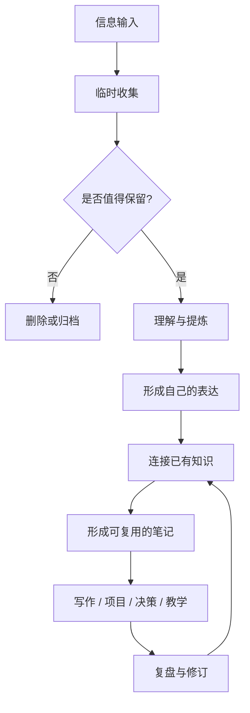

# 知识管理：从信息收集到可复用的思考

知识管理不是把资料尽可能多地存起来，而是建立一套可持续的机制，让有价值的信息经过理解、加工、连接，最终参与判断、表达和行动。

> [!quote] 核心原则
> 收集是入口，理解是加工，连接是增值，输出与行动才是检验。

## 知识流转的完整链路

## 四种常见笔记

| 类型 | 主要作用 | 应回答的问题 |
|---|---|---|
| 临时笔记 | 快速捕捉灵感、任务和线索 | 我现在不能忘记什么？ |
| 文献笔记 | 记录阅读来源及其观点 | 作者说了什么？依据是什么？ |
| 永久笔记 | 保存经过理解、可独立阅读的观点 | 我认为这意味着什么？ |
| 项目笔记 | 支持有明确目标和交付物的工作 | 下一步做什么？如何验收？ |

不要要求每条笔记都成为永久笔记。记录成本应与信息价值相匹配。

## 让笔记真正产生价值

1. **先写清楚，再追求完整。** 一条笔记聚焦一个问题或一个主张。
2. **区分来源与自己的判断。** 引用、事实、推断和待验证假设不要混在一起。
3. **使用自己的语言。** 不能脱离原文复述的内容，往往还没有真正理解。
4. **建立有意义的链接。** 每个链接都尽量说明两条笔记为什么有关联，而不只是共享关键词。
5. **围绕真实问题复用。** 用笔记解决工作问题、完成文章、解释概念或辅助决策。
6. **允许渐进完善。** 笔记可以先粗糙，再随着新证据和新问题不断修订。

## 推荐的日常节奏

- **捕捉时：** 先记录，不在灵感出现时强迫自己完成分类。
- **每日：** 清理收件箱，将值得保留的条目转为任务、文献笔记或知识笔记。
- **每周：** 检查重要项目与长期领域，补充链接，识别重复和过时内容。
- **每月：** 从笔记中寻找反复出现的问题，选择一个主题形成可交付成果。

## 如何判断系统是否有效

不要只看笔记数量，可以观察：

- 找到所需信息是否更快；
- 是否能解释概念，而不只是找到原文；
- 不同领域的知识是否产生了新的联系；
- 旧笔记是否帮助解决了新问题；
- 是否持续产生文章、代码、方案、决策或教学材料。

## 本知识域导航

- [[KM]]：知识管理领域入口
- [[知识管理工作流]]：收集、加工、连接与复盘的操作流程
- [[数字花园]]：将持续生长的知识公开发布
- [[渐进阅读]]：把阅读过程转化为可用知识
- [[inbox]]：待处理的临时记录
- [[工具]]：知识管理工具与使用场景
- [[Git提交规范]]：维护知识库时的提交约定

## 可继续建设的专题

- **卢曼卡片盒笔记法：** 如何让独立观点通过链接形成思考网络，并从笔记中长出新的问题。
- **PARA 方法：** 如何按行动与责任组织项目、领域、资源和归档。

这两个主题可以在后续建立独立页面后，再补充内部链接。

> [!tip] 一个实用的检验问题
> 如果这条笔记一年后再次出现，它能否在不依赖当时上下文的情况下，帮助我理解一个问题或采取一个行动？
