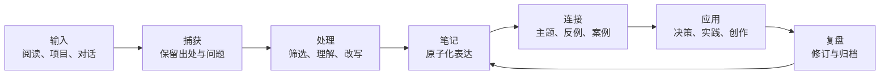

# 知识管理工作流

知识管理的目标不是收藏更多信息，而是降低未来理解、判断和行动的成本。建议把流程设计成一个可以每天执行、每周维护的闭环。

## 一、工作流总览

## 二、不同阶段应该记录什么

| 阶段 | 核心问题 | 最小产出 |
| --- | --- | --- |
| 捕获 | 我为什么保存它？ | 来源、日期、触发问题 |
| 理解 | 作者的主张是什么？依据是什么？ | 摘要与关键证据 |
| 内化 | 我如何用自己的话解释？ | 一个清晰的观点 |
| 连接 | 它与已有知识有什么关系？ | 至少一个关联或一个待连接问题 |
| 应用 | 它能改变什么行动或判断？ | 示例、实验或行动项 |
| 复盘 | 哪些内容需要修正、合并或归档？ | 更新后的笔记 |

## 三、三种笔记不要混为一谈

### 1. 临时记录

用于快速捕获灵感、任务和待处理信息。允许简短、不完整，但要尽量保留来源和上下文。

### 2. 文献笔记

记录一本书、一篇文章、一个视频或一次访谈中的重要内容。区分作者原意与自己的解释，引用时保留可追溯出处。

### 3. 永久笔记

记录一个可以独立理解、未来可能被重复使用的观点。建议采用以下结构：

- **标题**：用问题或完整判断表达核心。
- **观点**：用自己的语言说明结论。
- **推理**：解释为什么成立。
- **边界**：指出适用条件、反例或不确定性。
- **来源**：链接原始材料。
- **关联**：链接相关概念、案例、争议或项目。

## 四、卢曼卡片：从摘录走向思考

摘录本身通常只是材料，不等于自己的知识。可以按下面的顺序加工：

1. 原文说了什么？
2. 这个观点依赖什么前提？
3. 我是否认同？为什么？
4. 能否找到一个现实案例或反例？
5. 它与已有的哪张卡片互相解释、冲突或补充？
6. 如果未来要写文章或解决问题，我会怎样调用它？

不要为了建立链接而建立链接。链接应说明关系，例如“支持”“反驳”“前提”“案例”“延伸”或“适用边界”。

## 五、PARA 与永久笔记如何配合

PARA 主要回答“这条材料目前归哪里管理”；永久笔记回答“我形成了什么可以复用的理解”。

- 项目文件、待办和交付物放在 Project。
- 长期职责、标准和能力建设放在 Area。
- 尚无明确行动目标的主题与参考材料放在 Resource。
- 已结束或不再活跃的内容放在 Archive。
- 观点之间通过双向链接连接，不必强行塞进单一主题目录。

## 六、每日与每周节奏

### 每日（10–20 分钟）

- [ ] 清理临时收集箱，处理最重要的输入。
- [ ] 将一条有价值的信息改写为自己的理解。
- [ ] 为新笔记补充来源和必要的关联。
- [ ] 把可执行事项放回对应项目，而不是只留在笔记中。

### 每周（20–30 分钟）

- [ ] 合并重复笔记，修正过时信息。
- [ ] 检查孤立笔记，判断是否值得建立关联。
- [ ] 回顾项目中反复出现的问题，提炼可复用方法。
- [ ] 将已经完成或暂停的项目转入存档。
- [ ] 选一条知识真正用于实践、写作或决策。

## 七、质量标准

一条笔记是否有价值，不以字数或链接数量判断，而看它能否：

- 脱离原始材料仍然容易理解；
- 让读者分辨事实、推断与个人观点；
- 被未来的自己检索、验证和应用；
- 在新证据出现时被修订；
- 与其他知识形成有解释力的关系。

**最小可持续原则：每天沉淀一条真正理解的观点，胜过收藏一百条从未处理的信息。**

## 相关笔记与应用场景

- **方法论总览**：[[知识管理]]，用于理解从信息收集到知识复用的整体原则。
- **发布与连接**：[[数字花园]]，把笔记之间的链接转化为可浏览的知识网络。
- **阅读输入**：[[渐进阅读]]、[[微信读书到永久笔记]]，将书籍、划线与批注加工为自己的观点。
- **技术实践**：[[Area/EE/index|嵌入式学习体系]]、[[Project/AUTOSAR/index|AUTOSAR 项目知识]]，把工程问题沉淀为可复用的案例、排查路径与实践笔记。
- **日常入口**：[[Area/KM/index|知识管理专题]]、[[Resource/微信读书/index|微信读书书架]]。

这些链接表达的是“方法—输入—加工—应用—发布”的关系。新增笔记时，优先补充能解释这种关系的链接，而不是单纯重复标签。