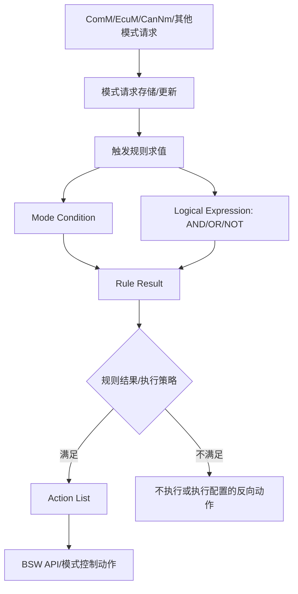

# BswM 模式管理深入 Q1：BswM 的「规则」在配置工具里怎么描述——if-then-else 还是状态机？

原始 Flomo：https://v.flomoapp.com/mine/?memo_id=MjU0OTY4NDY4

BswM 模式管理深入 Q1：BswM 的「规则」在配置工具里怎么描述——if-then-else 还是状态机？

答：更接近 **if-then-else 规则引擎**，而不是状态机。

BswM 核心配置结构（都是条件-动作）：

1. 模式请求源（BswMModeRequestSource / ModeRequestPort）：谁在请求模式——如 CanNm 请求通信模式、EcuM 请求运行模式。

2. 规则（BswMRule）+ 条件（BswMCondition）：规则由若干条件组成，条件分两种：
   - Mode 条件：判断某个模式请求源的「当前值」是否等于某值（如 CanNm 变成 FULL\_COMMUNICATION）。
   - Logical 条件：用 AND / OR / NOT 组合多个条件，形成逻辑表达式。
3. 动作列表（BswMActionList）：规则命中时执行的动作序列（BswMAction）。

所以执行逻辑是：某个模式请求变化 → 把当前所有模式请求值套进 rule 的条件做求值（逻辑组合）→ 命中则执行对应 ActionList。这与「if（条件）then（动作）」一致。

为什么不是状态机：BswM 自己不维护「当前状态」来做转移。它是对任意时刻的模式请求组合做「组合逻辑求值」——条件真就执行动作、假就不执行，不依赖历史状态积累。偶尔看着像状态机，是因为模式请求值的连续变化给人一种「状态迁移」观感，但底层是条件-动作规则，不是状态跳转表。

一句话：BswM 的规则是「条件 → 动作」的 if-then 规则引擎，用条件表达式（含逻辑组合）判断、用 ActionList 触发，不是传统状态机。

上一题：<https://v.flomoapp.com/mine/?memo_id=MjU0OTY4MzU0> 
总表：<https://v.flomoapp.com/mine/?memo_id=MjMxMTQ2NDk4>

#Area/技术/AUTOSAR

## BswM 规则求值与动作执行的工程细节

### 规则引擎与状态机的关系

BswM 的核心配置模型是“模式/事件输入 → Rule 条件求值 → Action List”，更接近可配置规则引擎。它会根据配置的求值策略、请求更新和 MainFunction 调度重新评估条件；因此它会观察到状态随时间变化，但规则本身不等同于一个显式状态转移表。若业务需要“上一个状态影响下一个动作”，应显式建模所需状态/条件，不能假设 BswM 自动保存任意历史上下文。

### 工程配置时要明确的项目

- **请求源：** 哪个模块/端口提供请求，初始值和无效值是什么。
- **条件表达式：** 规则依赖哪些 Mode/Logical 条件，AND/OR 组合是否符合需求。
- **求值时机：** 请求更新时立即评估，还是由周期性 BswM MainFunction 推进；按具体配置和实现确认。
- **动作列表：** 具体动作顺序、是否允许中断/延迟执行、动作返回值如何处理。
- **重复触发：** Rule 持续为 TRUE 时是否每次求值都执行动作，还是只在结果变化时执行；以所用版本和配置为准。
- **互斥与优先级：** 多条规则同时命中时如何避免互相覆盖或产生冲突动作。
- **初始化与恢复：** 输入未初始化、网络未 ready、请求超时或动作失败时采用什么安全默认策略。

### 验证建议

构造“单规则命中、规则条件切换、多个规则同时命中、请求快速抖动、初始化输入缺失、动作失败、延迟动作超时”等测试；记录请求值、Rule 结果、Action List 开始/结束和 BSW API 返回状态。不能只看工具中逻辑表达式显示正确，还要用目标 ECU 日志确认实际执行时序。
