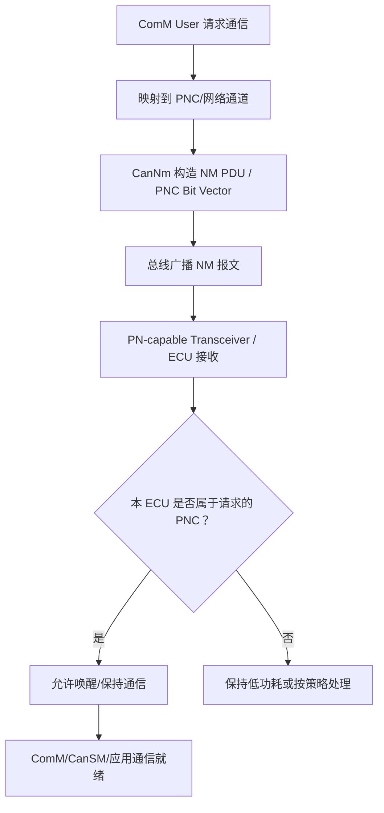

# AUTOSAR 1000问 · PartialNetworkingQ1：Partial Networking（部分网络）解决了什么问题？为什么一个 ECU 在不该做某事的时候还要被唤醒是一种浪费？

原始 Flomo：https://v.flomoapp.com/mine/?memo_id=MjU0NzcwNDc5

**AUTOSAR 1000问 · PartialNetworkingQ1：Partial Networking（部分网络）解决了什么问题？为什么一个 ECU 在不该做某事的时候还要被唤醒是一种浪费？**

▎ 五大学习法：费曼——把 Partial Networking 讲成「按需叫醒，不叫无关的」

**解决的问题**：传统 CAN 网络的唤醒是「全网络唤醒」——只要有节点被唤醒，整个网络（包括所有节点的收发器）都被唤醒，即使某些节点对这些报文根本不关心。结果是大量无关的唤醒和功耗浪费。

**为什么「不该做某事却唤醒」是浪费**

1. 功耗：整车熄火 / 关机后，很多节点本可以休眠——但因为收到一条无关报文被唤醒，收发器 \+ CPU 都耗电，直接推高静态电流，影响蓄电池
2. 无关唤醒：一个 ECU 只关心某几个信号，却被网络上所有报文唤醒——大部分唤醒它是白醒的，白白耗电
3. 寿命 / 热管理：频繁无效唤醒增加收发器和 CPU 的负担

**Partial Networking 的价值**

- 允许节点「选择性唤醒」：只对「跟它相关的 PN 报文」响应 / 唤醒，对无关报文继续睡
- 按「报文相关性」决定要不要醒——让 ECU 只在「跟它有关的事发生」时才醒来
- 大幅降低整车休眠时的静态功耗，同时对本地感兴趣的报文保持实时响应

**一句话总结**：Partial Networking 解决的是「整车休眠时不必要的唤醒耗电」——传统 CAN 一节点醒、全网醒；PN 让节点只对跟自己相关的报文唤醒、无关报文继续睡。因为它按报文相关性选择性唤醒，所以一个 ECU「不该醒却被唤醒」就没必要了——省电、降低静态电流，这是 PN 的核心价值（结合网络管理 CanNm / ComM 的唤醒策略）。

📎 AUTOSAR 1000问总表 → [https://v.flomoapp.com/mine/?memo\_id=MjMxMTQ2NDk4](https://v.flomoapp.com/mine/?memo_id=MjMxMTQ2NDk4)

#Area/技术/AUTOSAR

## PNC 位向量与唤醒链路

### PNC 的基本机制

Partial Networking Cluster（PNC）是一组具有共同通信需求的 ECU/网络功能集合。网络管理报文可携带 PNC 信息（例如 PNC bit vector），节点根据自身配置的 PNC 归属判断是否需要参与该部分网络的通信。具体位向量布局、报文格式和支持能力由 AUTOSAR Release、CanNm/网络管理配置及收发器能力决定。

### 需要区分的几个概念

- **PNC：** 网络功能/节点集合的逻辑分组，不等于一个独立 CAN 总线。
- **PN Information：** NM 报文中携带的部分网络信息，用于表达哪些 PNC 被请求。
- **PN-capable Transceiver：** 具备选择性唤醒过滤能力的收发器；若硬件不支持，不能仅靠软件就获得完整的硬件选择性唤醒效果。
- **ComM/CanNm：** 管理通信用户、PNC 请求与网络管理协作；具体映射和唤醒策略由配置决定。

### 工程验证

1. 核对 ComM User 与 PNC 的映射，以及 PNC bit vector 的位定义。
2. 确认 CAN 收发器型号、PN 支持能力、唤醒过滤配置和电源模式。
3. 用 CANoe 发送只请求某一 PNC 的 NM 报文，测量目标 ECU 是否唤醒、非目标 ECU 是否保持休眠。
4. 测试多个 PNC 同时请求、PNC 释放、NM 超时、错误位向量、收发器复位和本地唤醒。
5. 同时测量 ECU 静态电流与唤醒延迟，避免只验证“能唤醒”而忽略功耗和误唤醒。

**边界：** PN 不是简单地“某节点醒来全网都醒”与“其他节点绝对不醒”的二元切换。实际结果还受网络拓扑、PN-capable 收发器、NM 报文、唤醒源和 OEM 网络策略影响。
